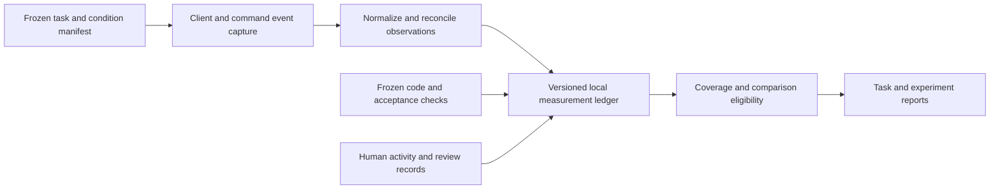

# Proposed coding-workflow measurement system

Date: 1 October 2026. Status: **PROPOSED; not implemented or collecting future tasks automatically**. Basis: [research](measurement-research.md), [primary sources](measurement-sources.md), existing [evaluation protocol](evaluation-plan.md), and [observed local capabilities](../tasks/workflow-measurement-research/evidence/capability-probe.json). This design concerns development work, not clinic patient/inventory/payroll telemetry.

Research amendment, 2 October 2026: [WF-04's three-agent expansion](measurement-research-expansion/README.md) adds established measurement processes, deeper evaluator/tool inspection and [qualification gates](measurement-research-expansion/trust-and-validation.md). Its decision register governs the current proposal. Reuse a maintained native evaluation provider if it passes a pinned compatibility test before writing a custom runner. Compare assigned workloads rather than selecting common successful tasks. Neither formal standard scopes nor software documentation establish local calibration or conformance.

The system must answer: what was attempted, what was accepted, what it consumed, what failed, which observations are complete, and whether an eligible comparison supports an improvement claim. It should produce a useful task report without requiring a hosted platform. Its measurements must remain auditable when the client, model or report viewer changes.

## 1. Evidence flow and ownership

`docs/tasks/<id>/task.md` retains ownership of narrative current state and next action. The measurement ledger owns **observations**, not a competing task status. Reports/checkpoints are derived projections. Tests and current authoritative sources govern factual acceptance. An agent finishing a turn, a task index saying complete, and an independently accepted artifact are three different events.

Start with per-run/per-worker JSONL files and immutable JSON manifests/results. A rebuildable SQLite index is optional after demonstrated query needs; it must not become the only durable evidence. Each writer owns a separate stream, avoiding unsynchronized shared appends. The integrating collector seals a manifest of stream/artifact hashes. Preserve corrections as new events with `supersedes`; never rewrite a historical failed attempt into success. Hashes identify byte changes, not truth or tamper-proof custody.

Keep detailed local acquisition files in an ignored, access-controlled development-evidence location. Commit reviewed, sanitized manifests and reports. Existing Git ignore policy needs a deliberate raw-evidence rule when implementation begins; this research changes no capture settings. Do not commit credentials, patient data, staff/payroll details or entire chat transcripts. Use synthetic evaluation fixtures and stable pseudonymous actor IDs. A configurable retention/export policy belongs to the future implementation; no expiry date or automatic deletion is imposed here.

## 2. Identity hierarchy and boundaries

| Entity | Identity and purpose | Counting rule |
| --- | --- | --- |
| Experiment | Versioned protocol/dataset/analysis, baseline and treatment | One declared comparison; distinguish exploratory from confirmatory |
| Task or trajectory | Frozen scope, class, prerequisites and acceptance | Primary useful-work unit; completed trajectory counts once |
| Stage | Initial work, follow-up requirement or resume exercise | Diagnostic milestone; not an extra primary task |
| Attempt | One dispatch/retry with stop/failure reason | Every attempt retained, including environmental interruption |
| Worker/session | Parent, implementer, packet preparer or reviewer with linked thread | All resource-bearing participants included in declared delivery scope |
| Turn/call | Provider/client event identity and usage scope | Deduplicate calls; distinguish deltas from cumulative snapshots |
| Artifact/check | Revision/hash, command, environment and outcome | Check execution count separate from unique cases/task outcomes |
| Human interval | Actor, start/stop, activity and task allocation | Union overlapping intervals per person; sum across people |

A condition manifest pins actual project/client/harness versions, model identity/settings if known, instructions/context hashes, eligible evidence, tools, permission configuration, machine/dependencies, limits and evaluator version. Record realized rerouting or unavailable identity rather than relying on a requested model string. Freeze the manifest before assignment and the evaluator before worker output. Hashes of the full hidden fixture are stored in the private evaluator scope; do not put hidden expected answers inside the worker checkout or context packet.

In operational mode a task can be recorded without a fully comparable experimental condition. Mark it observational; do not disable normal work because a nonessential metric is unavailable. A primary claim requiring that metric remains unavailable.

## 3. Acquisition adapters and priority

The first implementation decision is a maintained-provider fit gate: evaluate [Promptfoo's native Codex providers](measurement-research-expansion/tools-and-integration.md) for controlled runs and the maintained Langfuse/Phoenix Codex adapters for a separately selected operational scope. Check source presence, counter scope, thread isolation, interrupted attempts, artifacts, privacy and offline exports. A documented native integration is preferable to duplicated dispatch code only if those checks pass. Preserve raw allowed metadata and missingness where a provider normalizes absent fields to zero. Owned CLI capture remains a fallback and reference route; the following adapter descriptions specify needed evidence rather than require five bespoke implementations.

### A. Owned CLI runs for controlled experiments

If a maintained native provider cannot meet the qualified scope, the fallback/reference route is a wrapper around a separately scoped `codex exec` run that captures structured JSONL, stderr, process status and harness timestamps. The installed 0.159.2 client supports the documented output flags. The wrapper is **future code**, not a currently catalogued command. Current [CLI documentation](https://learn.chatgpt.com/docs/non-interactive-mode) describes events and turn usage; use supported flags for the installed version rather than copying an old blog's permission flag.

Pin the client version and capture acquisition-start, dispatch, first event, process exit, grading start/end and acceptance/stop separately. Save the allowed task checkout, final code hash and developer/evaluator logs. Process exit zero is necessary for successful process execution, not sufficient for task acceptance. Timeout/termination retains received usage and marks final totals partial. Never infer zero cost from an interrupted stream without usage.

### B. Supported desktop/App Server events

The [documented App Server](https://learn.chatgpt.com/docs/app-server) exposes lifecycle/item events and usage updates. Its generated local schema includes thread/turn identity and last/total token breakdowns. A future adapter may use an owned connection/export; access to the existing desktop stream has **not** been demonstrated. Do not start a parallel session and pretend it observed this one. Do not silently change the user's global configuration or attach to an unknown transport.

Optional account thread estimates exist in the generated response schema. A future read-only compatibility probe must establish live availability, identity and billing route. Keep estimated credits/USD separate from actual invoice charges. Account-wide totals or rate-limit percentages cannot attribute consumption to one task amid concurrent work.

### C. Opt-in OTel bridge

Official [advanced configuration](https://learn.chatgpt.com/docs/config-file/config-advanced) documents OTel events and asynchronous export. A future local bridge can normalize metadata and detect shutdown losses. Prove emitter/exporter/collector compatibility, loss behavior and task correlation before treating it as complete acquisition. Histograms are useful for aggregate performance; they do not recover per-task durations or independent acceptance. Native Codex logs are not automatically equivalent to GenAI spans expected by a third-party UI.

### D. Versioned local rollout fallback

Only explicitly selected task/session files are eligible. Pin a decoder against sanitized fixtures for each observed format. The current root file has both token-count and token-usage event families; do not sum them both. Handle compaction, repeated snapshots, counter resets, repeated imports, incomplete final lines and unrecognized fields. Unsupported input is quarantined and coverage reduced; no guessed totals.

The fallback can recover observations when metadata is trustworthy, but is not a promised stable public API. It must not scan unrelated conversations or expose raw reasoning/prompt/tool content. WF-02's old exports remain unchanged until any separately reviewed reconstruction establishes exact scope and provenance.

### E. Commands, acceptance and human observations

Wrap actual local check executions with command/environment/revision/exit status, start/end and machine-readable results where available. Parse test outcomes and selected case IDs; distinguish zero tests, collection errors, skipped checks, unrun checks and failures. An event showing that a command was invoked does not establish that it passed.

Human effort needs explicit observation: a lightweight start/pause/stop activity record or reviewed per-task time entry. Label contemporaneous timing versus retrospective estimate. Record planning, supervision, review, integration, measurement upkeep and rework; passive waiting and unrelated work are separate. Do not use keyboard monitoring, screenshot recording or chat-message timestamps as an automatic human-effort proxy. Friction feedback can be optional and brief: clarity, ease of checking, unnecessary steps and ability to focus. It remains perceived experience, not a causal speed estimate.

## 4. Metric provenance and completeness

Every metric observation carries value/unit, source reference/hash, acquisition adapter/version, time coverage, entity scope and status:

| Status | Meaning | Treatment |
| --- | --- | --- |
| measured_complete | Observed through a validated source covering the declared scope | Eligible for that metric's aggregate |
| measured_partial | A known portion observed; coverage is specified | Report observed minimum/portion; do not call total complete |
| estimated | Reconstructed or priced using a disclosed method | Show separately; never silently upgrade to measured |
| unavailable | Not observed or inaccessible | Null; state reason |
| not_applicable | Metric has no eligible exposure | Null; distinct from missing observation |

Completeness includes expected/observed workers, turns/calls where knowable, stream finalization, parser coverage and observation windows. One complete child's usage plus an unobserved reviewer produces partial delivery usage. If total calls are unknowable, do not invent a numerical coverage percentage. Validate nonnegative finite values and units; known zeros require observed exposure/source. A measurement-integrity error blocks the affected aggregate, not necessarily the valid code result.

Legacy v1 fields require an import annotation: unsupported zero counts can become unavailable in a new normalized projection while the original bytes remain preserved. Add phase/attempt/worker identity from retained evidence only when unambiguous. A schema-valid legacy record is not upgraded to complete telemetry.

## 5. Definitions and formulas

Let N be assigned eligible whole tasks, A accepted whole tasks, H total active human person-minutes, I total reported input tokens, C declared development resource spend, and T end-to-end task latency. All totals include failed attempts and the declared setup/preparation/review allocation. Show measurement coverage beside every value.

| Dimension | Primary observation | Derivation and guardrail |
| --- | --- | --- |
| Delivery quality | Accepted tasks / N | Independent contract checks and required review; unknown acceptance shown separately with lower/upper bounds where useful |
| Human productivity | A / (H/60) | H must be complete for the declared scope and positive; unknown/zero H means no ratio |
| User wait | T from task ready-for-dispatch to independent acceptance/stop | Preserve submission-to-ready/prerequisite wait separately; include account/approval/review waiting in the relevant boundary |
| Context resource | I / A, plus total I | All calls/workers within scope; cached input included once; A=0 makes per-accepted measure undefined |
| Model/tool economics | C / A, plus total C | Actual, estimated and allocated subscription amounts remain separate; include failed work |
| Reliability | Success within fixed budget, code-first-attempt and dispatch-first-attempt outcomes | Separate environmental retries from failed coding attempts; no hiding either |
| Iterative quality | Prior-case retention, current-feature success, accepted whole trajectory | Repeated test executions are correlated; report failure identities and checkpoints |
| Context correctness | Decisive facts correctly used / required applicable facts | Zero required facts means not applicable; stale authoritative fact or missing decisive constraint fails its gate |
| Recovery | Fresh-session resume success and elapsed effort to accepted next milestone | Timestamp boundary defined; separate seeded recovery from actual own-task interruption |
| Maintainability | Independent change exercise/rubric and associated rework | Clear scope, reviewer independence and unknown outcome when no review |
| Escaped defects | New confirmed defects during a declared follow-up window | Store severity, affected task and observation completeness; absence of observation is not zero defects |
| Diagnostic friction | Repeat acquisitions, failed tools, review wait, optional human feedback | Categorize required verification separately from unnecessary repetition; counts do not equal value |

Do not combine these into an arbitrary overall 'workflow score'. Display acceptance and decisive gates first, then resources and their availability. A workflow may save tokens while increasing review burden; show that tradeoff directly.

### Time accounting

Use wall-clock UTC for cross-process provenance and a monotonic clock for durations inside each process. Clock disagreement is an integrity warning; do not conceal it by replacing timestamps. Task latency includes defined waits. A batch's span is its start-to-last acceptance/stop; its **sum of individual latencies** is a different statistic.

Human effort is the union of that person's active intervals, with explicit allocation of overlapping task work so one minute is not counted twice. Multiple people contribute summed person-minutes. Rework is a subset, not an additional amount added again. Unrelated work during an agent wait is not active time for the waiting task.

For compute diagnostics, record worker process/session spans and tool spans separately. A process span is elapsed occupancy, not provider-active inference or CPU time. Do not add a nested tool duration to an encompassing worker span as additional runtime. Parallel workers' occupancy can sum to more than user latency. Exclude parent idle-child waits only when observed and independently accounted; otherwise state the runtime boundary and limitation.

### Token and context accounting

Select one authoritative usage source per scope and retain secondary sources for reconciliation. Record whether an observation is per-request, per-turn delta or cumulative thread total. Prefer stable request/event IDs. For totals, use validated increments/boundaries; never sum `last` and `total`, repeated cumulative snapshots, or duplicate sources. A fork can inherit counter/history state; capture an initial boundary and lineage before deriving new consumption. Reset, decreasing counter or ambiguous scope makes the interval partial pending reconciliation.

Cached-input tokens are a subset of input under the inspected schema. Reasoning/output fields require source-specific inclusion semantics; do not add a reasoning subset to an already inclusive output count. Preserve raw numeric breakdown and adapter interpretation. Packet generation, summaries and failed work consume resources even when the final reader packet is small.

Delivered UTF-8 bytes are counted at a declared harness/tool delivery boundary, after filtering/truncation and including repeated delivery. File size or disk-read size alone is insufficient. Full system/user/history usage may remain unknown despite a complete retrieval-byte counter; report the byte metric without relabelling it tokens. An exact token total can include overhead outside the project's control, so tag observable preparation/implementation/review categories without pretending all platform prompt content is visible.

### Cost accounting

For an API-priced estimate only when route/model/usage/rates are known, an illustrative formula is `(uncached_input * input_rate + cached_input * cache_rate + billable_output * output_rate) / rate_unit`, plus applicable tool/infrastructure charges. The adapter defines cache-write and reasoning treatment. Store rate source/effective date, currency, model, billing route and included/excluded charges. This is an **estimate**, not an invoice.

Plan credits, subscription allocation and monetary charge are distinct. If the client returns estimated thread credit/USD values, preserve that label and scope; test whether children are included. Never add a thread total to the same calls already contained in it. Fixed subscription allocation requires a declared period/allocation and remains an economic estimate. Unknown cost is null; no marginal API invoice does not mean development is free. The clinic's USD 8/month hosting cap is a separate production budget, not permission to spend that amount on development-agent tooling.

## 6. Outcome evaluation and measurement self-tests

Freeze the selected behavior contract, test revision and synthetic fixtures before exposing generated output. Keep normal development tests visible; place evaluator holdouts outside worker access and verify that actual filesystem, mount, Git-history and network permissions make the answers inaccessible. Another directory alone does not establish isolation. Hidden inputs may vary, but required behavior must be inferable from the task and permitted authoritative context. Declare whether any evaluator feedback can be used for retries, and apply the same policy/budget to both conditions. Never silently amend expected outputs after viewing worker results.

Acceptance records bind result to code/test/source hashes, command/environment, case IDs, severity, reviewer type and timestamps. Include relevant negative, error, denial, concurrency and regression cases. Expected test failure on deliberately broken base code proves the evaluator is sensitive to that defect. Missing prerequisites, ambiguous policies and broken evaluators are explicit states; they do not become failed model capability by default. Preserve their effect on real delivery wait and assigned-task completion separately.

Qualitative rubric judgments name dimensions and supporting evidence. A judge's output schema ensures structured data, not correctness. Human calibration/adjudication remains unrun until a separate reviewed exercise supplies it. Independent reviewer means separate authorship/evaluator ownership appropriate to the claim; static automated review, fresh model review and human review remain distinct labels.

The measurement implementation needs meaningful tests of duplicated/out-of-order/cumulative events, partial streams, unknown worker coverage, clock inconsistencies, invalid evidence references, test failure detection, hidden-fixture separation, resource double counting and null-versus-zero. These protect the claimed metrics, rather than mirroring parser code.

Add a decision/question/metric specification and versioned assurance record for each measurement family. Validate numerical accounting against independently established reference values. Validate the acceptance oracle against deliberately defective artifacts and independently reviewed valid alternatives; retain false accepts, false rejects, abstentions and individual reviewer labels. Measure source omissions and collector overhead separately from task-sampling uncertainty. [WF-04's G0-G8 gates](measurement-research-expansion/trust-and-validation.md) define the proposed release evidence. Synthetic replay does not qualify live collection; an evaluator's own tests do not establish full real-world correctness.

## 7. Comparison protocol

First collect observational task reports to find the relevant bottleneck. Then choose one intervention: conditional design fields, selective checkpoint/resume, context acquisition or a separately authorized review policy. The current baseline already contains valid authority, routing and normal verification. Freeze that exact baseline; a 'without AI' condition answers a different question from 'current workflow versus one amendment'.

For an eligible controlled comparison:

1. Prespecify task population/classes, matched variants or repeated runs, whole-task unit, primary metric, quality tolerances, budgets, retries, stopping and handling of missing/canceled work.
2. Randomize/record assignment and order; use isolated equivalent bases and fresh sessions where required. Prevent cross-condition answer/history access. Keep model/tools/permissions/resources comparable; record realized differences.
3. Separate initial repair, warm iterative changes, cold resume and instruction-freshness tracks. For an iterative track retain each condition's own generated code and earlier acceptance. Later requests stay undisclosed until their stage.
4. Evaluate frozen artifacts independently, with condition labels hidden where feasible. Include retained normal regressions, decisive facts and an appropriate maintainability/change exercise.
5. Report every assigned task/attempt, resource scope, missingness and class before computing ratios. Failure within budget is a quality outcome; its effort remains included. Observed partial totals are not used as complete savings evidence.
6. Treat exploratory runs as instrumentation/variance learning. Freeze a separate confirmatory set and analysis plan before inspecting its results.

Same-person task repetition can leak solutions. Prefer independent sessions and matched variants, or use a blocked assignment across tasks with declared familiarity. Do not claim variants are equivalent merely because their filenames differ. A model/settings/client change creates a new condition or drift annotation; compare epoch/class-specific results before pooling.

## 8. Analysis and claim eligibility

Compute treatment human throughput divided by baseline throughput only with positive complete H in both conditions, known acceptance, positive baseline throughput and comparable task assignments. Known zero treatment acceptances with positive H produce zero throughput and a zero observed treatment/baseline ratio, not an undefined result. Zero baseline acceptance makes that ratio undefined. For resource savings, compare baseline versus treatment total resource per accepted outcome while also reporting both acceptance rates and complete assigned workloads; cost/input per accepted outcome is undefined when its A is zero. A condition that drops difficult tasks does not earn an efficiency credit. Comparable assigned eligible workloads/budgets, a prespecified estimand and quality tolerances are necessary for the proposed multiplier. Do not restrict the primary analysis after assignment to tasks both conditions accepted: success is affected by the treatment, so this filtering can bias the comparison. Every assigned task and all its effort remain in scope. Other designs need their own prespecified estimand.

Report raw task values, counts, failures and class distribution. Use paired task/trajectory units for a paired comparison. Cluster repeated runs/stages as declared; uncertainty must not treat test assertions as independent tasks. Use pilot variance/expected effect to choose confirmation size. Bootstrap or randomization analysis is a candidate only with defensible assumptions and adequate independent units; [paired SciPy behavior](https://docs.scipy.org/doc/scipy/reference/generated/scipy.stats.bootstrap.html) does not fix an inadequate dataset.

A report should return an explicit eligibility decision for each claim: eligible; exploratory only; missing resource coverage; incomparable conditions; undefined denominator; inadequate independent units; failed quality gate; or unobserved follow-up. A 3x productivity or 5x input-efficiency claim needs the prespecified lower confidence bound to support that exact dimension. 'Three times quality' is undefined; a declared defect-rate reduction needs fixed exposure/severity and uncertainty. Do not manufacture infinity from zero failures or zero human minutes.

For canceled/incomplete tasks, preserve assignment and reason. By-budget acceptance can be reported conservatively as not accepted, with unavailable evaluation separated. Acceptance-only latency is descriptive for completers and vulnerable to selection; also show time-to-stop/budget and completion rates. Follow-up defects require observed exposure or explicit censoring. Present sensitivity to missingness rather than imputing convenient zeros.

Distinguish the descriptive point estimate, evidence of any useful improvement, evidence supporting an exact threshold, meaningful harm and inconclusive evidence. Prespecify handling of quota outages, human rescue, retries, cancellations and evaluator failure; these events are distinct from genuinely missing observations. A quality-preservation claim requires an explicit margin and adequate precision, not merely an insignificant difference. A narrow sampling interval cannot repair an invalid oracle, omitted worker usage or an unrepresentative task frame. [Methods review](measurement-research-expansion/methods-and-standards.md) supplies the source-backed amendment and scale/uncertainty limits.

## 9. Report and operating experience

The first report should be a generated local Markdown/HTML table with a reproducible JSON summary: task/class/revision, acceptance evidence, observation status, waits, human effort, usage by role, actual/estimated/unknown cost, context/follow-up gates and evidence links. Show coverage warnings beside affected cells. An aggregate report includes eligibility, assigned/accepted counts, class breakdown, failed/interrupted attempts, observed and unknown resources, uncertainty limitations and proposed retain/change/drop actions. It must be reproducible offline from sanitized artifacts without contacting an LLM.

During ordinary substantial work, the intended interaction is one task association at start, automatic evidence capture, a small human-effort entry if that dimension is wanted, and an explicit final acceptance link. No compulsory form stack for a typo edit. Measure collection/reporting overhead separately and include it in full delivery accounting. Log completeness failures visibly while retaining observations; they should not silently prevent unrelated coding.

Later a shared viewer may be useful for multiple maintainers. [Langfuse](https://langfuse.com/docs/evaluation/overview), [Phoenix](https://arize.com/docs/phoenix/tracing/tutorial) and [Promptfoo](https://www.promptfoo.dev/docs/configuration/expected-outputs/) are candidates for specific viewing/evaluation roles. Their installation, access policies and native event mapping require a separate fit test. Keep source evidence portable and the clinic application independent of development observability.

## 10. Open decisions with concrete resolution

| Decision | Current position | Required evidence |
| --- | --- | --- |
| Controlled-run adapter | Native-provider fit gate first; owned CLI JSONL fallback/reference | Selected-route calibration: completion/failure/resume usage reconciles without duplicate totals, with source-independence limits stated |
| Desktop ongoing acquisition | Supported export preferred; local-format fallback conditional | Prove exact current-thread and child correlation, scope and parser coverage |
| Thread-cost estimates | Optional estimated metric, not assumed available | Read-only live availability and reconciliation probe; never use account percentages as cost |
| Human timing | Explicit lightweight entries; otherwise unavailable | Maintainer use/burden assessment and overlapping-interval tests |
| Main report storage | Portable local files | Rebuild from sealed evidence; no missing source or network requirement |
| Shared platform | Deferred | Repeated team need, compatibility, privacy/retention and separately approved spending |
| Statistical confirmation | Underspecified until pilot | Variance, independent task distribution, target effect/tolerances and frozen analysis |

The [implementation plan](measurement-implementation-plan.md) turns these decisions into bounded acceptance gates. None of its proposed commands or services should be presented as installed until their exact implementations and calibration evidence exist.
