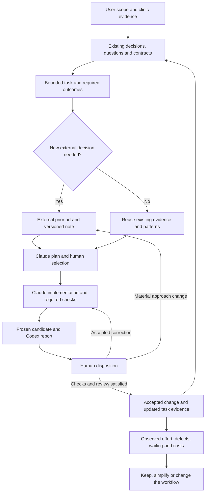

# Assessment of the Perplexity → Claude → Codex workflow bridge

Assessment date: **3 October 2026, America/Los_Angeles**. Status: **analysis and recommendations for discussion**, not adopted policy, plugin installation, defect repair, application implementation or measured ROI.

This evaluates the handoff supplied in the conversation against the existing Documents project. The [red-team task](../tasks/documentation-red-team/task.md) remains the owner of its current state and next action; the [defect register](../tasks/documentation-red-team/defects.md) owns RT-01–RT-09. This assessment does not close them or replace those records. The user requested a deep examination of fit, interconnections, future development and return on effort.

## 1. Judgment

**Use the handoff as a candidate operating routine around the existing project knowledge and checks. Its best contribution is a clear division of responsibility and a limit on unreviewed changes of approach. Keep the portable task/evidence structure. Do not build an orchestrator.**

The proposal has a plausible positive return for unfamiliar or consequential work. Its marginal benefit on routine changes may be small or negative. A local numerical ROI cannot currently be calculated: the recorded trials do not contain complete active human time, provider usage or spending, and this exact three-tool workflow has not been exercised here.

The statement that frozen external research is the *only* missing piece is too broad. Vendor tools supply execution features. They do not supply correct clinic policies, reliable project-specific acceptance, current task state, calibrated measurement or team ownership. Several of those responsibilities are already addressed in the docs; others remain demonstrably unfinished.

The biggest near-term opportunity is to use the existing knowledge to produce and verify bounded changes. Another framework or general literature review has less obvious marginal value. Existing research remains useful as a reference library; its past cost is not a reason to implement every proposed measurement module.

## 2. What exists, and what this proposal adds

| Layer | Existing project asset | Contribution from the handoff | Boundary that must remain |
| --- | --- | --- | --- |
| Authority | [AGENTS.md](../../AGENTS.md), clinic source hierarchy and [planning brief](../clinic-planning-brief.md) | One shared project instruction source | A web source or tool preference cannot establish a clinic fact or permission to deploy |
| Product decisions | [Technical plan](../technical-plan/README.md), A decisions, Q questions, S slices, T criteria | A selected external approach can inform a bounded design decision | Reuse the plan; new research must identify the decision it changes |
| Context and continuity | [Routing](README.md), [task templates](workflow-templates.md), task/context/checkpoint ownership | Frozen prior-art note reduces repeated discovery and makes the choice inspectable | Frozen evidence needs scope, dates, source versions and invalidation triggers |
| Planning and implementation | Code-shape fields, vertical slices, one integrating owner | Claude plans and implements within one approved task | Conversation continuity cannot replace durable state or actual code inspection |
| Verification | [Command catalogue](command-catalogue.md), local tools, Git hook and [WF-02](../tasks/workflow-rollout/task.md) evidence | A named done check makes completion concrete | Known false-success and artifact-binding weaknesses remain open; application checks do not yet exist |
| Review | Existing contract-based review template and automated review history | Read-only Codex findings followed by human disposition | Model diversity is not independent human acceptance; accepted fixes need fresh checks |
| Measurement | [Evaluation protocol](evaluation-plan.md), [system design](measurement-system-design.md), [qualification gates](measurement-research-expansion/trust-and-validation.md) | Explicit roles make effort attribution easier to define | A Codex-only recorder would miss much of a Claude-writing/Perplexity-research workflow |
| Operations | [Operations plan](../technical-plan/operations-and-costs.md) and S11/S12 gates | Better development may reduce downstream defects and maintenance | The coding tools do not prove hosting fit, restoration, staff usability or clinic acceptance |

The source lessons are compatible with this division. The [source-adoption audit](source-adoption-audit.md) already favors selective context, concrete program design, testable boundaries and one state owner while declining example runtimes. The [research synthesis](research-report.md) explicitly favors small observable changes and proportionate process. The handoff makes that easier to execute; it is not evidence that those ideas were previously absent.

## 3. How the pieces connect

These are responsibilities and evidence flows, not proposed software services. Ordinary documents and existing tools can carry them.

There are three distinct returns to pursue:

1. **Clinic value:** staff can reliably receive, issue, count, reconcile and explain permitted balances. This eventually needs an authorized operational baseline and pilot.
2. **Development value:** the team spends less total effort obtaining maintainable, accepted behavior. This includes research, approvals, reviews, failed work and later corrections.
3. **Learning value:** a small amount of trustworthy measurement reveals which workflow step to retain or remove. Measurement has value when it changes a decision.

Success in one does not establish success in the others. Faster coding can implement the wrong operational rule. Accurate token accounting can describe an unhelpful workflow. A clinic benefit can justify a careful implementation even when it does not reduce coding time.

The important reinforcing loop is: accepted behavior → reusable tests and examples → less uncertainty on the next task → less rediscovery and repair → more accepted behavior. There are also harmful loops: extra documentation → larger repeated reading → slower work → demands for more process; and more reviewer findings → more human triage → longer queues → more stale reviews. Selective routing and evidence-backed review are the controls on those loops.

## 4. What the cited sources establish

These were bounded checks of the handoff's decision-relevant claims, not a new search for workflow products. They establish documented behavior, not local compatibility or measured effectiveness.

| Handoff claim | Assessment |
| --- | --- |
| Official Codex review reports findings without editing the working tree | Supported by the [current CLI documentation](https://learn.chatgpt.com/docs/codex/cli). This is a review capability, not proof that every requirement was checked. |
| OpenAI's Claude plugin supplies read-only review and background results | Supported. Its README also documents optional review-gate behavior that can prolong a Claude/Codex loop. Keeping that gate off fits human disposition. Normal review does not accept custom focus text; adversarial review does. Other commands can delegate editing, so review-only is a selected usage boundary. The installation sequence matches the README. [Official plugin](https://github.com/openai/codex-plugin-cc). |
| Claude reads AGENTS.md from version 2.1.277 | Supported with qualifications: default loading also depends on ancestor/local Claude instruction files, configuration and availability of the built-in support. Current settings can load both formats. An import is not required to be the first line. Verify the active instructions in the actual session rather than treating a filename as proof. [Claude memory documentation](https://code.claude.com/docs/en/memory). |
| Codex always reads AGENTS.md | Too absolute. Override precedence, configured fallbacks, directory scope and a combined size limit affect discovery. Keep one maintained project source, then verify that the intended rules loaded. [Codex instruction discovery](https://learn.chatgpt.com/docs/agent-configuration/agents-md). |
| Official Claude guidance supports explore → plan → implement → commit | Supported; the same guidance allows small, clear edits to skip formal planning. File count is therefore a useful signal, not a complete risk policy. [Claude best practices](https://code.claude.com/docs/en/best-practices). |
| Perplexity supplies web-research tools | Supported, including documented Claude/Codex integration. This does not demonstrate superior local outcomes or require installing MCP into the writer. Separate-session use is the proposed process choice. [Perplexity MCP documentation](https://docs.perplexity.ai/docs/getting-started/integrations/mcp-server). |

The cited [cross-model study](https://arxiv.org/html/2607.21656v1) reports 91.4% versus 82.8% on 116 complete-case, single-file Python competition tasks using Claude Opus 4.7 and Codex GPT-5.5. Its reviewer returns a final program and cannot execute tests. That supports caution about replacing a working draft. It does **not** establish the benefit or harm of this repo's findings-only, human-adjudicated workflow, or a permanent ranking of current models. Its complete-case sample also differs from the local protocol's requirement to retain all assigned failures and resources. Treat the paper as a reason to test a mechanism, not as local ROI evidence.

The handoff's September 26 lifecycle map was not supplied as a separate inspectable artifact. Its exact coverage/version claim remains unverified. There was no need to re-audit the rejected third-party products or the secondary account about plan mode: neither is necessary for this decision.

Local inspection found the root AGENTS.md and no CLAUDE.md/CLAUDE.local.md/.claude/CLAUDE.md along the checked working-directory ancestry. Codex was discoverable on PATH; Claude was not. This does not prove Claude is absent, nor that a Claude session loads the intended configuration. No plugin setup or live review trial occurred.

## 5. Amend the handoff before treating it as an operating contract

### A. Separate discovery, repository investigation and business validation

Public prior art helps choose technical mechanisms. Repository investigation establishes what this implementation already does. Clinic validation establishes what people actually do and which future policy they accept. Each has different evidence and authority.

Before sending a question to Perplexity, derive a short factual brief from the existing task route: constraint, affected decision, current approach, unresolved question and outcome needed. This prevents external research from solving a generic problem. It can use the existing planning package without starting implementation or a broad second architecture exercise. Keep real patient/payroll records out of public-research prompts.

“Research required” should mean a material unanswered external question. It should not mean every nontrivial patch. RT-01 already has a researched remedy and closure cases. S00 already has a completed proposed architecture. Neither needs an automatic new comparison of three to five approaches. Reuse existing research when still applicable, even before an implementation pattern exists in code.

### B. Freeze the decision basis while allowing explicit correction

A URL list alone is weak evidence: a page can change, become unavailable or describe a different version. A useful compact note records the question, constraints, incumbent/no-new-dependency option, viable alternatives, source dates/versions, key findings, gaps, chosen option/status and reopening conditions. Three to five options is a heuristic; two serious candidates can be better than five padded ones.

The controlled boundary should be **adoption of an unreviewed approach**, not a ban on noticing that the selected approach is wrong. If source inspection or tests disprove a material assumption, record the counterexample, reopen that decision through the external research stage, and issue a new note revision. Preserve the previous version. Continue independent authorized work.

Distinguish fetching listed documentation to implement the chosen approach from discovering a replacement approach. If a missing API detail requires another source under a strict allowlist, add a narrow source amendment. Avoid making an entire new strategy search the price of every documentation gap. A security or support change can legitimately invalidate a frozen choice.

AGENTS.md gives behavioral guidance; it is not proof that every alternative network path is blocked. If hard enforcement becomes necessary, qualify native permissions/tool availability first. Removing one search integration alone does not prove no other route exists. There is no current evidence justifying a custom enforcement runtime.

### C. Fit the existing document layout

Use a task-local research note, such as `docs/tasks/<id>/research.md`, linked from its task record. Distinguish its external-prior-art section from local implementation evidence. Avoid creating a second top-level research system alongside clinic `docs/research/` and the workflow library.

Keep project-wide authority and routing in AGENTS.md. Keep task-specific choices and checks in the task/plan, with executable command details in the catalogue. Do not turn AGENTS.md into a growing list of every task's test commands or paste the whole prior-art library into it.

The exact filenames are less important than one owner for each fact: task for current state, plan for design, review for findings/disposition, immutable evidence for performed checks, context/checkpoint for resumption projections. Existing instructions should be supplemented, not replaced by four generic rules.

### D. Use task risk as well as size

Plan mode is a sensible default for uncertain or substantial implementation. One-line authorization or money changes can deserve more care than a mechanical rename across many files. Reversible wording changes rarely need the whole pipeline.

The existing templates already support proportional depth. Keep one named implementer per candidate. Same-session planning and coding can retain useful context, but a durable plan and freshness-checked handoff should allow a new session after interruption. “Same session forever” would work against the repository's resumption design.

Scope the proposed Claude-writer/Codex-reviewer assignment to the selected coding workflow. A global “Codex may never research or implement” rule would also exclude separately requested audits, documentation analysis and emergency alternatives. Any later exception can remain an explicit user decision, with its actual role recorded.

### E. Review a stable candidate, then verify the final correction

For background review, identify the exact candidate and comparison base. Keep its files stable or review an isolated snapshot. A report against an earlier diff is not a verdict on later edits. This matters in the current checkout, which already contains uncommitted navigation work and an untracked review package.

The reviewer needs the applicable contract and unresolved questions, not just the author's favorable account. For an actionable finding, seek a trigger, violated requirement, affected path, consequence and evidence/reproduction. Record accept, reject or dispute with a reason; disagreement is not automatically a repair request.

The handoff needs a final leg: Claude applies accepted corrections → relevant checks run on the changed candidate → affected consequential paths receive any needed follow-up review → final artifact and disposition are recorded. Keep this bounded and human-directed. A new library request returns to the decision stage; a normal defect correction within the chosen approach does not.

Accepting a finding, accepting its repair, approving the design and accepting the clinic system are different decisions. Rejecting an automated finding cannot make a reproducible critical contract failure disappear. Conversely, a plausible model criticism is not itself proof of a defect.

For hard-to-reverse choices, a focused challenge before expensive implementation may be useful as well as a final code review. Use it when it can change the decision, not as a mandatory extra round on every patch. A different model can share the writer's mistaken assumptions; require evidence rather than agreement counts.

## 6. The open register still constrains this workflow

The existing [red-team report](../tasks/documentation-red-team/report.md) is the relevant evaluation of local gate reliability. Selected current code paths were inspected during this assessment; the existing counterexamples were not rerun or repaired.

| Findings | Implication for the bridge |
| --- | --- |
| RT-01, RT-02 | A named check is insufficient when all required behavior can be skipped or decisive comparisons disabled. Inspect actual outcomes until the selected gates are repaired. |
| RT-03, RT-04 | Bind acceptance and review to the right candidate. Contradictory result records and checking different bytes from a commit undermine “done.” |
| RT-05, RT-09 | False failures and contaminated probes create wasted work and misleading diagnoses. Portability includes the actual Windows environment. |
| RT-06 | Unknown observations and overlapping intervals cannot become invented zero costs or inflated time totals. This directly affects ROI. |
| RT-07 | The active launcher still incorrectly says there is no Git baseline. A better vendor loop can repeatedly execute a stale instruction. |
| RT-08 | Measurement work still needs one agreed stopping boundary. Adding this handoff does not silently resolve M00/H00 versus the larger normalization/reporting scope. |

This is not a blanket stop on useful coding. The canonical recommendation remains a bounded RT-01 repair when implementation is requested. Other work can proceed with meaningful artifact-specific evidence and the known limitations. Application checks must be created with their S00–S12 behavior; the workflow suite cannot substitute for T01–T20.

## 7. The measurement proposal must follow the chosen work

The proposed [H00/M00–M06 plan](measurement-implementation-plan.md) emphasizes Codex-native providers and capture routes. That remains potentially useful for controlled Codex tasks or review acquisition. It cannot, by itself, measure a workflow where Perplexity researches, Claude writes and a person makes selection/disposition decisions.

The relevant delivery boundary would include external research preparation, research time/spend where observable, human plan decisions, Claude implementation and retries, Codex review, human triage, Claude repair, final checks, integration and later rework. Background review wait is wall time; active adjudication is human effort. A subscription, usage quota and per-task monetary charge are different quantities.

Do not force the production routine into a Codex-only runner just because that runner is easier to measure. A controlled provider experiment and observation of ordinary Claude sessions are different conditions. Freeze the selected workflow and question in M00; H00 should qualify only the route needed for that question. Reconcile RT-08 before promising an implementation scope. Retain independently calculated offline fixtures without turning them into a new orchestration service.

**Useful observation can start more simply than complete telemetry.** In the existing task/review records, record:

- Task class, candidate revision, applicable checks and final disposition.
- Active human time, separated into research/planning, review/coordination and repair; mark estimates as estimates.
- Elapsed completion/stop time and reasons for waits or interruptions.
- Confirmed useful findings, rejected/disputed findings and any regressions caused by accepted changes.
- Actual known tool spend, with unavailable portions explicit.
- Later defects/change effort over a declared follow-up window.

Do not force these into v1 fields known to misrepresent missing values; retain a small dated observation in the task evidence until a compatible contract exists. These observations can guide a keep/change/drop decision without a causal multiplier claim. Complete measurement of an unused metric is not a prerequisite for useful work.

To establish causality later, compare one addition at a time against the actual existing baseline. For example, assess review's incremental contribution while holding the writing approach stable; separately assess the prior-art boundary on tasks with genuine external uncertainty. Do not remove current routing/checks from the baseline, switch models and add research simultaneously, then attribute the whole difference to the frozen note. Include every assigned attempt. The existing [evaluation protocol](evaluation-plan.md) already addresses these requirements.

## 8. ROI: where value is plausible and how it can disappear

The return must be **incremental over the current workflow**. Most of the value of source authority, task routing, planning and meaningful tests is already part of the baseline. Credit this bridge only for additional avoided rediscovery, better approach control, useful review findings and lower integration friction.

| Investment | Expected fit, not a measured return | Condition for earning its cost |
| --- | --- | --- |
| Reuse existing decisions, tests and task routes | Strong near-term case | Prevents repeated setup and wrong assumptions with little added ceremony |
| Repair demonstrated acceptance-gate defects | Strong case for mechanisms being relied upon | Selected negative cases fail safely and legitimate cases still pass |
| External note for a material unfamiliar choice | Potentially valuable | Changes or strengthens a real decision; remains reusable and version-relevant |
| Read-only review of consequential changes | Potentially valuable | Finds actionable problems whose value exceeds triage, delay and induced repair cost |
| Full external research plus review for routine edits | Often weak | Needs a specific risk or demonstrated recurring failure to justify overhead |
| Minimal human-time/outcome recording | Useful if low-friction | Reveals an actionable bottleneck; unknown model costs remain visible |
| Complete multi-vendor telemetry/dashboard now | Unproven | An important decision cannot be answered with simpler observations |
| Custom orchestrator, auto-fix loop, many frameworks | No demonstrated need | No current evidence justifies the maintenance and control burden |

For human effort alone, let **F** be one-time setup minutes, **o** added process minutes per task, **s** minutes of rediscovery/repair actually avoided per task, and **n** comparable tasks. Then:

**Net human minutes saved = n × (s − o) − F.**

Break-even is possible only when s exceeds o. The task count is F / (s − o), rounded up. This deliberately excludes any unpriced quality benefit and monetary tool cost; report those separately.

Illustrative assumptions, **not local measurements**: F = 120 minutes and o = 12 minutes per task.

| Avoided work s | Recurring result | Tasks to recover setup |
| --- | --- | --- |
| 5 minutes | 7 extra minutes per task | Never under these assumptions |
| 25 minutes | 13 minutes saved per task | 10 tasks |
| 60 minutes | 48 minutes saved per task | 3 tasks |

For a monetary estimate, add tool/setup charges and a declared value of human time. Model an avoided expensive defect only as an explicit probability/severity scenario unless there is actual exposure evidence. Do not invent a salary rate, per-task subscription cost or “loss prevented.” Keep development spending separate from the clinic's USD 8/month hosting constraint.

An upper bound is also informative. If only 20% of baseline effort is avoidable discovery/rework and everything else stays constant, eliminating all of it yields at most 1.25× throughput at equal acceptance, before extra process overhead. A 3× result would require removing at least two-thirds of baseline effort or changing other components. The local data do not show that much avoidable effort.

The historical WF-02 trial supports feasibility: two synthetic trajectories completed retained/follow-up cases. Its six stages and 38 check executions are not 38 independent tasks, and both conditions met acceptance. It establishes no advantage for this bridge. The current review's own time is also not a measured workflow gain.

Practical stopping rules: simplify a control when it repeatedly consumes effort without affecting a decision or catching relevant defects; retain it when evidence shows useful avoided repair at acceptable overhead; keep high-consequence integrity requirements regardless of average speed. Treat a cluster of disputed findings as a reviewer-calibration problem, not automatic proof that either tool is bad.

## 9. How this should grow

| Stage | Appropriate next capability | Trigger for more machinery |
| --- | --- | --- |
| Current documentation/workflow stage | Use existing decisions; repair selected open gates; trial the smallest role split when authorized | Repeated, observed friction that native tools and concise records do not handle |
| Initial clinic S00–S03 | Reuse Git foundations; establish actual application environment/checks; deliver a bounded receipt behavior | Real application tests and maintainers reveal specific integration needs |
| Stock/finance/pay expansion | Keep ownership, atomic effects, permission tests and provisional policies attached to each task | Cross-module regressions or review backlog justify targeted additional checks |
| Team maintenance | Shared reproducible setup, reviewed revisions, clear ownership and small handoffs | A selected shared repository/CI route and actual parallel work; no remote is configured now |
| Operational clinic use | Authorized pilot, data reconciliation, restore/upgrade proof and staff acceptance | Measured operational constraints drive architecture changes, not agent count or document volume |
| Repeated workflow decisions | One qualified acquisition route and useful offline reports | Observation volume/manual accounting cost justifies automation; comparative claims need their own design |

S00 should finish application foundations, not recreate completed local Git work. S03 provides a useful first integrated behavior. The [effectiveness review](effectiveness-review.md) already contains proposed concerns about stock eligibility, concurrent period closure, upload safety, dependency edges and an early operating proof. Those remain proposals requiring targeted treatment before their affected work; the new handoff does not resolve them. No architecture replacement is inferred here.

Two worked connections show why project context matters:

- **Supplier return, S06/Q-07/T09:** external examples can suggest transaction patterns. The existing proposed contract still separates physical dispatch from recognized credit. A reviewer should challenge code that automatically reduces payable on dispatch. Web consensus cannot confirm the actual supplier's settlement terms.
- **Restricted pay, S08/Q-09/T11/T12:** a UI can hide a salary label while an export or aggregate still exposes it. Context routing must bring the permission contract and related consumers into the review. A passing unrelated workflow suite cannot establish salary isolation.

As the application grows, local patterns should cover more routine changes, so external discovery should concentrate on new boundaries, upgrades and changed constraints. Accepted findings should become a regression test, a corrected contract or a reusable example when appropriate. Only recurring cross-cutting lessons belong in AGENTS.md. This makes knowledge accumulate without making every future task read the entire archive.

Human review can become the limiting resource. Reduce that load through smaller diffs, evidence-backed findings and clear decision ownership before adding reviewers. More concurrent implementation can increase coordination cost at shared schema, transaction and permission boundaries. The clinic's one-VM production design has no reason to become distributed merely because several development tools are used.

Keep the portable evidence independent of a vendor: task identity, source status, selected decision, code revision, check outcomes and disposition should remain understandable when a model or plugin changes. Recheck changed integration behavior at that boundary; do not restart the whole research library on every release.

## 10. Recommendation for the next decision

Retain the preferred Perplexity/Claude/Codex role split as a **candidate**, with external research conditional on an unresolved external choice, human disposition of review findings, a final repair/check leg and versioned reopening of material decisions. Keep the automatic review gate off if this workflow is adopted. Preserve the existing authority, task structure, traceability and proportionality.

The next implementation remains a separately authorized bounded task. The existing canonical route recommends RT-01. It is a good example of work that already has enough research to proceed to a concrete plan and repair. For a later application request, follow S00 and the affected plan rather than requiring completion of the entire measurement system first.

The first adoption trial should answer a small practical question: **does this routine reduce the total effort needed to get an accepted change, without adding regressions or an excessive review queue?** Record the answer honestly, including “inconclusive” or “simplify it.” A small trial can guide the team's choice; it cannot support a universal 3×/5× claim.

## 11. Coverage and limits of this assessment

The reading covered the current root instructions/README; workflow route and canonical task/context; full defect register and review/disposition; command catalogue and operating guide; templates/evaluation protocol; WF-02 task/review; measurement implementation plan and WF-04 task/synthesis; workflow research synthesis and effectiveness review; clinic planning brief, technical-plan index, decision log and system dynamics. Targeted portions of the source-adoption audit, measurement design/qualification guidance, clinic implementation/operations/context routing, launcher and actual verifier/oracle/hook code were inspected for the decisions above.

This is not another exhaustive 262-file red-team audit, a reread of the 641 upstream source members, or a new all-page clinic-PDF/architecture reassessment. No new clinic facts are asserted. Dated source reviews provide background; current task records govern implementation status.

Observed baseline: Git HEAD `27febf997478bc7cef78e5d6c79d75778e6aa25e`; existing local modifications/untracked review work preserved; no configured Git remote. The declared red-team handoff freshness check passed with no changed dependencies. That establishes unchanged declared bytes only. No live Claude/plugin workflow, model comparison, collector, production deployment, purchase or independent human review was performed.

Assessment checks: local verification passed all 29 workflow tests and structural checks covering 76 Markdown documents, 708 local file targets and 80 JSON files. A comparison of 293 pre-existing tracked/unignored files found no changed or missing bytes; this assessment was the only added file at that check. The final amendment only records these results. These checks do not close any RT finding, validate external-source meaning or demonstrate workflow ROI. No project instruction, canonical task state or runtime configuration was changed.

## 12. Four-repository clarification, 4 October 2026

The subsequent user-requested full-tree review is recorded in the
[reassessment task](../tasks/upstream-workflow-reassessment/task.md) and
[integrated disposition](reviews/upstream-2026-10-04/README.md), with four pinned
source reports and per-file methods. HumanLayer has nine CLAUDE.md paths and no
AGENTS.md; scoped guidance is useful where actual components need it. Interpret
one shared instruction source as one maintained owner per rule, not a permanent
ban on nested AGENTS.md. Verify both tools' loading behavior before adoption.

The review also sharpens measurement qualification: upstream token/session
fields can describe the latest context, omit subagents, substitute guessed
usage or lose events. A qualified Codex route alone cannot account for the
Perplexity/Claude/Codex workflow. Keep full effort, all attempts, final artifact
acceptance and missingness explicit; compare against the actual incumbent at
equal quality before claiming improvement. The M00/H00 recommendation and RT-08
boundary remain proposals. All RT-01 through RT-09 remain open. The earlier
assessment/check counts above remain historical, not the checks for this amendment.

## 13. Lean-surface proposal, 5 October 2026

The [canonical proposal research](../tasks/lean-workflow-reassessment/task.md)
assesses the later one-instruction-file/no-docs submission against the connected
workflow, source reviews, measurement contracts and current vendor guidance.
It supports small diffs and concise human summaries while retaining shared
source authority, selected contracts and substantial-task state. Shortening
instructions, reducing delivered task context and deleting the underlying
corpus are distinct interventions. Current Codex documentation describes hooks
and optional local memory, correcting two claims in the new submission.

This is research and a proposed controlled comparison, not adoption of bans,
client configuration, measured savings or RT closure. Interpret the role split
and research-note rules in earlier source-report shorthand as candidate controls
under their canonical disposition, rather than installed local policy. The
existing M00/H00 and RT-08 implementation boundaries remain unchanged.

## 14. Separate human and agent views, 5 October 2026

The user clarified that the desired human side explains the whole project and
ongoing work with diagrams, examples, choices, progress and evidence. A concise
PR/diff summary is only one component. The [human entry](../human/README.md)
and [canonical clarification](../tasks/lean-workflow-reassessment/task.md#human-and-agent-views-user-clarification)
now connect that presentation to compact selected agent context and bounded
worker handbacks. Requirements, decisions, acceptance and current state keep
their existing owners; human pages are projections. Record corrections in the
owner before refreshing affected views. Pure presentation is not a dependency
of unrelated coding packets; actual whole-file checkpoint granularity remains.

The initial page and audience routing are written. Recurring view maintenance
and automatic synchronization are not qualified implementations. The proposed
first comparison varies human presentation while holding facts and agent
routing constant, then separately tests routing with the useful human view
constant. Count generation, checking, reading, communication and upkeep;
neither a diagram nor a shorter packet establishes zero overhead or equal
quality. The original source research, open RT findings and governing
measurement-tool scope remain unchanged.

## 15. Executable plan consolidation, 5 October 2026

The user subsequently authorized consolidation of the implementation plan.
The [execution plan](../tasks/documentation-red-team/plan.md) now owns repair
order, genuine dependencies, both-audience completion criteria and the precise
first RT-01 coding task. Its task owns readiness; this assessment remains a
dated rationale. Use the human explanation during repairs immediately. The
presentation-first comparison is a later experimental order, not a prerequisite
to ordinary repairs or a reason to build a portal first.

The [measurement plan's first-task boundary](measurement-implementation-plan.md#first-implementation-task-to-make-concrete)
now selects M00 plus one H00 offline fit result with independent references and
an explicit stop. The task/synthesis and current research continuations link
that owner. The earlier conflicting M01/M04 instruction is superseded; original
research/evidence is preserved. The register records RT-08's focused document
review and disposition. This planning amendment does not implement code repairs,
a collector, live qualification or a productivity result.
