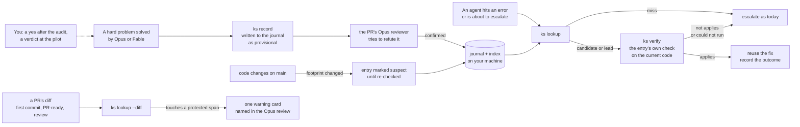

# Knowledge store for the agents working on FixFlow — research and design (2026-11)

**Status: v1.3 — research complete, design adjudicated; thirty refuter verdicts (§12.5), the completeness critic (§12.6) and the owner's critique of v1.2 (§12.7, KS-O1..O20) folded in.** Plan @ 3415b5e (ship plan v8). This is the deliverable of the knowledge-store track, a tooling/harness track separate from the ship program in `SHIP-PLAN-2026-11.md`; it changes nothing in that plan and must not delay P0a–P4c. Method: `docs/ORCHESTRATION-DESIGN-2026-10.md` (the main session judges and never implements; Sonnet researches; Opus proposes, judges and refutes). Provenance: four workflows: the research sweep `wf_2bb8c274-f02` (57 agents), the judge panel `wf_926f16a5-8dc` (7), the refuters and critic `wf_4c53797c-5fb` (31), about 15M subagent tokens between them, and the owner-critique check `wf_2c872948-51a` (17, run by the main session on 2026-11-03). Every raw output is under `evidence/knowledge-store/` with a sha256 manifest. Section 0 is for the owner; sections 1–11 are the design; section 12 is the adjudication record (§12.7 is the owner's own critique and what it changed). **Branch note:** this PR is based on `main`; the ship-plan documents it cites (`SHIP-PLAN-2026-11.md`, G2, HARNESS-REVIEW, OWNER-VIEW, `w2/*`, `ORCHESTRATION-DESIGN-2026-10.md`) live on PR #182's branch `docs/orchestration-design-2026-10` until that PR merges, so a session resuming from this branch alone reads them with `git show docs/orchestration-design-2026-10:<path>`.

**How to read it.** §0 in five minutes. If you want the decision only: §0, §11 and §10 KS-0. If you want to check the reasoning: §2 (what was researched and rejected), §12 (how the proposals were judged and attacked, and what changed as a result). If you are the session that implements a KS phase: §3–§7 and your phase in §10.

## 0. One page for the owner

**What this is.** A place where the agents write down a hard problem *once it is solved* (the symptom, the cause, what they tried that failed, the fix, what the fix depends on, and a check that shows the cause's condition is present), so that the next time it comes back a cheap agent can find it, run the check, and reuse the fix instead of a Fable or Opus session re-deriving it.

**Four words.** A *lead* is a hit the store is confident about; a *candidate* is a weaker hit shown for information only; the *journal* is the one-file-per-event history that is the store's truth; a *footprint* is the list of files, settings and versions an entry depends on, used to notice when it may have gone stale.

**What it is not.** Not a replacement for the rules in `CLAUDE.md` (rules stay; the stories behind them move out later, if the pilot passes). Not the defect register. Not session memory. Not a Markdown wiki: every lookup runs on a database engine that is already inside Node 24 on this box.

**The five rules.**

1. For a solved problem a miss costs nothing and changes nothing. For a "do not apply this fix" entry the rule is the reverse: the store reads the change about to be merged (the PR's diff), so that it rarely misses, and every miss is counted. The store is pull-only: nothing is ever pushed into an agent's context.
2. Nothing acts on a hit until the entry's own check finds the cause's condition present in the current code. The check proves the condition, not that it caused today's failure, so a wrong hit is still possible; it is counted, and the counts decide the store's fate.
3. An entry is invalidated by events (the files, versions or platform it depends on changed), never by age.
4. What failed and why is stored as carefully as what worked, and "do not apply this prescribed fix" is a first-class entry.
5. The store and its journal live on this box and are mirrored only to your VPS over SSH, never to GitHub. Secrets, phone numbers and ids are scrubbed before any write; names and addresses cannot be detected, so raw customer data is never stored. Whatever an agent reads from the store reaches Anthropic, like everything else it reads.

**Where the value is early.** Build and deploy traps (the empty `eas.json` value, the Sentry plugin, the migration traps) have checks that run without Docker. Code defects get their checks only after the pilot, if it passes.

**What it costs.** To build to the go/stop point: about six sessions (audit, core, retrieval, gate, seed, pilot), about half of them Opus, none while a ship phase is waiting on Opus; after a go, four more. To run: nothing to operate on this box; one command per lookup, its output capped at 2,000 characters; about 10–20 minutes of the solving session when a hard problem is recorded. Your touchpoints, in order: a yes after the audit; a verdict at the pilot and at the checkpoint; merging two small docs PRs; starting Docker Desktop for one phase; ten minutes at SSH once the VPS exists. Your critique of 2026-11-03 (§12.7) changed the design but added no touchpoint before the pilot: the two decisions it opened (D5b, the code reader; D21, an edit-time warning hook) are ruled after it.

**Where it could be wrong.** Hard problems do recur here (three to five same-cause repeats among the 48 fix commits on main, depending on how you count), but whether a lookup beats `git log --grep` and CLAUDE.md on them is unproven. The audit counts only repeats a store could have served; the pilot replays real symptoms blind against both incumbents and has a kill criterion. Your other project's month of harness research found no measurable gain from added context machinery; this design starts from that warning and builds nothing before the pilot that the pilot does not need.

**What you are asked now.** D1: run the free audit (one Sonnet session plus an Opus refuter pass; no code, no install). It can wait, needs nothing else from you, and must not displace P0a. Everything else waits for the audit's number and a second yes from you (D1b). "Accept all defaults" means: run the audit, then stop and ask.

## 1. The problem, and the framing agreed with the owner

### 1.1 What happens today

An agent working a phase of the ship plan hits a hard defect or a build/deploy trap, solves it
(sometimes only after escalating to Opus or to the main Fable session), and the only durable
traces are prose, in four places, none of which an agent can query by symptom:

| Where | What it holds | What it lacks |
| --- | --- | --- |
| `CLAUDE.md` "Invariants you must respect", "Build & deploy traps", "Do NOT assume" (about 30 bullets; injected into every agent at about 7.5k tokens) | rules and traps written as rule-first prose, several with the root cause attached | no symptom key, no validity condition, no verification command, no record of what was tried; every new entry makes every agent's fixed overhead larger |
| `docs/HANDOFF-2026-07-28-open-work.md` §2 (operational knowledge), §4 (issue register A1..), §6 (recurring defect shapes) | the best-recorded diagnoses in the repository, some with the wrong fix named and why it is wrong (A4's "naive `useState(() => randomUUID())` is worse") | point-in-time; not keyed; a fresh agent only finds it by reading the whole file |
| `docs/program/G2-deep-dive-gate-2026-11-01.md` §2 (103 register rows) and §1.3 (refuted claims) | open defects with ids, severities and owners; eight refuted or narrowed claims (negative results) | defects, not solutions: the register says what is broken, the store would say how it was fixed and what did not work |
| `docs/program/w2/*-design.md`, `HARNESS-REVIEW-2026-11-01.md` §3 and §4 | design decisions, ruled-out alternatives, refuter verdicts | the same: prose, read whole or not at all |

The cost shows up twice. First, re-derivation: the same defect shape recurs (HANDOFF §6 lists
seven shapes that "keep recurring"), and each recurrence is paid for at the tier that solved it
the first time. Second, context: the only mechanism that guarantees an agent sees a lesson is
putting it in `CLAUDE.md`, which every agent pays for on every call whether or not the lesson
applies.

### 1.2 The owner's need (2026-11-02)

When a hard problem has been solved, record the diagnosis, the ruled-out approaches and the fix
so that a cheap agent can later query and verify the solution instead of re-solving it. Two
positions the owner stated, which this document honours:

1. **Do not invent an algorithm.** This is a decades-old problem class: memoization, caching and
   invalidation, consistency, provenance, known-error databases, case-based reasoning, log
   template mining, information retrieval. Research and repurpose.
2. **Do not simulate a database with Markdown files.** Evaluate real engines behind an
   abstraction layer, possibly several for different workloads, including options the owner has
   not named. Discovery must be broad enough not to miss something good.

### 1.3 The framing already agreed

- **Memoization with invalidation, not a cache of answers.** The key is a problem; the value is
  a diagnosis path with its validity conditions; the entry is only as good as the mechanism that
  invalidates it.
- **The expensive thing to save is the diagnosis path and the negative results.** What failed
  and why is the part a cheap agent cannot reconstruct and the part a strong agent is most
  likely to retry.
- **For solved entries a miss is cheap and safe; a false positive is the dangerous failure.**
  Retrieval is tuned for precision, and every hit passes a verification gate (a discriminating
  check that reproduces the root cause on current code) before anything acts on it. For
  `do_not_apply` and `open_defect` entries the trade-off reverses: a miss lets the forbidden
  change through, so their triggers are recall-first (the PR's diff, §7.2) and their misses are
  measured (KS-O9).
- **Invalidation is event-driven**, keyed on what the entry depends on (files, symbols,
  dependency versions, platform), not on wall-clock age.
- **Refuted hits feed back into the entry** (relevance feedback; the revise/retain half of
  case-based reasoning).
- **Symptoms are fuzzy keys.** The same root cause shows up with different error text, in a
  different file, in different words; entries need several handle types, and machine-generated
  text is canonicalised into templates.

### 1.4 What the store is not

- Not a replacement for `CLAUDE.md` invariants. A rule stays a rule and stays loaded; the store
  holds diagnoses, and §8 moves the diagnostic detail out of `CLAUDE.md` so the file gets
  shorter, not longer.
- Not the defect register. Open defects live in G2 §2 and the plan's §5; an entry is written
  when something has been solved (or when an approach has been shown not to work).
- Not session memory. Context compaction and cross-session continuity were settled by the
  harness review (HR-C1..C5: one phase per session, state in the repo, no context system).
- Not a code index. Graph tooling (graphify) was evaluated and skipped (HR §5); an on-demand
  name search over owner-named guarded identifiers, run against a PR's diff, is in scope (§5.5,
  §7.2; KS-O5).

### 1.5 Workload and constraints

| Dimension | Value |
| --- | --- |
| Entries | a seed corpus in the low hundreds of candidate rows (§8), of which a few dozen are genuine solved entries today; a few new entries per phase over about 40 phases |
| Writes | a handful per phase, by the session that solved the problem; one confirmation by the reviewer |
| Reads | many per phase: a lookup at every tier escalation and at every unexplained failure; mostly misses |
| Readers and writers | several at once: parallel sessions, git worktrees, workflow subagents |
| History | every outcome event per entry (confirmed, refuted, invalidated, revised, superseded); never deleted |
| Analytics | hit, refute and miss counts; cost saved; which sources produced the entries that paid off |
| Dev box | Windows 11, Node 24, Docker Desktop, Git Bash; no Python on PATH (an interpreter exists at the Codex runtime path) |
| Production | self-hosted Linux VPS or home box (plan §4, HR-A3) |
| Data | code and defect data stay on machines the owner controls; a service that sends either to a third party is disqualified for production and cited only for its design |
| Operator | one developer with ADHD who wants less to track; nothing is installed without an owner decision |
| Access | agents reach the store through a CLI or MCP tools; the main session never implements |

## 2. Research register

Sweep `wf_2bb8c274-f02` (2026-11-02): 30 lanes, 24 web re-checks, one completeness critic; raw outputs under `evidence/knowledge-store/sweep/` with their manifest.

Facts in this register that later verification narrowed or withdrew (§12.5): X-05 F20's "almost no explicit repeats" (withdrawn: a subject-line count; KS-C10 found three to five same-cause repeats on `main`); E-01 F12's cross-worktree inference (replaced by measurement) and E-01 F10's "no SQLITE_BUSY with busy_timeout" (narrowed: busy surfaces under contention); R-02's "ex4 integration test exists" (nothing tests the 0046 seed or the age guard), "ex8 hit twice in 16 days" (added once; its fix stranded off main) and its branch-only commit citations 9b98c88, a6f9048, c731e66, 8dafcec and 37821f5 (not ancestors of `main`; the mainline commits are 2fe77f5, 6928828, da988e2).

Citation form: `[LANE.Fnn]` is a fact id in that lane's JSON; `[LANE.c:name]` a candidate; `[LANE.i]` an implication. Confidence as the lane recorded it (verified = read on the page or file; reported = secondary; inferred). Re-check outcomes: every lane's load-bearing web facts were re-fetched; PARTIAL means the page supports most of the statement and the note says which detail it does not; the two NOT_ON_PAGE results (T-03 F07, F20 URL mismatch) and one UNREACHABLE (M-01 F14, the "97.8% junk" claim) are downgraded to reported and not load-bearing in the design.

### 2.1 Theory lanes

**T-01 Caching, memoization, invalidation** — contributed: entries as memoised tasks with a *verifying trace* of (dependency, content-hash) pairs captured when the discriminating check last passed (Build Systems à la Carte ICFP 2018, Shake, Bazel, rustc red-green) [T-01.F01,F02,F09]; *early cutoff / backdating*: a changed dependency marks the entry suspect, the check re-runs, an unchanged result re-stamps the trace instead of discarding the entry [F02]; three documented ways memoisation breaks: untracked dependencies, non-determinism, volatility [F03]; Frankenbuild: never splice facets verified under different traces [F04]; negative caching per RFC 2308: a negative is scoped to the narrowest key, carries its authority and world-state, is bounded in life, and is a lead not a prohibition (RFC 8767) [F11,F12,F14]; tombstones so a stale writer cannot resurrect a refuted entry; write-through at fix time with compare-and-set (Facebook leases, "stale sets") [F17]; read repair by the reader restricted to mechanical outcome events (Dynamo) [F18]; serve-stale inverted: a drifted entry is shown only as a labelled lead. Rejected: TTL as validity; Make-style dirty bit (mass invalidation); deep traces; stale-while-revalidate; write-back; wall-clock last-writer-wins; Dynamo machinery. Lease (Gray & Cheriton) rests on a secondary summary.

**T-02 Provenance, lineage, event sourcing, temporal** — contributed: entry = immutable identity + append-only `entry_event` stream (recorded, confirmed, refuted, invalidated, revised, superseded, withdrawn, reaffirmed); the current view is a fold; corrections are new events (Microsoft event-sourcing pattern, PROV `wasInvalidatedBy`/`wasRevisionOf`, OpenLineage facets) [T-02.F01,F03,F07]; bitemporal split with the "valid" axis replaced by *code state*: record time = the event log; validity = a predicate over git (OSV GIT ranges, `git merge-base --is-ancestor`, `git diff --quiet <a> <b> -- paths`) [F09,F13,F15,F16]; record mainline SHAs and blob OIDs, never PR-branch SHAs (the repo squash-merges now: 135 merge commits of 369 historically, recent PRs squashed) [F20]; typed facets in a schema-versioned JSON column; per-entry optimistic concurrency + client-supplied event ids; content-hash event ids, hash chain optional (tamper evidence is a v1 non-goal). Rejected: wall-clock bitemporal engines (XTDB, Datomic: design only), CDC/materialized-view machinery, lineage catalogs, git notes.

**T-03 Information retrieval at tiny scale** — contributed: raw BM25 scores are rank-only and corpus-dependent (local FTS5 test: any unique single-term match scores exactly ln 3; a term in 4/5 rows scores 1e-6), so no absolute score threshold and no RRF as confidence [T-03.F02,F04,F05]; pipeline: canonicalise → exact-handle and facet prefilter → multi-field BM25 (FTS5 column weights) → score-free abstention features (exact-handle hit, IDF-weighted query-term coverage, rank margin) → three-valued output miss / candidate / lead → the gate [i]; BM25 is the robust baseline (BEIR; dense fails on entities/identifiers; BM25 beat embedders on LIMIT at 46 docs) [F09,F10,F11]; Rocchio repurposed document-side (confirmed query → new handle; refuted → "not when" discriminator); pseudo-relevance feedback rejected (drift); exact pairwise Jaccard for near-duplicate warnings at write time (MinHash/SimHash are web-scale); evaluation: leave-one-handle-out, hard negatives, stale probes, rule of three (3/n upper bound) [F20]; Postgres `ts_rank` has no IDF [F06]. Open: threshold values must be calibrated on the seed corpus.

**T-04 Log template mining and crash fingerprinting** — contributed: an ordered deterministic mask pipeline (Sentry's 20-pattern parameterizer; Drain's 1–2 domain regexes; Socorro's skip-lists) beats learned miners for a small corpus of rare errors (Loghub-2.0: parsers struggle on infrequent, parameter-heavy templates) [T-04.F01,F05,F10]; several signatures of different granularity each with a known failure mode (Chromium three signatures, WER ~500 heuristics measured 17.7–36.8% mis-bucketed, Crashlytics issue/variant) [F15,F16]; key stack traces on in-app module::function, never line numbers [F08,F09]; keep the scrubbed raw text beside the canonical form with a `recipe_version`, re-derive on recipe change (WER re-bucketing; Socorro's 2,044-bug signature migration) [F12,F13,F16]; bias defaults toward splitting; FixFlow's own traps show error text can mislead (`railway up --ci` timeout is benign; one alembic `CommandError` for different targets) so keys need tool + phase + command context [F25,F26]; per-tool adapters preferring structured output (pytest junit, Jest/Vitest json, Docker plain progress); recipe = code with golden fixtures. Rejected: Drain/Spell/IPLoM as primary; hosted Sentry/Crashlytics (egress); neural dedupe; hashing raw text; line numbers.

**T-05 Case-based reasoning, KEDB, postmortems** — contributed: the CBR cycle retrieve–reuse–revise–retain, retain regardless of success (Aamodt & Plaza 1994) [T-05.F1]; case = problem + solution + outcome + derivation annotations [F3]; ITIL/KEDB fields (symptom-first title, verbatim error text, affects/version scope, root cause, workaround vs permanent fix, status, retire-by-status-never-delete, extend-never-sibling) [F15]; SRE postmortem fields (what went well/poorly/lucky, detection method, owner, measurable action items) [F17]; Cook: a single root cause is a hindsight artefact → store cause + manifestation conditions [F21]; Smyth & Keane: deletion is safe only for speed-up learners with a first-principles fallback (this store has one: the top-tier session) and swamping is not the threat at this scale [F6,F7]; ReasoningBank top-1 beats top-k; Xiong et al.: agents copy near-matching records, wrong ones included [F22,F23]; no prior art invalidates by code dependency (gap this design fills) [F26]. Rejected: Etsy Morgue; competence-preserving deletion; time-only review dates; LLM judge as retain gate.

**T-06 Concurrency** — contributed: one SQLite file (WAL, `busy_timeout`, every write in `BEGIN IMMEDIATE`) gives serialised writers, non-blocking readers and atomic conditional updates; the WAL-reset corruption bug (3.7.0–3.51.2, fixed 3.51.3, 2026-03) means every runtime that opens the file must be ≥ 3.51.3 (Node 24.22.1 bundles 3.53.4) [T-06.F1,F4,F5,F6]; the file must live outside every worktree (git common dir or user dir), never on a network share, Docker bind mount or synced folder [F2,F23]; stampede control = advisory single-flight: a claim row (symptom signature, holder, `claim_seq` as fencing token, lease expiry), non-blocking, dead leader expires, waiters proceed (Kleppmann: TTL locks are leases, fencing tokens make them safe) [F13,F30]; append-only event log with client-minted ids (idempotent, set-union merge); integer version + conditional UPDATE on the few mutable header fields; wall-clock LWW rejected [F26]; Bloom filters, XFetch, singleflight, Redis/Redlock, raw OS locks, CRDT libraries unnecessary at this scale.

### 2.2 Engine lanes (each scored against the constraints; "ops" = one-developer operational cost)

**E-01 SQLite** — strong primary: `node:sqlite` is built into Node 24 (Stability 1.2 release candidate; no flag), the dev box bundles SQLite 3.53.4 with FTS5, JSON, SESSION, R*Tree; FTS5 gives BM25 with per-column weights, snippet/highlight, external-content tables, a trigram tokenizer (≥ 3 chars) for substring matching on error text [E-01.F01,F02,F04,F05]; WAL concurrency verified: 4 writer processes, 1200 inserts, no SQLITE_BUSY with `busy_timeout` [F10]; backups by `VACUUM INTO` / backup API / `sqlite3_rsync`, never a raw copy of a live file [F11]; sqlite-vec is pre-v1 (0.1.9) with Windows builds, optional [F13]; the reference MCP sqlite server is archived (2025-05-29) and community ones are generic SQL passthroughs → a purpose-built CLI (and thin MCP wrapper) [F20,F21]; better-sqlite3 is the fallback driver (needs an npm install). Egress: none. Ops: low. Rejected: sqlite-vss, LiteFS, committing the DB to git, one DB per worktree, network/synced locations.

**E-02 DuckDB, LanceDB, Kùzu** — none is a sensible primary. DuckDB 2.0 LTS: one read-write process per file, FTS index not auto-updated unless `incremental=1`, VSS persistence experimental; its role is an optional read-only analytics attach over the primary (READ_ONLY attach confirmed for Postgres; for the SQLite scanner unverified) [E-02.F03,F04,F05]. LanceDB: million-vector design, FTS stale until `optimize()`, concurrency undocumented; cite its versioning/tags model. Kùzu: repository archived 2025-10-10 (Apple acquisition reported), npm package deprecated; forks (LadybugDB 0.22.x) pre-1.0 → rejected; lineage edges as an edge table + recursive CTE.

**E-03 Postgres (separate instance)** — viable fallback, not the default: tsvector + pg_trgm cover the retrieval need with stock contrib (no custom image); pgvector optional; ParadeDB pg_search is AGPL and TB-scale; AGE and CDC overkill; LISTEN/NOTIFY is lossy for short-lived CLI agents → invalidation must be a re-computable query [E-03.F01,F03,F08,F12]; Docker Desktop on this box has AutoStart false (the store would be unavailable until Docker is started by hand) [F21]; the project already runs postgres:16-alpine locally and in CI [F22]; the archived reference Postgres MCP had a documented read-only bypass → enforce read-only at the DB role, not the wrapper [F14]; Postgres MCP Pro (MIT, restricted mode) and pgEdge are the credible MCP options; PGlite is single-connection (design only) [F23]. Verdict: "already in the production DB family" does not justify a second always-on stateful service for hundreds of rows; keep as the swap target behind the abstraction layer if multi-host writers or server-side SQL power are ever needed.

**E-04 Search engines** — nothing here adds retrieval capability over FTS5/pg_trgm at this scale; what they add is typo tolerance and hybrid vectors; what they cost is a daemon, a key, an upgrade path and a telemetry switch. Meilisearch (MIT community, telemetry on by default via Segment/Amplitude, off with `MEILI_NO_ANALYTICS=true`/`--no-analytics`, async writes, read-only experimental MCP) is the only credible optional tier [E-04.F01,F05,F07]; Typesense GPL-3, RAM-resident, WSL-only on Windows, telemetry undocumented [F09,F10]; Quickwit Linux-only, telemetry on by default (`QW_DISABLE_TELEMETRY`); OpenSearch/Elasticsearch/Vespa need ≥ 4 GB containers and ~1.2 GB images for a corpus under 1 MB [F24]; Sonic indexes ids only; Zinc/OpenObserve/Manticore telemetry on by default. Rejected as required components; "telemetry disabled" must be a deployment invariant for any engine adopted later.

**E-05 OLAP, log engines, HTAP** — a hybrid is not justified: practitioner thresholds for a second analytical engine sit around 10^7–10^8 rows (bands vary by source; reported) against 10^3–10^4 rows here [E-05.F22,F26]; ClickHouse wants batched inserts (≥ 1,000 rows/insert, ~1/s), handles mutable status badly, has no native Windows server and ships `send_crash_reports` on by default [F03,F04,F05,F06]; chDB has no Windows wheels; Loki indexes labels only; PeerDB/ClickPipes (CDC) are cloud or multi-service; TiDB/Citus/Hydra oversized. Keep: one transactional engine with an append-only outcome table and SQL views; DuckDB read-only attach in reserve with extension autoinstall off.

**E-06 Wide-column, KV, caches** — Cassandra (owner-named) rejected on the merits: 8 GB RAM/2 cores per node minimum, query-first denormalised model, no joins, SAI "is not a replacement for text-based search", no native Windows since 4.0, a scale gap of 5–7 orders of magnitude [E-06.F07,F09,F10,F20]; ScyllaDB Linux-only, source-available since 2025.1 with telemetry "may be required" [F12]; Redis 8 (AGPLv3 option from 2025-05-01) is the only engine here with ranked fuzzy text in-engine (BM25STD, Snowball, Levenshtein ≤ 3) but is a RAM-resident daemon with no native Windows build [F01,F03]; Valkey search full-text only since 1.2 (2026-03); Memcached, Dragonfly, KeyDB, RocksDB, LevelDB rejected; LMDB viable only as a hidden exact-handle map. The reusable idea: an exact-handle index (template hash, file, symbol, dependency fingerprint → entry ids) as the first retrieval tier [F21].

**E-07 Vector stores and embeddings** — embeddings later, behind a measured trigger, not now: at ≤ 200 entries the whole one-line index is ~8k tokens; lexical shortlist + the calling agent's own LLM as re-ranker needs no model (RankGPT) [E-07.F05,F06,F29 inferred; *superseded by KS-R4: no LLM re-ranking inside the store, one lead and one candidate shown*]; write-time handle expansion (doc2query by the solving agent) recovers part of the vocabulary-mismatch gap [F07; *"most" withdrawn by KS-O19: docT5query is about +1.6 % over BM25 on the BEIR average*]; no evidence either way that dense retrieval beats BM25 at this scale (BEIR, Sciavolino entity queries, LIMIT; no cited study is below about 3.6k documents; *reworded by KS-O19*) [F01,F03]; embedding drift forces a model+revision stamp per vector [F28]; if ever added: sqlite-vec or pgvector inside the same store with a pinned local int8 bge-small via transformers.js (Node, `allowRemoteModels=false`), fused by RRF [F19,F24]; telemetry switches: Qdrant `QDRANT__TELEMETRY_DISABLED`, Weaviate `DISABLE_TELEMETRY`, Chroma contradictory (config default True), Milvus opt-out undocumented [F10,F11]. Rejected: any vector server as the store; hosted embedding APIs; Ollama as the embedding runtime. The numeric trigger (≈ 5% "missed, entry existed" over 50 lookups or > ~1,000 entries) is inferred, an owner parameter.

**E-08 Graph and Datalog** — not needed: all four lineage queries (entries citing changed files; sharing a root cause; what X superseded; failed approaches for similar symptoms) are a join or one recursive CTE; measured in SQLite on a dense 300-node/3000-edge worst case: 0.07 ms (join) to 95 ms, sub-millisecond on realistic graphs; a depth column in the UNION key was 20× slower [E-08.f19,f16]; model root cause as a row (FK), not pairwise edges [f26]; Neo4j (`dbms.usage_report.enabled` default true, GPLv3 non-production wording), Memgraph (telemetry default on, BSL), FalkorDB (SSPL), SurrealDB (BSL), Dgraph, CozoDB (no release since 2023), Soufflé (a compiler), PG19 SQL/PGQ (committed 2026-03, reverted 2026-09) all rejected [f1,f4,f6,f9,f18]; write Cypher/Datalog forms in the design as documentation of intent only.

**E-09 Versioning, ledgers, git-native** — the index-is-a-cache pattern: immutable event files in git as truth (Fossil ticket artifacts; git-bug op-DAG; Beads classic) with a rebuildable local index [E-09.F02,F05,F13]; Beads abandoned mutable JSONL + SQLite + daemon for Dolt (merge driver, timing bugs) — the main warning [F03]; one small immutable file per event named by content hash merges as pure adds (merge=union is a fallback with random order) [F07]; refs are shared across worktrees, branch files are not [F08]; Dolt is the credible upgrade path for native tabular branch/merge (git-remote sync under `refs/dolt/data`; ~103 MB binary; CLI telemetry on by default per X-01) [F10,F11]; a SQLite file committed to git is rejected as truth (binary, no 3-way merge, WAL pairing) [F17]; immudb (BSL), XTDB, Datomic, TerminusDB, lakeFS rejected or design-only.

**E-10 Agent access and egress audit** — a thin project CLI called through Bash is the one path every subagent and workflow agent has with no configuration or approval prompt; a skill (description ≤ 1,536 chars always listed, body on demand) carries the lookup/verify/record procedure; a `.mcp.json` server is optional (approval prompt interactively; subagents inherit MCP tools; tool search defers schemas) [E-10.F16,F17]; output bounds: Bash 30k chars read-back, MCP warns at 10k tokens and caps at 25k [F18]; the reference sqlite/postgres/redis MCP servers are archived with "no security guarantees" [F2]; telemetry on by default with documented off switches: Meilisearch, Qdrant, Weaviate, Neo4j, Memgraph, ClickHouse crash reports; DuckDB auto-downloads extensions (`autoinstall_known_extensions=false`); SQLite and Postgres have no telemetry [F21,F22,F29,F30]; whatever a tool returns enters model context and reaches the model provider (engine-level egress control does not cover that path) [F31 inferred, confirmed by X-06].

**E-11 Multi-model and document engines** — none is a third option beside SQLite and Postgres: SurrealDB (BSL, embedded, BM25, built-in stdio MCP with owner-level access, docs inconsistent on storage-engine maturity, fuzzy matching unconfirmed) is the only candidate for a bounded spike if the owner wants one [E-11.F06–F10]; ArangoDB 3.12 dropped native Windows and tightened its Community licence; MongoDB search needs a Linux-only `mongot` process under SSPL; RavenDB Community keeps ≤ 2 revisions for 45 days (breaks append-only history) [F11]; CouchDB search is an experimental JVM service; Gel's company shut down; OrientDB sunset; KurrentDB/NATS/Xata design-only.

### 2.3 Agent-memory and software-engineering prior attempts

**M-01 Agent memory systems** — borrow Graphiti's two clocks re-anchored (valid-from/valid-to as code state + created/expired) and retire-don't-delete; a non-lossy raw episode layer with derived facts pointing back; Letta Code's git-backed memory files with one worktree per writer; ReasoningBank's first-class failed experiences [M-01.F01,F18,F24]. Avoid: LLM extraction at write time (junk, duplicates, hallucinated memories, per-write cost, poisoning route); LLM-judged contradiction as the invalidation trigger (Graphiti, Mem0) [F02,F12,F13]; Mem0's ADD-only side-by-side beliefs (a stale-hit generator); time-decay (MemoryBank); automatic rewriting of old entries (A-MEM). Benchmarks (LoCoMo, LongMemEval) measure chat recall and are disputed [F25]. Egress: every self-hosted path defaults to OpenAI; Mem0 and Graphiti ship PostHog telemetry [F06,F15]. Memory-poisoning attacks (MINJA, MemoryGraft) are documented → entries are untrusted until the gate passes [F26 reported].

**M-02 Coding-agent memory features and experience-reuse research** — the harness already provides: CLAUDE.md (always loaded; adherence falls past ~200 lines; this repo's is 390), auto-memory (MEMORY.md index first 200 lines/25 KB, per-repo, machine-local, not given to subagents), skills, hooks (incl. `PostToolUseFailure` as a possible automatic lookup trigger) [M-02.01,02,04]; no harness feature offers symptom-keyed lookup, canonical templates, dependency invalidation, a gate, outcome history or safe parallel writes. GitHub Copilot Memory is the closest production precedent (code-citation facts re-verified just-in-time against the current branch; vendor-reported merge-rate gain; hosted) [12]. Research: ReasoningBank gains from distilled failure lessons (46.5→49.7) where AWM loses with raw failures (44.4→42.2) [26]; Xiong et al. "experience-following" (agents copy similar records, wrong ones too) [28]; ACE: itemised bullets with helpful/harmful counters merged by non-LLM code; LLM whole-document rewrites collapse context [29]; Ghosh et al.: similarity scores and LLM judges rank harmful memories no better than chance → the gate must be external and executable [30]; Dynamic Cheatsheet: smaller consumer models can fall below baseline with memory [24]; Gloaguen et al.: repository context files raise cost > 20% without general success gains [32]. Verdicts: small itemised records; k=1 (≤ 2) shown; negative results as distilled, condition-scoped lessons with a failure-cause class; counters + append-only outcome log; never always-loaded.

**M-03 Program repair, fix-pattern mining, crash-to-fix** — Getafix validates the top candidate by re-running the tool that raised the signal (84% removed the warning; acceptance 42%) → the gate must reproduce the root cause, not just show the symptom gone [M-03.F01,F02]; SapFix: patches that passed all tests were rejected by reviewers ("null guard for an expression that cannot be null") → test-pass alone is a weak gate [F07]; WER assert tags and Getafix context-bound holes: key on stable semantic anchors, demote path and line [F12]; key-derivation changes orphan links (Socorro bug 1178094 rewrote 2,044 signature fields; WER kept raw dumps six months to re-bucket) → raw evidence + versioned derived keys, append not replace [F13,F16,F18]; Linux `Fixes:` tag and Sentry resolved-in-release as applies-while predicates [F24]; ast-grep as a local structural probe; retrieval precision is modest even at Meta → candidate generator with abstention, never auto-apply. No study measures fix decay after refactors.

**C-01 The owner's clinic-project research (local files)** — every memory/context product evaluated there was rejected or reduced to design ideas (MemTree/Claude Code Infinite: hosted egress, CLI-only; claude-mem: per-observation LLM compression; Virtual Context, YesMem (WSL-only), LCM, cairn, context-mode/RTK/squeez (Bash-only hooks on a PowerShell box), Continuous-Claude, headroom, Graphify) [C-01.c:*]. The finding "maintained notes recalled facts as well as an elaborate adapter" does not exist in that wording; the nearest evidence is the WF-02 trial (baseline vs treatment with a context projection: identical deterministic acceptance, null token figures) and the harness review's "a month of research established no gain" [F18,F19,F21]. Red-team defects that a store with a gate is exposed to: RT-01 (green without testing), RT-02 (bare assert), RT-03 (accepted beside a failed check), RT-04 (working-tree bytes vs committed), RT-05 (uncleaned environment), RT-06 (unknown recorded as 0), RT-07/09 (Windows paths) [F24–F33]. Design warnings carried: one state owner per kind of state; projections drift; private memory is not team authority; whole-file hashes over-invalidate; keyword heading matching misfired; time-based expiry rejected; no project-wide mutable pointer; writer identity explicit (subagent hooks fire with the main session id). HR §4 skip rulings the store must not re-adopt: task/context/evidence trees, Python checkpoint hashing, pre-commit hook gates, the context system, the M00–M06 measurement pipeline, Graphify.

### 2.4 Repository lanes (seed corpus and worked examples)

**R-01a** (CLAUDE.md three sections, HANDOFF §2/§4/§5.5/§6, lifecycle follow-ups): 121 rows — CLAUDE.md 4 traps, 16 invariants, 9 solved entries, 1 open; HANDOFF 13 traps, 4 invariants, 10 solved, 36 open defects, 14 other; follow-ups 11 open, 1 trap, 2 other. Contradictions found: HANDOFF A2 prescribes letting a correct PIN clear the lock, which CLAUDE.md forbids; 0045 is "a free slot" in the follow-ups and "merged" in HANDOFF; C1/C2 "do not ship" vs recorded merge; HANDOFF §4.4 lists as open what CLAUDE.md says is fixed. Very few items record tried-and-abandoned fixes (the strong ones: `railway up --ci` re-run, alembic revision targeting on rollback, naive `useState` for the payment id, login-lock PIN verification, dead-letter placement). No trap has a verification command.

**R-01b** (G2 §2 register, §1.3 refuted claims, HR §3/§4, W2 notes' ruled-out statements): 149 rows — G2 74 open defects (≈ 140 ids), 1 solved (a design-doc correction), 7 negative results; HR 6 open, 4 invariants, 3 traps; W2 notes 52 ruled-out alternatives/verifications. No register row records a landed code fix; the W2 file:line citations are tied to expo-location 18.0.10 / expo-task-manager 12.0.6 and invalidate on an SDK upgrade; O-10 and O-04 predate the HR amendments.

**R-02** (eight worked examples from git history; the first eight entries): ex1 non-ASCII `compare_digest` 500 → `compare_secret` (9b98c88, PR #168; existing test; 5 ruled-out notes); ex2 reverted migration 0045 / rollback crash-loop (c79bec7, ea48987, ADR-0001; a predicted hazard that was guarded, plus one proven-by-execution rule); ex3 web payment idempotency key per attempt — STILL OPEN on main (A4; the naive fix is worse; proposed Vitest check); ex4 dispatcher unseeded cursor drains history (c731e66/da988e2, PR #170; 0046 seed + age guard; integration test exists); ex5 completion form blank against a real bill (37821f5 incomplete, 8dafcec guard + `wizardState`; Jest tests exist); ex6 login lock must keep blocking a correct PIN — a **do-not-apply** entry whose prescribed register fix was deliberately refuted (PR #169; the handoff still prescribes the wrong fix); ex7 `eas.json` empty-string env fails every build (79a8dd4; proposed static check verified to discriminate on historical blobs); ex8 Sentry Expo plugin breaks Gradle, hit twice in 16 days (a6f9048, 6928828; proposed static check). Not reconstructible: the `railway up` from repo root incident (a rule without a case record). Token/wall-clock cost per fix is recorded nowhere; model tier only via `Co-Authored-By` trailers.

### 2.5 Round-2 lanes (the critic's missed angles)

**X-01 One data set across hosts and worktrees** — the two round-1 designs are compatible, not rivals: the SQLite file is the same in both; the question is the source of truth. Recommended ranked topologies: (2) a single SQLite file on the dev box outside all worktrees with one-way backup to the VPS (`VACUUM INTO` / node `backup()` / `sqlite3_rsync`, tested under 4 writers: integrity ok, restore then write ok) is cheapest on day one and is stage 0 of (1); (1) immutable per-event files in a *dedicated store repo outside the code repo*, synced by git over SSH to a bare repo on the VPS (never GitHub), with a per-host rebuildable index, wins once two hosts write [X-01.F10,F20]. Tested: distinct event files merge cleanly under squash and normal merges; a shared append file conflicts; events committed only on an abandoned branch vanish from main [F20,F22]. sqlite3_rsync one-way; Litestream beta; libSQL no Windows binary; rqlite is a Raft cluster; cr-sqlite per-column LWW loses edits; Dolt viable but heavy with default-on CLI telemetry (`metrics.disabled`) [F17]; Tailscale's control plane is third-party (Headscale/SSH instead). Version gate: every runtime that opens the index ≥ SQLite 3.51.3.

**X-02 Running stored checks safely** — the gate runner is the only code path that executes stored checks; the verdict comes from a runner-owned artifact (junit XML, json reporter), never the child's exit code (`git bisect run` treats 1–127 as bad incl. 127 command-not-found; Python/Node crashes exit 1; pytest exits 5 on no tests collected) [X-02.F01,F12]; tri-state applies / not_applies / inconclusive, with "could not run" never equal to not_applies; allow-listed check kinds (test_id at a pinned sha, structural_probe via ripgrep/ast-grep/Semgrep (the metrics-off qualifier applies to Semgrep only; for ast-grep no telemetry was found, an absence of evidence, KS-O2), scripted only with approval bound to the spec's sha256 by a verifier who is never the author); a control pair (fails_at / passes_at) so a vacuous pass is impossible; isolation = Docker (WSL2 backend on the dev box, same image on the VPS) with `--network none` or an `--internal` network, read-only detached worktree, tmpfs scratch, allow-list env, redirected HOME, resource caps, fail closed; a throwaway `postgres:16-alpine` per run because `backend/tests/conftest.py` TRUNCATEs every table on whatever URL it is given and `Settings` defaults to localhost:5432 [F13,F14]; Claude Code's own sandbox does nothing on native Windows; Windows Sandbox has no headless I/O [F03]; flaky policy: rerun only on disagreement, unanimity for applies. Dependency preparation is a separate trusted step keyed by lockfile hash.

**X-03 Capturing the dependency footprint automatically** — no single tool; three captures each see a different footprint: (1) Claude Code PreToolUse/PostToolUse hook logs (file_path, command text, agent_id) or a post-hoc parse of the session transcript → the *cognitive* candidate set (over-captures, misses Bash reads) [X-03.F08,F10]; (2) coverage of the discriminating check (`NODE_V8_COVERAGE`, Jest `--coverage`, coverage.py dynamic contexts) → the *causal* set, hashed at function level (Python `ast`, TypeScript compiler API) so unrelated edits in a big file do not invalidate [F12,F17]; (3) a fixed environment probe (node/npm/python/eas/expo versions, lockfile/Dockerfile/eas.json hashes, config key paths) [c]; plus capture of tool-reported resolution for remote-resolver traps (the EAS image name in the build log; Railpack's provider lines) [F20,F29]; footprint items carry a provenance tier; over-capture costs a re-verification, under-capture risks a false positive, so prune only on evidence. fsatrace (no Windows binary, 46% overhead), Rattle/tup/Bazel, Procmon/ETW rejected; strace-in-Docker optional Linux calibration; Node `--permission` as a completeness self-check. The backend has no coverage tool and root Vitest no coverage package → two small dev-dependency additions are an owner decision.

**X-04 CI failure classifiers and KCS** — elastic-recheck (one versioned query file per tracked bug, authoring rule: > 10% hits on successful runs means too broad; optional second discriminator `test_ids`; retirement on upstream fix status with `--dry-run`; backend needed ~6 TB per 7 days) [X-04.F01,F02,F03,F05,F07]; Jenkins BFA minimal schema; logreduce's canonicalisation recipe; Develocity's fail-then-pass retry oracle (hosted, design only); KCS v6 lifecycle WIP → Not Validated → Validated → Archived, template Issue/Environment/Resolution/Cause/Metadata, many-to-many typed links in machine-usable form, "reuse is review", "flag it or fix it", reuse accuracy (> 90%) over reuse rate [F17–F21]. Transfers: a negative-corpus precision check at write time; a required discriminating check beyond the handle; a separate link table entry-version ↔ incident typed resolved/referenced/refuted; review at hit time, never a scheduled sweep. Does not transfer: ER's infrastructure and "no hits in 10 days" expiry; KCS's staffed-organisation machinery.

**X-05 Recurrence base rate and a pilot** — no source measures recurrence of hard defects for one developer in a young repo, nor escalation cost avoided; population studies (17–45% recurring fix patterns, reported; 75% of flaky tests in clusters) are pattern-level; ReasoningBank cut SWE-bench steps 4–9% (steps, not cost) [X-05.F09]; the AGENTS.md study (> 20% cost, no general gain) matches the owner's no-gain record → the store must be pull-only and beat grep over existing prose [F12,F21]; locally 369 commits, 48 fix-prefixed, almost no explicit repeats [F20]. Pilot: Step 0 a free git-history recurrence audit (one Sonnet session over 48 fix commits); Step 1 blind replay with raw original symptoms, ≥ 40 negative/stale probes, a grep arm, rule of three (0 FP in 40 bounds at 7.5%; 60 → 5%) [F17,F24]; Step 2 a prospective lookup log (raw tokens, model id, tier, wall time; NULL for unknown; prices applied at analysis) with a checkpoint at 20 encounters or 8 weeks and a kill criterion. Thresholds are proposals for the owner.

**X-06 Scrubbing and provider egress** — local-only scrubbing is feasible in Node: exact-value redaction of the live secrets in env/.env; secretlint as a library (MIT, DB-connection-string and basic-auth rules, Windows exe); custom regexes for `postgresql+asyncpg://`, Bearer/Authorization, Railway/Supabase/R2 tokens, JWTs; libphonenumber-js `findPhoneNumbersInText(text,'PK')` + CNIC regex; gitleaks binary (MIT, stdin, best measured recall 86–88% at 46% precision) as a fail-closed second pass [X-06.c:*]; trufflehog rejected (AGPL, live verification and update check on by default), detect-secrets stale and Python; Presidio design-only (no PK entities, no Urdu). Names and addresses cannot be detected locally → structural rule: never store raw production-data output; store templates with typed placeholders. Provider egress is unavoidable: Claude Code sends prompts and tool output to Anthropic; retention 30 days to 5 years by account type; ZDR Enterprise-only; the owner must rule the scope [F01,F02,F04,F07]. Scrub at write time and again on every return.

The main session's rulings on the contradictions between lanes (KS-R1..R10) are recorded in §12.1.

## 3. Data model

The model is proposal A's (§12.2) with D's storage topology, the judges' grafts and the refuters' amendments (§12.5, cited as KS-F…). Prior art is cited per field; proposal A's full DDL sketch is in `evidence/knowledge-store/panel/architect-A.md` and is normative only where this section repeats it.

### 3.1 Two layers: the journal and the index

| Layer | What it is | Where it lives | Who may touch it |
| --- | --- | --- | --- |
| **Journal** (truth) | append-only, immutable event records: one canonical-JSON file per event (keys sorted, integers only, UTF-8, LF), named by the sha256 of its bytes, fanned out as `events/<aa>/<sha256>.json`; `.gitattributes` is `* -text` because `core.autocrlf=true` is set system-wide on the dev box | a private git repository at the store home, **`C:\Users\User\.fixflow-ks\store`** (the profile root, never under `%LOCALAPPDATA%` or `%APPDATA%`: the Claude desktop app is an MSIX package with AppData write virtualisation, so a new AppData folder is a different, uninstall-deleted file for Claude-launched processes than for the owner's shell; KS-F1); never under OneDrive, WPS Cloud, a UNC path, a Docker bind mount, WSL `/mnt/c`, or inside any work tree; curated writes (`ks record`, approvals) are committed and pushed immediately; mechanical journal events are committed in a batch at `ks close`; both under a **local commit lease** (a claim-style index row with holder, sequence and expiry, so two sessions closing at once never collide on git's own `index.lock`; KS-F15, critic K11), over SSH to a bare repository the owner controls (the VPS from P3b; a remote allow-list in code refuses `github.com` and anything unlisted) | only the CLI writes it; the owner never edits, renames, rebases, squashes or prunes it (the never-do list, §9) |
| **Index** (projection) | one SQLite file per host, keyed by schema version **and** `recipe_version`, `runner_version` and `scrub_ruleset_sha` (`index/ks-i<schema>-<recipe>-<runner>-<scrub>.sqlite`; the CLI refuses to open on any mismatch and rebuilds instead; KS-F4): entries, handles, FTS5 tables, footprints, traces, lookups, gate runs, outcomes, claims, analytics views; a `meta` row records the journal digest it was built from and the tool versions | the store home's `index/` directory, beside the journal, never inside it | rebuilt from the journal by `ks rebuild`; a broken or outdated index is deleted, never migrated; only `ks init` may create one (the CLI opens with `file:…?mode=rw`, so a wrong path fails loudly instead of silently starting an empty store; KS-F1) |

**Two kinds of event** (critic K3). *Curated and outcome events* (recorded, revised, confirmed, refuted, invalidated, reaffirmed, claims, approvals, corrections) go to the journal and are replicated. *Lookup and gate-run events* are high-volume analytics: they go to a **host-local log** (`store/local/`, same file format, never journaled, never pushed), and `ks close` writes a periodic rollup event (counts per view) into the journal, so the journal stays immutable and bounded and the freshness check never scans lookups. A restore therefore excludes lookups by design.

**The write path** (KS-F2, F3). Every journal write is journal-first. The CLI scrubs, canonicalises and builds the event; writes it to `store/tmp/<id>.tmp-<pid>` (an ignored directory on the same volume); publishes it with `linkSync(tmp, final)`, which never replaces: on `EEXIST` it reads the existing file and accepts an idempotent duplicate only if its sha256 equals the id, else quarantines; the temp file is unlinked in `finally`. (Plain rename-over-existing fails with `EPERM` on NTFS whenever the destination is open elsewhere or written concurrently; measured at 99–126 failures per 8×1,000 identical events; KS-C3.) Then it runs the **freshness check outside the write lock** under a read snapshot (names-only `readdirSync` of each of the 256 fan-out subdirectories, accepting only `^[0-9a-f]{64}\.json$`; a sha256 over the sorted ids compared with the stored watermark; the two-way set difference only on a mismatch; measured 23–35 ms at 5,000 events and 57–87 ms at 20,000 on this box; KS-C4), and only then takes `BEGIN IMMEDIATE` for the append itself: `INSERT … ON CONFLICT(id) DO NOTHING`, a body-hash compare on `changes=0`, the Lamport counter minted inside the lock, the fold update. `SQLITE_BUSY` after the 10 s `busy_timeout` is an expected, retryable outcome (bounded retry with jitter, then exit `store_busy`, which callers treat as neither a miss nor a failure): the journal file is already durable, so a later freshness ingest picks it up; nothing is ever lost at the index. Index pragmas: WAL, `synchronous=FULL`, foreign keys on; the CLI refuses any runtime whose `SELECT sqlite_version()` is below 3.51.3 (the WAL-reset fix; it deliberately refuses the 3.44.6 and 3.50.7 backports) and, on Linux, any Node whose `node_use_sqlite` is false or whose compile options lack `ENABLE_FTS5` (KS-F15). No daemon, watcher or git hook exists. Event count grows with lookups, so a compaction or rollup of `lookup` events is scheduled before the journal passes about 20,000 events (KS-F6).

**Store repository config**, set by `ks init` (KS-F5, K11): `* -text`, `.gitignore` with `tmp/`, `local/` and `*.tmp-*`, `merge.renames=false`, `core.longpaths=true`, `core.fsync` with `core.fsyncMethod=batch`, an explicit `main` branch (the system gitconfig defaults to `master`); `ks sync` pulls with `--no-rebase`, removes a `.git/index.lock` only when its pid is dead, and answers git's "untracked files would be overwritten" refusal by verify-then-commit (identical bytes make a clean add); `ks backup` stages explicit `events/<aa>/<64hex>.json` pathspecs only; fsck quarantines in index state and never deletes or moves a tracked file.

### 3.2 The entry

An entry is an immutable identity (`entry_id`, human-readable: `ks-<slug>-<6 hex>`) plus a stream of events; its current state is a fold over the stream (T-02). Content lives in immutable **entry versions**; corrections are new versions, never edits; a revision names its base by the base version's `content_sha` (KS-F4).

| Field group | Fields | Why / prior art |
| --- | --- | --- |
| Identity | `entry_id`, `kind` ∈ {defect, trap, do_not_apply, open_defect, rule_without_case}, `root_cause_id` (FK to a `root_cause` row so "shares a root cause" is a join, E-08) | KEDB record ids (T-05 F15); do-not-apply entries are first class (R-02 ex6, KS-R9) |
| Symptom | `title` (symptom-first, in the words a searcher would use), `symptom_meaning` + `misleading` flag (some error text means the opposite of what it says: `railway up --ci`'s benign timeout, T-04 F25) | KEDB symptom-first title; Sentry rates message-only grouping least reliable |
| Diagnosis | `cause`, `manifestation_conditions`, `diagnosis_path` (ordered steps: observation, discriminating test, escalation point, dead end) | Cook: a single root cause is a hindsight artefact (T-05 F21); CBR derivation annotations (T-05 F3) |
| Fix | `fix`, `fix_kind` ∈ {permanent, workaround, do_not_apply, none}, `fix_commit` (a full 40-hex sha; before the PR merges the entry is recorded with its branch sha as `pending_anchor`, candidate-only, and `ks close` runs `anchor`, which matches the fix by `git patch-id` to the squash commit on `origin/main` and re-points the controls; a fix that never lands stays `fixed_off_main` and is reported at every phase close, KS-F13, critic K4); **the fix text is withheld on the CLI path until an `applies` gate run bound to the current lookup exists** (the journal itself is plain JSON on disk; §9, D20) | KEDB workaround vs permanent fix; experience-following (M-02 28); ex8's first fix was pushed after its PR merged and never reached main (KS-C12) |
| Negative results | child rows: `approach`, `why_failed` (one or two sentences, distilled), `failure_class` ∈ {wrong_premise, incomplete, worse_side_effect, vacuous_check, not_reproducible, tool_limit, wrong_severity}, `scope` (the conditions and footprint it was observed under), `proof` ∈ {executed, argued, reported} (graft from C), `evidence_ref`; an optional **executable refuting check** (graft from B: ex3's naive `useState` becomes a Vitest assertion, not prose) | RFC 2308/8767 negatives are scoped leads, never prohibitions (T-01); ReasoningBank gains from distilled failure lessons where raw ones hurt (M-02 26) |
| Validity | `applies_while` (a predicate over code state: `fix_ancestor` checked with `git merge-base --is-ancestor`, with a `git patch-id` fallback for fixes cherry-picked onto `release/drain` (graft from C); dependency ranges; platforms), `facets` (runtime, tool, phase, platform, slice) | OSV GIT ranges; Linux `Fixes:`; Sentry resolved-in-release (T-02 F13, M-03 F24) |
| Links | `refs` (mainline commit shas and blob OIDs only, never branch-only shas: a6f9048, 9b98c88, 8dafcec, c731e66, f3dfa6f are not ancestors of `main`; PR numbers; doc anchors with the doc's blob OID; register ids) | the store links to the plan, PR bodies, git and the register and never restates them (KS-R7, T-02 F20) |
| Status (folded) | provisional → verified (or unverified_seed, candidate-only) → suspect / conflict → refuted (scoped) / superseded / withdrawn; `fixed_off_main`; counters shown, applies, absent, inconclusive, resolved, not_resolved; `refuted_footprints` | KCS WIP → Not Validated → Validated → Archived (X-04 F17); retire by status, never delete (T-05) |
| Cost | raw token counts, model id, tier, wall time of the original solve; NULL means unknown, never 0 | X-05; RT-06 |
| Provenance (on every event) | `actor_session`, `actor_agent`, `actor_model`, `actor_tier`, `host`, `based_on` (content sha), `footprint_digest`, `scrub_ruleset_sha`, `recipe_version` | explicit writer identity, because subagent hooks fire with the main session id (C-01 F45); PROV vocabulary for naming only |

### 3.3 Handles (the fuzzy keys)

Eight handle kinds, each with a stated failure mode (Chromium's three signatures; WER's expanding and condensing heuristics; T-04 F15, F16). Every derived handle carries its `recipe_version` and the scrubbed raw text it came from, so a recipe change re-derives keys instead of orphaning them (Socorro bug 1178094, M-03 F16).

| Kind | Built from | Matched | Fails by |
| --- | --- | --- | --- |
| `tmpl` canonical template, with a **cause-multiplicity flag** (KS-F9) | the ordered mask pipeline over the first error line(s); sha256 `value_key`; flagged `ambiguous` at write time when more than one cause is recorded or known for it (alembic's one `CommandError` for several states; `EAS_BUILD_UNKNOWN_GRADLE_ERROR`, which build 15 had two causes for; Node's `ERR_CRYPTO_TIMING_SAFE_EQUAL_LENGTH`, three causes) | exact; trigram for fragments ≥ 3 chars; an ambiguous template never makes a lead alone | brittle on reworded messages (splits: safe); shared templates over-merge |
| `sig` tool | phase | error code / exception class | per-tool adapters reading structured output (pytest junit, Jest/Vitest json, alembic, eas/gradle earliest failing `> Task :app:X FAILED` line) | exact | over-merges: never enough for a lead alone |
| `frames` top-3 in-app module::function | repo-relative frames, no line numbers, framework frames on a changelogged skip-list, recursion collapsed | exact on the triple and the top frame | renames; minified Hermes frames carry no signal |
| `ctx` command and context | normalised argv, cwd relative to the repo root, phase (`railway up --ci @ repo-root`) | exact; a query `ctx` that contradicts the entry's caps the entry at candidate (KS-F9) | the same command fails for many causes; the cwd is what tells the deploy-from-root trap apart |
| `prose` paraphrases | written by the solving agent at record time in several wordings, including silent symptoms with no error text (write-time doc2query, E-07 F07) | FTS5 BM25 with IDF-weighted coverage | zero vocabulary overlap is a miss (safe for a solved entry; counted, never "safe", for a `do_not_apply` or `open_defect` entry, KS-O9); near matches invite copying, so prose alone yields a candidate at most |
| `ident` files, symbols, config keys, env names, error codes | the fix diff and the check inputs | exact table plus an FTS5 table tokenised on `_.-/:#` | busy files (`AppContext.jsx`) have low IDF |
| `doc_ref` pointer to a prose prescription | doc path + anchor + the doc's blob OID (`docs/HANDOFF-2026-07-28-open-work.md#A2`) | exact; this is how an agent about to apply a prescribed fix hits the do-not-apply entry | prose renumbering relabels it "pointer moved" |
| `action` verb-object intent (graft from D) | written by the solving agent: "enable dispatcher", "restore reverted migration", "let correct PIN clear lock", "add env key to eas.json" | exact verb-object tokens against `--action`, plus FTS | the agent phrases its plan differently (a miss); with `--diff` (§7.2) the code-edit hazards (ex3, ex6) also have a code trigger, and `action` stays **the only route for operator-action hazards** that no diff or hook can see: ex4's dispatcher env flip on Railway, a hand cursor reset, a snapshot restore (KS-O13) |
| `not_when` discriminator | written by the author or proposed from a refuted lookup (inactive until confirmed, KS-R3) | matched like `tmpl`/`prose`; a match caps the entry at candidate and shows the discriminator | an over-broad `not_when` suppresses true hits (a miss: safe for a solved entry, counted otherwise) |

### 3.4 Checks, controls and preconditions (the gate's data)

Every entry that can be a lead carries at least one **check spec** (data, never a script): `kind` ∈ {json_predicate, regex_in_span, ordered_in_span, duplicate_values, path_state, dep_version} (declarative probes interpreted by the runner over git blobs; nothing stored is executed) or {pytest, jest, vitest} test ids run in Docker, or {db_probe} (a throwaway Postgres migrated to head, read-only SQL), or {scripted} (only with owner enablement and an approver who is not the author); `strength`; `polarity`; **`target_mode` ∈ {tree, proposed_change}** (proposal A's field, restored by KS-O12: `tree` is the default; `proposed_change` is the only way a `do_not_apply` entry can return `applies` before the forbidden change lands, see below); `present_when` (for test checks: the named test must fail in the call phase with a `reprcrash` message matching the root-cause template, not merely fail; KS-F10); `requires` (docker, postgres, node_modules:…, prod_db, eas_cloud); `spec_sha` and, for executable kinds, `approved_by` ≠ author bound to that sha.

**The probe discipline** (KS-F7, which replaces the panel's polarity rule as the sole defence):

- A declarative probe may return `applies` **only where the matched value is itself the root cause**: a data or config value (ex7's empty env string, ex2a's duplicate revision id, a `dep_version` pin). For a **code-behaviour entry** no text probe of either polarity may return `applies`: at most candidate plus probe evidence; its lead-capable check is an executable one (a test id with a `present_when` template, a `db_probe`, or an approved scripted check). An absence-of-guard probe returns at most `inconclusive(weak_check_only)`.
- **Before the pilot, declarative probes read parsed data only** (KS-O1): `json_predicate` and `duplicate_values` over `JSON.parse` of `eas.json` and `app.json`, `dep_version` over lockfile JSON, and one narrow, fixture-pinned reader for ex2a: case-sensitive top-level `revision` / `down_revision` assignments outside the module docstring, with a golden fixture over all 46 migrations asserting that the `Revision ID:` docstring lines do not count (a case-insensitive `^revision` matches 92 lines, not 46; a loose reader would read PRESENT on HEAD, its control pair would not flip, and the check would be refused at write time). No code-token lexer, no symbol-span anchoring and no code mutant is built before KS-6b; code-file footprint items are whole-file blobs until then (over-invalidation, the safe direction). The v1.2 hand-written lexer is withdrawn: no lane evaluated it, its spec omitted JSX, and its one health metric could not see a silently wrong span.
- **When structural probes land (KS-6b, under D5b)**, text probes match **code tokens only**: comments and docstrings are stripped before `regex_in_span`, `ordered_in_span` or count probes run, but **value probes** (`json_predicate`, `duplicate_values`, `dep_version`) read string-literal *values* as typed tokens, never stripped (ex2a's root-cause value is `revision: str = "0045"`, a string literal; KS-O3). The reader is ast-grep's tree-sitter parse if D5b is accepted, else nothing (code-behaviour entries then keep executable checks and whole-file spans only). Languages: Python, JavaScript **with JSX**, TypeScript and TSX, JSON, YAML. **SQL is not a lexer language**: the repository has no `.sql` file, migration SQL lives in Python strings (37 `op.execute` calls in 21 migrations; ex4's guard is an f-string at `0046_seed_dispatch_cursor.py:56–61`), so SQL is read as the string argument of `op.execute` or `sa.text`, found by a Python rule and passed through a small case-and-comment normaliser; no SQL grammar is needed. A YAML or Python data value is lead-capable **only through a real parse**, never through a block-scalar or indentation heuristic. An `ERROR` node inside a probed span is `inconclusive` (tree-sitter recovers silently with `ERROR` and zero-width `MISSING` nodes, so a half-broken file still yields a tree). Golden fixtures are cut from this repository's own hazards: `src/features/ops/components/States.jsx:19` (an apostrophe in JSX text before a template literal), `src/features/attendance/pages/Attendance.jsx:184` (a regex with a lone quote inside `${}`), `src/app/providers/AppContext.jsx:229` (a regex literal holding five double quotes, directly above ex3's `logPayment` span at 312–328), `technician-app/src/features/jobs/JobDetailScreen.tsx:537`, `technician-app/src/features/attendance/ClockScreen.tsx:142` and `src/features/ops/pages/ApiMetrics.jsx:100` (bare apostrophes in JSX text, where `</Text>` also puts a `/` in a regex-allowed position), and the 0046 f-string. The health metric is the **parse-error and unresolved-anchor rate** plus a **mis-anchor check** (re-anchor on a known mutant and compare span bounds: a span that resolves silently to the wrong range hides an edit while the entry stays trusted, which v1.2's "fallback rate" never counted), reported from KS-6b, the phase that builds it, not first at KS-9 (critic K14 as amended by KS-O3). An ambiguous anchor is `inconclusive` (ex3's "caller span in `JobDetail.jsx`" is unnameable as `path::symbol`: `onSave={(payload) => {` occurs four times, lines 670, 679, 689 and 736, so that precondition is the whole-file blob, KS-O4). Exclusions are by **symbol** ("inside the body of `compare_secret` wherever it lives"), never by path (a path allow-list is a location anchor, not a semantic one: moving `compare_secret` verbatim into `ops/deps.py` would otherwise read PRESENT on a correct tree). Comment-awareness fixes exactly one of KS-C14's four fooling modes (§9).
- On a tree that **contains the fix commit** (is-ancestor) a PRESENT from a text probe means "regression or refactor" and returns candidate unless an executable check agrees.
- For `test_id` kinds the artifact is produced by the target tree's own pytest or Jest with its `conftest.py` and setup files; the runner chooses the path and nonce but does not produce it, so the target's `conftest.py` blob is a precondition, a target that defines `pytest_runtest_makereport` or junit hooks is `inconclusive`, and for a `do_not_apply` entry the protective test's blob must equal the approved one or the verdict is `inconclusive` (critic K12). **`applies` for a `do_not_apply` entry** (KS-O12; v1.2 never defined it, so ex6 could only verify once the forbidden change already existed): in `target_mode: tree` the entry is `applies` only when the forbidden change is already on the target (the protective test fails there, or its blob differs from the approved one); in `target_mode: proposed_change` (`ks verify --target proposed --diff <merge-base>`, or the working tree) PRESENT means the protective test fails against the proposed change, or the protective test's blob differs from the approved one, which is what lets the stop rule of §7.2 fire *before* the change lands. The declarative half (blob and span comparison over the proposed tree) is KS-3's; the executable half (running the protective test against the proposed tree) is KS-6b's. Every runnable check carries a **control pair**: `fails_at` (a full 40-hex mainline commit, optional overlay or stored mutant; expects PRESENT) and `passes_at` (expects ABSENT). A check whose controls do not flip is refused at write time (proposal C's two naive probes that inverted are kept as golden negative fixtures). **Specificity is shown, not assumed**: `passes_at` plus **semantics-preserving refactor mutants** (file move, comment edit quoting the bad code, identifier rename, YAML quoting, SQL case) must still read ABSENT; `passes_at` plus a mutant injecting the pattern as a comment must read ABSENT; a probe that matches the added lines of its own fix commit is refused (self-match). A text probe's `applies` on a historical tree is honest only when `passes_at` is a real mainline fix commit; with a synthetic `passes_at` it is a hint (KS-C6).
- At every reaffirm the fail-side mutant is re-applied to the **current** tree and must read PRESENT (**inject-control**, graft from B; replaying fixed historical commits is deterministic and proves nothing, KS-C6).
- **Preconditions** (`valid_when`, KS-F8): every check declares, as typed items or extra probes, the dependencies its main probe does not read (ex8: no `SENTRY_DISABLE_AUTO_UPLOAD` in any `eas.json` profile's env, no auth token configured for the EAS project; ex3: the `JobDetail.jsx` blob unchanged, whole-file, KS-O4). A precondition that cannot be probed on the caller's machine caps the verdict at `inconclusive(precondition_unprobed)` with the fix withheld; a precondition that differs from the trace, or was never recorded, blocks `reaffirmed`. ex7 and ex8 are `necessary_condition` checks: a lead for a remote-resolver entry also needs the caller's raw symptom to match a cause-specific template (the sentry-cli or upload-task line in the Gradle log, not the generic `EAS_BUILD_UNKNOWN_GRADLE_ERROR`).
- Entries whose discriminating state lies outside the tree and outside a throwaway container (ex2's live `alembic_version`, ex2c's deployed head: `prod_db`) are capped at candidate (KS-F9, F19).

Where this leaves the eight worked examples: ex7 and ex2a are lead-capable declaratively (data values are the cause); ex8 is lead-capable only with its conjunctive probe and the Gradle-log template match; ex1 is lead-capable through its pytest id (the count probe is evidence only); ex5 and ex6 through their Jest/pytest ids once the Jest phase signal exists; ex4 is candidate-only until its `db_probe` and a `max_event_age` unit test exist (nothing in the suite tests the 0046 seed or the age guard; its text-side probe reads the normalised SQL string argument of `op.execute` in 0046 and is evidence only; v1.2's "lower-case SQL" mutant tested SQL that exists only inside a Python string, so it stayed ABSENT vacuously, the RT-01 shape, and is redefined at KS-6b through the normaliser, KS-O4); ex3 is an `open_defect` linked to ship phase P12a and takes P12a's own test id as its check when that phase merges (no KS phase writes one; critic K20); ex2b and ex2c stay candidates with a `prod_db` capability.

### 3.5 Footprint and trace (what the entry depends on)

A **footprint** is a set of typed items, each with a provenance tier, never a flat file list (X-03): `file_blob` (repo-relative POSIX path → git blob OID, computed with `git hash-object --path=
` so the clean filter and LF normalisation apply; KS-F12), `symbol_span` (path::symbol → sha256 of the anchored span over LF-normalised bytes, whole-file blob as fallback; **not built before KS-6b**: until then every code-file item is a `file_blob`, KS-O1), `config_key` (path#json-pointer → sha256 of the canonical JSON value, e.g. `technician-app/eas.json#/build/*/env`), `dep_version` (a lockfile entry; the backend has no lockfile, so a `pip freeze` inside the gate image), `env` (node, python, Docker image digest, OS), `tool_resolution` (what a remote resolver reported: the EAS image name, Railpack's provider line; flagged `remote_resolver`), `doc_anchor`, `precondition` items (§3.4), and, optionally after KS-6b, `guarded_refs` (author-named allowed sites, by symbol, of a guarded identifier; `do_not_apply` and invariant entries only; read only by `ks lookup --diff`, which reports a new site as a separate advisory "new site for <entry>: path:line" that never changes status, is not cleared by `reaffirmed`, and is cleared only by an Opus `ks revise`; switched on only after its false-alarm rate has been measured from git history; off the KS-0 → KS-5 path; KS-O8). Tiers: `fix_diff` (`git diff --name-only fails_at passes_at` on mainline), `check_input` (every path the check reads or overlays), `env_probed`, `tool_reported`, `read` (from a post-hoc parse of the solving session's transcript; no hooks), `executed` (coverage; deferred, D5). The **trace** is the digest of the footprint items at the moment the control pair last flipped on the target (a verifying trace, T-01 F01); the footprint **feeds the verdict** (an unrecorded or changed precondition caps it), it is not only a staleness label (KS-C8); over-capture only costs a re-verification, under-capture risks a false positive, so items are pruned only on evidence.

### 3.6 Events, lookups, claims

Event kinds: `recorded`, `revised`, `confirmed`, `refuted` (scoped to a footprint digest), `invalidated`, `reaffirmed`, `controls_broken`, `anchored` (re-pointing controls at the squash commit after merge), `fix_landed` / `fixed_off_main`, `check_approved`, `proposed_handle`, `proposed_not_when`, `proposal_approved`, `proposal_rejected`, `superseded`, `withdrawn`, `rescrubbed`, `lookup`, `gate_run` (records the target's blob OIDs, never a snapshot sha; KS-F12), `outcome` (resolved, not_resolved, referenced, abandoned, gate_absent, and **missed_existing**, which names the entry, the lookup that missed it and a cause class; KS-O17), `claim` (with `claim_seq` minted inside the lock and written into the event; KS-F15), `attempt` (a failed approach recorded against an open claim before any entry exists; graft from B), `concurrent_miss`, `correction_noted`. Every event has a client-minted content-hash id (idempotent on replay), a per-entry Lamport counter minted inside the write lock, and `based_on` (content sha); two curated revisions on the same base fold to `conflict`, which waits for Opus. The fold rejects curated events whose actor is not an Opus tier or equals the author (graft from C), resolves duplicate `(signature, claim_seq)` pairs and record authority from the total order `(lamport, event_id)`, never from ingest state, and is a pure function of the event set **for a given tools/ks version** (schema, recipe, runner, scrub rule-set), which the index `meta` row records.

A **lookup** row keeps the canonical query, the handles it produced, the internal top-20 with their features, what was shown, which thresholds fired, the gate verdict and the later outcome, plus raw tokens (input, output, `cache_read`, `cache_creation`), model id, tier and wall time (NULL for unknown; KS-F16). A **claim** row (signature = the strongest key in the query; holder; `claim_seq`; opened and released events) is the advisory single-flight of KS-R5.

### 3.7 Lineage queries

All answered inside the index: entries citing changed files = a join from the changed-path set to `footprint_item` (the same join, fed by `git diff` between a merge-base and HEAD or the working tree, plus the identifiers in the changed hunks against `ident` handles and the changed `symbol_span`, `config_key` and `precondition` items, is `ks lookup --diff`, §7.2; KS-O10); entries sharing a root cause = an equality join on `root_cause_id`; what an entry superseded = one recursive CTE over `entry_link` (UNION over id only; a depth column in the key was 20× slower, E-08 f19); failed approaches for similar symptoms = retrieval at internal depth joined to negative results. Every ranked or listed result ends `ORDER BY …, entry_id ASC` (KS-F4). The Cypher or Datalog forms are documentation of intent only.

## 4. Retrieval

### 4.1 Pipeline

1. **Canonicalise** the query: decode, CRLF to LF, strip ANSI and progress redraws; **scrub** (§5.4) before anything else touches the text; normalise absolute Windows, Linux and worktree paths to repo-relative POSIX; run the per-tool adapter when the tool is known or detectable (pytest junit: test id, phase, failure type, the full message rather than the truncated summary line; Jest/Vitest json; alembic; eas/gradle earliest failing phase and `> Task` line; docker `--progress=plain`; railway); mask timestamps, UUIDs, hex runs, ids, IPs, free numbers; keep error codes, exception classes, tool names, basenames and env names. The recipe is code with golden fixtures (one per tool, starting from the repository's own real traps); a recipe change re-derives every handle. Coverage is computed over the canonicalised query (template + handles + paraphrase), never over a raw pasted log (KS-C7).
2. **Prefilter**, deterministic and explainable: exact-handle lookup on `tmpl` (unambiguous), `frames`, `ctx`, `doc_ref`, `action` and (for `--files` paths, and for `--diff`'s changed paths and changed-hunk identifiers, §7.2; the `--touching` flag v1.2 named here never existed, KS-O8) `ident`; facet filter (runtime, tool, phase, platform); status filter (superseded and withdrawn dropped, superseded redirects to its successor; refuted-at-this-footprint suppressed; unverified_seed, provisional, suspect, conflict and `fixed_off_main` capped at candidate); existence filter (an entry none of whose footprint paths exist in the caller's tree is demoted); contradiction cap (a query handle of the same kind that contradicts the entry's). **Probe-in-lookup** (graft from B): for the top candidates whose checks are declarative and lead-capable, the lookup runs them in-process (with their preconditions) and drops a *solved* entry whose root cause is absent; it never drops an `open_defect` or `do_not_apply` entry on `not_applies` (KS-F11); that run is the recorded gate run, so a cheap agent gets a gated lead in one call.
3. **Rank** with three FTS5 tables and column weights (prose: title 4, symptom paraphrases 3, cause 1.5, diagnosis 0.5; identifiers tokenised on `_.-/:#` without stemming; trigram over scrubbed raw text), the query tokenised in the temp schema of a **read-only connection** so the ranking never takes the write lock (KS-C7); the lookup event is appended to the host-local log afterwards, where `store_busy` can only delay the record, never the answer (critic K3). The order is lexicographic: strong exact-handle hits, then IDF-weighted coverage, then the best BM25 rank, then `entry_id` (ties are common at this scale; FTS5 otherwise returns them in ingest order, KS-F4). A BM25 value only orders results within one query; it is never a threshold or a confidence (T-03 F02, F05). No RRF, no pseudo-relevance feedback, no LLM re-ranking inside the store.
4. **Abstain** on score-free features: (a) a strong exact-handle hit (which kinds; an ambiguous `tmpl` or a `sig` never counts alone); (b) **coverage** = the summed IDF of the query terms the entry matches over the summed IDF of all query terms, with document frequencies from the **prose table's** `fts5vocab` in `row` mode (identifier and trigram hits are exact handles and do not enter coverage; critic K13) and **out-of-corpus terms kept in the denominator at maximum IDF** (this removes the measured false 1.0 tie for "android build broke" between ex7 and ex8: coverage falls to 0.16–0.22; coverage adds no information for an exact-template query, where it is 1.0 by construction; KS-C7); (c) **margin** = coverage of the top result minus the second; (d) `not_when` matches and status caps. **Lead** requires all of: a strong exact hit, coverage ≥ θ_lead, margin ≥ μ, a validated status, not refuted at this footprint, and no unsatisfied precondition. **Candidate** requires coverage ≥ θ_cand or any exact handle or a lead-shaped hit on a non-validated entry. Everything else is a **miss**. For `do_not_apply`, `open_defect` and trap entries matched through `--diff` the output is a **warning card**, not a lead or a candidate: it names the entry and the protected span, never changes the entry's status, and the fix stays withheld until `ks verify --target proposed` returns `applies` (KS-O10, KS-O12). Internal depth 20; shown: at most one lead and one candidate (KS-R4), inside **one total output cap of 2,000 characters** for the whole lookup output including the header line and any do-not-apply warning lines (about 860 tokens at the measured 0.4 tokens per character; a miss prints one line; KS-F16). The zero-acted-false-lead target is the **gate's** (§3.4), not abstention's: a template shared by several causes still reaches the gate as a lead when exact, and the gate's preconditions and executable checks are what refuse it (KS-C7).
5. **Gate**: nothing is acted on until `ks verify <id> --lookup <lid>` returns `applies` on the caller's target (HEAD, a mainline sha, or the working tree through a `git stash create` snapshot, which makes a commit object without touching the shared stash list; untracked files are invisible to it, so the runner refuses or returns `inconclusive` when an untracked path matches a probe's or footprint's path set, KS-F19); `inconclusive` behaves as a miss and escalates; `not_applies` on a *solved* entry records `gate_absent`; on an `open_defect` entry an ABSENT from a presence probe renders as "root-cause pattern gone; fix correctness unverified" and is `inconclusive(root_cause_absent_fix_unverified)` (the correct P12a fix, the naive `useState` fix and a rotate-on-close fix all leave `AppContext.jsx` byte-identical, KS-C11). Only `applies` lets `ks show` print the fix.

### 4.2 Thresholds (owner parameters, KS-R10)

Starting values θ_lead 0.5, θ_cand 0.3, μ 0.2 (coverage units), trigram fragment ≥ 12 characters. Proposed in KS-2 on a synthetic corpus, **calibrated and frozen in KS-4** by leave-one-handle-out over the seeded entries as `config.set` events, and never changed by KS-5 (the pilot must not grade itself; critic K23): pick the largest θ_lead that gives zero wrong leads on the hard-negative set of cross-entry pairs (ex7 vs ex8) and out-of-corpus incidents, then report recall, preferring misses; **same-template/different-cause** probes (alembic with another worktree's migration; ex8 with the Dependabot cause; the three Node `RangeError` causes) are scored against the ambiguous-template rule (KS-F9) and reported separately, because coverage is 1.0 for them by construction and no threshold can carry them (KS-C7). Calibrate on queries that carry realistic log context, not bare templates. Stored as owner-approved `config.set` events so every host uses the same values; recalibrated after any index-engine or recipe change, and at the **size checkpoint**: once the corpus passes about 1,000 entries the IDF distribution the thresholds were frozen on has drifted, so the next checkpoint re-runs the leave-one-handle-out calibration; that checkpoint is a recalibration trigger, not an embedding trigger (KS-O18).

### 4.3 Feedback (document-side; the revise/retain half of CBR)

- `applies` then `resolved` → `confirmed` (counter +1, ACE-style) and, when the canonical query adds a new key, a `proposed_handle`.
- `not_applies` on a shown *solved* hit → `gate_absent` plus a `proposed_not_when` built from the query handles the entry lacks; a `not_when` derived from a **working-tree** `not_applies` needs Opus approval and cannot be activated by the second-confirmation route (parallel cheap sessions in the same wrong-fix state would ratify it; KS-F11).
- `applies` then `not_resolved` → `refuted`, scoped to the target's footprint digest (KS-R2); the entry is suppressed at that footprint and queued for an Opus revision that adds the negative result; counted in `v_gate_wrong` separately from gate refusals (X-05).
- controls fail to flip at reaffirm (inject-control on the current tree) → `controls_broken`; suspect until revised.
- A proposal becomes active only on approval by an Opus actor other than the proposer, or (except as above) on a second independent confirmation from another session against another lookup (KS-R3).
- Outcome reporting is mechanical where possible: after applying a fix, the agent re-runs the original failing command or gate and records `resolved`/`not_resolved` from the runner's result, not from its own judgement (judge 2). A presence probe's ABSENT never feeds a mechanical `resolved` (KS-F11).

### 4.4 Embeddings

None in v1. **There is no evidence either way at this scale**: no cited study has a corpus below about 3.6k documents. Lexical retrieval is favoured for log, identifier and doc-reference queries (BEIR's zero-shot result against 2020–21 dense models; Sciavolino's entity-centric questions, whose mapping to error codes and symbols is the lane author's inference, T-03 F11, not the paper's finding); prose and `--action` queries are unmeasured. LIMIT (46 documents) supports only "a small corpus does not by itself make dense retrieval win": the paper attributes the embedders' failure to embedding dimension against the number of top-k subsets, not to entity tokens, and its own synonym-substitution ablation dropped BM25 by more than 89 %, which favours dense retrieval on vocabulary mismatch. Modern embedders (E5; bge-small at MTEB retrieval 51.68, E-07 F22) beat BM25 on the BEIR average. Write-time paraphrase and `action` handles recover part of the vocabulary-mismatch gap, not "most" of it (docT5query is about +1.6 % over BM25 on the BEIR average); how much they recover here is measured by `v_missed_existing` (KS-O19; the register's E-07 line is amended to match, and its LLM re-ranker is superseded by KS-R4). If the owner's trigger fires (D16: k ≥ 3 vocabulary-class misses), vectors become a derived column in the index only (sqlite-vec in the same file, a pinned local int8 bge-small through transformers.js with `allowRemoteModels=false`, model and revision stamped per vector), fused by RRF for ranking, and **a dense-only rank-1 hit with a rank margin may raise an entry to candidate, never to lead**, still behind the gate (otherwise the remedy could not recover the zero-overlap misses that fired the trigger: their coverage is 0 by construction, so ranking-only vectors would leave them misses); no vector server, no hosted embedder, no Ollama.

### 4.5 Measurement

Inside the store, as SQL views over the lookup and outcome tables (KS-R6, R7): `v_retrieval` (decision mix, applies-on-lead rate), `v_false_leads` (gate-passed-but-wrong separately from gate-refuted), `v_rule_of_three` (the 3/n bound, valid only when the count is zero), `v_missed_existing` (a miss later ruled `same` against an entry that existed at the lookup's index watermark, written by the record-time check of §7.3 and classified by cause: `vocabulary` for zero shared terms, `threshold` for partial overlap below θ_cand, `typo` for edit distance ≤ 2, `handle_gap` for a missing handle kind; only the `vocabulary` class counts toward D16, as k of n examined misses; misses in sessions that never recorded are invisible, so the view is a lower bound and `ks close` reports never-examined misses as "unexamined", never as zero; KS-O17, KS-O18), `v_concurrent_misses` (the lease trigger), `v_store_unavailable` (exit-3 and `store_busy` shares), `v_lock_wait`, `v_stale`, `v_cost` (raw tokens by tier including cache reads, with a dated price table applied only at analysis). Offline, `ks eval` runs leave-one-handle-out, hard negatives (§4.2), stale probes (a fixed tree overlaid onto a pre-fix tree, and **neutraliser-outside-the-probe-input** probes: HEAD plus the Sentry plugin re-added plus `SENTRY_DISABLE_AUTO_UPLOAD=true`; HEAD plus a reconcile-before-retry overlay for ex3; KS-F8), out-of-corpus queries that must abstain, and **two incumbent arms**: a grep over CLAUDE.md and `docs/` with CLAUDE.md treated as already loaded (judge 1), and `git log --all --grep` over the repository's commit bodies (KS-F17), on the same queries.

### 4.6 The three measurements the owner asked for

| Measurement | Where it comes from |
| --- | --- |
| confirmed hits | `outcome.resolved` after `gate_run.applies` on a shown lead |
| refuted hits | `gate_run.not_applies` on a shown hit (`gate_absent`), and `outcome.not_resolved` after `applies` (`gate_wrong`), counted separately |
| misses that later matched an existing entry | `v_missed_existing`: a `lookup.miss` whose later `outcome(missed_existing)` names an entry that existed at the lookup's index watermark, written by `ks record --lookup` (§7.3); a lower bound |

## 5. Invalidation and provenance

### 5.1 Triggers (events, never time)

(1) a footprint item's digest at the target differs from the trace (file blob, symbol span, config key path, precondition item); (2) a dependency version in a lockfile or the gate image changes; (3) a platform or env probe value changes; (4) `recipe_version` changes (handles re-derived); (5) `runner_version` changes (controls re-demonstrated); (6) the scrub rule-set changes (entries re-scrubbed); (7) a `refuted` or `controls_broken` event; (8) a superseding entry; (9) a `doc_ref`'s source blob changes ("pointer moved"); (10) a recorded mainline anchor becomes unreachable (`is-ancestor` fails; patch-id fallback); (11) a precondition was never recorded (the entry cannot be reaffirmed until it is). No TTL, no review dates, no scheduled sweep (T-01, X-04, C-01).

### 5.2 Mechanism: lazy, with early cutoff

- **At lookup and verify**, the CLI recomputes the candidate entries' trace items against the caller's target with argv-only git through `execFileSync` (`git rev-parse <rev>:<path>`, `git hash-object --path=
` over working-tree bytes so uncommitted edits count, RT-04; span hashes over LF-normalised bytes; the JSON-pointer hash; the lockfile entry). A clean trace keeps the status; a changed item marks the entry **suspect for this caller only**, capped at candidate with the changed items named, and no event is written for that recompute (the gate run that follows does write its events, tagged with the target's blob OIDs; KS-F12). A changed item is a **staleness** signal only: footprint drift never means "the rule now has an uncovered site", and because early cutoff re-stamps the trace whenever the controls still flip, any coverage-gap signal routed through `suspect` would clear itself at the next reaffirm (KS-O7). For `do_not_apply`, `open_defect` and trap entries a protected span, path or identifier that changes **in a PR's diff** is therefore not a staleness label but a **warning**, raised by `ks lookup --diff` (§7.2), never by the trace recompute (KS-O10). `verify` then re-demonstrates the controls on the target (inject-control) and re-checks the preconditions before running the check. **Early cutoff**: if the controls still flip on the target *and* every precondition holds, a `reaffirmed` event re-stamps the trace and the entry stays useful (T-01 F02); if the controls no longer flip, `controls_broken`.
- **At phase close**, `ks close` (one command: scan plus sync, KS-F16) reads blobs with `git cat-file` (no checkout), appends `invalidated` events for entries whose mainline footprint changed, and **re-runs every validated declarative probe at `origin/main` by state** (KS-F13): any PRESENT is reported, with two labels: **"fix not on main"** when the entry's fix commit is not an ancestor of `origin/main` (ex8's real June shape: a fix pushed after its PR merged, stranded for sixteen days while main stayed broken) and **"regression"** when it is. No prior ABSENT is required and no footprint drift is needed. `ks close` also re-runs `ks lookup --diff` over the merged change (merge-base to the squash commit), so the warning count at close covers commits made after PR-ready (KS-O10). The closing message states the two counts the command prints: events not yet pushed (with the age of the last push); entries newly suspect or reported.
- An unchanged footprint is necessary, never sufficient: the gate always runs before anything acts (T-01 F03; T-02 F14), and the footprint's preconditions are part of the gate's verdict (KS-F8).

### 5.3 Who repairs

Cheap agents append only mechanical events (lookup, verify, outcome, claim, attempt, proposals, scan, reaffirm). Revisions (a new check, a corrected cause, a new negative result, a re-anchor after a refactor) come from an Opus actor and need a different Opus approver (KS-R3); Fable judges conflicts; the owner never repairs entries. Writer identity is self-declared (`--by session/agent/model/tier`) and the approver-is-not-author rule is therefore policy plus PR review, not a control (the judges' shared finding; §9).

### 5.4 Scrubbing (write time and return time)

Runs in the CLI's own process with no install: exact-value redaction of the live secrets found in the session environment and the caller's `.env` files (values used to redact, never stored); regexes for `postgresql(+asyncpg)://user:pass@`, `Authorization`/`Bearer`, JWTs, GitHub, Railway, Supabase, R2 and Cloudflare token shapes, `X-Ops-Proxy-Token` values, secret-like `key=value` pairs; PII rules for Pakistani mobile numbers (`+92` / `03xx`), CNIC (5-7-1 digits), emails, user-profile paths; typed deterministic placeholders; a must-survive fixture group so error codes and identifiers are not over-redacted; fail closed on write, reporting the finding type never the value. Names and addresses are not detectable locally: a structural rule forbids storing raw production-data output (X-06), and the fixture set carries a **customer-name known-miss case** (a synthetic row with a Pakistani name and a Karachi address that the scrubber is documented not to detect) so that the limit is visible in every test run. gitleaks as a fail-closed second pass is an owner decision (D5).

### 5.5 What cannot be detected

Remote-resolver changes (the EAS cloud image and schema, EAS-side secrets, Railway/Railpack defaults, the Meta API): preconditions record what can be read locally and cap the verdict when they cannot; a silent server-side change has no local trace. Behaviour changes behind unchanged version strings or floating tags. Untracked dependencies (Docker Desktop settings, phone OEM behaviour, the owner's shell). Semantic changes outside the footprint: a new reference to a guarded identifier **is detectable** (`ks lookup --diff` matches changed-hunk identifiers against `ident` handles, and `guarded_refs` names the allowed sites once it exists, KS-O8); **whether the entry's check covers the new site is not** (a new file that calls `verify_pin` and writes the lock state itself leaves ex6's protective test passing and ex6's footprint unchanged, which is why D17 pins the closed caller sets in the repository's own CI; KS-O5, KS-O6). Production data state (`job_event` kinds, the dispatcher cursor row, the deployed `alembic_version`), which is not in git. Races, whose footprint is identical between a good and a bad run. Whether a text pattern's presence *caused* the caller's symptom (§9).

### 5.6 Provenance

Every event carries explicit actor identity, host, the content sha it was based on, the footprint digest it was observed against and its evidence (mainline commit shas and blob OIDs; gate artifacts by sha256 with a bounded scrubbed excerpt, the full artifact host-local and **not restored** by a clone, KS-F15). Content-hash event ids give idempotency and per-event integrity now; a `prev_hash` chain is deferred (KS-R8). The restore point of the store is the last push, and lookups are never restored (they live in the host-local log; critic K3) (`ks status` shows the unpushed count and the age of the last push); as-of questions ("what did the store believe at phase P3c?") are answered by folding the event set of a journal commit into a scratch index with the same tools/ks version.

## 6. Engine comparison and recommendation

### 6.1 The comparison

Scored against this track's constraints, not a generic workload. Scale: **S** strong fit, **V** viable, **W** weak, **R** rejected, **D** design only (cited for ideas; disqualified or unneeded as a component). "Egress" is what the engine itself sends by default; "ops" is the one-developer operational cost on a Windows dev box plus a Linux VPS. Sources are the engine lanes (E-01..E-11, X-01) and the re-checks.

| Engine or family | Fit | Egress by default | Ops | Why (one line) |
| --- | --- | --- | --- | --- |
| **SQLite 3.53.4 via `node:sqlite` (FTS5 porter/unicode61 + trigram, JSON, WAL)** | **S** | none | none | Already inside Node 24 on the dev box; BM25 with column weights, trigram substrings, `fts5vocab` document frequencies; WAL multi-process writes verified (4 processes, 12,000 rows, integrity ok); release-candidate API is the one risk (E-01, T-06, X-01) |
| better-sqlite3 | V | none | low (npm) | Reserve driver if the `node:sqlite` API drifts; adds nothing else (E-01) |
| sqlite-vec | V (later) | none | low | Pre-v1; only behind the embedding trigger, inside the same file, with a local model (E-07) |
| Postgres (separate instance, tsvector + pg_trgm) | V (swap target) | none | medium | Everything needed is in contrib; but a second always-on stateful service, Docker-dependent on a box where Docker does not auto-start, for hundreds of rows; `ts_rank` has no IDF (E-03, T-03) |
| pgvector / pg_search (ParadeDB) / Apache AGE | W / R / R | none | medium–high | pgvector needs a local model; pg_search is AGPL and TB-scale; AGE is a custom image for a graph that is three joins (E-03) |
| DuckDB 2.0 | V (reserve) | none at runtime; extension auto-download | low | One writer process per file; read-only attach over the primary for analytics if plain SQL ever gets slow; autoinstall must be off (E-02, E-05) |
| LanceDB | W | unverified | low | Million-vector design; FTS stale until `optimize()`; cite its versioning model (E-02) |
| Kùzu and forks | R | — | high | Repository archived 2025-10-10; forks pre-1.0 (E-02, E-08) |
| Meilisearch (community) | V (trigger only) | telemetry on (Segment/Amplitude), off with `MEILI_NO_ANALYTICS=true` | medium | The only credible optional search tier: typo tolerance; async writes; read-only experimental MCP; earns a place only if logged misses show typo mismatch (E-04) |
| Typesense | W | undocumented | medium | GPL-3, RAM-resident, WSL-only on Windows (E-04) |
| Tantivy / Quickwit | R | Quickwit telemetry on (`QW_DISABLE_TELEMETRY`) | high | Needs a Rust toolchain / Linux-only log-scale system (E-04) |
| OpenSearch / Elasticsearch / Vespa | R | mixed | high | 4 GB containers and 1.2 GB images for a corpus under 1 MB (E-04) |
| Sonic / Zinc / OpenObserve / Manticore | R | on by default (Zinc, OpenObserve, Manticore) | medium | Ids-only, or unasserted licence, or an observability platform (E-04) |
| ClickHouse / chDB / clickhouse-local | R | crash reports on (`send_crash_reports`) | high | Batched-insert OLAP for 10^8+ rows; mutable status is a poor fit; no native Windows server (E-05) |
| Loki / VictoriaLogs / PeerDB / TiDB / Citus columnar | R | Loki reporting on | high | Label-only index, or log-scale, or multi-service CDC, or cluster minimums (E-05) |
| Cassandra / ScyllaDB (owner-named) | R | none / "may be required" | high | 8 GB RAM floor, query-first model, no joins, SAI is not text search, no native Windows since 4.0; a 5–7 orders-of-magnitude scale gap (E-06) |
| Redis 8 (Query Engine) / Valkey search | W / W | none found | medium | The only daemon with ranked fuzzy text in-engine, but a RAM-resident service with no native Windows build; AGPLv3 (E-06) |
| Memcached / Dragonfly / KeyDB / RocksDB / LevelDB / LMDB | R (LMDB V as a hidden map) | none | low–medium | No persistence, or no query language, or maintenance mode (E-06) |
| Qdrant / Chroma / Weaviate / Milvus | R | telemetry on (documented switches; Chroma contradictory; Milvus undocumented) | medium–high | Vector servers for orders of magnitude more data; dense retrieval unproven at this scale (E-07) |
| Neo4j / Memgraph / FalkorDB / SurrealDB / Dgraph / CozoDB / Soufflé | R | Neo4j usage report on, Memgraph telemetry on | medium–high | All four lineage queries are a join or one recursive CTE, measured at 0.07–95 ms in SQLite; PG19 SQL/PGQ was reverted (E-08) |
| Dolt | V (upgrade path) | CLI metrics on (`metrics.disabled`) | high | Native tabular branch/merge and a git remote under `refs/dolt/data`; ~103 MB binary and usually a server; Beads moved to it after its JSONL design failed (E-09, X-01) |
| immudb / XTDB / Datomic / TerminusDB / lakeFS / Fossil / git-bug / git notes | D / R | — | — | Design precedents (bitemporal, verifiable, op-DAG, ticket artifacts); each adds a server, a JVM, a second SCM or is commit-keyed (E-09, T-02) |
| libSQL/sqld, rqlite, cr-sqlite, Litestream, sqlite3_rsync | R / W / R / W / V (backup) | none (Litestream heartbeat opt-in) | low–high | No Windows binary; a Raft cluster; per-column last-write-wins; beta daemon; one-way copy (X-01) |
| ArangoDB / MongoDB+mongot / RavenDB / CouchDB / Gel / TypeDB / OrientDB / Xata / KurrentDB / NATS KV | R (SurrealDB W, a spike at most) | mostly none | medium–high | No third option beside SQLite and Postgres: licence, Linux-only components, free-tier limits on history, experimental search (E-11) |
| Agent-memory products (Letta, Mem0, Zep/Graphiti, LangMem, Cognee, claude-mem, MemTree) | D | default OpenAI and PostHog telemetry; hosted variants send content | high | LLM-extracted conversational memory; cited for the bitemporal edge model and failure modes only (M-01, M-02, C-01) |

### 6.2 The recommendation

**One query engine, one durable form, one CLI.**

- **Query engine: SQLite through `node:sqlite`**, one file per host, WAL, `busy_timeout`, every write in `BEGIN IMMEDIATE`, held at the profile root (`C:\Users\User\.fixflow-ks\`), never under AppData, outside every worktree and sync folder (KS-F1), opened only by runtimes with SQLite ≥ 3.51.3 (the WAL-reset fix). FTS5 supplies BM25 with column weights over prose handles, a trigram table over scrubbed raw text, and `fts5vocab` document frequencies for the coverage feature. Analytics are SQL views in the same file; lineage queries are joins and one recursive CTE; claims are one table. No second engine until a logged trigger fires (KS-R6).
- **Durable, mergeable form: an append-only journal of immutable event records**, one canonical-JSON file per event named by its content hash, in a private store repository outside the code repository and its worktrees, synced by git over SSH to a bare repository the owner controls (the VPS from P3b), never pushed to GitHub by default. Pure-add merges need no merge driver (tested under squash and normal merges). The SQLite file is a rebuildable index of the journal with a "built from event set X" watermark (KS-R1).
- **Access: a zero-dependency Node CLI in the code repository** (`tools/ks/`), called through Bash, which every subagent and workflow agent has with no configuration; a skill carries the lookup → verify → record procedure; an MCP wrapper over the same read verbs is optional and later. Output is capped (one lead card and one candidate card, 2,000 characters; sections of 6,000) and scrubbed on return.
- **Reserve, behind the abstraction layer**: better-sqlite3 as a driver swap; Postgres tsvector + pg_trgm as an index swap if multi-host writers or server-side SQL are ever needed; DuckDB read-only over a snapshot for analytics; sqlite-vec plus a pinned local embedder behind the measured trigger; Meilisearch only if typo-mismatch misses are logged; Dolt only if native tabular merge is ever needed.

### 6.3 The abstraction layer

Two ports (`Journal`, `Index`, the only rows that persist state) and four modules, so that the engine can change without touching the workflow or the entries:

| Port / module | Operations | What leaks |
| --- | --- | --- |
| `Journal` | `append(event) → id` (idempotent), `list() → {ids, digest}`, `read(id)`, `sync(remotes)`, `fsck()` | nothing: content-addressed files are the contract |
| `Index` | `ingest(events)`, `rebuild(journal)`, `watermark()`, `lookup(query, context, files, action) → candidates with features`, `entry(id)`, `history(id)`, `view(name)`, `claim(signature, holder)` | FTS5 tokenisation and the hard-coded BM25 constants shape the coverage features, so an index swap recalibrates the thresholds; WAL's same-host rule shapes the topology (one index per host); FTS5 returns equal-score rows in rowid order, so every ranked list ends `ORDER BY …, entry_id` (KS-F4) |
| `Canonicaliser` | `canonicalise(raw, tool_hint) → {template, handles, recipe_version}` | a recipe bump re-derives every handle from the scrubbed raw copy (never edits keys in place) |
| `Scrubber` | `scrub(text, mode: write or return) → {text, findings, rules_sha}`; fails closed on write | names and addresses are not detectable; the structural rule (no raw production data) stands in |
| `CodeState` | `digest(item, target)`, `isAncestor(sha)`, `export(target, dir)` | git-native by design (blob OIDs, `merge-base --is-ancestor`) |
| `Gate` | `run(check_spec, target) → {verdict, artifact_sha, excerpt, trace}` | Docker is the only isolation on the dev box; "Docker down" is `inconclusive` |

Swap stories: a driver swap (better-sqlite3) touches only `Index`'s open path; an engine swap (Postgres) re-implements `Index`, runs `rebuild` from the journal, and recalibrates thresholds, with no data migration and no dual-write window because only the journal persists; a journal swap (Dolt, or an event table) is a one-way re-import of content-addressed events with ids preserved.

### 6.4 Why not a bounded engine trial

No two candidates are close on the facts that matter. The one fact the decision rested on (does the box already have an engine with FTS5, with no install, that handles several writer processes) was verified in the main session and by three lanes on 2026-11-02 (E-01 F02/F10, T-03 F05, X-01 F10). The remaining open engine questions (does `node:sqlite` load the sqlite-vec extension; what is Meilisearch's idle RSS) only matter after a trigger that the lookup log must fire first, so they are answered inside those later phases, not by a trial now. A bounded local trial *is* needed for retrieval quality (leave-one-handle-out and hard negatives over the seed corpus); that is phase KS-2's done-when, runs on the engine already present, and installs nothing.

## 7. Workflow: who writes, who reads, how it plugs into the ship plan

### 7.1 The agent-facing surface (five verbs to know, six for Opus, the rest admin)

| Verb | Who | What |
| --- | --- | --- |
| `ks lookup --text @err.txt|--text -|--log <file> [--tool pytest|jest|vitest|alembic|eas|gradle|railway|docker] [--phase build] [--files a,b] [--diff <merge-base>] [--action "…"] [--prescription "…" --doc path#anchor] --by <session>/<role>/<model>` | any tier | prints `KS miss|candidate|lead <lookup-id>` on the first line (machine-parsable), then at most two cards, the whole output capped at 2,000 characters (KS-F16); exit 0 when the store answered, **3 when the store is unavailable** and **4 when it is busy** (`store_busy`), both of which callers treat as a miss; reads the error from a file or stdin so a pre-retry lookup never re-emits it as output tokens; **`--diff <merge-base>`** joins the changed paths, `symbol_span` hashes, `config_key` and `precondition` items and changed-hunk identifiers of `git diff <merge-base>...HEAD` (or the working tree) against `do_not_apply`, `open_defect` and trap footprints and prints at most one warning card naming the entry and the protected span; a warning needs a hunk-level match (a changed span, a changed-hunk identifier among the entry's `ident` handles, or a changed config or precondition item), while a path-only overlap is logged as `path_only` and prints nothing, so shared files do not fire on every phase; `--action` is matched independently of any path join (KS-O10) |
| `ks verify <entry> --lookup <id> [--target worktree|HEAD|<sha>|proposed --diff <merge-base>]` | any tier | runs the entry's checks and preconditions on the target through the gate runner; prints `applies|not_applies|inconclusive(<reason>)` per check; appends the outcome events; `--target proposed` runs a `do_not_apply` entry in `target_mode: proposed_change` (§3.4, KS-O12) |
| `ks show <entry> [--section summary|diagnosis|negatives|gate|validity|links]` | any tier | ≤ 6,000 characters per section; the fix only after an `applies` run bound to this lookup; dead ends shown under an UNVERIFIED banner even on a candidate |
| `ks outcome <lookup-id> resolved|not_resolved|abandoned|missed_existing [--entry <id> --cause vocabulary|threshold|typo|handle_gap] --note "…"` | any tier (`missed_existing`: Opus, from the record-time check) | mechanical; from the re-run of the original failing command where one exists; `missed_existing` is written by the record-time check of §7.3 against an Opus ruling (KS-O17) |
| `ks claim --lookup <id>` / `ks attempt --claim <seq> --approach "…" --why "…" --class …` / `ks release` | any tier | advisory single-flight; failed approaches saved against the claim before any entry exists |
| `ks record @draft.json [--lookup <id>] --by <session>/author/<opus model>` · `ks capture <entry> --fix <40-hex mainline sha>` · `ks control <entry>` · `ks approve <entry> --spec-sha …` / `ks reject` · `ks revise` / `ks supersede` / `ks withdraw` · `ks accept-handle` | Opus only; approver ≠ author | the curated path; a recorded entry lands `provisional` and stays inert as a lead until confirmed; `record` and approvals push the journal immediately (KS-F15) |
| `ks close` (scan at `origin/main` plus sync, one line of output with the two counts) · `ks status` · `ks stats --view …` · `ks history <entry>` · `ks rebuild` · `ks fsck` · `ks doctor` · `ks eval` · `ks rescrub --audit` | session or owner | admin; `doctor` refuses a store home under AppData, OneDrive, WPS Cloud, a UNC path, WSL `/mnt/c`, a bind mount, a work tree or an MSYS `/c/...` spelling, any SQLite below 3.51.3, and on Linux a Node without `node_use_sqlite` or `ENABLE_FTS5`; it sweeps dead temp files and names the box's antivirus |

A project skill (`.claude/skills/knowledge-store/SKILL.md`) carries the lookup → verify → outcome procedure and the rule never to read the store's files directly; its description is kept at **300–400 characters** (not the 1,536-character ceiling), because the description rides every API call of every agent that has the Skill tool, about 620 tokens at the ceiling (KS-C9). There is no hook in v1: the store is pull-only and injects nothing. The evidence behind that rule covers exactly what it covers (KS-O16): always-loaded context files, which Gloaguen et al. found useful only for non-standard practices (X-05 F12; M-02 32), and the `PostToolUseFailure` error-injection hook the panel rejected (architect B); lane M-02 itself rated a lookup hook viable, and D21 holds a default-off, fail-open edit-time warning hook for a KS-9 ruling. An MCP wrapper over the read verbs is optional and later (D15).

### 7.2 Who reads: step zero

- **Before escalating** a defect, a failing gate or a build/deploy error to a higher model tier (Haiku or Sonnet → Opus; Fable → an Opus deep-dive), or re-dispatching a failed agent, the escalating session runs `ks lookup --log <the captured error file>` with the paths involved. On a lead it dispatches a cheap agent to `ks verify`; on `applies`, a cheap agent applies the fix only outside the areas the ship plan's Routing reserves to Opus (the outbox, migrations, auth, PIN, money, the job lifecycle); inside them Opus applies it with the diagnosis in hand, and the store has saved the diagnosis, not the whole solve (critic K23). On a miss it runs `ks claim` and escalates, putting **only the lookup id** in the brief so the receiving agent pulls the card itself under the same gate (pull-only stays true; KS-F16).
- **Before retrying** a failed build or deploy (the `railway up --ci` double-deploy trap is the model case). Gated commands run as `… 2>&1 | tee <scratchpad>/last.err` so the lookup reads the file.
- **Before applying a fix that a prose register prescribes** (HANDOFF, G2 §2): `ks lookup --prescription "<its wording>" --doc <path#anchor>`; a do-not-apply entry that verifies in `proposed_change` mode (§3.4, KS-O12) stops the change until the phase's Opus reviewer rules (ex6).
- **On the change itself, three times per code phase** (KS-O10). v1.2 ran one lookup over the plan's Scope paths at the first commit; those paths rarely name a repository file (by the critic's count 6 of 45 phase sections in the ship plan name one, and the three phases tied to the silent examples, P12a, P6b-2 and P7b-1, name none), and the `--action` match was gated behind the path join, so it was never reached. Now: `ks lookup --diff <merge-base> --action "<the phase Goal>"` runs at the **first commit** (an early hint, not a pre-edit guard: in a one-PR phase the first commit can be the whole change), at **PR-ready**, and inside **`ks close`** over the merged change. The `--diff` join (§3.7) matches the changed paths, `symbol_span` hashes, config and precondition items and changed-hunk identifiers against `do_not_apply`, `open_defect` and trap footprints, compares against the diff and never the stored trace (an unrelated change merged earlier does not keep firing), and needs a hunk-level match to warn (a path-only overlap is logged, not printed: `jobs/service.py` has 36 commits against 5 for `run_dispatch_once`, `AppContext.jsx` 13 against 3 for `logPayment`); the `--action` match runs **independently** of the path join. At most one warning card is printed, naming the entry and the protected span; any warning is copied into the draft PR's decisions journal (KS-F16). A phase with nothing protected in its diff still pays one line.
- A cheap agent that hits an unexpected error in a gate looks it up before retrying.

### 7.3 Who writes: write-through at solving time

A session that resolves a defect, a failing gate or a build/deploy trap **that needed a tier escalation, two or more failed approaches, or a burned build or deploy**, or that establishes a do-not-apply fact, records it with `ks record` **before the PR is marked ready** (the entry lands `pending_anchor` on its branch sha, candidate-only, and `ks close` anchors it to the squash commit after the merge; critic K4), while the diagnosis path is still in its context, taking the ruled-out approaches from the phase's "Decisions / ruled out" journal in the PR body (the store links to that journal; it does not restate it). Then `ks capture` (the footprint and preconditions) and `ks control` (the pair, the refactor mutants and the inject-control on the current tree). The PR body's journal entry for the ruled-out approaches links the store id instead of being copied, so the approach has one owner (D4; critic). Routine fixes are not recorded; open defects without a diagnosis stay owned by G2 and the plan. Recording is **never part of a phase's Done-when**: a skipped case can be seeded later from the PR's journal. After the squash merge, `ks close` runs `anchor`, which re-points the controls at the mainline squash commit by patch-id and clears `pending_anchor` or `fixed_off_main`.

The solving agent fills a fixed schema; nothing is extracted from a transcript by an LLM after the fact (M-01: LLM extraction at write time is the documented source of junk, duplicates and poisoning). The write gate runs the scrubber, the near-duplicate check (exact pairwise Jaccard on token shingles; a near duplicate extends the existing entry's handles instead of creating a sibling, T-05 F15), the **missed-existing check** (KS-O17; v1.2's `v_missed_existing` had no writer, a mechanism both proposals B and C specified and the merge lost: `ks record --lookup <id>` names the miss that started the solve, which the escalation brief already carries; before creating the entry the gate gathers the entries that existed at that lookup's index watermark through three detectors that do not all depend on wording: the draft's own handles run as a lookup at that watermark, the §3.7 join from the fix diff's changed files to existing footprints, and the Jaccard check; the Opus author rules each one `same`, `related` or `new`; a `same` ruling writes `outcome(missed_existing, entry, lookup, cause)` with the cause pre-classified mechanically by term overlap and a `proposed_handle` from the missed wording; an Opus "should it have matched" ruling is an LLM relevance judgement, acceptable here because it measures and opens an owner decision, never gates), the **negative-corpus precision check** (a handle or probe that fires on known-good HEAD or on unrelated historic failures is refused or tightened; elastic-recheck's rule, X-04 F02), the self-match refusal, mainline-sha normalisation (a branch-only sha is refused with the squash commit suggested; full 40-hex shas only), the fix-reached-main check, and the control pair.

### 7.4 Who confirms

The PR's Opus reviewer, which the plan's §0 Routing already requires on every PR, refutes the entry beside the diff (does the check fail at `fails_at` *because of the stated root cause*, not just because of the symptom? do the refactor mutants stay ABSENT?), re-runs the controls and runs `ks approve --spec-sha` or `ks reject`, naming the entry and the PR head SHA in its verdict. It also re-checks every `same` / `related` / `new` ruling the author made at record time against the lookup that missed (KS-O17). The approver is never the author session. Handles and discriminators proposed by cheap agents need an Opus accept or a second independent confirmation (never for a working-tree `not_when`, KS-F11). Fable judges disputes and conflict states and never implements. The owner confirms only do-not-apply entries that encode an owner decision, by the link to that decision; there is no per-phase owner work.

### 7.5 Stampede control

Two sessions missing on the same symptom: the first `ks claim` wins `claim_seq` n inside one `BEGIN IMMEDIATE` transaction (the sequence is written into the claim event, KS-F15); the second sees "being solved by <session/agent/tier> since <time>, claim_seq n, attempts so far: …", a `concurrent_miss` is logged, and it may wait, proceed on a different hypothesis, or pick other work; nothing blocks (an expensive agent waiting is the real cost, T-06). The solver's `ks record` carries its `claim_seq` as a fencing token: a record with a superseded sequence is stored as corroborating, not authoritative. No renewal or expiry policy until `v_concurrent_misses` shows the problem exists (KS-R5).

### 7.6 The phase routine: proposed text for SHIP-PLAN §0 (not applied by this PR; D10)

To be added as one bullet after the **Resume** bullet, only after the pilot (KS-5) says go (about 260 words, read by the main session once per phase; measured by refuter KS-C9):

> - **Knowledge store (advisory; tooling track, `docs/program/KNOWLEDGE-STORE-DESIGN-2026-11.md`).** Before a session escalates a defect, a failing gate or a build or deploy error to a higher model tier, retries a failed build or deploy, or applies a fix that a prose register prescribes, it runs `ks lookup` on the captured error and the paths involved; it acts on a hit only after `ks verify` returns `applies` on the current tree, passes a `candidate` into the brief as a lookup id only, and otherwise proceeds unchanged. At a code phase's first commit and again before marking the PR ready the session runs `ks lookup --diff <merge-base> --action "<the phase Goal>"` (one line when nothing in the store touches the change) and copies any do-not-apply or trap warning into the draft PR's decisions journal. A session that resolves a defect or trap which needed an escalation, a second attempt or a burned build records it with `ks record` before the PR is marked ready, taking its ruled-out approaches from this phase's "Decisions / ruled out" journal; the PR's Opus reviewer approves or rejects that entry in the same review (never the author); cheap agents append only lookup, verify and outcome events. At phase close the session runs `ks close`, and the closing message's evidence line states the entry ids written or reused, the lookups made, any escalation made without a lookup, and the two counts `ks close` prints. If `ks` is missing or exits 3 or 4, the phase proceeds without it and the closing message says so: the store never blocks or delays a ship phase.

And two sentences in the **Routing** bullet after the reviewer sentences: "For each knowledge-store entry the PR records, the reviewer names its control-pair result at the PR head SHA. The reviewer runs `ks lookup --diff <merge-base>` at the PR head SHA and names every do-not-apply warning it printed and how the diff respects it." (The second sentence is KS-O11: it makes the do-not-apply check a deterministic step of the one review that is already mandatory, and answers §7.8's self-reporting gap for that class.)

The six-question closing message gains no new file: the "what evidence ran" line carries the lookup and entry counts. `OWNER-VIEW.md` gains one line at the pilot checkpoint, not before.

### 7.7 Cost per phase (inferred; owner parameters, KS-R10; restated after KS-C9)

The dominant term of any `ks` call is not its output but the API round trip that re-reads the caller's context as cache reads (a subagent starts above 63k prompt tokens; the main session reads hundreds of thousands per call late in a phase). Per call: caller context × (1 − cache-hit rate) + output (about 0.4 tokens per character plus 55) + any subagent it dispatches. So: a phase that hits nothing hard pays one conditional first-commit lookup (often one line) and one `ks close` turn: two cheap turns, not zero. A step-zero lookup with a native verify adds two to three turns in the escalating session; a Docker verify adds 1–5 minutes of wall time. A phase that records adds about 5–10k Opus author tokens when the solver is itself Opus (facets from context already loaded, capture, control), or a fresh Opus subagent's start (above 63k prompt tokens, KS-C9) when the solver was Sonnet or the main session, plus 2–4k Opus reviewer tokens; about 10–20 minutes. The owner does nothing per phase. The lookup log records every call's `cache_read` and `cache_creation` tokens so these estimates are replaced by measurements at the checkpoint.

### 7.8 Compliance is measured, not assumed

Because the store is pull-only, "the store is useless" and "the store was never consulted" look the same from the outside (judge 3). The closing message's evidence line therefore reports escalations made without a lookup. That count is self-reported (no hook exists), and the only cross-check is the main session's own dispatch records; KS-9 reads both beside the hit rate before judging the store (critic K24). The do-not-apply class is the exception: `ks lookup --diff` at the PR head SHA is a named step of the Opus review (§7.6), so for that class the check is reviewed, not self-reported (KS-O11).

## 8. Migration: the seed corpus from the existing prose sources

**What exists** (lanes R-01a, R-01b, R-02; counts are rows as extracted, not entries):

| Source | Rows | Solved (a diagnosis with a landed fix) | Traps (a gotcha with a procedure) | Negative results (refuted claims, ruled-out alternatives) | Invariants (rules) | Open defects (register material) | Other (notes and shapes, not entries) |
| --- | --- | --- | --- | --- | --- | --- | --- |
| `CLAUDE.md` (Build & deploy traps, Do NOT assume, Invariants; about 30 bullets) | 30 | 9 | 4 | — | 16 | 1 | — |
| `docs/HANDOFF-2026-07-28-open-work.md` §2, §4, §5.5, §6 | 77 | 10 | 13 | — | 4 | 36 | 14 (4 contradiction notes, 3 review-programme notes, the 7 recurring defect shapes of §6) |
| `docs/lifecycle-audit-followups-2026-07.md` | 14 | — | 1 | — | — | 11 | 2 |
| `docs/program/G2-deep-dive-gate-2026-11-01.md` §2 and §1.3 | 83 | 1 | — | 7 | 1 | 74 (≈ 140 ids) | — |
| `docs/program/HARNESS-REVIEW-2026-11-01.md` §3, §4 lessons | 14 | — | 3 | 1 | 4 | 6 | — |
| `docs/program/w2/*-design.md` (ruled-out statements and named verifications only) | 52 | — | — | 52 | — | — | — |

So the seed is about **20 solved entries, 21 traps and some 60 negative results** (G2 §1.3's seven refuted claims and the W2 notes' ruled-out alternatives, few of which record a tried-and-abandoned fix: the inventory says so), plus the eight worked examples (R-02), which carry commits, symptoms, ruled-out approaches and a *proposed* check each; after the refuters only ex7, ex2a and (with its conjunctive probe) ex8 are lead-capable without Docker, and the rest are candidates until their executable checks exist (§3.4). The roughly 128 open defects stay in the register and the plan; an entry is written only when one is solved or an approach to it has been shown not to work.

**Rules for seeding** (KS-R9; grafts from C and D; critic KS-K5, K6, K13).

1. **The eight worked examples first, each through the write gate** (KS-4): about fifteen entries after splitting ex1 into its Python and Node siblings (one `root_cause` row) and ex2 into its three traps. ex6 is the model do-not-apply entry. **ex3 is seeded as an `open_defect` linked to ship phase P12a**, which fixes A4 with a test per case; when P12a merges, its test id becomes ex3's check and no KS phase writes one. An entry whose lead-capable check needs Docker or does not yet exist (ex1's test id, ex4's `db_probe`, ex5, ex6) is stored `unverified_seed` until KS-6. ex8 carries its corrected history (the plugin was added once; its first fix was stranded off main, KS-C12).
2. **The four CLAUDE.md traps in the same phase**, because their probes exist or are one line: ex7 and ex8 as above; `railway up` from the repo root as a `rule_without_case` with a `ctx` handle and no gate; "`expo export` bundles JS only" as a `rule_without_case` with an `action` handle ("trust CI for a native change"), since it has no probe.
3. **After that, seeding is lazy.** An entry from CLAUDE.md, HANDOFF, G2 §1.3 or a W2 note is recorded when a lookup misses and the solving session finds the answer in that prose, with a probe where one exists; never in bulk.
4. **Negative results get their validity condition or they get nothing.** A refuted claim or a ruled-out alternative enters only with the footprint it was observed on (the W2 citations are tied to expo-location 18.0.10 and expo-task-manager 12.0.6 and invalidate on an SDK upgrade, R-01b); negatives are leads scoped to that footprint (KS-R2).
5. **Contradictions become corrections, not entries.** HANDOFF A2 prescribes what CLAUDE.md forbids; HANDOFF §6 item 2 presents ex6's deliberate correct-PIN lock as "tests pinned the broken behaviour"; migration 0045 is "a free slot" in one file and "merged" in another; C1/C2 "do not ship" beside their recorded merge; HANDOFF §4.4 lists as open what CLAUDE.md says is fixed; R-02 says the Sentry plugin was "re-added twice"; §9 of an earlier draft said the suite catches ex4 regressions. KS-4 resolves each against git and opens one docs PR with the corrections, each linking its entry id (D12); ex6 gets a `doc_ref` on HANDOFF §6 as well as on A2. That PR ships even if the track stops.
6. **HANDOFF §6's seven recurring defect shapes are not store entries.** A shape ("tests pinned the broken behaviour", "mocked tests hid FK-level defects") has no symptom to key on and no fix; it is a review heuristic. They become a seven-line checklist in the Opus reviewer's refute brief (the ship plan already names the register ids a reviewer must try to break; the checklist rides beside them), and a shape acquires an entry only when a concrete case with a check occurs.
7. **A rule without a case stays a rule** (the `railway up` incident has no commit, date or symptom text anywhere, R-02).

**Thresholds are frozen with the seed.** KS-4 ends with the leave-one-handle-out replay over the seeded entries and freezes θ_lead, θ_cand and μ as `config.set` events; KS-5 (the pilot) may not change them, so it never grades itself (critic).

**How `CLAUDE.md` stays honest and gets shorter.** CLAUDE.md's own rule requires a same-PR edit when the stack changes, and KS-1 adds a runtime (`tools/ks`), a CI workflow and a skill. KS-1 therefore makes a **net-zero edit**: it rewrites the CI row in place to name the path-filtered tools workflow, adding no line; KS-7's before/after count starts from the pre-KS-1 file; KS-T reverts the edit. The trim itself (KS-7, after the pilot, D11): every invariant keeps its rule sentence and gains `(ks <id>)`; the diagnostic paragraphs move into the entry's root-cause and negative-result facets, **only once that entry is verified**; the four Build & deploy traps become one line each; "Do NOT assume" is unchanged. Because the trim happens only after the pilot shows that lookups happen (§7.8), moving a narrative out cannot take knowledge away from sessions that never look up (judge 1). `MEMORY.md` gains one pointer line naming the CLI and nothing else.

## 9. Honest limits

**Where the store cannot help.**

- **Root causes outside the repository.** EAS cloud builds and EAS-side secrets, Railpack's provider detection on Railway, the Supabase pooler, OEM behaviour on phones. Their entries carry preconditions that cap the verdict at `inconclusive` when they cannot be probed locally (§3.4); a silent server-side change has no local trace. Their symptoms reach an agent only when the owner pastes the build or deploy log into the session; `ks lookup --log <file>` accepts the paste, and fetching those logs automatically is out of scope (judge 1).
- **Races and data-state causes.** The outbox mutual-exclusion defect, a reverted migration's production audit, the dispatcher cursor row, the deployed `alembic_version`. A race's footprint is identical between a good and a bad run; production data is not in git. Such entries are candidates verified only by a test that encodes the race or by an operator query outside the store.
- **Untracked dependencies.** A footprint is only as complete as what was captured; an unchanged footprint is necessary, never sufficient; the gate always runs before anything acts, and its preconditions are part of the verdict (T-01 F03; KS-C8).
- **The gate proves a condition, not a cause.** A check that finds the root-cause condition present does not prove it caused the caller's symptom: a latent co-present cause (an empty env value during a build that actually failed on the Sentry plugin) passes the gate, gets "fixed", and the problem persists. Presence probes over source text are also fooled by moved guards, comments that quote the bad code and fixes in another idiom (KS-C14), which is why code-behaviour entries are candidate-only without an executable check. A parser-based reader (D5b) removes exactly one of KS-C14's four fooling modes (comments and strings that quote the bad code); symbol scoping handles the moved guard; nothing structural handles a correct fix in another idiom or a neutraliser in another file, which is why ex3 still takes P12a's own test id as its check (KS-O4). The mechanical outcome from re-running the original failing command, and `v_gate_wrong`, catch it after the fact, not before.
- **Test artifacts are produced by the code under test.** For `test_id` checks the junit or json file is written by the target tree's own pytest or Jest with the target's `conftest.py` and setup files; the runner chooses its path and nonce but does not produce it. A refactored `conftest.py` can manufacture or suppress a failure, so the conftest blob is a precondition and a target that defines `pytest_runtest_makereport` or junit hooks is `inconclusive` (critic, from KS-C6).
- **Checks that cannot run on the dev box.** A native Android compile is gated nowhere; Docker Desktop does not auto-start, so test-id and database checks are usually `inconclusive`, and the realistic v1 value is the config-trap class (judges 1 and 3). Jest and Vitest report no test phase, so until the runner's own test environment records hook failures their checks are `inconclusive` (KS-C6).
- **Symptoms that mislead.** `railway up --ci` always ends in a benign timeout; alembic raises one `CommandError` for several targets; `EAS_BUILD_UNKNOWN_GRADLE_ERROR` covers any Gradle failure (T-04 F25, F26; KS-C7). A symptom match is a candidate; an ambiguous template never leads alone.
- **Lexical retrieval only.** A symptom phrased with no word in common with any handle is a miss; `v_missed_existing` counts such misses only when a later record examines them, so it is a lower bound (KS-O17). Silent **code-edit** hazards are reached by `--diff` (§7.2); silent **operator-action** hazards (ex4's dispatcher env flip on Railway, a hand cursor reset, a snapshot restore) are reached only by the wording-based `action` handle, which no diff or hook can replace (KS-O13).
- **The do-not-apply class is only as good as its diff arm.** `ks lookup --diff` fires on paths, spans, config items and identifiers; a forbidden change that touches none of an entry's footprint (a new file that calls `verify_pin` and writes the lock state itself) is seen only once `guarded_refs` exists, and whether the entry's protective test covers the new site is never known from the store (D17's CI caller-pin test is the answer, KS-O6). Without KS-5's diff arm a "go" verdict says nothing about this class (KS-O14).
- **The Docker test-id gate largely duplicates CI** for ex1, ex5 and ex6, whose regressions the repository's own suite already catches (not ex4: nothing tests the 0046 seed or the age guard, KS-C14); the store's distinct value is in traps CI cannot see (ex7, ex8, ex2) and in diagnosis paths and negative results (judge 2).
- **Fix withholding is a CLI behaviour, not a lock.** The journal is plain canonical JSON on disk; an agent with Bash or Read can open it. The skill forbids it and D20 offers a deny rule; "withheld" means the CLI path (critic).
- **CLI version skew across worktrees.** `tools/ks` lives in the code repository, so a worktree on an old branch runs an old CLI against the shared store; the index is keyed by tool version, so the old CLI rebuilds its own index file and refuses to write events of a newer schema, telling the agent to update (§3.1; critic). Ship-phase worktrees cut from `release/drain` are the likely case.

**What it costs per phase.** §7.7 holds the formula and the current estimates; the quiet-phase cost is two cheap turns, not zero, and the dominant term is the round trip's cache reads, not the output. Owner parameters, replaced by measurements at KS-9.

**What it costs the owner to keep** (judge 3: no proposal budgeted upkeep).

- One ritual: after any Node upgrade, run `node --test tools/ks`; the CLI pins a Node major in `package.json` `engines` and refuses to open the index below SQLite 3.51.3. `node:sqlite` is a release candidate (Stability 1.2); if its API drifts, the reserve driver is an npm install (D5).
- One never-do list (from proposal D): never push the store to GitHub; never edit, rename or delete journal files; never rebase, squash, force-push or prune the store; never add a merge driver; never put the store or index on OneDrive, a share, a bind mount, under AppData or inside a repository; never copy or commit an index; never open the index with an older SQLite. Allowed recovery, done by `ks doctor`, never by hand: removing a `.git/index.lock` whose pid is dead; verify-then-commit when git refuses an "untracked files would be overwritten" pull (identical bytes make a clean add); sweeping temp files whose pid is dead.
- A teardown checklist exists (KS-T), so a kill verdict leaves nothing lingering except the read-only journal.

**What the clinic research warns about** (C-01; HR §4).

- A month of harness research in the owner's other project established no measurable gain from added context machinery; its synthetic trials showed identical acceptance with and without a context projection, with null token figures (C-01 F18, F19, F21). This track therefore starts with a free audit and an explicit owner yes before any build, has a pilot with a kill criterion and a stop point before any Docker, sync or wiring, and is pull-only. Its no-hook rule rests on the evidence for always-loaded context files (X-05 F12; M-02 32) and on the rejected error-injection hook, not on any measurement of a lookup hook, which lane M-02 rated viable and D21 holds default-off (KS-O16).
- Verification that goes green without testing anything (RT-01), bare `assert` (RT-02), an accepted row beside a failed check (RT-03), hashes of working-tree bytes used as proof (RT-04), an uncleaned environment (RT-05), unknown recorded as 0 (RT-06), absolute Windows paths (RT-07/09). Each is addressed by name: runner-owned probe artifacts, control pairs and refactor mutants (RT-01/02/03), `git hash-object --path` only to detect change, never to prove validity (RT-04), allow-list env and redirected HOME in the gate (RT-05), NULL for unknown in every cost field (RT-06), repo-relative POSIX paths in every handle and footprint (RT-07/09).
- One state owner per kind of state; projections drift; private memory is not team authority; time-based expiry rejected; keyword heading matching rejected; no project-wide mutable pointer; explicit writer identity (C-01 F39, F41, F43, F44, F45). D4 scopes the store's ownership narrowly: distilled diagnostic negatives (approach, failure class, scope) belong to the store; decisions belong to W0-results and the plan; a PR journal entry links to the store id instead of being copied (critic). The store re-adopts none of the skipped machinery (HR §4).

**What the evidence does not establish.**

- That the repeats which exist would have been served by a lookup: KS-C10 found three to five same-cause repeats among the 48 fix commits on main (by lens) and more off main, but each second occurrence may have been findable by `git log --grep` or CLAUDE.md, or cheap to re-derive. KS-0 counts only repeats a store could have served, and the solve cost avoided (S) has no historical prior: every fix commit in history is top-tier, so S is measured only by the prospective log (KS-9).
- That a Haiku- or Sonnet-class agent benefits from a gated hit: smaller models can fall below baseline with memory, and agents comply with wrong memories (M-02 24, 28, 30). Hits are advisory and carry the gate; the with/without comparison is the prospective checkpoint's (KS-9), not the pilot's.
- Retrieval thresholds: no literature gives them; they are calibrated on the KS-4 seed and frozen before the pilot; small samples bound only coarsely (0 in 40 means 7.5 % or less).
- Whether the pilot's recall transfers: blind queries are written for entries the corpus already holds; only the prospective checkpoint measures new encounters (judge 2).
- Compliance: with no hook, "escalations made without a lookup" is self-reported by the closing message; the only cross-check is the main session's own dispatch records, read at KS-9. The do-not-apply check is the exception: it is a named step of the Opus review (§7.6, KS-O11).
- Writer identity: actor ids are self-declared, so "approver is not author" is policy plus PR review, not a control; binding ids to transcript evidence is a later option.
- Egress to the model provider is unavoidable: everything an agent reads reaches Anthropic under the owner's account terms (X-06); D7 scopes the rule to "no other third party; no live credential or customer PII in store content"; evidence tables with raw symptom text stay in the store home and only scrubbed aggregates and digests are committed (critic).

## 10. Implementation sequence (one session per phase; the ship plan's format; nothing on the P0a–P4c path)

Rules that apply to every KS phase. A KS phase never gates a ship phase. **A KS session starts only when no ship phase is waiting on Opus, or when the owner chooses to spend spare quota on it; a KS phase that hits a usage limit yields, never the ship phase** (critic K8). **KS-6a and KS-6b take the one Docker-gate slot** and run only when no backend ship phase holds it. Every code phase opens a draft PR at its first commit with its Scope as a checklist, `Plan @ <sha>` of this document as the first line, and the decisions journal; every PR gets an Opus reviewer refuting by default. The store's own tests run with `node --test tools/ks` in a separate path-filtered GitHub Actions workflow on Node 24 (parity with the dev box's runtime, where `node:sqlite` is Stability 1.2 against 1.1 on Node 22; not for SQLite version, since CI's Node 22 already bundles 3.53.4, KS-F18); that job prints and asserts `sqlite_version() ≥ 3.51.3` and runs the Linux fold drill on a fixture journal; `tools/ks/` is added to the root ESLint `globalIgnores` and `.prettierignore` so the frontend job does not police it (critic). The code lives in `tools/ks/` with fixtures that are scrubbed reconstructions of real traps; raw originals stay in the store home. The gate's Postgres major follows the ship plan's Appendix A at the time (17 after P3a). **KS-5 is the stop point**: KS-6a to KS-9 run only on its verdict. Each KS phase close adds or updates one line in `OWNER-VIEW.md`.

### KS-0 — Recurrence audit (one Sonnet session plus one Opus refuter pass; no code; no install)

**Goal.** Establish the recurrence prior for this repository and the seed list of past encounters, with the honest measure: repeats a symptom-keyed store could actually have served (KS-F17).
**Entry.** D1. Any time; independent of every ship phase; never displacing P0a.
**Scope.** Read-only on git, over **all refs** (72 fix-prefixed commits across `git log --all`, de-duplicated against squash merges by patch-id; the subject regex accepts a leading `@ `), plus reverts, commits whose bodies record a failure (`failed|broke|500|crash|was invalid`), and introducer→fix pairs (60c026d→6928828, 140428c→79a8dd4); run while the squashed PR branches still exist on `origin`. For each commit: root-cause class, tool and runtime, `unknown` where history is silent (RT-06), and the repeat class: **exact**, **same cause in a different file**, or **shape-level** (HANDOFF §6's seven shapes, which a review checklist serves, not a lookup). A repeat **counts** only if, at the second occurrence, all three hold: a lookup-able symptom existed; the earlier knowledge was not findable by `git log --all --grep=<error token>` or a grep of CLAUDE.md and HANDOFF; and the diagnosis was non-trivial (a production incident, a burned build, a differential against a known-good build). Record the guard installed after each first hit (a Dependabot ignore, a bootstrap test, a CLAUDE.md trap) as the repository's existing answer to recurrence. An Opus refuter re-checks ten sampled rows and every counted repeat.
**Deliverables.** The classified table with raw symptom text stays in the store home's `artifacts/` (it is defect data, D7). Committed under `docs/program/evidence/knowledge-store/recurrence-audit/`: a scrubbed aggregate (counts per class and per cause family, the counted repeats by commit sha only), the refuter's verdicts, the sha256 of the raw table, and manifest lines. The closing message states the counted repeats, the raw sibling-inclusive count (already three to five on `main`, KS-C10), the discount for the VPS move (Railway traps retire), and that **the model tier is uniform in history (every fix commit is top-tier), so the solve cost avoided has no historical prior and is measured only by KS-9**.
**Done when.** The aggregate is committed and Fable records the prior. The owner then rules D1b.
**Owner inputs.** D1 before; D1b after.
**Workflow.** Sonnet extracts; Opus refutes the sample; Fable judges; the owner reads the verdict.
**Size.** Small. **Resume.** Draft PR `docs/ks-recurrence-audit`; the last classified commit in the table.

### KS-1 — Journal and index core (`tools/ks`; one PR; split into 1a and 1b if long)

**Goal.** The store exists: events, journal, index, fold, backup and restore, with the concurrency guarantees tested under the conditions the refuters found.
**Entry.** **D1b is yes**; D3, D4 and D6 ruled; no ship phase waiting on Opus.
**Scope.** Zero-dependency ES modules on Node 24: event schema v1 and validator; canonical JSON and sha256 ids; the **no-replace journal publisher** (`linkSync(tmp, final)`, `EEXIST` compare, temp files under an ignored `store/tmp/`, `finally` cleanup; KS-F3); the **host-local event log** (`store/local/` for lookup and gate-run events, never journaled or pushed; critic K3); `ks init` (store git repository with `* -text`, `.gitignore`, `merge.renames=false`, `core.longpaths=true`, `core.fsync` with `core.fsyncMethod=batch`, an explicit `main` branch, the remote allow-list that refuses `github.com`; the only verb that creates an index; KS-F5, K11); index open (`file:…?mode=rw`, WAL, `busy_timeout` 10 s, `BEGIN IMMEDIATE`, `synchronous=FULL`, the `sqlite_version()` gate, the path guards incl. AppData and MSYS spellings; KS-F1); the per-call **freshness check outside the lock** (names-only readdir per fan-out directory, digest-first, two-way set difference, newly ingested files hash-verified; KS-F6); the write path (`ON CONFLICT DO NOTHING`, body-hash compare, Lamport minted inside the lock, bounded retry with jitter and the `store_busy` exit; KS-F2); deterministic fold (per-entry Lamport, `based_on` by content sha, `(lamport, event_id)` total order, conflict and tombstone rules, claim sequencing from events, `pending_anchor`; curated events from a non-Opus or same-as-author actor rejected; KS-F4, F15, K4); **CLI version skew**: the index file keyed by tool versions, an older CLI refusing to write events of a newer schema with an "update" message (critic); the **commit lease** (a claim-style row with holder, sequence and expiry) and `pull --no-rebase`, dead-pid `index.lock` recovery and verify-then-commit in `ks sync` (K11); `rebuild` ingesting in `(lamport, event_id)` order, `fsck` (hash equals name; quarantine as index state; never deletes a tracked file), `doctor` (incl. dead temp-file sweep, antivirus name, Linux Node checks), `status` (unpushed count, age of last push), `history`; `backup` (explicit pathspecs; phase-close commit of mechanical events) and the immediate commit-and-push on curated writes; `restore` (clone plus rebuild); the **net-zero CLAUDE.md edit** (the CI row rewritten in place to name the tools workflow; no new line; K6); the ESLint and Prettier ignore entries. Tests on `node --test`: 8+ processes from 2 worktree directories, one launched from a Claude-desktop child and one from an unpackaged shell, doing 1,000+ mixed writes with identical events, concurrent readers and a held-open destination (0 unhandled errors, 0 temp files after cleanup, hash equals name, `integrity_check` ok; absorbed `EEXIST` counted separately; KS-F3, F20); a two-worktree version-skew test; a 100× shuffled-ingest determinism check comparing entry state, derived handles and the top-k output of a tie fixture set, on Windows and in the ubuntu CI job (KS-F4); two scratch clones merged normally and by squash; a freshness benchmark that fails above 50 ms uncontended and 100 ms with 8 callers at 5k, or 200 ms at 20k fanned events (the refuters measured 49–55 ms at 5k with 4–8 callers), plus a lint test forbidding recursive readdir and per-file stat (KS-F6); real `git add` + `commit` latency and object growth at 5k and 20k events; a lock-wait metric; rebuild-from-journal equals the source for the same tools/ks version, on Windows and on the ubuntu job with a fixture journal.
**Deliverables.** Code and tests; the separate Node 24 CI workflow; the PR body records the measured numbers for KS-C1 to KS-C4 and the git timings.
**Done when.** CI green on the PR; a restore drill on the dev box gives an identical fold digest; `ks doctor` refuses a store home inside a work tree, under OneDrive and under AppData.
**Owner inputs.** D1b, D3, D4, D6.
**Workflow.** Opus implements (the concurrency and the fold are invariant-shaped); Sonnet writes the tests from the list; an Opus reviewer refutes by default and names the PR head SHA.
**Size.** Medium to large; if long, 1a (journal, local log, index, write path, lease) and 1b (fold, rebuild, backup, drills, the CLAUDE.md and lint edits). **Resume.** Branch `tools/ks-core`; first unticked Scope box.

### KS-2 — Canonicaliser, scrubber, write gate, retrieval and abstention (one PR; split into 2a and 2b if long)

**Goal.** A query becomes handles; a lookup returns miss, candidate or lead with one bounded output and never a raw score; an entry can be recorded and curated through the write gate.
**Entry.** KS-1 merged; D7 ruled.
**Scope.** Recipe v1 (ordered masks, path normaliser, adapters for pytest junit, Jest/Vitest json, alembic, eas/gradle incl. the earliest failing `> Task` line, docker plain, railway) with golden fixtures that are scrubbed reconstructions of the repository's own real traps; the scrubber (exact-value, patterns, PK phone and CNIC, placeholders, must-survive group, the customer-name known-miss fixture of §5.4, fail closed on write, scrub on return); derivation of all handle kinds, with the `tmpl` cause-multiplicity flag (KS-F9); the three FTS5 tables with their `fts5vocab` tables (coverage from the prose table's vocabulary in `row` mode; identifier hits are exact handles and do not enter coverage; K13), queries tokenised in the temp schema of a read-only connection with the lookup event appended to the local log afterwards (K3); the exact-handle, facet, status, existence and contradiction prefilters; coverage (OOV terms at maximum IDF, computed over the canonicalised query), margin and the two thresholds; `ORDER BY …, entry_id` everywhere; one total output cap; **the write gate** (`record --lookup` with scrubbing, the exact-Jaccard near-duplicate check, the missed-existing check with its three detectors, the mechanical cause pre-classification and the `missed_existing` outcome with its `proposed_handle` (KS-O17), the negative-corpus precision check, the self-match refusal, mainline-sha normalisation with `pending_anchor` for branch shas, the fix-reached-main check) and the curated verbs `revise`, `supersede`, `withdraw`, `accept-handle`, `rescrub --audit` (K2); `lookup` (`--text`, `--text -`, `--log`, `--files`, `--diff <merge-base>` on the §3.7 changed-path join with changed-hunk identifiers against `ident` handles and the hunk-level warning rule of §7.1, `--action` matched independently of any path join, `--prescription`; KS-O10), `show` (fix withheld on the CLI path), `claim`, `attempt`, `release`; the SQL views; `ks eval --loho` with the hard-negative set of §4.2 and the two incumbent arms, same-template probes scored against the ambiguous-template rule and excluded from θ calibration (K23).
**Deliverables.** Code, fixtures, tests; a leave-one-handle-out run over a synthetic 30-entry corpus with cross-entry and same-template/different-cause negatives that proposes θ values (frozen later, at KS-4).
**Done when.** Fixtures green with the customer-name case recorded as a known miss; the output cap holds under test; no negative in the set produces a lead; the write gate refuses a probe that matches its own fix commit and a near-duplicate sibling; `--diff` warns on a fixture diff whose hunk names a seed entry's identifier and stays silent on an edit to another function of the same file; a `same` ruling at `record --lookup` lands a `missed_existing` outcome with a cause class; CI green.
**Owner inputs.** D7.
**Workflow.** Sonnet implements from the fixture list; Opus reviews the scrubber as a security boundary and the abstention and write-gate logic, refuting by default.
**Size.** Medium to large; if long, 2a (canonicaliser, scrubber, write gate) and 2b (retrieval). **Resume.** Branch `tools/ks-retrieval`; first unticked box.

### KS-3 — Declarative gate runner, preconditions, footprint capture, invalidation, outcomes and close (one PR; no Docker; split into 3a and 3b if long)

**Goal.** The false-positive defence exists for everything that can be checked without executing stored code, under the probe discipline of §3.4, and the phase-close routine exists.
**Entry.** KS-1 merged (KS-3 does not depend on KS-2 except for probe-in-lookup, which lands in 3b after KS-2).
**Scope.** The runner: argv-only git through `execFileSync` (never a shell) with path validation; a virtual tree with overlays and stored mutants; the closed probe set over **parsed data only** (KS-O1: `JSON.parse` for `eas.json` and `app.json`, lockfile JSON for `dep_version`, and the narrow fixture-pinned ex2a reader of §3.4 with its 46-migration golden fixture); **no code-token lexer, no span anchoring and no code mutant** (all moved to KS-6b under D5b); code-file footprint items are whole-file blobs; the probe discipline (declarative `applies` only on data values; code-behaviour entries candidate-plus-evidence; post-fix-tree PRESENT = candidate); unique-anchor rule; a runner-owned JSON artifact with a nonce; control pairs with **refactor mutants** as mandatory golden negatives, the comment-injection specificity control, the self-match refusal, and **inject-control on the current tree** at reaffirm; **preconditions** (`valid_when`) with `inconclusive(precondition_unprobed)` (KS-F8); approval bound to spec sha with approver ≠ author; tri-state verdicts with reasons; `verify` (`--target worktree` through `git stash create`, refusing or `inconclusive` when an untracked path matches; blob OIDs recorded on the gate run; `git hash-object --path`; CRLF→LF before span hashes; KS-F12, F19); `capture` (fix diff, check inputs, symbol spans, config key paths, dep versions, env probe, preconditions, transcript parse); the trace; **`outcome`** (mechanical, from the re-run of the original failing command where one exists; never from a presence probe's ABSENT; K2; `missed_existing --entry --cause`, KS-O17); **`verify --target proposed --diff`**, the declarative half of `target_mode: proposed_change` for `do_not_apply` entries (the protective test's blob and the protected spans compared over the proposed tree; KS-O12); **`anchor`** (patch-id match of a `pending_anchor` entry's fix to the squash commit on `origin/main`; clears `fixed_off_main`); **`close`** (the **state-based** scan at `origin/main` with the "fix not on main" and "regression" labels, automatic `anchor`, the mechanical-event commit under the lease, sync; one line of output with the two counts; KS-F13, K2, K4); the fix-reached-main check in `record`; `reverify`; early cutoff only after preconditions re-check; **probe-in-lookup** (3b; never drops an `open_defect` or `do_not_apply` entry on `not_applies`; KS-F11). Fault-injection tests: missing anchor, missing file, malformed JSON, a path-traversal attempt, a control pair that does not flip (refused), proposal C's two naive probes, the data-value mutants for ex7 (a quoted empty string against an absent key), ex8 (plugin order and env-key case) and ex2a (a `Revision ID:` docstring line added, which must not count; a lower-case `Revision = …` assignment, which must not count), a fixture diff that inverts ex6's protective test (the `proposed` target must return `applies`, HEAD `not_applies`), a CRLF working copy hashing like its blob, a stranded-fix fixture and a regression fixture for the scan.
**Deliverables.** Code and tests; the PR body records, with full shas, the control-pair results on mainline for ex7 (140428c PRESENT, 79a8dd4 ABSENT), ex8 (60c026d PRESENT, 6928828 ABSENT, with the conjunctive probe), ex2a (HEAD ABSENT, synthetic overlay PRESENT, flagged synthetic) and no code-text probe at all (ex1's count probe, ex3's span probe and ex4's normalised-SQL probe wait for KS-6b, KS-O1).
**Done when.** Every lead-capable control pair above flips and every data-value mutant stays ABSENT; every fault injection returns `inconclusive`; the scan reports "fix not on main" at every main tip from b4f0766 to ded44c8 for the stranded ex8 fixture and "regression" on the regression fixture; `ks close` prints its two counts; CI green.
**Owner inputs.** none.
**Workflow.** Opus implements; a separate Opus reviewer refutes using the fault list; Fable judges the control-pair evidence.
**Size.** Medium to large; if long, 3a (runner, probes, mutants, preconditions) and 3b (capture, outcome, anchor, close, scan, probe-in-lookup). **Resume.** Branch `tools/ks-gate`; first unticked box.

### KS-4 — Seed the worked examples and the CLAUDE.md traps, freeze the thresholds, the skill, the prose corrections (one PR plus one docs PR)

**Goal.** The store holds its first entries, each through the write gate; thresholds are frozen; the inventory's contradictions are corrected at their source.
**Entry.** KS-2 and KS-3 merged.
**Scope.** An Opus author session drafts the entries from R-02 and git (about fifteen after splitting ex1 into its Python and Node siblings and ex2 into its three traps) plus the four CLAUDE.md traps (§8 rule 2), each through `ks record`, `ks capture`, `ks control`; a different Opus session approves or rejects; ex3 is seeded as an `open_defect` linked to P12a (K20); entries whose lead-capable check needs Docker or does not yet exist (ex1's test id, ex4's `db_probe`, ex5, ex6) are stored `unverified_seed` until KS-6b; ex2b and ex2c carry `prod_db`; ex8 carries the corrected history; the leave-one-handle-out replay over the seeded entries **freezes θ_lead, θ_cand and μ as `config.set` events** (K23); `.claude/skills/knowledge-store/SKILL.md` with a 300–400-character description; the seven HANDOFF §6 shapes as a checklist block for the reviewer brief (§8 rule 6); one docs PR with the §8 rule 5 corrections, each linking its entry id.
**Deliverables.** The entries; `ks status` listing each as verified, `pending_anchor` or unverified_seed with a reason; the frozen thresholds; the skill; the checklist block; the docs PR.
**Done when.** Every entry has a status and a reason; the thresholds are frozen; the skill is listed; the docs PR is open with its own reviewer verdict.
**Owner inputs.** D12 (merge the docs PR).
**Workflow.** Opus authors; a separate Opus session verifies; Sonnet writes the skill and the checklist; Fable judges disputes.
**Size.** Medium. **Resume.** Draft PR `tools/ks-seed` with one checklist box per entry id.

### KS-5 — Pilot step 1: blind replay against the incumbents; the stop point (one session)

**Goal.** Measure whether the store beats the incumbents (prose on disk with CLAUDE.md already loaded, and `git log --all --grep` over commit bodies) at equal precision, before any more machinery is built.
**Entry.** KS-4 done; D8 ruled or defaulted; the thresholds frozen (KS-5 may not change them).
**Scope.** An Opus session that did not seed the entries writes at least 20 blind positive queries from raw original symptoms and at least 40 (target 60) labelled hard-negative and stale probes: cross-entry pairs, same-template/different-cause queries, a fixed tree overlaid onto a pre-fix one, **neutraliser-outside-the-probe-input** probes, out-of-corpus failures; Haiku and Sonnet agents run lookup and verify as the cheap consumer; the two incumbent arms run the same queries under a stated **protocol**: an agent of the same tier and token budget reads the grep or `git log --grep` output and names one entry or abstains, scored exactly like a lead (K10). **The diff arm** (KS-O14; offline, no hook): every commit on `main` that touches a seed footprint is replayed through `ks lookup --diff <parent>`, plus synthetic forbidden diffs (HANDOFF A2's patch with the two protective tests inverted; a 0046 downgrade that deletes the cursor row; the naive `PaymentModal` `useState` fix) and an unrelated edit to another function of `AppContext.jsx`, which must stay silent; `--prescription` is replayed with HANDOFF A2's own wording against ex6; recall and false fires are reported per phase. The report states **the number of lead-capable entries at pilot time** (expected: ex7, ex2a, ex8 and the traps; the code-behaviour entries are candidates until KS-6b) and scopes the acted-false-positive bound to them; it gives P@1, recall at shown, acted false positives (gate-passed-but-wrong separately from gate-refuted), the rule-of-three bounds, cost per lookup with cache reads and NULL for unknown.
**Deliverables.** The probe table with raw symptom text stays in the store home's `artifacts/` (D7); committed under `docs/program/evidence/knowledge-store/pilot-1/`: scrubbed per-arm aggregates, the probe ids and labels, the sha256 of the raw table, and manifest lines.
**Done when.** The report is committed and the owner's verdict recorded: **go** (recall at shown ≥ 60 %, zero acted false positives over the lead-capable entries in 40+ probes, a win over both incumbents at equal precision, and the diff arm catching every synthetic forbidden diff with its false-fire rate reported, KS-O14), **go-minimal** (the declarative class is worth keeping: KS-7 restricted to declarative entries, KS-9 runs, KS-6 and KS-8 skipped), or **stop** (KS-T).
**Owner inputs.** D8; the verdict.
**Workflow.** Opus authors and labels; Haiku and Sonnet consume; Fable judges; the owner decides.
**Size.** Medium. **Resume.** The probe table; first unrun row.

### KS-6a — Docker gate: dependency images and the Jest/Vitest phase signal (conditional on KS-5 go; one PR; the Docker-gate slot)

**Goal.** The sandbox exists and a Jest or Vitest hook failure can never read as a test failure.
**Entry.** KS-5 go; D9 ruled; the owner has started Docker Desktop and confirmed with `docker info`; no backend ship phase holds the Docker gate slot.
**Scope.** A trusted dependency-preparation step (network on, no stored input, a volume keyed by the lockfile or requirements hash, `--ignore-scripts` where feasible); the run step (`git archive` streamed into a tmpfs, `--network none` or an `--internal` network with a per-run Postgres of Appendix A's major named `ks-pg-<nonce>`, `--read-only`, `--cap-drop ALL`, `--security-opt no-new-privileges`, pids/memory/cpu caps, an allow-list env, `HOME=/scratch`, `TZ=UTC`, timeouts); a guard that refuses any `FIXFLOW_TEST_DATABASE_URL` host other than the run's container; a **runner-supplied Jest test environment and Vitest reporter** overlaid into the tmpfs that record `hook_failure`, `test_fn_failure` and uncaught-error attribution with the nonce (KS-F10); `host_busy` and `sandbox_unavailable`.
**Deliverables.** Code and tests; image digests recorded; `docker network inspect` evidence in the PR body.
**Done when.** A hook-throw fixture reads `inconclusive`; a DB URL at localhost:5432 is refused; Docker stopped yields `sandbox_unavailable`; CI green (Docker kinds stubbed in CI, run for real locally).
**Owner inputs.** D9; Docker Desktop started.
**Workflow.** Opus implements; a separate Opus reviewer refutes; Fable judges.
**Size.** Medium. **Resume.** Branch `tools/ks-gate-docker-a`; first unticked box.

### KS-6b — Docker gate: test-id and db-probe kinds, the executable checks the seed needs (conditional; one PR; the Docker-gate slot)

**Goal.** Entries whose root cause lives in code behaviour get their lead-capable check.
**Entry.** KS-6a merged; the Docker-gate slot free; **D5b ruled** at this phase's start (the code reader: the pinned ast-grep CLI, or none; KS-O2).
**Scope.** **The code reader under D5b** (KS-O1, O3, O4): if ast-grep is accepted, the pinned CLI (an exact version at least 14 days old on the ruling day; sha256 recorded; version folded into `runner_version`; called as `ast-grep.exe` by full path; one smoke test on the box under 360 Total Security recorded in the PR body), **symbol-span anchoring**, the §3.4 rules (an `ERROR` node in a probed span is `inconclusive`; value probes keep string-literal values; SQL as the string argument of `op.execute` / `sa.text` through the normaliser; JSX golden fixtures from the six files named in §3.4), the **parse-error and unresolved-anchor rate** and the **mis-anchor check** reported in the PR body, the code-text probes and refactor mutants for ex1 (move `compare_secret`; the comment edits at `ops/deps.py:42` and `identity/service.py:91`), ex3 (the `mapJob.js:199` idiom) and ex4 (rename plus lower-case SQL inside the 0046 f-string), and the symbol-level `--diff` match; if D5b is declined, none of these: code-behaviour entries keep executable checks and whole-file spans. The executable half of `target_mode: proposed_change` (the protective test run against the proposed tree; KS-O12). pytest junit parsing matching the `reprcrash` message, a duplicated testcase id as `inconclusive`, the target's `conftest.py` blob as a precondition and a target that defines `pytest_runtest_makereport` or junit hooks as `inconclusive` (K12); for `do_not_apply` entries the protective test's blob must equal the approved one, else `inconclusive` (K12); the flaky policy (rerun only on disagreement, unanimity for `applies`); the new approved checks the seed needs: ex4's behavioural `db_probe` (cursor row after `upgrade head`) and a `max_event_age` unit test, ex5's and ex6's stored mutants, ex1's pinned single-file overlay executed under pytest; ex3 takes P12a's test id when P12a has merged (no check is written here).
**Deliverables.** Code and tests; control pairs demonstrated for ex1, ex4, ex5 and ex6 (and ex3 if P12a has merged); the D17 PR with the backend pytest that pins the closed caller sets of `verify_pin` and `create_access_token` to `IdentityService.login`, opened once ex6 is verified (KS-O6); the reader's parse-error, unresolved-anchor and mis-anchor figures.
**Done when.** The pairs flip; fault injections (exit 127, pytest exit 5, a renamed test, a conftest import error, a conftest defining a report hook, a `beforeEach` throw with a matching message) all return `inconclusive`; CI green.
**Owner inputs.** none beyond KS-6a's.
**Workflow.** Opus implements; a separate Opus reviewer refutes; Fable judges the fault-injection evidence.
**Size.** Medium to large. **Resume.** Branch `tools/ks-gate-docker-b`; first unticked box.

### KS-7 — Wire-in: plan hook, prospective log, CLAUDE.md trim (conditional on KS-5 go or go-minimal; two docs PRs)

**Goal.** The store enters the phase routine and the always-loaded file gets shorter.
**Entry.** KS-5 go or go-minimal; D10 and D11 ruled. Under go-minimal only declarative entries are wired in and trimmed.
**Scope.** A plan amendment PR adding the §7.6 sentences verbatim to SHIP-PLAN §0 and the one Routing sentence; the prospective log starts (X-05 Step 2) with its checkpoint date in `OWNER-VIEW.md`; a CLAUDE.md PR that replaces the case narratives of **verified** entries with their one-line rule plus `(ks <id>)`, keeping every rule, counted from the pre-KS-1 file; "Do NOT assume" unchanged; `MEMORY.md` gains one pointer line.
**Deliverables.** Both PRs; CLAUDE.md line counts before and after in the PR body; every removed narrative resolves with `ks show <id>`.
**Done when.** Both PRs merged; the first real encounter is logged.
**Owner inputs.** D10, D11; the owner merges the plan amendment.
**Workflow.** Sonnet edits the docs; Opus reviews; Fable judges.
**Size.** Small. **Resume.** Branch `docs/ks-wire-in`; first unticked box.

### KS-8 — Second host: VPS bare remote, sync, restore drill (conditional on KS-5 go; owner session at SSH, about ten minutes)

**Goal.** The journal is replicated to a machine the owner controls and restores there with an equal fold.
**Entry.** P3b done (the VPS exists); D13 ruled.
**Scope.** The numbered step table is committed first at the head of the draft PR body. Owner at SSH: create user `ks` with `git-shell`, `/srv/ks/store.git` (bare, default branch `main`), the dev box's authorized key. Then `ks remote add` (allow-list), first `ks sync` right after a phase close with no writers, a restore drill (clone to a temp directory, rebuild with the same tools/ks version, compare a fold digest over entry state, handles, claims and config plus `meta.recipe` and `meta.scrub_rules` with the source's at the last push; KS-F15), and a blocked-remote drill (every non-sync verb works with the remote unreachable). Node is not installed on the VPS (D19 default).
**Deliverables.** The step table ticked; the drill record in the PR body.
**Done when.** Drill digests equal; with the remote blocked, every non-sync verb works and adds under 1 s.
**Owner inputs.** D13; the SSH steps.
**Workflow.** Sonnet drives; the owner runs the SSH steps; Opus verifies the drill record.
**Size.** Small. **Resume.** The first unticked row of the step table.

### KS-9 — Prospective checkpoint (X-05 Step 2; one session)

**Goal.** Decide, on real encounters, whether the store continues.
**Entry.** 20 logged encounters or 8 weeks after KS-7, whichever comes first.
**Scope.** Read the SQL views: verified hits, acted false positives (`v_gate_wrong`), misses that later matched an existing entry, escalations made without a lookup (self-reported; cross-checked against the main session's dispatch records; K24), lookup-plus-verify cost on hits (cache reads included) against the recorded solve cost (S, measured here for the first time; K18), the store-unavailable and store-busy shares, lock waits, concurrent misses (the lease trigger), the embedding trigger as k of n vocabulary-class misses and the "unexamined" miss count (KS-O17, O18), the reader's parse-error and unresolved-anchor rate if KS-6b built one, the diff arm's live false-fire rate and any late catch that cost rework or that a reviewer skipped (the D21 hook ruling, KS-O15), `guarded_refs`' false-alarm rate from git history if KS-O8 is wanted, the size checkpoint (recalibrate θ if the corpus passed about 1,000 entries, §4.2), the local log's size against the 20k-event freshness bound (the rollup cadence is set here; K3); a small with/without arm if the encounter count allows (the same symptoms, a cheap agent with and without `ks`, outcome measured mechanically). Apply the continue/kill criteria (D8).
**Deliverables.** Scrubbed aggregates and digests under `docs/program/evidence/knowledge-store/checkpoint-1/` (raw rows stay in `artifacts/`); the verdict in `OWNER-VIEW.md`.
**Done when.** The verdict is recorded: continue, extend once, or retire (KS-T).
**Owner inputs.** The verdict.
**Workflow.** Sonnet extracts; Opus judges; Fable adjudicates.
**Size.** Small. **Resume.** The checkpoint evidence file.

### KS-T — Teardown (one session)

**Goal.** A stop or retire verdict leaves nothing lingering except the read-only journal.
**Entry.** A KS-5 stop or a KS-9 retire verdict.
**Scope.** Remove the skill file, the plan-hook sentences (a plan amendment PR), the CI workflow, the lint ignore entries and `tools/ks/`; revert KS-1's CLAUDE.md CI-row edit and restore any trimmed narratives from the entries; leave the store home and the VPS bare repository read-only (never delete the journal); record the verdict and the final counts in `OWNER-VIEW.md`.
**Deliverables.** One code PR and one docs PR; the final `ks status` output in the PR body.
**Done when.** Both PRs merged; `git grep ks` finds no live reference outside the evidence folders; the journal is readable and unchanged.
**Owner inputs.** merging the two PRs.
**Workflow.** Sonnet implements; Opus reviews; Fable judges.
**Size.** Small. **Resume.** The checklist in the code PR.

### Budget and break-even

Up to the stop point: KS-0 (small), then on D1b five sessions (KS-1 medium to large, KS-2 medium to large, KS-3 medium to large, KS-4 medium, KS-5 medium); Opus-implemented in KS-1 and KS-3 (the concurrency, fold, probes and preconditions are invariant-shaped), Sonnet elsewhere, every PR Opus-reviewed. After a go: KS-6a, KS-6b, KS-7, KS-8, KS-9 (five more, one large). KS-O1 moved the code reader and the code mutants from KS-3 to KS-6b, so the pre-pilot build is smaller than v1.2's and KS-6b larger; nothing before the pilot serves an entry the pilot cannot score. The break-even model (X-05 F25): per hard encounter, net saving = h·(S − L_hit) − (1 − h)·L_miss − W/E, where h is the verified-hit rate, S the top-tier solve cost avoided (unknown until KS-9; and smaller than a whole solve, because in Routing-reserved areas Opus still applies the fix, the store only saves the diagnosis), L the cheap lookup-plus-verify cost including the round trip's cache reads, W the build cost and E the number of encounters over which it is amortised. With W about ten sessions, the store repays itself only through h·S: the recurrence audit (h's prior), the pilot (h measured against two incumbents) and the checkpoint (S measured) are the whole decision, and the design spends nothing on Docker, sync or wiring before them.

## 11. Owner decisions (one ruling covers them all)

**The one ruling.** "Accept all defaults" is a complete answer and means: run the free audit (KS-0), then stop and ask. Nothing is built without a second yes (D1b). Only D1 is needed now; D1b after the audit; D7 before KS-2; D5b at KS-6b; D21 at KS-9 (the owner's critique of 2026-11-03 added no decision before the pilot). The decisions that are genuinely the owner's call, where a default is only a guess, are marked ★.

| # | Decision | Blocks | Default if undecided |
| --- | --- | --- | --- |
| D1 ★ | **Run the recurrence audit** (KS-0; one Sonnet session plus an Opus refuter pass; no code, no install; any time, never displacing P0a) | KS-0 | yes |
| D1b ★ | **Build to the pilot** after reading the audit's counted repeats (about five sessions, about half Opus, scheduled only when no ship phase is waiting on Opus) | KS-1 | **no**: the audit reports and the track stops until you say go |
| D2 | **The audit's counting rule**: repeats over all refs, three classes apart (exact; same cause in another file; shape-level), counted only if a lookup-able symptom existed, the earlier knowledge was not findable by `git log --all --grep` or a grep of CLAUDE.md/HANDOFF, and the diagnosis was non-trivial (KS-F17); the raw sibling-inclusive count is already three to five on main (KS-C10) | KS-0 | accept; the audit gives a number, D1b gives the verdict |
| D3 | **Store home** | KS-1 | `C:\Users\User\.fixflow-ks\` (`store/`, `index/`, `tmp/`, `local/`, `gate/`, `artifacts/`), the profile root: never under AppData (the Claude desktop app's MSIX write virtualisation makes a new AppData folder a different, uninstall-deleted file for Claude-launched processes, KS-C1), outside the code repository, every worktree, OneDrive and WPS Cloud; `ks doctor` refuses anything else |
| D4 | **The store is a new state owner** with a narrow scope: diagnoses, traps and distilled diagnostic negatives (approach, failure class, scope) with their validity; decisions stay with W0-results and the plan; the PR journal links to store ids | KS-1 | acknowledged, with exactly that scope (KS-R7) |
| D5 | **Installs**: the gitleaks binary as a fail-closed second scrub pass; a Python coverage package and `@vitest/coverage-v8` for the footprint's executed tier; libphonenumber-js; better-sqlite3 as a reserve driver | nothing (each adds a capability) | none; the scrubber uses the built-in patterns, footprints have no executed tier, `node:sqlite` is the only driver |
| D5b | **The code reader** (KS-O2; split out of D5 by the owner's critique and ruled at KS-6b's start beside D9, so no touchpoint before the pilot): the ast-grep CLI (`@ast-grep/cli`) at an exact version at least 14 days old on the ruling day (0.51.0 of 2026-10-15 qualifies today; 0.51.1 of 2026-11-02 does not), sha256 recorded, version folded into `runner_version`, smoke-tested once on the box under 360 Total Security, called as `ast-grep.exe` by full path (never `sg.exe`). Facts (checked 2026-11-03, §12.7): the CLI package pins per-platform `optionalDependencies` at the same exact version, `win32-x64-msvc` included (about 110 MB unpacked; the postinstall only hard-links the binary and makes no network call); Python, JavaScript with JSX, TypeScript, TSX, JSON and YAML are built in, **SQL is not** (`@ast-grep/lang-sql` 0.0.8: Windows prebuild unconfirmed, the fallback needs `tree-sitter-cli` and a C toolchain; hence §3.4's string-argument rule); `@ast-grep/napi` has only Html, JavaScript, Tsx, Css and TypeScript built in, so the in-process route would need 0.0.x `@ast-grep/lang-*` postinstall packages for Python, JSON and YAML; the binaries are unsigned and Defender false-positived `sg.exe` in July 2026 (issues #2799 and #2841; PR #2842 shipped in 0.45.0; whether the pinned build is flagged by 360 is untested); pre-1.0, effectively one maintainer, and 0.50.0 changed CLI behaviour; no telemetry found (absence of evidence; the "metrics off" qualifier in X-02 applies to Semgrep only); pattern rules match AST nodes, so comments and strings are not matched, but a `regex` rule sees a node's whole text and a comment inside an argument list can make a fixed-arity pattern miss at the default `smart` strictness; tree-sitter recovers with `ERROR` and zero-width `MISSING` nodes | KS-6b | **the ast-grep CLI as above**; if declined, **no code lexer at all**: code-behaviour entries keep executable checks and whole-file spans (the v1.2 hand lexer is withdrawn: nobody evaluated it, its spec omitted JSX, and its one health metric could not see a silently wrong span) |
| D6 | **A separate path-filtered GitHub Actions workflow on Node 24** for `tools/ks` tests, leaving `ci.yml` untouched; `tools/ks/` added to the root ESLint `globalIgnores` and `.prettierignore` so the frontend job does not police it | KS-1 done-when | yes (justified by parity with the dev box's runtime; CI's Node 22 already bundles SQLite 3.53.4, KS-F18); the job asserts `sqlite_version()` and runs the Linux fold drill on a fixture journal |
| D7 ★ | **Egress scope and account type.** The model provider the agents already use is inside the trust boundary; no store content, service, backup or evidence file with raw symptom text goes to any other third party (GitHub included); no live credential and no customer PII may enter the store; which Anthropic account type and retention applies | KS-2 | yes to the scope; assume a consumer account, 30-day retention, training off, until the owner states otherwise (X-06) |
| D8 | **Retrieval thresholds and pilot criteria** (all inferred): θ_lead 0.5, θ_cand 0.3, μ 0.2, frozen at KS-4; KS-5 **go** = recall at shown ≥ 60 %, zero acted false positives over ≥ 40 negative or stale probes (scored over the lead-capable entries), a win over **both** incumbents at equal precision, and the diff arm catching every synthetic forbidden diff with its false-fire rate reported (KS-O14); **go-minimal** = keep the declarative class only (KS-7 restricted to declarative entries, KS-9 runs, KS-6 and KS-8 skipped); **stop** = KS-T; KS-9 checkpoint at 20 encounters or 8 weeks; kill on fewer than 3 verified hits, any acted false positive that reached a merged change, or either incumbent matching the store | KS-5 and KS-9 verdicts | accept as written; recalibrate at the checkpoint |
| D9 | **Docker images for the gate** (`python:3.12-slim` and `node:24-bookworm-slim` pinned by digest; the Postgres major is whatever the ship plan's Appendix A uses when KS-6 starts, 17 after P3a) and lockfile-keyed dependency volumes | KS-6 | yes, but only when KS-6 starts, and only after a KS-5 go |
| D10 ★ | **Apply the §7.6 sentences to SHIP-PLAN §0** | KS-7 | only after KS-5 says go, as a plan amendment PR the owner merges |
| D11 | **Trim CLAUDE.md** by moving the narratives of verified entries into the store, keeping every rule | KS-7 | only after KS-5 says go, one verified entry at a time; "Do NOT assume" untouched |
| D12 | **Merge the prose-corrections docs PR** (§8 rule 5) | nothing | merge; it ships even on a stop verdict |
| D13 ★ | **The sync remote** once a second host exists | KS-8 | a bare repository on the VPS under a dedicated `ks` user with `git-shell` and one key per host; the home box added as a second remote at P13e; GitHub only by an explicit ruling |
| D14 | **An off-box copy before the VPS exists** | nothing | none; accept the bounded single-disk risk (the store is a speed-up learner with a first-principles fallback); alternative: a second local target in `ks config` that `ks sync` also pushes to when present |
| D15 | **A thin stdio MCP wrapper** over the read verbs | nothing | no; add only if the lookup log shows CLI misuse |
| D16 | **The embedding trigger** (KS-O18): the install decision opens when **k ≥ 3 vocabulary-class misses** have been recorded (`v_missed_existing` with cause `vocabulary`: zero shared terms between the missed query and the entry that existed), reported as **k of n** examined misses at KS-9; v1.2's arm "more than about 1,000 entries" is now a threshold-recalibration checkpoint (§4.2), not an install trigger; the view is a lower bound (misses that never led to a record are invisible); the three-miss figure is still an inferred owner parameter, numerically the same as v1.2's 5 % of 50 | nothing | deferred; no model is installed before it fires; if it fires, vectors rank and may raise a candidate, never a lead (§4.4) |
| D17 | **Promote a validated trap probe into the repository's own CI check** as the ITIL permanent fix (ex7's `eas.json` empty-env check; ex8's `app.json` plugin check), and, when ex6 is verified, **a backend pytest that pins the closed caller sets of `identity.security.verify_pin` and `create_access_token` to `IdentityService.login`** (stdlib `ast`, tests excluded), so a second door through a new file fails CI before the merge, for every agent and human, with no store involved (KS-O6; the store can detect a new reference but never whether the protective test covers it, §5.5). Ship phase P7b-1 builds exactly that second door (`w2/O-05-design.md` item 4, the known-device bypass) and must keep the CLAUDE.md invariant: its login path still refuses a correct PIN while locked | nothing | yes, one small PR per probe, after the entry is verified |
| D18 | **Enable `scripted` checks** (free-form commands run in the sandbox, each approved by a verifier who is not the author) | nothing | off; only declarative probes, test ids and `db_probe` |
| D19 | **Install Node 24 on the VPS** so agents can run `ks` there (official binaries, not distro packages: Ubuntu 26.04's Node 22 links a shared SQLite 3.46.1) | nothing before agents run on the VPS | no; the VPS is a bare git remote only |
| D20 | **A `.claude/settings.json` deny rule** for Read/Grep on the store home, so agents cannot read the journal around the CLI's fix withholding | nothing | off; the skill instruction and PR review stand |
| D21 | **An edit-time warning hook** (KS-O15): a fail-open `PreToolUse` (or `PostToolUse`) hook on `Edit\|Write` that calls the same `--diff` join on the edited path; one warning of at most 300 characters, repo-relative POSIX paths, deduped per session, agent and entry, never blocking; its stated blind spot is edits made through Bash or PowerShell (which this harness tells agents to prefer in bypass mode), so it can never be the backstop; persistent configuration, with D20 as the precedent for an owner gate | nothing | **off**; ruled at KS-9, and only if the diff arm's false-fire rate is acceptable **and** the prospective log shows late catches that cost rework or reviewers skipping the §7.6 check |

**Where you see progress.** Each KS phase close adds or updates one line in `OWNER-VIEW.md`, the same routine the ship plan uses, so the track's state is visible beside the program's.

## 12. Adjudication record

### 12.1 Rulings on the research sweep's contradictions (binding on the panel; recorded 2026-11-02)

- **KS-R1 Source of truth and the "Markdown database" line.** The query engine is a real database (SQLite via `node:sqlite`, FTS5) and every lookup, fold and analytic runs on it. The durable, mergeable form is an append-only journal of immutable event records (one file per event, content-hash name, canonical JSON). The journal is the write-ahead log and transport, never a thing an agent greps; a store that is only files is what the owner rejected, and a store that is only a binary file in one worktree is what the research rejected. Stage 0 (dev box only) may run on the SQLite file alone with the journal produced by export; the journal becomes authoritative when a second host writes (X-01). *The last sentence is superseded by KS-A2: journal-first from day one. The original text is kept so the record is not rewritten.*
- **KS-R2 Negatives are leads, scoped to the footprint.** A refute event is scoped to the footprint it was observed on; the entry stays suppressed for that footprint and becomes "needs re-verify" when the footprint changes (T-01 over T-02).
- **KS-R3 Cheap agents append only mechanical events.** A new handle or discriminator derived from a lookup is a proposed event, active only after Opus confirmation or a second independent confirmation (T-01/M-01 over T-03's direct Rocchio write).
- **KS-R4 Depth versus display.** Internal candidate depth 10–20; at most one lead and one candidate shown (resolves T-03/E-07 against T-05/M-02).
- **KS-R5 The claim row ships; the lease policy waits** until concurrent misses are observed (T-06 against T-01).
- **KS-R6 Analytics are SQL views in the one engine.** DuckDB attach is reserve only; the SQLite-scanner READ_ONLY attach is unverified and not cited (E-05 against E-02).
- **KS-R7 The store is a new state owner** (diagnoses, traps and negative results with their validity); it links to, never restates, the plan, the PR body, git and the register; measurement stays inside its own tables (owner acknowledgement D4).
- **KS-R8 Content hashes now, chain later** (T-02; E-09's "zero cost" chain claim not load-bearing).
- **KS-R9 Seeding is per entry through the write gate**; do-not-apply entries are first class; the inventory's contradictions become prose corrections.
- **KS-R10 Numbers marked inferred are owner parameters**, not design facts: the embedding trigger, OLAP thresholds, the "97.8 % junk" audit (unreachable), Copilot's merge-rate gain (vendor), per-lookup token estimates, the pilot thresholds.

### 12.2 The judge panel (workflow `wf_926f16a5-8dc`; four Opus architects at xhigh, three Opus judges at xhigh; the judges were lost once to a usage limit and re-run from the cached proposals)

| Proposal | Shape | Judge 1 (machinery) | Judge 2 (safety) | Judge 3 (operations) | Total of 360 | Fatal flaws |
| --- | --- | --- | --- | --- | --- | --- |
| **A** `kb`: one SQLite file behind a gated CLI | single embedded engine; SQLite truth at stage 0, journal exported per write | 95 (2nd) | **100 (1st)** | 97 (2nd) | **292** | none |
| C `kb`: staged hybrid in one SQLite file | hybrid; concludes a multi-engine hybrid is not justified; record vs derived discipline; trigger-only Meilisearch/DuckDB | **97 (1st)** | 92 (2nd) | 93 (3rd) | 282 | judge 2: no `resolved`/`not_resolved` outcome, so acted false positives are invisible; absence-polarity probes return `applies` after a rewording |
| D `ks`: journal-first with a per-host SQLite lens | git-native event journal authoritative from day one; disposable index | 93 (3rd) | 89 (3rd) | **99 (1st)** | 281 | judge 2: lead eligibility from in-corpus-only coverage; fix not withheld; ex8's control used a branch-only sha (a6f9048); a 13-item owner never-do list |
| B `ks`: separate Postgres container | Postgres-centric | 73 | 77 | 72 | 222 | all three: unreachable whenever Docker Desktop is off (AutoStart off); contradicts KS-R1 and E-03; a second always-on stateful service for hundreds of rows; `docker exec -u postgres` voids the role separation |

Per-criterion scores, fatal flaws, grafts, rankings, recommendations, shared blind spots and dissents are in `evidence/knowledge-store/panel/judge-{1,2,3}.md`; the proposals in `architect-{A,B,C,D}.md`.

### 12.3 Adjudication (Fable)

- **KS-A1 Winner: proposal A as the base.** First on the safety lens and second on the other two, first on total, with no fatal flaw from any judge. Its data model, retrieval discipline (fix withheld by code, exact handle required for a lead, out-of-corpus terms at maximum IDF, the `guard_presence` strength rule, the `present_when` template), gate runner (runner-owned artifacts, control pairs, `git archive` into a tmpfs, the DB-URL host guard, exit 3 as a miss) and provenance (mainline shas only) are adopted as written in §3–§5.
- **KS-A2 Storage topology from D** (judge 3's recommendation, accepted by judges 1 and 2 as a "fixable" difference): the journal is authoritative from day one, written before the index on every write; a separate `store/` (git) and `index/` (disposable, one file per schema version) directory; a local commit lease; batched commits at phase close (judge 3's fix to D's commit-per-write); the remote allow-list refusing `github.com`; a git-shell-only VPS user; `* -text`; validity computed per caller against its working tree with no event written; the phase-close scan at `origin/main` (made state-based with two labels after KS-C12); the `action` handle and `--files --action` pre-action lookup; lazy seeding after the eight; a never-do list. A's two-layer backup (snapshot retention plus journal) collapses to `git push` of the journal plus `rebuild`. The DAG-of-parents ordering in D is not adopted: A's per-entry Lamport counter with `based_on_version` gives the same conflict detection with less code.
- **KS-A3 Grafts from C**: the go-minimal stop point after the pilot (probes plus lookup, no Docker gate, no sync); the `git patch-id` fallback for cherry-picked `release/drain` fixes; mainline-sha normalisation at write; the two naive probes that inverted as golden negative fixtures; `lookup --prescription`; the `proof` field on negative results; the fold's rejection of curated events from the wrong actor; git hardening flags for probes; triggers counted only on cause-classified misses.
- **KS-A4 Grafts from B** (rejected as a shape, mined for its safety ideas): probe-in-lookup; inject-control at reaffirm; the negative-corpus precision check at write; `attempt` events against an open claim; `guard <paths>` as the judges' edit-time guard (realised in v1.2 as the first-commit `ks lookup --files --action`, which is an early hint, not a pre-edit guard; what realises the graft is `ks lookup --diff <merge-base>` at first commit, PR-ready and review, KS-O10, KS-O13); `host_busy` while `fixflow-w1-*` containers run; executable refuting checks on negative results (ex3's naive `useState`); the behavioural `db_probe` for ex4; the store-unavailable share as a metric; `gate_wrong` counted separately.
- **KS-A5 The polarity rule** (judge 2's fatal finding against C and D) is adopted as a schema rule: a text probe may return `applies` only in presence polarity; absence-of-guard probes return at most `inconclusive(weak_check_only)`. Refuters KS-C14 and KS-C6 found the rule necessary but not sufficient; §3.4's probe discipline replaces it as the defence (KS-F7).
- **KS-A6 Sequencing**: machinery after evidence (all three judges). KS-0 (audit) → KS-1..KS-4 (core, retrieval, declarative gate, the eight entries) → KS-5 (pilot, the stop point) → only then Docker, wire-in, sync and the checkpoint. The verb set an agent must know is five.

### 12.4 Shared blind spots the judges found, and where each is addressed

| Blind spot (judges) | Addressed |
| --- | --- |
| No break-even for the build; machinery-first sequencing; 12–16 owner decisions | §10 budget and break-even; go-minimal stop point; §11 collapsed to one "accept all defaults" plus four real choices |
| The wrong baseline: CLAUDE.md is already loaded; moving narratives out can take knowledge away from sessions that never look up | §4.5 grep arm counts CLAUDE.md as loaded; §8 and KS-7 trim only verified entries, only after the pilot, and only narratives, never rules; §7.8 compliance measured |
| Prevention versus lookup: an approved probe is a regression check; promote it | §5.2 phase-close scan with regression reporting; a validated trap probe may be promoted into the repository's own CI check as the ITIL permanent fix (owner decision, cheap) |
| Symptom capture for remote failures is a manual paste | §9: `ks lookup --text @file` accepts pasted logs; fetching EAS/Railway logs is out of scope |
| Writer identity is self-declared; two-actor approval is policy, not a control | §5.3 and §9 say so plainly; binding actor ids to transcript evidence is listed as a later option |
| Tool maintenance has no owner | §9: one ritual (`node --test tools/ks` after any Node upgrade), a pinned Node major, the version gate; KS-T teardown |
| Docker realism: v1 value is the config-trap class | §10 builds Docker kinds only after the pilot; `v_store_unavailable` measured |
| Plan format and oversized phases | §10 uses the full format; L phases carry a split |
| The gate proves the condition is present, not that it caused the caller's symptom | §4.3 mechanical outcome from the re-run; `v_gate_wrong`; §9 limit |
| Absence-polarity probes are unsafe; ex3's correct and naive fixes are indistinguishable by a presence probe | KS-A5, then KS-F7 (declarative `applies` only on data values; code-behaviour entries candidate-only without an executable check); executable refuting checks on negatives |
| The Docker test-id gate duplicates CI for ex1/4/5/6 | §9: the store's unique value is traps CI cannot see plus diagnosis paths; Docker kinds deferred |
| Pilot recall overstates reuse on new encounters | §10 KS-9 prospective checkpoint is the real measure |
| ci.yml's Node 22 cannot pass the 3.51.3 gate (judge 3; **refuted** by KS-C15: CI's Node 22 resolves to 22.23.4 with SQLite 3.53.4); Node on the VPS is a production-host change | the separate workflow is kept on its own grounds (KS-F18); the VPS needs only git and sshd (KS-8) |
| Single-disk exposure before P3b | §11 D14: an optional second local target, default none |
| No teardown checklist | §10 KS-T |

### 12.5 Refuters (workflow `wf_4c53797c-5fb`; fifteen claims, two fresh-context Opus refuters each at xhigh, one from the repository and the dev box, one from operations and prior art; default verdict refuted; raw verdicts in `evidence/knowledge-store/refute/`)

Tally: 1 confirmed, 21 narrowed, 8 refuted verdicts. Three claims fell on both lenses (KS-C3, KS-C8, KS-C14), two on one lens (KS-C11, KS-C15). Every refutation came with executed counter-evidence on this box; none removes a component of the design, each changes a mechanism. The amendments are numbered **KS-F1..F20** and applied in the sections named.

| Claim | Verdicts (repo / ops) | What survived, what fell | Amendment |
| --- | --- | --- | --- |
| KS-C1 one WAL file serves every worktree | narrowed / narrowed | ~18,300 writes from ~1,500 processes across two worktree cwds and four path spellings: no corruption, no duplicate, no lost committed event. **Fell:** `busy_timeout` does not prevent `SQLITE_BUSY` under contention (8+ busy writers, or ~15 ms held inside the lock: 2–4 failures per 1,200 writes); and the Claude desktop app is an MSIX package with AppData write virtualisation, so a new folder under `%LOCALAPPDATA%` is a *different, uninstall-deleted* file for Claude-launched processes than for the owner's own shell (the `GitHub CLI` folder is already split in two on this box). WSL cannot be tested (no distro installed). | **F1** store home at the profile root (`C:\Users\User\.fixflow-ks\`), never under AppData; `ks doctor` refuses AppData, MSYS `/c/...` spellings (Node maps them to `C:\c\...`), relative paths; `ks init` is the only verb that may create the index (open with `?mode=rw`). **F2** `SQLITE_BUSY` is an expected retryable outcome: bounded retry with jitter, then exit `store_busy` (not a miss, not a failure); the freshness scan runs outside the write lock under a read snapshot, `BEGIN IMMEDIATE` only when something must be ingested; the write transaction holds nothing but the append; `busy_timeout` 10 s; lock-wait recorded as a metric; `INSERT … ON CONFLICT DO NOTHING` with a body-hash compare on `changes=0`, constraint failures quarantined. **F20** WSL out of scope until a distro exists; KS-1 adds a writer launched from a Claude-desktop child and one from an unpackaged shell. |
| KS-C2 event files merge as pure adds; the fold is order-independent | narrowed / narrowed | Merge as pure adds holds for well-formed files. **Fell:** "identical index" is false for ties: FTS5 returns equal-score rows in rowid order and rowids follow ingest order, so a rebuilt index (NTFS readdir is name-sorted; Linux is not) can show a different candidate for a tied query; the index depends on the CLI build (recipe, runner, scrub versions), not the events alone; a temp file left inside `events/` would be committed and conflict; git commit latency on Windows is unmeasured. | **F4** every ranked list ends `ORDER BY …, entry_id ASC`; rebuild ingests in `(lamport, event_id)` order; the Lamport counter is minted inside the write lock; the index file is keyed by schema, `recipe_version`, `runner_version` and `scrub_ruleset_sha`, refusing to open on any mismatch; a revision names its base by `content_sha`, not an integer; the fold-equality test compares entry state, derived handles and the top-k output for a tie fixture set across shuffled orders and across Windows and Linux. **F5** store repository config set by `ks init`: `merge.renames=false`, `* -text`, `.gitignore` `*.tmp-*`, `core.longpaths=true`; `ks backup` stages explicit `events/<aa>/<64hex>.json` pathspecs only; fsck quarantines in index state and never deletes a tracked file; KS-1 measures real `git add`+`commit` latency at 5k and 20k events. |
| KS-C3 temp-then-rename is safe on NTFS | **refuted / refuted** | Unique-name writes: 0 errors over 8×1,000. **Fell:** renaming over an existing name fails with `EPERM` whenever the destination is open in another process or being replaced concurrently (99–126 failures per 8×1,000 identical events, each leaving a `.tmp` file; proposal D's "4×300, 0 errors" did not reproduce; an exists-check first made it worse: 1,803). Content was never torn. | **F3** the journal writer publishes with `linkSync(tmp, final)` (no replace); on `EEXIST` it reads the existing file and accepts it as an idempotent duplicate only if its sha256 equals the id, else quarantines; the temp file is unlinked in `finally`; temp files live under an ignored `store/tmp/` on the same volume; ingest, freshness and fsck accept only `^[0-9a-f]{64}\.json$`; `ks doctor` sweeps temp files whose pid is dead; a journal-write exception never aborts an index transaction for an event already durable. Both tested protocols gave 0 errors, 0 temp files, 0 bad files under 8–16 writers with readers and a held-open destination. |
| KS-C4 per-call freshness check is cheap | narrowed / narrowed | Holds for the exact hot path: names-only `readdirSync` of each of the 256 fan-out subdirectories, two-way set difference against `SELECT id`, digest over sorted ids. Measured fresh-process medians 23–35 ms at 5k and 57–87 ms at 20k; 49–55 ms at 5k with 4–8 concurrent callers (over the 50 ms bound). **Fell:** proposal D's 5.96 ms was a flat readdir only; obvious alternatives break the bound (`recursive:true` 345 ms, a stat per file 286 ms, hashing contents 1,085 ms at 20k); the box's antivirus is 360 Total Security, not Defender; event count grows with lookups, so 20k is reachable within the program. | **F6** the hot path is pinned in the spec and a `node --test` benchmark fails above 50 ms at 5k / 200 ms at 20k (8 callers); the digest is over sorted names, never contents; the set difference runs both ways (a store reset removes files); content is verified only for newly ingested files; a lint test forbids recursive readdir and per-file stat in the freshness module; a compaction or rollup trigger before ~20k events; the doctor names the antivirus. |
| KS-C5 declarative probes discriminate on mainline commits | **confirmed** / narrowed | Every stated value reproduced from Git Bash and PowerShell with argv-only git. **Narrowed:** ex4's probe detects the guard (the `last_seq=0` line exists on both sides), so it is guard-presence and can never be a lead; ex2's control is synthetic-only; "mainline" must mean `merge-base --is-ancestor` (four of six controls reach main through merge commits, not first-parent); a6f9048 is a post-merge orphan push, not a squash casualty; `git stash create` has no `-u`, so a worktree target cannot see untracked files (a new migration file would read ABSENT); the ex1 overlay must be the single file `test_router.py` (`test_metrics.py` imports `_MAX_ROUTES`, absent before the fix); ex1's substring probe also counts comments. | **F19** mainline = is-ancestor of `origin/main`; controls stored as full 40-hex shas resolved at write time; the runner calls git through `execFileSync`, never a shell (`^` is a cmd escape); ex1's overlay pinned to one path with the planned `control_not_reproduced` rejection for overlays importing post-fix symbols; ex4 reclassified guard-presence (candidate-only until its Docker check); ex2's control flagged synthetic; `--target worktree` refuses or returns `inconclusive` when an untracked path matches a probe's or footprint's path set. |
| KS-C6 no vacuous or crash-induced `applies` | narrowed / narrowed | Holds for pytest (`<failure>` in the call phase vs `<error>` for setup/collection; match the `reprcrash` message; a duplicated testcase id is inconclusive). **Fell:** Jest 29.7 and Vitest json carry no phase field, a `beforeEach` throw is reported as the named test failing, and Jest attaches stray async errors to the running test; a presence text probe whose `passes_at` is synthetic can return `applies` on a correctly fixed tree (ex3 written with a `?? crypto.randomUUID()` fallback or a comment naming the call); replaying fixed historical commits as "re-demonstration" is deterministic and vacuous. | **F10** Jest/Vitest checks get their phase from a runner-supplied test environment or reporter overlaid into the tmpfs (records `hook_failure`, `test_fn_failure`, uncaught attribution with the nonce); until built, Jest/Vitest checks are `inconclusive`, or allowed only for hook-free files run alone; pytest matches on `reprcrash`. **F7** (with KS-C14) text probes match code tokens only (comments, docstrings and strings stripped with a small language-aware lexer); an ambiguous anchor is inconclusive; specificity controls: `passes_at` plus a mutant injecting the pattern as a comment must read ABSENT; re-demonstration builds the control on the target (target tree plus the stored mutant must read PRESENT). |
| KS-C7 score-free abstention keeps acted false leads at zero | narrowed / narrowed | Implementable today: `fts5vocab`, weighted `bm25()`, `highlight`, `snippet`, temp-schema tokenisation on a read-only connection all work on 3.53.4; the OOV rule removes the ex7/ex8 1.0 tie (coverage falls to 0.16–0.22, a miss); exact-template queries still lead. **Fell:** for a template shared by several causes (alembic `CommandError`; `EAS_BUILD_UNKNOWN_GRADLE_ERROR`, which build 15 had two causes for; Node's `ERR_CRYPTO_TIMING_SAFE_EQUAL_LENGTH`, three causes) an exact-template query from a different cause is a lead with coverage 1.0; coverage adds no information for exact-template queries; a supplied `ctx` that contradicts the entry's changes nothing. | **F9** `tmpl` carries a cause-multiplicity flag set at write time; an ambiguous template, like `sig`, never makes a lead alone and needs a second cause-specific strong handle or an `applies` from probe-in-lookup; a contradicting query handle of the same kind caps the entry at candidate; entries whose discriminating state lies outside the tree and outside a throwaway container (ex2's live `alembic_version`) are capped at candidate; the hard-negative set includes same-template/different-cause probes; the zero-acted-false-lead target is attributed to the gate, not to abstention. |
| KS-C8 an under-captured footprint cannot cause an acted false positive | **refuted / refuted** | A declarative probe reads only its input blob; every other dependency of the root cause is invisible to it, and controls on immutable commits cannot notice a change. ex8: the deciding condition is an EAS-side secret (`SENTRY_AUTH_TOKEN`; `SENTRY_DISABLE_AUTO_UPLOAD` in `eas.json` env, a file the probe never reads); the Sentry project now exists (PR #176), so the plugin's presence no longer implies a burned build, yet the probe returns `applies` for ever. | **F8** every check carries `valid_when` preconditions: typed items or extra probes over the dependencies the main probe does not read (ex8: no `SENTRY_DISABLE_AUTO_UPLOAD` in any profile's env and no auth token configured; ex3: the caller span unchanged); a precondition that cannot be probed on the caller's machine caps the verdict at `inconclusive(precondition_unprobed)` and keeps the fix withheld; ex7 and ex8 are reclassified `necessary_condition`, and a lead for a remote-resolver entry also needs the caller's raw symptom to match a cause-specific template (the sentry-cli or upload-task line, not the generic Gradle code); early cutoff re-stamps a trace only after the preconditions are re-checked at the target; KS-5 adds "neutraliser outside the probe input" stale probes. |
| KS-C9 pull-only, about zero per quiet phase, 2,000 chars ≈ 500 tokens | narrowed / narrowed | No hook; nothing pushed. **Fell:** the real lookup bound is header plus two 2,000-character cards plus warning lines; measured on 2,904 Bash results in local transcripts, 2,000 characters cost about 860 tokens (0.40 per character plus 55 per call), not 500; each Bash call re-reads the caller's context as cache reads (every subagent starts above 63k prompt tokens), so the round trip dominates; the skill description (≈620 tokens at 1,536 chars) rides every API call of every agent (≈0.5 % of prompt tokens in a heavy session); the routine adds three fixed turns per phase. | **F16** one total output cap enforced by the CLI (2,000 characters for the whole lookup output ≈ 860 tokens; a miss prints one line, warnings included within the cap); `ks close` merges scan and sync into one phase-close turn; the first-commit `--files --action` lookup runs only when the phase's Scope paths intersect an entry footprint (one cheap join), else it is skipped and said so; escalation briefs carry only the lookup id, so the receiving agent pulls the card itself; the skill description is kept at 300–400 characters; `ks lookup --log <file>` and `--text -` so a pre-retry lookup never re-emits the error; the lookup log records that call's `cache_read` and `cache_creation` tokens; §7.7 restated as caller context × cache-hit rate + output + subagent overhead. |
| KS-C10 recurrence is unproven; the audit tests it | narrowed / narrowed | 48 fix-prefixed commits on main confirmed. **Fell:** "almost no explicit repeats" was a subject-line keyword count; reading commit bodies finds at least five same-cause repeats among those 48 (mypy `no-implicit-reexport` in two modules a day apart; `NoReferencedTableError` from a missing registry import, twice in one day, the second a production login 500; a press-race guard ported to a sibling component; Expo native modules off the SDK-52 pins, twice, CI green both times; the expo-audio `stop()` exception, first fix wrong) plus ex8's stranded fix. So the "≤ 2 repeats" stop rule cannot fire and KS-0 as specified is not a test. `git log --all` has 72 fix commits; the subject regex misses `@ `-prefixed subjects. | **F17** KS-0 redefined: basis is all refs (de-duplicated by patch-id), reverts and failure-describing commits included, introducer→fix pairs recorded; a repeat counts only if, at the second occurrence, a lookup-able symptom existed, the earlier knowledge was *not* findable by `git log --all --grep` or a grep of CLAUDE.md/HANDOFF, and the diagnosis was non-trivial (a production incident, a burned build, a differential against a known-good build); three classes kept apart (exact; same cause, different file; shape-level, which a review checklist serves, not a lookup); a `git log --grep` arm joins the pilot's grep arm; the historical prior is discounted for the VPS move (Railway traps retire); D2 rewritten accordingly; KS-0 yields a prior and seed data, the kill decision belongs to the pilot and the checkpoint. **F14** R-02 ex8 corrected: one plugin added once (60c026d), its fix stranded off main. |
| KS-C11 per-call validity gives each worktree the right verdict | narrowed / **refuted** | Per-call change detection works (path-aware `git hash-object` matches committed blobs; raw-byte hashing does not). **Fell:** for ex3 the correct P12a fix, the naive `useState` fix and a rotate-on-close fix leave `AppContext.jsx` byte-identical (the difference is five lines in `JobDetail.jsx`), so the probe gives all three `not_applies`; a correct fix with a `?? crypto.randomUUID()` default reads `applies`; the gate run on a worktree target does write events, and a stash-create sha is unreachable and pruned. | **F11** for `open_defect` entries an ABSENT from a presence probe renders as "root-cause pattern gone; fix correctness unverified" (`inconclusive(root_cause_absent_fix_unverified)`), never a mechanical `resolved`; ex3 is candidate-only until the behavioural Vitest check exists (KS-6); probe-in-lookup never drops an `open_defect` or `do_not_apply` entry on `not_applies`; a `not_when` proposed from a working-tree `not_applies` needs Opus approval (no second-confirmation route). **F12** a gate run on a worktree target records the blob OIDs it read, never the snapshot sha; `git hash-object --path=
` (filters on), never `--no-filters`; CRLF→LF before any span hash; a golden test that a CRLF working copy hashes like its committed blob. |
| KS-C12 the phase-close scan would have caught ex8 | narrowed / narrowed | Probe PRESENT at 60c026d; 60c026d is an ancestor of main; build 15 burned after it reached main. **Fell:** 60c026d was the plugin's *original* introduction; the first fix (a6f9048) was pushed four hours *after* PR #59 merged and never reached main; main stayed PRESENT from 2026-06-10 to 06-26, so a scan that fires on a "flip back to PRESENT" has no edge to see; build 15 also failed on a Dependabot cause. | **F13** the scan is state-based: at every phase close every validated fixed or trap entry's probe runs at `origin/main` and any PRESENT is reported, with two labels: "fix not on main" (the fix commit is not an ancestor) and "regression" (it is); `ks record` checks fix-reached-main and marks a stranded fix `fixed_off_main`, reported until it lands; all validated probes re-run regardless of footprint drift; the KS-3 done-when becomes "fires at every main tip from b4f0766 to ded44c8 and labels a stranded-fix fixture". |
| KS-C13 restore needs no raw copy; the VPS needs only git and sshd | narrowed / narrowed | git-shell serves a bare repository; a Windows clone keeps LF bytes (`* -text` applies at checkout). **Fell:** the restore point is the last push, not the whole store (unpushed events and all host-local gate artifacts are lost); fold equality holds only per (journal digest, tools/ks version); claim sequencing must be in the events, not ingest state; Ubuntu 26.04's Node 22 links a shared SQLite 3.46.1 and Debian 13's Node 20 has no `node:sqlite`. | **F15** `ks status` and the closing message show the unpushed count and the age of the last push; `ks record` and curated approvals push immediately (not only at phase close); the restore drill compares a fold digest (entry state, handles, claims, config) plus `meta.recipe` and `meta.scrub_rules`, once on Linux too; artifacts are stated as host-local and not restored; `claim_seq` is minted inside the lock and written into the claim event, duplicates resolved from a total order; `ks doctor` on Linux checks `node_use_sqlite`, `sqlite_version() ≥ 3.51.3` and `ENABLE_FTS5`; official Node 24 binaries, not distro packages, if agents ever run on the VPS. |
| KS-C14 the polarity rule is necessary and sufficient | **refuted / refuted** | Necessary half survives (blocks the reworded-guard false positive on ex4 and the Dependabot ignore line). **Fell:** presence probes over source text are fooled by a guard that moved (`compare_secret` moved verbatim into `ops/deps.py` makes ex1's count 1 on a correct tree), by comments that quote the bad code (all three ex1 sites already carry such comments on main), by a correct fix in the repository's own idiom (ex3 `clientId ?? crypto.randomUUID()`, the `mapJob.js:199` pattern), and by a neutraliser in another file (ex8). Path allow-lists are location anchors, not semantic ones. ex2c (VALIDATE bundled with NOT VALID) depends on the deployed head and can never be a declarative lead. | **F7** (restated rule) declarative `applies` only where the matched value *is* the root cause (ex7's empty env value, ex2a's duplicate revision, `dep_version` pins); for a code-behaviour entry no text probe of either polarity may return `applies`: at most candidate plus probe evidence; comment- and string-aware matching; exclusions by symbol ("inside the body of `compare_secret` wherever it lives"), never by path; semantics-preserving refactor mutants of `passes_at` (file move, comment edit, identifier rename, YAML quoting, SQL case) as golden negatives every text probe must stay ABSENT on; a write-time self-match refusal (a probe that matches the added lines of its own fix commit is refused); on a tree that contains the fix commit a PRESENT from a text probe means "regression or refactor" and returns candidate unless an executable check agrees; ex8's probe becomes conjunctive (plugin present AND no `SENTRY_DISABLE_AUTO_UPLOAD` in any profile) with a capability-gated EAS-secret conjunct; ex1's count probe is dropped as a lead check in favour of the pytest id; ex4 needs a `db_probe` and a `max_event_age` unit test as new approved code (nothing in the suite tests the 0046 seed or the age guard; §9 corrected); ex2c gets a `prod_db` capability and is never a declarative lead. |
| KS-C15 CI's Node 22 cannot pass the 3.51.3 gate | narrowed / **refuted** | `ci.yml` pins `node-version: 22` by major only. **Fell:** every Node 22 from 22.22.3 (2026-05-13) bundles SQLite ≥ 3.51.3, and the current `ubuntu-24.04` runner image resolves `22` to 22.23.4 with SQLite 3.53.4, the dev box's version; `node:sqlite` is unflagged on 22 since 22.13.0. | **F18** the Node-22 premise is removed from the design and from judge 3's note; the separate path-filtered workflow is justified only on its own grounds (path isolation from the ship jobs; parity with the dev box's Node 24; `node:sqlite` is Stability 1.1 on v22 and 1.2 on v24) or the tests run on 22 with a `>= 22.22.3` floor; whichever job runs them prints and asserts `sqlite_version()`; the CLI's gate stays on `SELECT sqlite_version()` (a shared-SQLite Node on the VPS would report the system library) and states that it refuses the 3.44.6 and 3.50.7 backports. |

Two things the refuters said about the register itself: X-05 F20's "almost no explicit repeats" is withdrawn (it was a subject-line count); E-01 F12's cross-worktree inference is replaced by KS-C1's measurement. Proposal D's "4×300 identical events, 0 errors" (its LB2) is recorded as non-evidence: its harness masked `EPERM` by construction.

### 12.6 Completeness critic (the same workflow; one Opus agent at xhigh over the v1.1 draft and the register; raw output in `evidence/knowledge-store/refute/critic.*`)

The critic found no architectural fault: "none of this changes the architecture; all of it is text or scope repair." It listed 19 missing items, 15 unsupported statements, 19 contradictions and 9 owner-readability problems, and judged five of the nine done-when requirements unmet as the draft stood. Every item is folded into v1.2; the amendments are numbered **KS-K1..K24**.

| Finding | Amendment |
| --- | --- |
| "Accept all defaults" claimed to stop after the audit, but KS-1's Entry had no go gate and D2's default made KS-0 non-gating; the defaults would have started about four Opus-heavy build sessions | **K1** D1b (owner yes after the audit, default no); KS-1 Entry requires it; §0 and §11 say so |
| Designed mechanisms with no phase (`outcome`, `anchor`, `close`, revise/supersede/withdraw/accept-handle, `rescrub`, probe-in-lookup, the near-duplicate and negative-corpus checks, compaction) | **K2** KS-2 gets the write gate and curated verbs; KS-3 gets `outcome`, `anchor`, `close`, probe-in-lookup; compaction is designed away (K3) |
| Compaction contradicted the immutable journal; the lookup write contradicted the read-only ranking connection; restore included lookups | **K3** lookup and gate-run events are host-local (`store/local/`, never journaled or pushed) with periodic rollup events (counts) into the journal; the ranking runs read-only and the local event is appended afterwards; the restore point excludes lookups by design |
| Record-before-merge contradicted the write gate's mainline-sha rule | **K4** `ks record` accepts a branch sha as `pending_anchor` (candidate-only); `ks close` runs `anchor` (patch-id match to the squash commit) automatically |
| HANDOFF §6's seven shapes had no disposition and were miscounted as negative results; HANDOFF §6 item 2 contradicts ex6 | **K5** §8 rule 6: shapes become a reviewer-brief checklist, not entries; counts corrected; the §6 contradiction joins D12's list; ex6 gets a `doc_ref` on §6 |
| CLAUDE.md's honesty rule fires at KS-1, before any trim | **K6** KS-1 makes a net-zero in-place edit of the CI row; KS-7 counts from the pre-KS-1 file; KS-T reverts |
| No build cost, no touchpoints, no definitions, overstated rules 2 and 5, a two-page summary, a misleading diagram | **K7** §0 rewritten: four definitions, the build cost and the owner's touchpoints, rule 2 and 5 restated, early value named, diagram corrected (journal written at record; owner steps shown) |
| Contention for Opus usage and owner attention with P0a–P4c | **K8** §10 rule: a KS session starts only when no ship phase is waiting on Opus or the owner chooses to spend spare quota; a KS phase that hits a usage limit yields |
| "go-minimal" undefined | **K9** defined in D8 and KS-5: KS-7 restricted to declarative entries, KS-9 runs, KS-6 and KS-8 skipped |
| Pilot validity with few lead-capable entries; no incumbent protocol | **K10** KS-5 states the lead-capable count, scopes the false-positive bound to them, and gives the incumbents a protocol (same tier and budget reads the grep or `git log --grep` output and names one entry or abstains, scored like a lead) |
| Commit lease unspecified; five store-repo git settings from KS-C2 not folded | **K11** §3.1: lease as a claim-style row with holder, sequence and expiry; `core.fsync` with `core.fsyncMethod=batch`, an explicit `main` branch, `pull --no-rebase`, dead-pid `index.lock` recovery, verify-then-commit; allowed recoveries added to the never-do list |
| Four KS-C6 items not folded (do-not-apply protective test blob; conftest hooks; artifact produced by the target; vacuous `not_applies`) | **K12** §3.4 and KS-6b fault list; "runner-owned artifact" narrowed for `test_id` kinds in §3.4 and §9 |
| Coverage vocabulary unspecified | **K13** §4.1: the prose table's `fts5vocab` in `row` mode; identifier hits are exact handles and do not enter coverage |
| Lexer and span anchoring unspecified for a zero-dependency CLI | **K14** §3.4: Python indentation blocks, a TS/JS brace matcher aware of strings, template and regex literals, JSON pointers, YAML block scalars, golden fixtures; ast-grep as a D5 option; fallback rate a KS-9 metric |
| Fix withholding can be bypassed by reading the journal | **K15** stated in §9; D20 deny rule (default off) |
| KS-T lacked the format; KS-6 was two sessions; "customer-name case" undefined | **K16** KS-T in full format; KS-6a and KS-6b separate phases; the customer-name fixture defined in §5.4 |
| Base-branch dependency on PR #182 unstated in the document | **K17** header states it |
| KS-0 cannot estimate S (tier is uniform in history) | **K18** KS-0 deliverables say so; S comes from KS-9 only |
| Evidence deliverables would commit raw symptom text to GitHub | **K19** raw tables stay in the store home's `artifacts/`; only scrubbed aggregates and digests are committed (KS-0, KS-5, KS-9) |
| ex3 overlaps P12a | **K20** ex3 seeded as an `open_defect` linked to P12a; P12a's test id becomes its check; KS-6 writes none |
| Decisions outside the table (scripted checks, Node on the VPS, deny rule); no owner status line | **K21** D18–D20; each KS phase close updates one `OWNER-VIEW.md` line |
| Unsupported statements: the tally (21 narrowed, 8 refuted), §7.6's word count (about 260), "at least five" (three to five by lens), "39 bullets" (about 30), "withheld by code" (by the CLI), §8's counts and "a verification command each", D6's "path isolation" (root ESLint and Prettier would police `tools/ks`), the freshness bound with 8 callers, §9's withdrawn F20 citation and stale cost numbers, §2's uncorrected R-02 and E-01 facts | **K22** each corrected in place; §2's intro lists the withdrawn or narrowed register facts |
| Contradictions: thresholds calibrated before the seed exists; fixtures "real" vs "synthetic"; KS-4 scope vs §8; with/without arm promised in §9 but absent from KS-5; two owners for ruled-out approaches; cheap agents applying fixes in Routing-reserved areas; Postgres 16 vs the plan's 17; the Linux fold drill assigned nowhere; D8 "the incumbent" vs "both"; KS-A4's `guard`; KS-R1's text silently rewritten; same-template probes in θ calibration | **K23** θ frozen at KS-4 as `config.set`; fixtures in `tools/ks` are scrubbed reconstructions; KS-4 scope carries the traps and the replay; the with/without question moves to KS-9; D4 narrowed; cheap agents verify and Opus applies in Routing-reserved areas (and S is reduced accordingly); the gate's Postgres major follows Appendix A; the Linux drill runs in KS-1's ubuntu job on a fixture journal; "both incumbents"; `guard` = `lookup --files --action` (corrected by KS-O13: that lookup is an early hint, and the graft is realised by `lookup --diff`); KS-R1's original text restored with a "superseded by KS-A2" note; same-template probes scored against the ambiguous-template rule and excluded from θ calibration |
| Compliance is self-reported | **K24** §7.8 and §9 say so; the main session's dispatch records are the one cross-check at KS-9 |

Done-when after the fold-in: all nine requirements are met as far as a document can meet them; the owner summary is about 550 words with one diagram, which is the shortest honest version of it.

### 12.7 The owner's critique of v1.2 (2026-11-03; adjudicated by the main session, workflow `wf_2c872948-51a`; raw outputs in `evidence/knowledge-store/critique-2026-11-03/`)

The owner read v1.2 and sent four points (verbatim in `critique.md`): a header point that syntax trees, not a hand-written reader, should run the checks; a one-hop callers list per footprint; a code trigger for silent do-not-apply entries instead of a wording match; and a different rule for adding embeddings. The main session ran each point through two Opus verifiers (an engineering lens and a doc-fidelity lens), sent the four cited numbers and the ast-grep claims to Sonnet researchers, had an Opus synthesiser write one verdict per point, and ran a completeness critic over what the critique had not said (17 agents). The standing rule applied: a critique is not taken blindly; each point is scored, what it got right is adopted, and where it misjudged the design is recorded here so that it is not re-litigated.

**Verdicts.**

| Point | Verdict | Where the critique was right | Where it misjudged | Ruling |
| --- | --- | --- | --- | --- |
| 0. Syntax trees should run the checks; the hand lexer is a slip | partly right (high confidence) | The default really was an untested hand-written lexer, adopted straight from the completeness critic's suggested fix while the register had pointed at real parsers (X-03, M-03, X-02). Its spec omitted JSX in a repository whose web app is `.jsx` and whose precondition anchor `JobDetail.jsx` has 195 lines containing `</`; it stripped string literals yet tested SQL that lives only inside Python strings; its only health metric, the fallback rate, counted the visible failure and not a silently wrong span, and was read only at KS-9, after the go/stop decision. The ast-grep facts mostly hold (pinned per-platform packages with a Windows binary; pattern rules match AST nodes). | "Those checks are the store's only safety gate" is wrong: under KS-F7 no text probe over code can produce a code-behaviour lead, whichever engine reads the text; the bound is set by test ids and `db_probe`s, which are lexer-independent. The lead-capable probes mostly never touched the lexer (ex7 and ex8 go through `JSON.parse`; only ex2a read Python, and its systematic slip, 92 lines for a case-insensitive `^revision` against 46, would have been caught at write time by the control pair). "A reader for five languages" overstates (JSON parsed; SQL comment-stripped only). "Exactly what fooled the text checks" fixes one of KS-C14's four fooling modes. "One pinned npm package" is two (about 110 MB), and the in-process route needs 0.0.x language packages; the critique omitted the unsigned binaries, the July 2026 Defender false positive, the pre-1.0 single-maintainer state, and that 0.51.1 fails the program's 14-day rule. "Never matches inside comments or strings" is true for pattern rules, not for `regex` rules or tree-sitter's silent error recovery. | Build neither before the pilot (v1.2 broke its own §0 rule by scheduling the lexer in KS-3); rule ast-grep at KS-6b as D5b with the pinned-CLI default; fix the rules for when structural probes land. **KS-O1, O2, O3, O4.** |
| 1. A one-hop callers list per footprint; the design calls a detectable thing undetectable | partly right (high) | The hole exists and §5.5 admitted it in so many words. The example is invisible today: `verify_pin` has one non-test caller, a new file that calls it and writes the lock state itself changes no footprint item, and the only pre-merge pull was keyed on the plan's Scope paths. The second-door shape is real here (HANDOFF §6 item 7; CLAUDE.md's "reopened through the automated door"). One hop is the right bound if callers are computed at all (import closure through `AppContext.jsx` reaches about 22 of 111 files). It is cheap and pull-only (`git grep -w` over about 11 symbols, 60–100 ms; caller sets of 1–3). HR §5 skipped graphify, not grep; HR Q3 says grep suffices for these call sets. | A callers list of ex6's own footprint misses the critique's own example: `verify_pin` is not in ex6's fix diff (only in an added comment, which KS-F7 strips), and the new code by definition skips `is_locked`, so no caller set in the footprint changes. "Turns ex6 suspect" would catch nothing: early cutoff re-verifies, the stored controls still flip, `reaffirmed` re-stamps the trace and the alarm clears itself; and `suspect` caps the entry at candidate at the moment it matters most. "Today ex6 stays trusted" is inaccurate (it is `unverified_seed` until KS-6b). Calling a documented limit a slip overstates. The Facebook figures support "transitive closure over-selects", not "one hop is enough". | Fix it in the repository's CI first (D17's caller-pin pytest), amend the text second (§1.4, §5.5, §5.2), defer the store-side `guarded_refs` to after KS-6b as a non-status advisory. **KS-O5, O6, O7, O8.** |
| 2. Silent entries need a code trigger, not a wording match; "a miss is safe" is false for them | mostly right (high) | "A miss is cheap and safe" is false for `do_not_apply` and `open_defect` entries: a miss lets brute-force throttling be removed from 4-digit PINs (ex6), a permanent mass message through (ex4), a legitimate second payment be swallowed (ex3). The only code-anchored trigger was one file-level join over the plan's Scope paths at the first commit, which the completeness critic then showed is dead where it matters (below). Function grain matters on shared files (`jobs/service.py` 36 commits against 5 for `run_dispatch_once`; `AppContext.jsx` 13 against 3 for `logPayment`; `main.py` 21). The judges' edit-time `ks guard` graft was recorded as adopted but lost its edit-time property. §5.2 filed the exact event a `do_not_apply` entry exists for under staleness. The pilot never tested these routes. The no-hook rule's evidence was weaker than the doc implied (always-loaded context files and an error-injection hook, not a lookup hook; lane M-02 rated a hook viable). | "Lookups driven by errors can never find them" misdescribes the doc: the `action` handle, `--prescription --doc` and the first-commit lookup were three non-error routes, and ex6 even has error text (a 429 on a correct PIN). "A code trigger, not a wording match" is a false choice: ex4's dangerous moment is an operator action outside git (the dispatcher env flip on Railway, a hand cursor reset, a snapshot restore) that no diff or hook can see, so the wording-based `action` handle stays the only route for operator-action hazards. Relative to having no store, "a miss costs nothing" is literally true today, because each named entry sits behind layers (CLAUDE.md always loaded; the "do not invert" docstring on ex6's protective test; the reviewer's removed-assertion rule), though ex3's own in-code comment is wrong, so comments are not a dependable channel. An edit-time hook is the wrong first mechanism: `Edit\|Write` hooks do not fire for Bash or PowerShell edits, which this harness tells agents to prefer, it is persistent configuration, and a spurious warning pushed to a cheap agent is not free (the compliance-trap result, M-02 31). | The first fix is a check on the PR's real diff, which needs no hook: `ks lookup --diff <merge-base>` at first commit, PR-ready, `ks close` and in the Opus review; "a miss is safe" limited to solved entries; `applies` defined for `do_not_apply` through `proposed_change`; a diff arm in the pilot; the hook as D21, default off. **KS-O9, O10, O11, O12, O13, O14, O15, O16.** |
| 3. The embedding rule (D16) is wrong: wording gaps come from how people describe symptoms, not from store size; three wording misses, then a local model | partly right (high) | The size arm is not a valid install trigger (for a different reason than the critique gives). "At this scale" was not established: no lane found a small-corpus study, and T-03's own wording was the weaker "no evidence dense beats BM25". The misses were invisible in practice: `v_missed_existing` had no writer (both proposals B and C specified one and the merge lost it), `ks outcome` took no entry, and nothing assigned the cause classes §4.5 promised. Record time is the right place for the check (an Opus author is already present; it measures, it does not gate). Only vocabulary misses should count toward embeddings. A fixed count is easier to read than "5 % over 50 lookups" when the KS-9 window may never hold 50. Query kind matters, and wording-heavy queries really occur here (ex3's only on-screen text is a generic toast). | "The rule was wrong" overstates: D16's miss arm (5 % of 50 ≈ 2.5) is numerically the critique's own "3 or more"; the real additions are measurability and the wording-only restriction. "Wording gaps versus size" answers a reason the design never gave: E-07's size arm was about the one-line index fitting in a prompt, and it is dead because KS-R4 removed what it protected. The quoted "keyword search beats embeddings at this scale" is stronger than the doc's "does not beat" and "unproven". "It depends on the kind of query" mostly restates §4.4's own condition. The cited numbers do not support embeddings: the 10–18 points are BM25 compared with itself, and in the same paper the only embedding-style retriever scored 34–51 points below BM25 on the differently-worded subset. The fix as stated was incomplete in four ways (record time sees only misses that lead to a record; it must link to the lookup; the Opus ruling is an LLM relevance judgement; "3 ever" with no denominator ratchets toward an install). | Give the measurement a writer and a mechanical cause class; count k of n vocabulary misses; relabel the size arm as a recalibration checkpoint; and, found by neither side, fix the remedy so it can recover what the trigger counts (a dense-only hit may reach candidate). **KS-O17, O18, O19.** |

**Missed by the critique** (the completeness critic over the critique, the design and the repository; all adopted):

- *[high]* The design did have a trigger that needs no error text, the first-commit `ks lookup --files <Scope paths> --action`, but its input was wrong: ship-plan Scopes cite design notes and register ids, not repository files (by the critic's rough count 6 of 45 phase sections name a backtick path; the three phases tied to the silent examples, P12a, P6b-2 and P7b-1, name none; 33 of 45 have no `Goal` line to pass as `--action`), and the `--action` match was gated behind the path join, so it was never reached. P7b-1 is also the phase that builds the owner's "remember this device" case (`w2/O-05-design.md`, the known-device bypass), so ex6's warning could not appear in the very phase that needs it. The `--touching` flag §4.1 named was never defined. → KS-O10.
- *[high]* The rule for what makes a `do_not_apply` entry `apply` was lost in the merge. Proposal A had `target_mode ∈ {tree, proposed_change}` and ran ex6 in `proposed_change` mode; §3.4's field list dropped it, so ex6's protective test could only return `applies` once the forbidden change already existed, and the reason behind a do-not-apply was withheld exactly when an agent was about to break it. → KS-O12.
- *[high]* The embedding fix could not cure what triggers it: §4.4 fused vectors "for ranking only, never for abstention", but a miss is an abstention decision, and a paraphrased symptom with zero shared terms has coverage 0 by construction, so an installed model would have left the very misses that fired the trigger unchanged. The critique's own "3 wording misses, then a model" inherited the flaw. → KS-O19.
- *[high]* `v_missed_existing` had nothing that writes to it (above). → KS-O17.
- *[high]* "String literals are stripped before regex, ordered and count probes" contradicted this repository's data: ex2a's root-cause value is a Python string literal (`revision: str = "0045"`); the repository has no `.sql` file and all migration SQL is inside Python strings, so ex4's SQL-side probe was stripped on every tree and KS-3's "lower-case SQL" mutant stayed ABSENT without testing anything (the RT-01 shape); YAML quoting was a mandatory mutant whose stripping changed the probe's own input. → KS-O3, O4.
- *[medium]* The pilot never tested the routes the silent entries depend on (blind queries from raw symptoms only), so a "go" said nothing about the do-not-apply class. → KS-O14.
- *[medium]* The lexer spec left out JSX (bare apostrophes in JSX text at `JobDetailScreen.tsx:537`, `ClockScreen.tsx:142` and `ApiMetrics.jsx:100`; `</Text>` in a regex-allowed position), and ex3's precondition "the caller span in `JobDetail.jsx`" is unnameable (`onSave={(payload) => {` occurs four times). → KS-O3, O4.
- *[minor]* Building a five-language lexer before the pilot contradicted §0's "builds nothing before the pilot that the pilot does not need": KS-5 scores only ex7, ex2a, ex8 and the traps. → KS-O1.

Candidates the critic raised and rejected (kept so they are not re-raised): ex7's empty env value is a JSON string, but JSON is parsed, not stripped; `symbol_span` under-invalidation of ex3's JSX precondition specifically (an ambiguous anchor is `inconclusive` and falls back to the whole blob, the safe direction; kept only as the general JSX risk); the hand lexer against the no-install rule (code in `tools/ks` is not an install; the real tension was with §0's build-nothing rule); PEP 701 nested same-quote f-strings (none in `backend/`; worth a fixture, not a current slip); the self-match refusal against ex2a (its fix is a rule, not a commit; too speculative).

**Research status of every number the critique cited** (Sonnet researchers, re-checked by the Opus verifiers; pages were read through a summarising fetch except where a PDF was extracted locally):

| Figure | Status | What the source says |
| --- | --- | --- |
| "~10,000 tests per change" (Facebook) | partly supported | Machalica et al., *Predictive Test Selection*, ICSE-SEIP 2019 (arXiv 1810.05286), Section I: tests "of the order of ten thousands" (10^4), an order of magnitude in the introduction only; the body's one measured figure is "much greater than 1000" transitively dependent targets per change; the engineering blog says up to a quarter of all tests. A **build-target** graph in a mobile monorepo, not a call graph. |
| "99.9 % of them passed" | supported | Section III-B: "almost 99.9 %" of the test targets selected by build-dependency selection pass. Not the abstract's 99.9 %, which is the learned model's recall over faulty changes. |
| one hop as the bound against over-selection | unsupported by that source | Neither the paper nor the blog discusses a one-hop or depth-limited baseline. The depth literature treats depth 1 as giving up recall: Beszédes et al. (dynamic function coupling) find d = 1 precise but unsafe, about 13–15 % of the safe impact set; Memon et al., *Taming Google-Scale Continuous Testing*, ICSE-SEIP 2017, find most breakages at distance 5–10. |
| "19–23 % of duplicate bug reports are worded differently" | real but weak | Jahan and Rahman, arXiv 2212.09976 (SANER 2023), Introduction: a hedged one-sentence estimate ("could be textually dissimilar") with no method; the paper's operational definition is the bottom quartile by n-gram cosine, 25 % by construction. The nearest primary measurement is Chaparro et al., ICSME 2016: duplicate pairs sharing **no** terms are 33.6 % by title, 19.0 % by description, 5.1 % by title plus description. Both come from public trackers with many human reporters and no write-time paraphrases. One research note misattributed 2212.09976 to "Zhang et al." |
| "keyword search finds 10–18 points fewer of them" | accurate as worded, misleading as used | The same paper, Table IV: BM25's Recall-rate@100 gap between textually similar and dissimilar duplicates (Eclipse 10.20, Firefox 10.86, Mobile 18.45). BM25 compared with itself, not with embeddings; near zero at k = 5/10 (Eclipse 37.63 against 37.50 at k = 5) and not significant on Eclipse (p ≈ 0.29); the dissimilar set is defined lexically, so the gap is partly circular. The paper's only embedding-style retriever (LDA + GloVe) scored 18.5 / 8.0 / 15.0 on that subset against BM25's 52.6 / 46.7 / 59.6, 34–51 points below. |
| the field's view of lexical versus deep duplicate detection | supported | Zhang et al., *Duplicate Bug Report Detection: How Far Are We?*, TOSEM 2023 (arXiv 2212.00548): the BM25F-based REP beats the deep detectors on 5 of 6 trackers; deep learning may only pay off at tens of thousands of reports. |
| "3 or more" | the critique's own parameter | Not from the literature; numerically D16's 5 % of 50 ≈ 2.5. |
| the design's own "keyword beats embeddings at this scale" (§4.4 as v1.2 wrote it) | overclaim as written | No cited study below about 3.6k documents; LIMIT was cited for a mechanism (entity tokens) it does not test, and its own synonym ablation dropped BM25 by more than 89 %; the Sciavolino mapping to error codes was the lane author's inference stated as fact; E5 and bge-small (MTEB retrieval 51.68) beat BM25 on the BEIR average; docT5query is about +1.6 % over BM25, so "captures most" was unsupported. Corrected by KS-O19. |
| the ast-grep facts | mostly supported | Recorded in D5b: pinned per-platform packages with a Windows x64 binary and a local-only postinstall; Python, JS with JSX, TS, TSX, JSON and YAML built into the CLI; SQL absent on every route; the napi build covers only the JS-ecosystem languages; unsigned binaries and the July 2026 Defender false positive (#2799, #2841; PR #2842 in 0.45.0); pre-1.0, one effective maintainer; no telemetry found (absence of evidence); pattern rules skip comments and strings, `regex` rules do not; tree-sitter recovers with `ERROR` and `MISSING` nodes; 0.51.1 (2026-11-02) fails the 14-day rule, 0.51.0 (2026-10-15) passes. |
| repository figures | re-checked by the verifiers at the ship plan's head 3415b5e; the 46/92 count and the six fixture lines re-run by this session on this branch | `AppContext.jsx:229` regex and the `logPayment` span at 312–328; `States.jsx:19`; `Attendance.jsx:184`; the 0046 f-string SQL at 56–61; 195 `</` lines in `JobDetail.jsx`; 37 `op.execute` calls in 21 migrations; 0 `.sql` files; `^revision` matches 46 lines case-sensitive and 92 case-insensitive; `jobs/service.py` 36 commits against 5 for `run_dispatch_once`, `AppContext.jsx` 13 against 3 for `logPayment`, `main.py` 21, `identity/service.py` 3; `verify_pin` has one non-test caller; `git grep -w` over about 11 symbols takes 60–100 ms on this box; `AppContext` is mentioned in about 22 of 111 `src` files. |

**The amendments (KS-O1..O20).**

- **KS-O1** (point 0) Build neither the hand lexer nor ast-grep before the pilot: pre-pilot declarative probes read parsed data only (`JSON.parse`, lockfile JSON) plus one narrow fixture-pinned ex2a reader; the code-token lexer, symbol-span anchoring and the ex1/ex3/ex4 code mutants move from KS-3 to KS-6b; code-file footprint items are whole-file blobs until then. §3.4, §3.5, §10 KS-3 and KS-6b, §0.
- **KS-O2** (point 0) D5 split: the code reader is its own decision, D5b, ruled at KS-6b's start beside D9, with the pinned ast-grep CLI as its default and "no code lexer" as the declined branch; the facts the critique left out are recorded in the row; X-02's "metrics off" qualifier corrected to Semgrep only. §11, §2.5.
- **KS-O3** (point 0) Rules for when structural probes land: KS-F7 verbatim; an `ERROR` node inside a probed span is `inconclusive`; value probes read string-literal values as typed tokens; SQL is not a lexer language and is read as the string argument of `op.execute` / `sa.text` through a normaliser; a YAML or Python data value is lead-capable only through a real parse; JSX named in the TS/JS spec with six golden fixtures from this repository; the health metric is the parse-error and unresolved-anchor rate plus a mis-anchor check, reported from the phase that builds it. §3.4, §10 KS-6b, KS-9.
- **KS-O4** (point 0) The contradictions fixed: ex4's "lower-case SQL" mutant (SQL inside a Python string; the RT-01 shape) is redefined through the normaliser at KS-6b; ex3's caller-span precondition becomes the whole-file blob (the anchor occurs four times); §9 records that comment-awareness fixes one of KS-C14's four fooling modes and that ex3 still takes P12a's test id. §3.4, §9, §10 KS-3.
- **KS-O5** (point 1) §1.4 and §5.5 reworded: not a code index; graph tooling (graphify) skipped per HR §5; an on-demand name search over owner-named guarded identifiers is in scope; a new reference to a guarded identifier is detectable, whether the check covers it is not.
- **KS-O6** (point 1) D17 gains the backend pytest that pins the closed caller sets of `identity.security.verify_pin` and `create_access_token` to `IdentityService.login` (stdlib `ast`, tests excluded), added when ex6 is verified; P7b-1 builds exactly that second door and must keep the CLAUDE.md invariant. §11 D17, §10 KS-6b.
- **KS-O7** (point 1) §5.2: footprint drift never means "the rule now has an uncovered site"; early cutoff self-clears any signal routed through `suspect`, so no coverage-gap signal is routed that way.
- **KS-O8** (point 1) Optional, after KS-6b and off the KS-0 → KS-5 path: a per-entry `guarded_refs` footprint item (author-named; `do_not_apply` and invariant entries only; allowed sites by symbol) computed from the PR diff by `ks lookup --diff`, reported as a separate advisory that never changes status, is not cleared by `reaffirmed` and is cleared only by an Opus `ks revise`, switched on only after its false-alarm rate is measured from git history; `--diff` replaces the dangling `--touching` of §4.1. No owner default changes. §3.5, §4.1, §10 KS-9.
- **KS-O9** (point 2) "A miss is cheap and safe" limited to solved entries; for `do_not_apply` and `open_defect` entries the triggers are recall-first and their misses are measured. §0 rule 1, §1.3, §3.3.
- **KS-O10** (point 2; the critic's first finding) `ks lookup --diff <merge-base>`, built in KS-2/KS-3 on the §3.7 changed-path join: it matches the changed paths, `symbol_span` hashes, config and precondition items and changed-hunk identifiers (against `ident` handles) between the merge-base and HEAD or the working tree against `do_not_apply`, `open_defect` and trap footprints, compared against the diff and never the stored trace; a warning needs a hunk-level match (a path-only overlap is logged, not printed); at most one warning card names the entry and the protected span; it replaces the Scope-path input of the first-commit lookup and runs again at PR-ready and inside `ks close`; the `--action` match runs independently of any path join; §5.2 makes a diff hit a warning for these kinds, never a staleness label. §3.7, §4.1, §5.2, §7.1, §7.2, §10 KS-2, KS-3.
- **KS-O11** (point 2) The §7.6 Routing sentence gains "The reviewer runs `ks lookup --diff <merge-base>` at the PR head SHA and names every do-not-apply warning it printed and how the diff respects it", which answers §7.8's self-reporting gap for that class. §7.6, §7.8, §9.
- **KS-O12** (point 2; the critic's second finding) `applies` defined for `do_not_apply`: `target_mode ∈ {tree, proposed_change}` restored in §3.4's check-spec fields; `ks verify --target proposed --diff <merge-base>` (or the working tree) returns PRESENT when the protective test fails against the proposed change or its blob differs from the approved one; the declarative half in KS-3, the executable half in KS-6b. §3.4, §4.1, §7.1, §7.2, §10.
- **KS-O13** (point 2) KS-A4 and K23 corrected: the first-commit lookup is an early hint, not "pre-edit"; the diff check is what realises the judges' guard; §3.3 and §9 state that the `action` handle stays the only route for operator-action hazards (ex4's dispatcher env flip, a hand cursor reset, a snapshot restore). §3.3, §9, §12.3, §12.6.
- **KS-O14** (point 2; the critic's sixth finding) KS-5 gains a diff arm, offline and hook-free: replay of the commits on `main` touching seed footprints plus synthetic forbidden diffs (HANDOFF A2's patch with the two protective tests inverted; a 0046 downgrade deleting the cursor; the naive `PaymentModal` `useState`) plus an unrelated `AppContext.jsx` edit that must stay silent; `--prescription` replayed with HANDOFF A2's wording; recall and false fires per phase; the go verdict covers the arm; §9 says that without it a "go" says nothing about the do-not-apply class. §10 KS-5, §11 D8, §9.
- **KS-O15** (point 2) D21, default off: a fail-open `PreToolUse`/`PostToolUse` hook on `Edit\|Write` calling the same join; one warning of at most 300 characters; repo-relative POSIX paths; deduped per session, agent and entry; never blocking; blind to Bash and PowerShell edits; ruled at KS-9 only if the replay's false-fire rate is acceptable and late catches showed rework or skipped reviews. §11, §10 KS-9.
- **KS-O16** (point 2) §7.1 and §9 cite what the no-hook evidence covers (always-loaded context files; the rejected error-injection hook) and record that lane M-02 rated a lookup hook viable.
- **KS-O17** (point 3; the critic's fourth finding) `v_missed_existing` gets its writer: `ks record --lookup <id>`; three detectors at the write gate over the entries that existed at the lookup's index watermark; an Opus `same` / `related` / `new` ruling re-checked by the PR's reviewer; `same` writes `outcome(missed_existing, entry, lookup, cause)` plus a `proposed_handle`; `missed_existing` added to the outcome kinds and `--entry --cause` to `ks outcome`; the cause pre-classified mechanically (zero shared terms = vocabulary; partial overlap below θ_cand = threshold; edit distance ≤ 2 = typo; a missing handle kind = handle gap); `ks close` reports never-examined misses as "unexamined", never zero; §9 marks the view a lower bound. §3.6, §4.5, §4.6, §7.1, §7.3, §7.4, §9, §10 KS-2, KS-3.
- **KS-O18** (point 3) D16 and §4.5: the install decision opens at k ≥ 3 vocabulary-class misses, reported as k of n at KS-9; "> ~1,000 entries" relabelled a threshold-recalibration checkpoint (IDF drift after the KS-4 freeze), not an install trigger. §4.2, §4.5, §11 D16, §10 KS-9.
- **KS-O19** (point 3; the critic's third finding) §4.4 and the register's E-07 line: if vectors are ever added, a dense-only rank-1 hit with a rank margin may yield a candidate, never a lead, still gated; "at this scale" reworded to "no evidence either way at this scale; lexical favoured for log, identifier and doc-reference queries; prose and `--action` queries unmeasured"; "captures most" dropped; the LLM re-ranker marked superseded by KS-R4; the Sciavolino mapping marked inferred; LIMIT cited for "small does not make dense win" only; modern embedders beat BM25 on the BEIR average.
- **KS-O20** (record) The status line and header provenance; §0 (rule 1; the diagram's diff path; the note that the critique added no owner touchpoint before the pilot); the §10 scopes of KS-2, KS-3, KS-5, KS-6b and KS-9 and the budget note; §11's intro, the D5 split, D8, D16, D17 and D21; §7.6 stays "not applied by this PR" and the ship plan is untouched. `OWNER-VIEW.md` has no knowledge-store line on this branch (the file lives on PR #182's branch), so nothing there changes.

**What was not applied, and one interpretation.** The adjudication's point-1 instruction to correct the Facebook figures "if they are cited" needed no design edit: the design never cited them, so their status is recorded only in the table above. Everything else was applied. The one interpretation this fold-in added is the hunk-level warning rule for `--diff` (a path-only overlap is logged and prints nothing): the pilot's requirement that an unrelated `AppContext.jsx` edit stay silent forces it, since code-file footprint items are whole-file blobs before KS-6b and shared files would otherwise fire on most phases.

## Appendix — evidence index

| Folder | Contents |
| --- | --- |
| `evidence/knowledge-store/sweep/` | 30 lane outputs (`lane-*.json/.md`), 24 re-checks (`recheck-*`), the critic (`critic.*`) |
| `evidence/knowledge-store/panel/` | four proposals (`architect-{A,B,C,D}.*`), three judgments (`judge-{1,2,3}.*`) |
| `evidence/knowledge-store/refute/` | thirty refuter verdicts (`refute-KS-C<n>-<lens>.*`) and the completeness critic (`critic.*`) |
| `evidence/knowledge-store/critique-2026-11-03/` | the owner's critique verbatim (`critique.md`), the four adjudicated verdicts with the research and the completeness critic's findings (`verdicts.txt`), the workflow script, output and journal (`wf_2c872948-51a.*`, `ks-critique-check-*.js`) |
| `evidence/knowledge-store/manifest.sha256` | digests of every file above at copy time |
