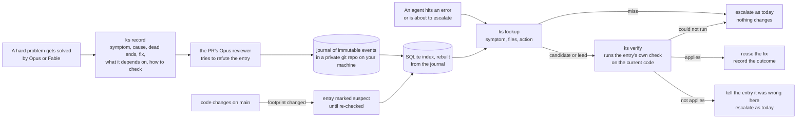

# Knowledge store for the agents working on FixFlow — research and design (2026-11)

**Status: v1 — research complete, design adjudicated, refuters and completeness critic recorded (§12).** Plan @ 3415b5e (ship plan v8). This is the deliverable of the knowledge-store track, a tooling/harness track separate from the ship program in `SHIP-PLAN-2026-11.md`; it changes nothing in that plan and must not delay P0a–P4c. Method: `docs/ORCHESTRATION-DESIGN-2026-10.md` (the main session judges and never implements; Sonnet researches; Opus proposes, judges and refutes). Provenance: four workflows, about 11M subagent tokens: the research sweep `wf_2bb8c274-f02` (57 agents), the judge panel `wf_926f16a5-8dc` (7), the refuters and critic `wf_4c53797c-5fb`. Every raw output is under `evidence/knowledge-store/` with a sha256 manifest. Section 0 is for the owner; sections 1–11 are the design; section 12 is the adjudication record.

**How to read it.** §0 in five minutes. If you want the decision only: §0, §11 and §10 KS-0. If you want to check the reasoning: §2 (what was researched and rejected), §12 (how the proposals were judged and attacked). If you are the session that implements a KS phase: §3–§7 and your phase in §10.

## 0. One page for the owner

**What this is.** A place where the agents write down a hard problem *once it is solved* (what the symptom looked like, what the cause was, what they tried that did not work, the fix, and what the fix depends on), so that the next time the same problem comes back a cheap agent can find it, prove it still applies, and reuse it instead of a Fable or Opus session re-deriving it.

**What it is not.** Not a replacement for the rules in `CLAUDE.md` (rules stay rules; the stories behind them move out, so the file gets shorter). Not the defect register (open defects stay in G2 and the plan). Not session memory (the harness review settled that). Not a Markdown wiki (every lookup runs on a real database engine).

**How it works, in one picture.**

**The five rules that keep it safe.**

1. A miss costs nothing and changes nothing. The store is pull-only: it never injects anything into an agent's context.
2. Nothing is acted on until the entry's own check reproduces the cause on the current code. "Could not run" counts as a miss.
3. An entry is invalidated by events (the files, versions or platform it depends on changed), never by age.
4. What failed and why is stored as carefully as what worked, and "do not apply this prescribed fix" is a first-class entry.
5. Everything stays on machines you control: a private git repository and a SQLite file on this box, later mirrored to your VPS over SSH. Secrets and customer data are scrubbed before anything is written.

**What it costs you.** Nothing to run: no service, no daemon, no new program on this box (Node 24 already contains the database engine). Seventeen decisions in §11, every one with a safe default, so "accept all defaults" is a complete answer; four of them are marked as genuinely yours. About ten minutes once on the VPS when it exists.

**What it costs the program.** A lookup is one command and a few hundred tokens; a phase that records a hard solve spends about fifteen minutes of the solving session and one more item in the reviewer's brief. Nothing in this track sits on the P0a–P4c path, and the ship plan is not changed by this document: the exact sentences to add to its §0 are proposed in §7 and applied only after the pilot passes.

**Where it could be wrong.** Whether hard problems recur often enough here to pay for this is unproven: the first phase is a free audit of the 48 fix commits in the repository's history, with a stop rule. The pilot that follows replays real past symptoms blind, with a grep-over-the-existing-docs arm, and has a kill criterion. Your other project's month of harness research found no measurable gain from added context machinery; this design starts from that warning.

**The decision you are being asked for now.** Whether to run the free audit (phase KS-0, one Sonnet session, no code). Everything else waits on its answer.

## 1. The problem, and the framing agreed with the owner

### 1.1 What happens today

An agent working a phase of the ship plan hits a hard defect or a build/deploy trap, solves it
(sometimes only after escalating to Opus or to the main Fable session), and the only durable
traces are prose, in four places, none of which an agent can query by symptom:

| Where | What it holds | What it lacks |
| --- | --- | --- |
| `CLAUDE.md` "Invariants you must respect", "Build & deploy traps", "Do NOT assume" (39 bullets; injected into every agent at about 7.5k tokens, design doc §3) | rules and traps written as rule-first prose, several with the root cause attached | no symptom key, no validity condition, no verification command, no record of what was tried; every new entry makes every agent's fixed overhead larger |
| `docs/HANDOFF-2026-07-28-open-work.md` §2 (operational knowledge), §4 (issue register A1..), §6 (recurring defect shapes) | the best-recorded diagnoses in the repository, some with the wrong fix named and why it is wrong (A4's "naive `useState(() => randomUUID())` is worse") | point-in-time; not keyed; a fresh agent only finds it by reading the whole file |
| `docs/program/G2-deep-dive-gate-2026-11-01.md` §2 (103 register rows) and §1.3 (refuted claims) | open defects with ids, severities and owners; eight refuted or narrowed claims (negative results) | defects, not solutions: the register says what is broken, the store would say how it was fixed and what did not work |
| `docs/program/w2/*-design.md`, `HARNESS-REVIEW-2026-11-01.md` §3 and §4 | design decisions, ruled-out alternatives, refuter verdicts | the same: prose, read whole or not at all |

The cost shows up twice. First, re-derivation: the same defect shape recurs (HANDOFF §6 lists
seven shapes that "keep recurring"), and each recurrence is paid for at the tier that solved it
the first time. Second, context: the only mechanism that guarantees an agent sees a lesson is
putting it in `CLAUDE.md`, which every agent pays for on every call whether or not the lesson
applies.

### 1.2 The owner's need (2026-11-02)

When a hard problem has been solved, record the diagnosis, the ruled-out approaches and the fix
so that a cheap agent can later query and verify the solution instead of re-solving it. Two
positions the owner stated, which this document honours:

1. **Do not invent an algorithm.** This is a decades-old problem class: memoization, caching and
   invalidation, consistency, provenance, known-error databases, case-based reasoning, log
   template mining, information retrieval. Research and repurpose.
2. **Do not simulate a database with Markdown files.** Evaluate real engines behind an
   abstraction layer, possibly several for different workloads, including options the owner has
   not named. Discovery must be broad enough not to miss something good.

### 1.3 The framing already agreed

- **Memoization with invalidation, not a cache of answers.** The key is a problem; the value is
  a diagnosis path with its validity conditions; the entry is only as good as the mechanism that
  invalidates it.
- **The expensive thing to save is the diagnosis path and the negative results.** What failed
  and why is the part a cheap agent cannot reconstruct and the part a strong agent is most
  likely to retry.
- **A miss is cheap and safe; a false positive is the dangerous failure.** Retrieval is tuned
  for precision, and every hit passes a verification gate (a discriminating check that
  reproduces the root cause on current code) before anything acts on it.
- **Invalidation is event-driven**, keyed on what the entry depends on (files, symbols,
  dependency versions, platform), not on wall-clock age.
- **Refuted hits feed back into the entry** (relevance feedback; the revise/retain half of
  case-based reasoning).
- **Symptoms are fuzzy keys.** The same root cause shows up with different error text, in a
  different file, in different words; entries need several handle types, and machine-generated
  text is canonicalised into templates.

### 1.4 What the store is not

- Not a replacement for `CLAUDE.md` invariants. A rule stays a rule and stays loaded; the store
  holds diagnoses, and §8 moves the diagnostic detail out of `CLAUDE.md` so the file gets
  shorter, not longer.
- Not the defect register. Open defects live in G2 §2 and the plan's §5; an entry is written
  when something has been solved (or when an approach has been shown not to work).
- Not session memory. Context compaction and cross-session continuity were settled by the
  harness review (HR-C1..C5: one phase per session, state in the repo, no context system).
- Not a code index. Call-graph tooling was evaluated and skipped (HR §5).

### 1.5 Workload and constraints

| Dimension | Value |
| --- | --- |
| Entries | a seed corpus in the low hundreds of candidate rows (§8), of which a few dozen are genuine solved entries today; a few new entries per phase over about 40 phases |
| Writes | a handful per phase, by the session that solved the problem; one confirmation by the reviewer |
| Reads | many per phase: a lookup at every tier escalation and at every unexplained failure; mostly misses |
| Readers and writers | several at once: parallel sessions, git worktrees, workflow subagents |
| History | every outcome event per entry (confirmed, refuted, invalidated, revised, superseded); never deleted |
| Analytics | hit, refute and miss counts; cost saved; which sources produced the entries that paid off |
| Dev box | Windows 11, Node 24, Docker Desktop, Git Bash; no Python on PATH (an interpreter exists at the Codex runtime path) |
| Production | self-hosted Linux VPS or home box (plan §4, HR-A3) |
| Data | code and defect data stay on machines the owner controls; a service that sends either to a third party is disqualified for production and cited only for its design |
| Operator | one developer with ADHD who wants less to track; nothing is installed without an owner decision |
| Access | agents reach the store through a CLI or MCP tools; the main session never implements |

## 2. Research register

Sweep `wf_2bb8c274-f02` (2026-11-02): 30 lanes, 24 web re-checks, one completeness critic; raw outputs under `evidence/knowledge-store/sweep/` with their manifest.

Citation form: `[LANE.Fnn]` is a fact id in that lane's JSON; `[LANE.c:name]` a candidate; `[LANE.i]` an implication. Confidence as the lane recorded it (verified = read on the page or file; reported = secondary; inferred). Re-check outcomes: every lane's load-bearing web facts were re-fetched; PARTIAL means the page supports most of the statement and the note says which detail it does not; the two NOT_ON_PAGE results (T-03 F07, F20 URL mismatch) and one UNREACHABLE (M-01 F14, the "97.8% junk" claim) are downgraded to reported and not load-bearing in the design.

## A. Theory lanes

**T-01 Caching, memoization, invalidation** — contributed: entries as memoised tasks with a *verifying trace* of (dependency, content-hash) pairs captured when the discriminating check last passed (Build Systems à la Carte ICFP 2018, Shake, Bazel, rustc red-green) [T-01.F01,F02,F09]; *early cutoff / backdating*: a changed dependency marks the entry suspect, the check re-runs, an unchanged result re-stamps the trace instead of discarding the entry [F02]; three documented ways memoisation breaks: untracked dependencies, non-determinism, volatility [F03]; Frankenbuild: never splice facets verified under different traces [F04]; negative caching per RFC 2308: a negative is scoped to the narrowest key, carries its authority and world-state, is bounded in life, and is a lead not a prohibition (RFC 8767) [F11,F12,F14]; tombstones so a stale writer cannot resurrect a refuted entry; write-through at fix time with compare-and-set (Facebook leases, "stale sets") [F17]; read repair by the reader restricted to mechanical outcome events (Dynamo) [F18]; serve-stale inverted: a drifted entry is shown only as a labelled lead. Rejected: TTL as validity; Make-style dirty bit (mass invalidation); deep traces; stale-while-revalidate; write-back; wall-clock last-writer-wins; Dynamo machinery. Lease (Gray & Cheriton) rests on a secondary summary.

**T-02 Provenance, lineage, event sourcing, temporal** — contributed: entry = immutable identity + append-only `entry_event` stream (recorded, confirmed, refuted, invalidated, revised, superseded, withdrawn, reaffirmed); the current view is a fold; corrections are new events (Microsoft event-sourcing pattern, PROV `wasInvalidatedBy`/`wasRevisionOf`, OpenLineage facets) [T-02.F01,F03,F07]; bitemporal split with the "valid" axis replaced by *code state*: record time = the event log; validity = a predicate over git (OSV GIT ranges, `git merge-base --is-ancestor`, `git diff --quiet <a> <b> -- paths`) [F09,F13,F15,F16]; record mainline SHAs and blob OIDs, never PR-branch SHAs (the repo squash-merges now: 135 merge commits of 369 historically, recent PRs squashed) [F20]; typed facets in a schema-versioned JSON column; per-entry optimistic concurrency + client-supplied event ids; content-hash event ids, hash chain optional (tamper evidence is a v1 non-goal). Rejected: wall-clock bitemporal engines (XTDB, Datomic: design only), CDC/materialized-view machinery, lineage catalogs, git notes.

**T-03 Information retrieval at tiny scale** — contributed: raw BM25 scores are rank-only and corpus-dependent (local FTS5 test: any unique single-term match scores exactly ln 3; a term in 4/5 rows scores 1e-6), so no absolute score threshold and no RRF as confidence [T-03.F02,F04,F05]; pipeline: canonicalise → exact-handle and facet prefilter → multi-field BM25 (FTS5 column weights) → score-free abstention features (exact-handle hit, IDF-weighted query-term coverage, rank margin) → three-valued output miss / candidate / lead → the gate [i]; BM25 is the robust baseline (BEIR; dense fails on entities/identifiers; BM25 beat embedders on LIMIT at 46 docs) [F09,F10,F11]; Rocchio repurposed document-side (confirmed query → new handle; refuted → "not when" discriminator); pseudo-relevance feedback rejected (drift); exact pairwise Jaccard for near-duplicate warnings at write time (MinHash/SimHash are web-scale); evaluation: leave-one-handle-out, hard negatives, stale probes, rule of three (3/n upper bound) [F20]; Postgres `ts_rank` has no IDF [F06]. Open: threshold values must be calibrated on the seed corpus.

**T-04 Log template mining and crash fingerprinting** — contributed: an ordered deterministic mask pipeline (Sentry's 20-pattern parameterizer; Drain's 1–2 domain regexes; Socorro's skip-lists) beats learned miners for a small corpus of rare errors (Loghub-2.0: parsers struggle on infrequent, parameter-heavy templates) [T-04.F01,F05,F10]; several signatures of different granularity each with a known failure mode (Chromium three signatures, WER ~500 heuristics measured 17.7–36.8% mis-bucketed, Crashlytics issue/variant) [F15,F16]; key stack traces on in-app module::function, never line numbers [F08,F09]; keep the scrubbed raw text beside the canonical form with a `recipe_version`, re-derive on recipe change (WER re-bucketing; Socorro's 2,044-bug signature migration) [F12,F13,F16]; bias defaults toward splitting; FixFlow's own traps show error text can mislead (`railway up --ci` timeout is benign; one alembic `CommandError` for different targets) so keys need tool + phase + command context [F25,F26]; per-tool adapters preferring structured output (pytest junit, Jest/Vitest json, Docker plain progress); recipe = code with golden fixtures. Rejected: Drain/Spell/IPLoM as primary; hosted Sentry/Crashlytics (egress); neural dedupe; hashing raw text; line numbers.

**T-05 Case-based reasoning, KEDB, postmortems** — contributed: the CBR cycle retrieve–reuse–revise–retain, retain regardless of success (Aamodt & Plaza 1994) [T-05.F1]; case = problem + solution + outcome + derivation annotations [F3]; ITIL/KEDB fields (symptom-first title, verbatim error text, affects/version scope, root cause, workaround vs permanent fix, status, retire-by-status-never-delete, extend-never-sibling) [F15]; SRE postmortem fields (what went well/poorly/lucky, detection method, owner, measurable action items) [F17]; Cook: a single root cause is a hindsight artefact → store cause + manifestation conditions [F21]; Smyth & Keane: deletion is safe only for speed-up learners with a first-principles fallback (this store has one: the top-tier session) and swamping is not the threat at this scale [F6,F7]; ReasoningBank top-1 beats top-k; Xiong et al.: agents copy near-matching records, wrong ones included [F22,F23]; no prior art invalidates by code dependency (gap this design fills) [F26]. Rejected: Etsy Morgue; competence-preserving deletion; time-only review dates; LLM judge as retain gate.

**T-06 Concurrency** — contributed: one SQLite file (WAL, `busy_timeout`, every write in `BEGIN IMMEDIATE`) gives serialised writers, non-blocking readers and atomic conditional updates; the WAL-reset corruption bug (3.7.0–3.51.2, fixed 3.51.3, 2026-03) means every runtime that opens the file must be ≥ 3.51.3 (Node 24.22.1 bundles 3.53.4) [T-06.F1,F4,F5,F6]; the file must live outside every worktree (git common dir or user dir), never on a network share, Docker bind mount or synced folder [F2,F23]; stampede control = advisory single-flight: a claim row (symptom signature, holder, `claim_seq` as fencing token, lease expiry), non-blocking, dead leader expires, waiters proceed (Kleppmann: TTL locks are leases, fencing tokens make them safe) [F13,F30]; append-only event log with client-minted ids (idempotent, set-union merge); integer version + conditional UPDATE on the few mutable header fields; wall-clock LWW rejected [F26]; Bloom filters, XFetch, singleflight, Redis/Redlock, raw OS locks, CRDT libraries unnecessary at this scale.

## B. Engine lanes (each scored against the constraints; "ops" = one-developer operational cost)

**E-01 SQLite** — strong primary: `node:sqlite` is built into Node 24 (Stability 1.2 release candidate; no flag), the dev box bundles SQLite 3.53.4 with FTS5, JSON, SESSION, R*Tree; FTS5 gives BM25 with per-column weights, snippet/highlight, external-content tables, a trigram tokenizer (≥ 3 chars) for substring matching on error text [E-01.F01,F02,F04,F05]; WAL concurrency verified: 4 writer processes, 1200 inserts, no SQLITE_BUSY with `busy_timeout` [F10]; backups by `VACUUM INTO` / backup API / `sqlite3_rsync`, never a raw copy of a live file [F11]; sqlite-vec is pre-v1 (0.1.9) with Windows builds, optional [F13]; the reference MCP sqlite server is archived (2025-05-29) and community ones are generic SQL passthroughs → a purpose-built CLI (and thin MCP wrapper) [F20,F21]; better-sqlite3 is the fallback driver (needs an npm install). Egress: none. Ops: low. Rejected: sqlite-vss, LiteFS, committing the DB to git, one DB per worktree, network/synced locations.

**E-02 DuckDB, LanceDB, Kùzu** — none is a sensible primary. DuckDB 2.0 LTS: one read-write process per file, FTS index not auto-updated unless `incremental=1`, VSS persistence experimental; its role is an optional read-only analytics attach over the primary (READ_ONLY attach confirmed for Postgres; for the SQLite scanner unverified) [E-02.F03,F04,F05]. LanceDB: million-vector design, FTS stale until `optimize()`, concurrency undocumented; cite its versioning/tags model. Kùzu: repository archived 2025-10-10 (Apple acquisition reported), npm package deprecated; forks (LadybugDB 0.22.x) pre-1.0 → rejected; lineage edges as an edge table + recursive CTE.

**E-03 Postgres (separate instance)** — viable fallback, not the default: tsvector + pg_trgm cover the retrieval need with stock contrib (no custom image); pgvector optional; ParadeDB pg_search is AGPL and TB-scale; AGE and CDC overkill; LISTEN/NOTIFY is lossy for short-lived CLI agents → invalidation must be a re-computable query [E-03.F01,F03,F08,F12]; Docker Desktop on this box has AutoStart false (the store would be unavailable until Docker is started by hand) [F21]; the project already runs postgres:16-alpine locally and in CI [F22]; the archived reference Postgres MCP had a documented read-only bypass → enforce read-only at the DB role, not the wrapper [F14]; Postgres MCP Pro (MIT, restricted mode) and pgEdge are the credible MCP options; PGlite is single-connection (design only) [F23]. Verdict: "already in the production DB family" does not justify a second always-on stateful service for hundreds of rows; keep as the swap target behind the abstraction layer if multi-host writers or server-side SQL power are ever needed.

**E-04 Search engines** — nothing here adds retrieval capability over FTS5/pg_trgm at this scale; what they add is typo tolerance and hybrid vectors; what they cost is a daemon, a key, an upgrade path and a telemetry switch. Meilisearch (MIT community, telemetry on by default via Segment/Amplitude, off with `MEILI_NO_ANALYTICS=true`/`--no-analytics`, async writes, read-only experimental MCP) is the only credible optional tier [E-04.F01,F05,F07]; Typesense GPL-3, RAM-resident, WSL-only on Windows, telemetry undocumented [F09,F10]; Quickwit Linux-only, telemetry on by default (`QW_DISABLE_TELEMETRY`); OpenSearch/Elasticsearch/Vespa need ≥ 4 GB containers and ~1.2 GB images for a corpus under 1 MB [F24]; Sonic indexes ids only; Zinc/OpenObserve/Manticore telemetry on by default. Rejected as required components; "telemetry disabled" must be a deployment invariant for any engine adopted later.

**E-05 OLAP, log engines, HTAP** — a hybrid is not justified: practitioner thresholds for a second analytical engine sit around 10^7–10^8 rows (bands vary by source; reported) against 10^3–10^4 rows here [E-05.F22,F26]; ClickHouse wants batched inserts (≥ 1,000 rows/insert, ~1/s), handles mutable status badly, has no native Windows server and ships `send_crash_reports` on by default [F03,F04,F05,F06]; chDB has no Windows wheels; Loki indexes labels only; PeerDB/ClickPipes (CDC) are cloud or multi-service; TiDB/Citus/Hydra oversized. Keep: one transactional engine with an append-only outcome table and SQL views; DuckDB read-only attach in reserve with extension autoinstall off.

**E-06 Wide-column, KV, caches** — Cassandra (owner-named) rejected on the merits: 8 GB RAM/2 cores per node minimum, query-first denormalised model, no joins, SAI "is not a replacement for text-based search", no native Windows since 4.0, a scale gap of 5–7 orders of magnitude [E-06.F07,F09,F10,F20]; ScyllaDB Linux-only, source-available since 2025.1 with telemetry "may be required" [F12]; Redis 8 (AGPLv3 option from 2025-05-01) is the only engine here with ranked fuzzy text in-engine (BM25STD, Snowball, Levenshtein ≤ 3) but is a RAM-resident daemon with no native Windows build [F01,F03]; Valkey search full-text only since 1.2 (2026-03); Memcached, Dragonfly, KeyDB, RocksDB, LevelDB rejected; LMDB viable only as a hidden exact-handle map. The reusable idea: an exact-handle index (template hash, file, symbol, dependency fingerprint → entry ids) as the first retrieval tier [F21].

**E-07 Vector stores and embeddings** — embeddings later, behind a measured trigger, not now: at ≤ 200 entries the whole one-line index is ~8k tokens; lexical shortlist + the calling agent's own LLM as re-ranker needs no model (RankGPT) [E-07.F05,F06,F29 inferred]; write-time handle expansion (doc2query by the solving agent) captures most vocabulary-mismatch benefit [F07]; evidence that dense retrieval does not beat BM25 at this scale (BEIR, Sciavolino entity queries, LIMIT) [F01,F03]; embedding drift forces a model+revision stamp per vector [F28]; if ever added: sqlite-vec or pgvector inside the same store with a pinned local int8 bge-small via transformers.js (Node, `allowRemoteModels=false`), fused by RRF [F19,F24]; telemetry switches: Qdrant `QDRANT__TELEMETRY_DISABLED`, Weaviate `DISABLE_TELEMETRY`, Chroma contradictory (config default True), Milvus opt-out undocumented [F10,F11]. Rejected: any vector server as the store; hosted embedding APIs; Ollama as the embedding runtime. The numeric trigger (≈ 5% "missed, entry existed" over 50 lookups or > ~1,000 entries) is inferred, an owner parameter.

**E-08 Graph and Datalog** — not needed: all four lineage queries (entries citing changed files; sharing a root cause; what X superseded; failed approaches for similar symptoms) are a join or one recursive CTE; measured in SQLite on a dense 300-node/3000-edge worst case: 0.07 ms (join) to 95 ms, sub-millisecond on realistic graphs; a depth column in the UNION key was 20× slower [E-08.f19,f16]; model root cause as a row (FK), not pairwise edges [f26]; Neo4j (`dbms.usage_report.enabled` default true, GPLv3 non-production wording), Memgraph (telemetry default on, BSL), FalkorDB (SSPL), SurrealDB (BSL), Dgraph, CozoDB (no release since 2023), Soufflé (a compiler), PG19 SQL/PGQ (committed 2026-03, reverted 2026-09) all rejected [f1,f4,f6,f9,f18]; write Cypher/Datalog forms in the design as documentation of intent only.

**E-09 Versioning, ledgers, git-native** — the index-is-a-cache pattern: immutable event files in git as truth (Fossil ticket artifacts; git-bug op-DAG; Beads classic) with a rebuildable local index [E-09.F02,F05,F13]; Beads abandoned mutable JSONL + SQLite + daemon for Dolt (merge driver, timing bugs) — the main warning [F03]; one small immutable file per event named by content hash merges as pure adds (merge=union is a fallback with random order) [F07]; refs are shared across worktrees, branch files are not [F08]; Dolt is the credible upgrade path for native tabular branch/merge (git-remote sync under `refs/dolt/data`; ~103 MB binary; CLI telemetry on by default per X-01) [F10,F11]; a SQLite file committed to git is rejected as truth (binary, no 3-way merge, WAL pairing) [F17]; immudb (BSL), XTDB, Datomic, TerminusDB, lakeFS rejected or design-only.

**E-10 Agent access and egress audit** — a thin project CLI called through Bash is the one path every subagent and workflow agent has with no configuration or approval prompt; a skill (description ≤ 1,536 chars always listed, body on demand) carries the lookup/verify/record procedure; a `.mcp.json` server is optional (approval prompt interactively; subagents inherit MCP tools; tool search defers schemas) [E-10.F16,F17]; output bounds: Bash 30k chars read-back, MCP warns at 10k tokens and caps at 25k [F18]; the reference sqlite/postgres/redis MCP servers are archived with "no security guarantees" [F2]; telemetry on by default with documented off switches: Meilisearch, Qdrant, Weaviate, Neo4j, Memgraph, ClickHouse crash reports; DuckDB auto-downloads extensions (`autoinstall_known_extensions=false`); SQLite and Postgres have no telemetry [F21,F22,F29,F30]; whatever a tool returns enters model context and reaches the model provider (engine-level egress control does not cover that path) [F31 inferred, confirmed by X-06].

**E-11 Multi-model and document engines** — none is a third option beside SQLite and Postgres: SurrealDB (BSL, embedded, BM25, built-in stdio MCP with owner-level access, docs inconsistent on storage-engine maturity, fuzzy matching unconfirmed) is the only candidate for a bounded spike if the owner wants one [E-11.F06–F10]; ArangoDB 3.12 dropped native Windows and tightened its Community licence; MongoDB search needs a Linux-only `mongot` process under SSPL; RavenDB Community keeps ≤ 2 revisions for 45 days (breaks append-only history) [F11]; CouchDB search is an experimental JVM service; Gel's company shut down; OrientDB sunset; KurrentDB/NATS/Xata design-only.

## C. Agent-memory and software-engineering prior attempts

**M-01 Agent memory systems** — borrow Graphiti's two clocks re-anchored (valid-from/valid-to as code state + created/expired) and retire-don't-delete; a non-lossy raw episode layer with derived facts pointing back; Letta Code's git-backed memory files with one worktree per writer; ReasoningBank's first-class failed experiences [M-01.F01,F18,F24]. Avoid: LLM extraction at write time (junk, duplicates, hallucinated memories, per-write cost, poisoning route); LLM-judged contradiction as the invalidation trigger (Graphiti, Mem0) [F02,F12,F13]; Mem0's ADD-only side-by-side beliefs (a stale-hit generator); time-decay (MemoryBank); automatic rewriting of old entries (A-MEM). Benchmarks (LoCoMo, LongMemEval) measure chat recall and are disputed [F25]. Egress: every self-hosted path defaults to OpenAI; Mem0 and Graphiti ship PostHog telemetry [F06,F15]. Memory-poisoning attacks (MINJA, MemoryGraft) are documented → entries are untrusted until the gate passes [F26 reported].

**M-02 Coding-agent memory features and experience-reuse research** — the harness already provides: CLAUDE.md (always loaded; adherence falls past ~200 lines; this repo's is 390), auto-memory (MEMORY.md index first 200 lines/25 KB, per-repo, machine-local, not given to subagents), skills, hooks (incl. `PostToolUseFailure` as a possible automatic lookup trigger) [M-02.01,02,04]; no harness feature offers symptom-keyed lookup, canonical templates, dependency invalidation, a gate, outcome history or safe parallel writes. GitHub Copilot Memory is the closest production precedent (code-citation facts re-verified just-in-time against the current branch; vendor-reported merge-rate gain; hosted) [12]. Research: ReasoningBank gains from distilled failure lessons (46.5→49.7) where AWM loses with raw failures (44.4→42.2) [26]; Xiong et al. "experience-following" (agents copy similar records, wrong ones too) [28]; ACE: itemised bullets with helpful/harmful counters merged by non-LLM code; LLM whole-document rewrites collapse context [29]; Ghosh et al.: similarity scores and LLM judges rank harmful memories no better than chance → the gate must be external and executable [30]; Dynamic Cheatsheet: smaller consumer models can fall below baseline with memory [24]; Gloaguen et al.: repository context files raise cost > 20% without general success gains [32]. Verdicts: small itemised records; k=1 (≤ 2) shown; negative results as distilled, condition-scoped lessons with a failure-cause class; counters + append-only outcome log; never always-loaded.

**M-03 Program repair, fix-pattern mining, crash-to-fix** — Getafix validates the top candidate by re-running the tool that raised the signal (84% removed the warning; acceptance 42%) → the gate must reproduce the root cause, not just show the symptom gone [M-03.F01,F02]; SapFix: patches that passed all tests were rejected by reviewers ("null guard for an expression that cannot be null") → test-pass alone is a weak gate [F07]; WER assert tags and Getafix context-bound holes: key on stable semantic anchors, demote path and line [F12]; key-derivation changes orphan links (Socorro bug 1178094 rewrote 2,044 signature fields; WER kept raw dumps six months to re-bucket) → raw evidence + versioned derived keys, append not replace [F13,F16,F18]; Linux `Fixes:` tag and Sentry resolved-in-release as applies-while predicates [F24]; ast-grep as a local structural probe; retrieval precision is modest even at Meta → candidate generator with abstention, never auto-apply. No study measures fix decay after refactors.

**C-01 The owner's clinic-project research (local files)** — every memory/context product evaluated there was rejected or reduced to design ideas (MemTree/Claude Code Infinite: hosted egress, CLI-only; claude-mem: per-observation LLM compression; Virtual Context, YesMem (WSL-only), LCM, cairn, context-mode/RTK/squeez (Bash-only hooks on a PowerShell box), Continuous-Claude, headroom, Graphify) [C-01.c:*]. The finding "maintained notes recalled facts as well as an elaborate adapter" does not exist in that wording; the nearest evidence is the WF-02 trial (baseline vs treatment with a context projection: identical deterministic acceptance, null token figures) and the harness review's "a month of research established no gain" [F18,F19,F21]. Red-team defects that a store with a gate is exposed to: RT-01 (green without testing), RT-02 (bare assert), RT-03 (accepted beside a failed check), RT-04 (working-tree bytes vs committed), RT-05 (uncleaned environment), RT-06 (unknown recorded as 0), RT-07/09 (Windows paths) [F24–F33]. Design warnings carried: one state owner per kind of state; projections drift; private memory is not team authority; whole-file hashes over-invalidate; keyword heading matching misfired; time-based expiry rejected; no project-wide mutable pointer; writer identity explicit (subagent hooks fire with the main session id). HR §4 skip rulings the store must not re-adopt: task/context/evidence trees, Python checkpoint hashing, pre-commit hook gates, the context system, the M00–M06 measurement pipeline, Graphify.

## D. Repository lanes (seed corpus and worked examples)

**R-01a** (CLAUDE.md three sections, HANDOFF §2/§4/§5.5/§6, lifecycle follow-ups): 121 rows — CLAUDE.md 4 traps, 16 invariants, 9 solved entries, 1 open; HANDOFF 13 traps, 4 invariants, 10 solved, 36 open defects, 14 other; follow-ups 11 open, 1 trap, 2 other. Contradictions found: HANDOFF A2 prescribes letting a correct PIN clear the lock, which CLAUDE.md forbids; 0045 is "a free slot" in the follow-ups and "merged" in HANDOFF; C1/C2 "do not ship" vs recorded merge; HANDOFF §4.4 lists as open what CLAUDE.md says is fixed. Very few items record tried-and-abandoned fixes (the strong ones: `railway up --ci` re-run, alembic revision targeting on rollback, naive `useState` for the payment id, login-lock PIN verification, dead-letter placement). No trap has a verification command.

**R-01b** (G2 §2 register, §1.3 refuted claims, HR §3/§4, W2 notes' ruled-out statements): 149 rows — G2 74 open defects (≈ 140 ids), 1 solved (a design-doc correction), 7 negative results; HR 6 open, 4 invariants, 3 traps; W2 notes 52 ruled-out alternatives/verifications. No register row records a landed code fix; the W2 file:line citations are tied to expo-location 18.0.10 / expo-task-manager 12.0.6 and invalidate on an SDK upgrade; O-10 and O-04 predate the HR amendments.

**R-02** (eight worked examples from git history; the first eight entries): ex1 non-ASCII `compare_digest` 500 → `compare_secret` (9b98c88, PR #168; existing test; 5 ruled-out notes); ex2 reverted migration 0045 / rollback crash-loop (c79bec7, ea48987, ADR-0001; a predicted hazard that was guarded, plus one proven-by-execution rule); ex3 web payment idempotency key per attempt — STILL OPEN on main (A4; the naive fix is worse; proposed Vitest check); ex4 dispatcher unseeded cursor drains history (c731e66/da988e2, PR #170; 0046 seed + age guard; integration test exists); ex5 completion form blank against a real bill (37821f5 incomplete, 8dafcec guard + `wizardState`; Jest tests exist); ex6 login lock must keep blocking a correct PIN — a **do-not-apply** entry whose prescribed register fix was deliberately refuted (PR #169; the handoff still prescribes the wrong fix); ex7 `eas.json` empty-string env fails every build (79a8dd4; proposed static check verified to discriminate on historical blobs); ex8 Sentry Expo plugin breaks Gradle, hit twice in 16 days (a6f9048, 6928828; proposed static check). Not reconstructible: the `railway up` from repo root incident (a rule without a case record). Token/wall-clock cost per fix is recorded nowhere; model tier only via `Co-Authored-By` trailers.

## E. Round-2 lanes (the critic's missed angles)

**X-01 One data set across hosts and worktrees** — the two round-1 designs are compatible, not rivals: the SQLite file is the same in both; the question is the source of truth. Recommended ranked topologies: (2) a single SQLite file on the dev box outside all worktrees with one-way backup to the VPS (`VACUUM INTO` / node `backup()` / `sqlite3_rsync`, tested under 4 writers: integrity ok, restore then write ok) is cheapest on day one and is stage 0 of (1); (1) immutable per-event files in a *dedicated store repo outside the code repo*, synced by git over SSH to a bare repo on the VPS (never GitHub), with a per-host rebuildable index, wins once two hosts write [X-01.F10,F20]. Tested: distinct event files merge cleanly under squash and normal merges; a shared append file conflicts; events committed only on an abandoned branch vanish from main [F20,F22]. sqlite3_rsync one-way; Litestream beta; libSQL no Windows binary; rqlite is a Raft cluster; cr-sqlite per-column LWW loses edits; Dolt viable but heavy with default-on CLI telemetry (`metrics.disabled`) [F17]; Tailscale's control plane is third-party (Headscale/SSH instead). Version gate: every runtime that opens the index ≥ SQLite 3.51.3.

**X-02 Running stored checks safely** — the gate runner is the only code path that executes stored checks; the verdict comes from a runner-owned artifact (junit XML, json reporter), never the child's exit code (`git bisect run` treats 1–127 as bad incl. 127 command-not-found; Python/Node crashes exit 1; pytest exits 5 on no tests collected) [X-02.F01,F12]; tri-state applies / not_applies / inconclusive, with "could not run" never equal to not_applies; allow-listed check kinds (test_id at a pinned sha, structural_probe via ripgrep/ast-grep/Semgrep with metrics off, scripted only with approval bound to the spec's sha256 by a verifier who is never the author); a control pair (fails_at / passes_at) so a vacuous pass is impossible; isolation = Docker (WSL2 backend on the dev box, same image on the VPS) with `--network none` or an `--internal` network, read-only detached worktree, tmpfs scratch, allow-list env, redirected HOME, resource caps, fail closed; a throwaway `postgres:16-alpine` per run because `backend/tests/conftest.py` TRUNCATEs every table on whatever URL it is given and `Settings` defaults to localhost:5432 [F13,F14]; Claude Code's own sandbox does nothing on native Windows; Windows Sandbox has no headless I/O [F03]; flaky policy: rerun only on disagreement, unanimity for applies. Dependency preparation is a separate trusted step keyed by lockfile hash.

**X-03 Capturing the dependency footprint automatically** — no single tool; three captures each see a different footprint: (1) Claude Code PreToolUse/PostToolUse hook logs (file_path, command text, agent_id) or a post-hoc parse of the session transcript → the *cognitive* candidate set (over-captures, misses Bash reads) [X-03.F08,F10]; (2) coverage of the discriminating check (`NODE_V8_COVERAGE`, Jest `--coverage`, coverage.py dynamic contexts) → the *causal* set, hashed at function level (Python `ast`, TypeScript compiler API) so unrelated edits in a big file do not invalidate [F12,F17]; (3) a fixed environment probe (node/npm/python/eas/expo versions, lockfile/Dockerfile/eas.json hashes, config key paths) [c]; plus capture of tool-reported resolution for remote-resolver traps (the EAS image name in the build log; Railpack's provider lines) [F20,F29]; footprint items carry a provenance tier; over-capture costs a re-verification, under-capture risks a false positive, so prune only on evidence. fsatrace (no Windows binary, 46% overhead), Rattle/tup/Bazel, Procmon/ETW rejected; strace-in-Docker optional Linux calibration; Node `--permission` as a completeness self-check. The backend has no coverage tool and root Vitest no coverage package → two small dev-dependency additions are an owner decision.

**X-04 CI failure classifiers and KCS** — elastic-recheck (one versioned query file per tracked bug, authoring rule: > 10% hits on successful runs means too broad; optional second discriminator `test_ids`; retirement on upstream fix status with `--dry-run`; backend needed ~6 TB per 7 days) [X-04.F01,F02,F03,F05,F07]; Jenkins BFA minimal schema; logreduce's canonicalisation recipe; Develocity's fail-then-pass retry oracle (hosted, design only); KCS v6 lifecycle WIP → Not Validated → Validated → Archived, template Issue/Environment/Resolution/Cause/Metadata, many-to-many typed links in machine-usable form, "reuse is review", "flag it or fix it", reuse accuracy (> 90%) over reuse rate [F17–F21]. Transfers: a negative-corpus precision check at write time; a required discriminating check beyond the handle; a separate link table entry-version ↔ incident typed resolved/referenced/refuted; review at hit time, never a scheduled sweep. Does not transfer: ER's infrastructure and "no hits in 10 days" expiry; KCS's staffed-organisation machinery.

**X-05 Recurrence base rate and a pilot** — no source measures recurrence of hard defects for one developer in a young repo, nor escalation cost avoided; population studies (17–45% recurring fix patterns, reported; 75% of flaky tests in clusters) are pattern-level; ReasoningBank cut SWE-bench steps 4–9% (steps, not cost) [X-05.F09]; the AGENTS.md study (> 20% cost, no general gain) matches the owner's no-gain record → the store must be pull-only and beat grep over existing prose [F12,F21]; locally 369 commits, 48 fix-prefixed, almost no explicit repeats [F20]. Pilot: Step 0 a free git-history recurrence audit (one Sonnet session over 48 fix commits); Step 1 blind replay with raw original symptoms, ≥ 40 negative/stale probes, a grep arm, rule of three (0 FP in 40 bounds at 7.5%; 60 → 5%) [F17,F24]; Step 2 a prospective lookup log (raw tokens, model id, tier, wall time; NULL for unknown; prices applied at analysis) with a checkpoint at 20 encounters or 8 weeks and a kill criterion. Thresholds are proposals for the owner.

**X-06 Scrubbing and provider egress** — local-only scrubbing is feasible in Node: exact-value redaction of the live secrets in env/.env; secretlint as a library (MIT, DB-connection-string and basic-auth rules, Windows exe); custom regexes for `postgresql+asyncpg://`, Bearer/Authorization, Railway/Supabase/R2 tokens, JWTs; libphonenumber-js `findPhoneNumbersInText(text,'PK')` + CNIC regex; gitleaks binary (MIT, stdin, best measured recall 86–88% at 46% precision) as a fail-closed second pass [X-06.c:*]; trufflehog rejected (AGPL, live verification and update check on by default), detect-secrets stale and Python; Presidio design-only (no PK entities, no Urdu). Names and addresses cannot be detected locally → structural rule: never store raw production-data output; store templates with typed placeholders. Provider egress is unavoidable: Claude Code sends prompts and tool output to Anthropic; retention 30 days to 5 years by account type; ZDR Enterprise-only; the owner must rule the scope [F01,F02,F04,F07]. Scrub at write time and again on every return.

The main session's rulings on the contradictions between lanes (KS-R1..R10) are recorded in §12.1.

## 3. Data model

The model is proposal A's (§12.2) with D's storage topology and the judges' grafts. Prior art is cited per field; the full DDL sketch is in `evidence/knowledge-store/panel/architect-A.md` and is normative only where this section repeats it.

### 3.1 Two layers: the journal and the index

| Layer | What it is | Where it lives | Who may touch it |
| --- | --- | --- | --- |
| **Journal** (truth) | append-only, immutable event records: one canonical-JSON file per event (keys sorted, integers only, UTF-8, LF), named by the sha256 of its bytes, fanned out as `events/<aa>/<sha256>.json`; `.gitattributes` is `* -text` because `core.autocrlf=true` is set system-wide on the dev box | a private git repository at the store home (default `%LOCALAPPDATA%\fixflow-ks\store`; never under OneDrive, WPS Cloud, a UNC path, a Docker bind mount, WSL `/mnt/c`, or inside any work tree), committed in batches at phase close under a local commit lease, pushed over SSH to a bare repository the owner controls (the VPS from P3b; a remote allow-list in code refuses `github.com` and anything unlisted) | only the CLI writes it; the owner never edits, renames, rebases, squashes or prunes it (the never-do list, §9) |
| **Index** (projection) | one SQLite file per host and per schema version (`index/ks-i<N>.sqlite`): entries, handles, FTS5 tables, footprints, traces, lookups, gate runs, outcomes, claims, analytics views; a `meta` row records the journal digest it was built from | the store home's `index/` directory, beside the journal, never inside it | rebuilt from the journal by `ks rebuild`; a broken or outdated index is deleted, never migrated (graft from D) |

Every write goes journal-first: the CLI scrubs, canonicalises, builds the event, writes `events/<aa>/<id>.json.tmp-<pid>` and renames it, then ingests it into the index in one `BEGIN IMMEDIATE` transaction. Every CLI call first checks freshness (`readdir` of the journal against the indexed ids; measured at about 6 ms for 5,000 files by proposal D, re-measured by the refuters, §12.4) and ingests any file the index lacks, so no daemon, watcher or git hook exists. Index writes use WAL, `busy_timeout`, `synchronous=FULL`, foreign keys on, and refuse any runtime whose `sqlite_version()` is below 3.51.3 (the WAL-reset fix; T-06 F4).

### 3.2 The entry

An entry is an immutable identity (`entry_id`, human-readable: `ks-<slug>-<6 hex>`) plus a stream of events; its current state is a fold over the stream (T-02). Content lives in immutable **entry versions**; corrections are new versions, never edits.

| Field group | Fields | Why / prior art |
| --- | --- | --- |
| Identity | `entry_id`, `kind` ∈ {defect, trap, do_not_apply, open_defect, rule_without_case}, `root_cause_id` (FK to a `root_cause` row so "shares a root cause" is a join, E-08) | KEDB record ids (T-05 F15); do-not-apply entries are first class (R-02 ex6, KS-R9) |
| Symptom | `title` (symptom-first, in the words a searcher would use), `symptom_meaning` + `misleading` flag (some error text means the opposite of what it says: `railway up --ci`'s benign timeout, T-04 F25) | KEDB symptom-first title; Sentry rates message-only grouping least reliable |
| Diagnosis | `cause`, `manifestation_conditions`, `diagnosis_path` (ordered steps: observation, discriminating test, escalation point, dead end) | Cook: a single root cause is a hindsight artefact (T-05 F21); CBR derivation annotations (T-05 F3) |
| Fix | `fix`, `fix_kind` ∈ {permanent, workaround, do_not_apply, none}; **the fix text is withheld by code until an `applies` gate run bound to the current lookup exists** | KEDB workaround vs permanent fix; experience-following (M-02 28): agents copy near matches |
| Negative results | child rows: `approach`, `why_failed` (one or two sentences, distilled), `failure_class` ∈ {wrong_premise, incomplete, worse_side_effect, vacuous_check, not_reproducible, tool_limit, wrong_severity}, `scope` (the conditions and footprint it was observed under), `proof` ∈ {executed, argued, reported} (graft from C), `evidence_ref`; an optional **executable refuting check** (graft from B: ex3's naive `useState` becomes a Vitest assertion, not prose) | RFC 2308/8767 negatives are scoped leads, never prohibitions (T-01); ReasoningBank gains from distilled failure lessons where raw ones hurt (M-02 26) |
| Validity | `applies_while` (a predicate over code state: `fix_ancestor` sha checked with `git merge-base --is-ancestor`, with a `git patch-id` fallback for fixes cherry-picked onto `release/drain` (graft from C); dependency ranges; platforms), `facets` (runtime, tool, phase, platform, slice) | OSV GIT ranges; Linux `Fixes:`; Sentry resolved-in-release (T-02 F13, M-03 F24) |
| Links | `refs` (mainline commit shas and blob OIDs only, never PR-branch shas: a6f9048, 9b98c88, 8dafcec, c731e66, f3dfa6f are branch-only in this repository after squash merges; PR numbers; doc anchors with the doc's blob OID; register ids) | the store links to the plan, PR bodies, git and the register and never restates them (KS-R7, T-02 F20) |
| Status (folded) | provisional → verified (or unverified_seed, candidate-only) → suspect / conflict → refuted (scoped) / superseded / withdrawn; counters shown, applies, absent, inconclusive, resolved, not_resolved; `refuted_footprints` | KCS WIP → Not Validated → Validated → Archived (X-04 F17); retire by status, never delete (T-05) |
| Cost | raw token counts, model id, tier, wall time of the original solve; NULL means unknown, never 0 | X-05; RT-06 |
| Provenance (on every event) | `actor_session`, `actor_agent`, `actor_model`, `actor_tier`, `host`, `based_on_version`, `footprint_digest`, `scrub_ruleset_sha`, `recipe_version` | explicit writer identity, because subagent hooks fire with the main session id (C-01 F45); PROV vocabulary for naming only |

### 3.3 Handles (the fuzzy keys)

Eight handle kinds, each with a stated failure mode (Chromium's three signatures; WER's expanding and condensing heuristics; T-04 F15, F16). Every derived handle carries its `recipe_version` and the scrubbed raw text it came from, so a recipe change re-derives keys instead of orphaning them (Socorro bug 1178094, M-03 F16).

| Kind | Built from | Matched | Fails by |
| --- | --- | --- | --- |
| `tmpl` canonical template | the ordered mask pipeline over the first error line(s); sha256 `value_key` | exact; trigram for fragments ≥ 3 chars | brittle on reworded messages (splits: safe) |
| `sig` tool | phase | error code / exception class | per-tool adapters reading structured output (pytest junit, Jest/Vitest json, alembic, eas/gradle earliest failing phase) | exact | over-merges (one alembic `CommandError` for several states): never enough for a lead alone |
| `frames` top-3 in-app module::function | repo-relative frames, no line numbers, framework frames on a changelogged skip-list, recursion collapsed | exact on the triple and the top frame | renames; minified Hermes frames carry no signal |
| `ctx` command and context | normalised argv, cwd relative to the repo root, phase (`railway up --ci @ repo-root`) | exact | the same command fails for many causes; the cwd is what tells the deploy-from-root trap apart |
| `prose` paraphrases | written by the solving agent at record time in several wordings, including silent symptoms with no error text (write-time doc2query, E-07 F07) | FTS5 BM25 with IDF-weighted coverage | zero vocabulary overlap is a miss (safe); near matches invite copying, so prose alone yields a candidate at most |
| `ident` files, symbols, config keys, env names, error codes | the fix diff and the check inputs | exact table plus an FTS5 table tokenised on `_.-/:#` | busy files (`AppContext.jsx`) have low IDF |
| `doc_ref` pointer to a prose prescription | doc path + anchor + the doc's blob OID (`docs/HANDOFF-2026-07-28-open-work.md#A2`) | exact; this is how an agent about to apply a prescribed fix hits the do-not-apply entry | prose renumbering relabels it "pointer moved" |
| `action` verb-object intent (graft from D) | written by the solving agent: "enable dispatcher", "restore reverted migration", "let correct PIN clear lock", "add env key to eas.json" | exact verb-object tokens against `--action`, plus FTS | the agent phrases its plan differently (a miss); the only handle for silent defects and predicted hazards with no error text (ex3, ex4, ex6) |
| `not_when` discriminator | written by the author or proposed from a refuted lookup (inactive until confirmed, KS-R3) | matched like `tmpl`/`prose`; a match caps the entry at candidate and shows the discriminator | an over-broad `not_when` suppresses true hits (a miss: safe) |

### 3.4 Checks and controls (the gate's data)

Every entry that can be a lead carries at least one **check spec** (data, never a script): `kind` ∈ {json_predicate, regex_in_span, ordered_in_span, duplicate_values, path_state, dep_version} (declarative probes interpreted by the runner over git blobs; nothing stored is executed) or {pytest, jest, vitest} test ids run in Docker, or {db_probe} (a throwaway Postgres migrated to head, read-only SQL), or {scripted} (only with owner enablement and an approver who is not the author); `polarity` (a text probe may return `applies` only when it asserts the **presence** of the root-cause condition; an absence-of-guard probe returns at most `inconclusive(weak_check_only)`, judge 2's ruling); `present_when` (for test checks: the named test must fail in the call phase with a message matching the root-cause template, not merely fail); `requires` (docker, postgres, node_modules:…); `spec_sha` and, for executable kinds, `approved_by` ≠ author bound to that sha. Each runnable check carries a **control pair**: `fails_at` (a mainline commit, optional overlay or stored mutant; expects PRESENT) and `passes_at` (expects ABSENT). A check whose controls do not flip is refused at write time (proposal C's two naive probes that inverted are kept as golden negative fixtures). At every reaffirm the fail-side mutant is re-applied to current HEAD (**inject-control**, graft from B), so a passing check is never vacuous today.

### 3.5 Footprint and trace (what the entry depends on)

A **footprint** is a set of typed items, each with a provenance tier, never a flat file list (X-03): `file_blob` (repo-relative POSIX path → git blob OID, LF-normalised), `symbol_span` (path::symbol → sha256 of the anchored span, whole-file blob as fallback), `config_key` (path#json-pointer → sha256 of the canonical JSON value, e.g. `technician-app/eas.json#/build/*/env`), `dep_version` (a lockfile entry; the backend has no lockfile, so a `pip freeze` inside the gate image), `env` (node, python, Docker image digest, OS), `tool_resolution` (what a remote resolver reported: the EAS image name, Railpack's provider line; flagged `remote_resolver`), `doc_anchor`. Tiers: `fix_diff` (`git diff --name-only fails_at passes_at` on mainline), `check_input` (every path the check reads or overlays), `env_probed`, `tool_reported`, `read` (from a post-hoc parse of the solving session's transcript; no hooks), `executed` (coverage; deferred, owner decision D5). The **trace** is the digest of the footprint items at the moment the control pair last flipped (a verifying trace, T-01 F01); over-capture only costs a re-verification, under-capture risks a false positive, so items are pruned only on evidence.

### 3.6 Events, lookups, claims

Event kinds: `recorded`, `revised`, `confirmed`, `refuted` (scoped to a footprint digest), `invalidated`, `reaffirmed`, `controls_broken`, `anchored` (re-pointing controls at the squash commit after merge), `check_approved`, `proposed_handle`, `proposed_not_when`, `proposal_approved`, `proposal_rejected`, `superseded`, `withdrawn`, `rescrubbed`, `lookup`, `gate_run`, `outcome` (resolved, not_resolved, referenced, abandoned, gate_absent), `claim`, `attempt` (a failed approach recorded against an open claim before any entry exists, so a crashed or compacted session keeps its negatives; graft from B), `concurrent_miss`, `correction_noted` (a contradiction with a prose source, feeding a docs PR). Every event has a client-minted content-hash id (idempotent on replay), a per-entry Lamport counter and `based_on_version`; two curated revisions on the same base fold to `conflict`, which waits for Opus. The fold rejects curated events whose actor is not an Opus tier or equals the author (graft from C), so a bypassed CLI check still cannot change lookups.

A **lookup** row keeps the canonical query, the handles it produced, the internal top-20 with their features, what was shown, which thresholds fired, the gate verdict and the later outcome, plus raw tokens, model id, tier and wall time (NULL for unknown). A **claim** row (signature = the strongest key in the query; holder; `claim_seq`; opened and released events) is the advisory single-flight of KS-R5.

### 3.7 Lineage queries

All answered inside the index: entries citing changed files = a join from the changed-path set to `footprint_item`; entries sharing a root cause = an equality join on `root_cause_id`; what an entry superseded = one recursive CTE over `entry_link` (UNION over id only; a depth column in the key was 20× slower, E-08 f19); failed approaches for similar symptoms = retrieval at internal depth joined to negative results. The Cypher or Datalog forms are documentation of intent only.

## 4. Retrieval

### 4.1 Pipeline

1. **Canonicalise** the query: decode, CRLF to LF, strip ANSI and progress redraws; **scrub** (§5.4) before anything else touches the text; normalise absolute Windows, Linux and worktree paths to repo-relative POSIX; run the per-tool adapter when the tool is known or detectable (pytest junit: test id, phase, failure type, the full message rather than the truncated summary line; Jest/Vitest json; alembic; eas/gradle earliest failing phase; docker `--progress=plain`; railway); mask timestamps, UUIDs, hex runs, ids, IPs, free numbers; keep error codes, exception classes, tool names, basenames and env names. The recipe is code with golden fixtures (one per tool, starting from the repository's own real traps); a recipe change re-derives every handle.
2. **Prefilter**, deterministic and explainable: exact-handle lookup on `tmpl`, `sig`, `frames`, `ctx`, `doc_ref`, `action` and (for `--files`/`--touching` paths or identifiers in the query) `ident`; facet filter (runtime, tool, phase, platform); status filter (superseded and withdrawn dropped, superseded redirects to its successor; refuted-at-this-footprint suppressed; unverified_seed, provisional, suspect and conflict capped at candidate); existence filter (an entry none of whose footprint paths exist in the caller's tree is demoted). **Probe-in-lookup** (graft from B): for the top candidates whose checks are declarative, the lookup runs them in-process and drops those whose root cause is absent; that run is the recorded gate run, so a cheap agent gets a gated lead in one call.
3. **Rank** with three FTS5 tables and column weights (prose: title 4, symptom paraphrases 3, cause 1.5, diagnosis 0.5; identifiers tokenised on `_.-/:#` without stemming; trigram over scrubbed raw text). The order is lexicographic: strong exact-handle hits, then IDF-weighted coverage, then the best BM25 rank. A BM25 value only orders results within one query; it is never a threshold or a confidence (T-03 F02, F05: on a tiny corpus the score is set by N and df). No RRF (rank-only, cannot abstain), no pseudo-relevance feedback (drift), no LLM re-ranking inside the store.
4. **Abstain** on score-free features: (a) a strong exact-handle hit (which kinds); (b) **coverage** = the summed IDF of the query terms the entry matches over the summed IDF of all query terms, with document frequencies from `fts5vocab` and **out-of-corpus terms kept in the denominator at maximum IDF** (proposal C measured that in-corpus-only coverage gives a false 1.0 tie for "android build broke" between ex7 and ex8); (c) **margin** = coverage of the top result minus the second; (d) `not_when` matches and status caps. **Lead** requires all of: a strong exact hit, coverage ≥ θ_lead, margin ≥ μ, a validated status, not refuted at this footprint. **Candidate** requires coverage ≥ θ_cand or any exact handle or a lead-shaped hit on a non-validated entry. Everything else is a **miss**. Internal depth 20; shown: at most one lead and one candidate (KS-R4), each a card of ≤ 2,000 characters (title, kind, status, matched handles, validity summary for this tree, the exact verify command, outcome counts); do-not-apply entries whose `action` or `ident` handles match are shown as a separate warning line even with no error text.
5. **Gate** (§5.2): nothing is acted on until `ks verify <id> --lookup <lid>` returns `applies` on the caller's target (HEAD, a mainline sha, or the working tree through a `git stash create` snapshot, which makes a commit object without touching the shared stash list); `inconclusive` behaves as a miss and escalates; `not_applies` records `gate_absent` and a proposed `not_when`. Only `applies` lets `ks show` print the fix.

### 4.2 Thresholds (owner parameters, KS-R10)

Starting values θ_lead 0.5, θ_cand 0.3, μ 0.2 (coverage units), trigram fragment ≥ 12 characters. Calibrated in KS-2 by leave-one-handle-out over the seed and frozen before the pilot: pick the largest θ_lead that gives zero wrong leads on the hard-negative pairs (ex7 vs ex8; the alembic `CommandError` family; ex1 Python vs Node), then report recall, preferring misses. Stored as owner-approved `config.set` events so every host uses the same values; recalibrated after any index-engine or recipe change.

### 4.3 Feedback (document-side; the revise/retain half of CBR)

- `applies` then `resolved` → `confirmed` (counter +1, ACE-style) and, when the canonical query adds a new key, a `proposed_handle`.
- `not_applies` on a shown hit → `gate_absent` plus a `proposed_not_when` built from the query handles the entry lacks.
- `applies` then `not_resolved` → `refuted`, scoped to the target's footprint digest (KS-R2); the entry is suppressed at that footprint and queued for an Opus revision that adds the negative result; counted in `v_gate_wrong` separately from gate refusals (X-05).
- controls fail to flip at reaffirm → `controls_broken`; suspect until revised.
- A proposal becomes active only on approval by an Opus actor other than the proposer, or on a second independent confirmation from another session against another lookup (KS-R3).
- Outcome reporting is mechanical where possible: after applying a fix, the agent re-runs the original failing command or gate and records `resolved`/`not_resolved` from the runner's result, not from its own judgement (judge 2).

### 4.4 Embeddings

None in v1. BM25 is the robust baseline at this scale and dense retrieval fails on exactly the entity-like tokens defect text is made of (BEIR; Sciavolino; LIMIT at 46 documents; T-03 F09–F11, E-07 F01, F03); write-time paraphrase and `action` handles capture most of the vocabulary-mismatch benefit. If the owner's trigger fires (D16), vectors become a derived column in the index only (sqlite-vec in the same file, a pinned local int8 bge-small through transformers.js with `allowRemoteModels=false`, model and revision stamped per vector), fused by RRF for ranking only, never for abstention; no vector server, no hosted embedder, no Ollama.

### 4.5 Measurement

Inside the store, as SQL views over the lookup and outcome tables (KS-R6, R7): `v_retrieval` (decision mix, applies-on-lead rate), `v_false_leads` (gate-passed-but-wrong separately from gate-refuted), `v_rule_of_three` (the 3/n bound, valid only when the count is zero), `v_missed_existing` (a miss later resolved to an existing entry: the embedding trigger), `v_concurrent_misses` (the lease trigger), `v_store_unavailable` (exit-3 share: the Docker-realism metric, graft from B), `v_stale`, `v_cost` (raw tokens by tier with a dated price table applied only at analysis). Offline, `ks eval` runs leave-one-handle-out, hard negatives, stale probes (a fixed tree overlaid onto a pre-fix tree), out-of-corpus queries that must abstain, and a **grep arm over CLAUDE.md and docs/ with CLAUDE.md treated as already loaded** (the real incumbent, judge 1), on the same queries.

### 4.6 The three measurements the owner asked for

| Measurement | Where it comes from |
| --- | --- |
| confirmed hits | `outcome.resolved` after `gate_run.applies` on a shown lead |
| refuted hits | `gate_run.not_applies` on a shown hit (`gate_absent`), and `outcome.not_resolved` after `applies` (`gate_wrong`), counted separately |
| misses that later matched an existing entry | `v_missed_existing`: a `lookup.miss` whose later `outcome` names an entry that existed at lookup time |

## 5. Invalidation and provenance

### 5.1 Triggers (events, never time)

(1) a footprint item's digest at the target differs from the trace (file blob, symbol span, config key path); (2) a dependency version in a lockfile or the gate image changes; (3) a platform or env probe value changes; (4) `recipe_version` changes (handles re-derived); (5) `runner_version` changes (controls re-demonstrated); (6) the scrub rule-set changes (entries re-scrubbed); (7) a `refuted` or `controls_broken` event; (8) a superseding entry; (9) a `doc_ref`'s source blob changes ("pointer moved"); (10) a recorded mainline anchor becomes unreachable (`is-ancestor` fails; patch-id fallback). No TTL, no review dates, no scheduled sweep (T-01, X-04, C-01).

### 5.2 Mechanism: lazy, with early cutoff

- **At lookup and verify**, the CLI recomputes the candidate entries' trace items against the caller's target with argv-only git (`git rev-parse <rev>:<path>`, `git hash-object` over working-tree bytes so uncommitted edits count, RT-04; the span hash; the JSON-pointer hash; the lockfile entry). A clean trace keeps the status; a changed item marks the entry **suspect for this caller only**, capped at candidate with the changed items named, and **no event is written** for a per-caller answer (graft from D). `verify` then re-demonstrates the controls (with inject-control) before running the check on the target. **Early cutoff**: if both control outcomes are unchanged, a `reaffirmed` event re-stamps the trace and the entry stays useful (T-01 F02); if the controls no longer flip, `controls_broken`.
- **At phase close**, `ks scan --at origin/main` reads blobs with `git cat-file` (no checkout) and appends `invalidated` events for entries whose mainline footprint changed, and re-runs every validated declarative probe at `origin/main`, reporting **"possible regression"** when a fixed trap's probe flips back to PRESENT (graft from D; it would have flagged ex8's June recurrence at 60c026d before the burned build, subject to the refuters' check of KS-C12). The closing message states two counts: events not yet pushed; entries newly suspect.
- An unchanged footprint is necessary, never sufficient: the gate always runs before anything acts (T-01 F03; T-02 F14).

### 5.3 Who repairs

Cheap agents append only mechanical events (lookup, verify, outcome, claim, attempt, proposals, scan, reaffirm). Revisions (a new check, a corrected cause, a new negative result, a re-anchor after a refactor) come from an Opus actor and need a different Opus approver (KS-R3); Fable judges conflicts; the owner never repairs entries. Writer identity is self-declared (`--by session/agent/model/tier`) and the approver-is-not-author rule is therefore policy plus PR review, not a control (the judges' shared finding; §9).

### 5.4 Scrubbing (write time and return time)

Runs in the CLI's own process with no install: exact-value redaction of the live secrets found in the session environment and the caller's `.env` files (values used to redact, never stored); regexes for `postgresql(+asyncpg)://user:pass@`, `Authorization`/`Bearer`, JWTs, GitHub, Railway, Supabase, R2 and Cloudflare token shapes, `X-Ops-Proxy-Token` values, secret-like `key=value` pairs; PII rules for Pakistani mobile numbers (`+92` / `03xx`), CNIC (5-7-1 digits), emails, user-profile paths; typed deterministic placeholders; a must-survive fixture group so error codes and identifiers are not over-redacted; fail closed on write, reporting the finding type never the value. Names and addresses are not detectable locally: a structural rule forbids storing raw production-data output (X-06). gitleaks as a fail-closed second pass is an owner decision (D5).

### 5.5 What cannot be detected

Remote-resolver changes (the EAS cloud image and schema, Railway/Railpack defaults, the Meta API): footprints record the `tool_resolution` seen and flag `remote_resolver`, but a silent server-side change has no local trace. Behaviour changes behind unchanged version strings or floating tags. Untracked dependencies (Docker Desktop settings, phone OEM behaviour, the owner's shell). Semantic changes outside the footprint (a new caller passing different input to an unchanged function). Production data state (`job_event` kinds, the dispatcher cursor row), which is not in git. Races, whose footprint is identical between a good and a bad run.

### 5.6 Provenance

Every event carries explicit actor identity, host, the version it was based on, the footprint digest it was observed against and its evidence (mainline commit shas and blob OIDs; gate artifacts by sha256 with a bounded scrubbed excerpt, the full artifact host-local). Content-hash event ids give idempotency and per-event integrity now; a `prev_hash` chain is deferred (KS-R8): the threat is accidental mutation, which insert-only enforcement in the index and immutable files in the journal already cover. As-of questions ("what did the store believe at phase P3c?") are answered by folding the event set of a journal commit into a scratch index.

## 6. Engine comparison and recommendation

### 6.1 The comparison

Scored against this track's constraints, not a generic workload. Scale: **S** strong fit, **V** viable, **W** weak, **R** rejected, **D** design only (cited for ideas; disqualified or unneeded as a component). "Egress" is what the engine itself sends by default; "ops" is the one-developer operational cost on a Windows dev box plus a Linux VPS. Sources are the engine lanes (E-01..E-11, X-01) and the re-checks.

| Engine or family | Fit | Egress by default | Ops | Why (one line) |
| --- | --- | --- | --- | --- |
| **SQLite 3.53.4 via `node:sqlite` (FTS5 porter/unicode61 + trigram, JSON, WAL)** | **S** | none | none | Already inside Node 24 on the dev box; BM25 with column weights, trigram substrings, `fts5vocab` document frequencies; WAL multi-process writes verified (4 processes, 12,000 rows, integrity ok); release-candidate API is the one risk (E-01, T-06, X-01) |
| better-sqlite3 | V | none | low (npm) | Reserve driver if the `node:sqlite` API drifts; adds nothing else (E-01) |
| sqlite-vec | V (later) | none | low | Pre-v1; only behind the embedding trigger, inside the same file, with a local model (E-07) |
| Postgres (separate instance, tsvector + pg_trgm) | V (swap target) | none | medium | Everything needed is in contrib; but a second always-on stateful service, Docker-dependent on a box where Docker does not auto-start, for hundreds of rows; `ts_rank` has no IDF (E-03, T-03) |
| pgvector / pg_search (ParadeDB) / Apache AGE | W / R / R | none | medium–high | pgvector needs a local model; pg_search is AGPL and TB-scale; AGE is a custom image for a graph that is three joins (E-03) |
| DuckDB 2.0 | V (reserve) | none at runtime; extension auto-download | low | One writer process per file; read-only attach over the primary for analytics if plain SQL ever gets slow; autoinstall must be off (E-02, E-05) |
| LanceDB | W | unverified | low | Million-vector design; FTS stale until `optimize()`; cite its versioning model (E-02) |
| Kùzu and forks | R | — | high | Repository archived 2025-10-10; forks pre-1.0 (E-02, E-08) |
| Meilisearch (community) | V (trigger only) | telemetry on (Segment/Amplitude), off with `MEILI_NO_ANALYTICS=true` | medium | The only credible optional search tier: typo tolerance; async writes; read-only experimental MCP; earns a place only if logged misses show typo mismatch (E-04) |
| Typesense | W | undocumented | medium | GPL-3, RAM-resident, WSL-only on Windows (E-04) |
| Tantivy / Quickwit | R | Quickwit telemetry on (`QW_DISABLE_TELEMETRY`) | high | Needs a Rust toolchain / Linux-only log-scale system (E-04) |
| OpenSearch / Elasticsearch / Vespa | R | mixed | high | 4 GB containers and 1.2 GB images for a corpus under 1 MB (E-04) |
| Sonic / Zinc / OpenObserve / Manticore | R | on by default (Zinc, OpenObserve, Manticore) | medium | Ids-only, or unasserted licence, or an observability platform (E-04) |
| ClickHouse / chDB / clickhouse-local | R | crash reports on (`send_crash_reports`) | high | Batched-insert OLAP for 10^8+ rows; mutable status is a poor fit; no native Windows server (E-05) |
| Loki / VictoriaLogs / PeerDB / TiDB / Citus columnar | R | Loki reporting on | high | Label-only index, or log-scale, or multi-service CDC, or cluster minimums (E-05) |
| Cassandra / ScyllaDB (owner-named) | R | none / "may be required" | high | 8 GB RAM floor, query-first model, no joins, SAI is not text search, no native Windows since 4.0; a 5–7 orders-of-magnitude scale gap (E-06) |
| Redis 8 (Query Engine) / Valkey search | W / W | none found | medium | The only daemon with ranked fuzzy text in-engine, but a RAM-resident service with no native Windows build; AGPLv3 (E-06) |
| Memcached / Dragonfly / KeyDB / RocksDB / LevelDB / LMDB | R (LMDB V as a hidden map) | none | low–medium | No persistence, or no query language, or maintenance mode (E-06) |
| Qdrant / Chroma / Weaviate / Milvus | R | telemetry on (documented switches; Chroma contradictory; Milvus undocumented) | medium–high | Vector servers for orders of magnitude more data; dense retrieval unproven at this scale (E-07) |
| Neo4j / Memgraph / FalkorDB / SurrealDB / Dgraph / CozoDB / Soufflé | R | Neo4j usage report on, Memgraph telemetry on | medium–high | All four lineage queries are a join or one recursive CTE, measured at 0.07–95 ms in SQLite; PG19 SQL/PGQ was reverted (E-08) |
| Dolt | V (upgrade path) | CLI metrics on (`metrics.disabled`) | high | Native tabular branch/merge and a git remote under `refs/dolt/data`; ~103 MB binary and usually a server; Beads moved to it after its JSONL design failed (E-09, X-01) |
| immudb / XTDB / Datomic / TerminusDB / lakeFS / Fossil / git-bug / git notes | D / R | — | — | Design precedents (bitemporal, verifiable, op-DAG, ticket artifacts); each adds a server, a JVM, a second SCM or is commit-keyed (E-09, T-02) |
| libSQL/sqld, rqlite, cr-sqlite, Litestream, sqlite3_rsync | R / W / R / W / V (backup) | none (Litestream heartbeat opt-in) | low–high | No Windows binary; a Raft cluster; per-column last-write-wins; beta daemon; one-way copy (X-01) |
| ArangoDB / MongoDB+mongot / RavenDB / CouchDB / Gel / TypeDB / OrientDB / Xata / KurrentDB / NATS KV | R (SurrealDB W, a spike at most) | mostly none | medium–high | No third option beside SQLite and Postgres: licence, Linux-only components, free-tier limits on history, experimental search (E-11) |
| Agent-memory products (Letta, Mem0, Zep/Graphiti, LangMem, Cognee, claude-mem, MemTree) | D | default OpenAI and PostHog telemetry; hosted variants send content | high | LLM-extracted conversational memory; cited for the bitemporal edge model and failure modes only (M-01, M-02, C-01) |

### 6.2 The recommendation

**One query engine, one durable form, one CLI.**

- **Query engine: SQLite through `node:sqlite`**, one file per host, WAL, `busy_timeout`, every write in `BEGIN IMMEDIATE`, held outside every worktree and every sync folder, opened only by runtimes with SQLite ≥ 3.51.3 (the WAL-reset fix). FTS5 supplies BM25 with column weights over prose handles, a trigram table over scrubbed raw text, and `fts5vocab` document frequencies for the coverage feature. Analytics are SQL views in the same file; lineage queries are joins and one recursive CTE; claims are one table. No second engine until a logged trigger fires (KS-R6).
- **Durable, mergeable form: an append-only journal of immutable event records**, one canonical-JSON file per event named by its content hash, in a private store repository outside the code repository and its worktrees, synced by git over SSH to a bare repository the owner controls (the VPS from P3b), never pushed to GitHub by default. Pure-add merges need no merge driver (tested under squash and normal merges). The SQLite file is a rebuildable index of the journal with a "built from event set X" watermark (KS-R1).
- **Access: a zero-dependency Node CLI in the code repository** (`tools/ks/`), called through Bash, which every subagent and workflow agent has with no configuration; a skill carries the lookup → verify → record procedure; an MCP wrapper over the same read verbs is optional and later. Output is capped (one lead card and one candidate card, 2,000 characters; sections of 6,000) and scrubbed on return.
- **Reserve, behind the abstraction layer**: better-sqlite3 as a driver swap; Postgres tsvector + pg_trgm as an index swap if multi-host writers or server-side SQL are ever needed; DuckDB read-only over a snapshot for analytics; sqlite-vec plus a pinned local embedder behind the measured trigger; Meilisearch only if typo-mismatch misses are logged; Dolt only if native tabular merge is ever needed.

### 6.3 The abstraction layer

Two ports and four modules, so that the engine can change without touching the workflow or the entries:

| Port / module | Operations | What leaks |
| --- | --- | --- |
| `Journal` | `append(event) → id` (idempotent), `list() → {ids, digest}`, `read(id)`, `sync(remotes)`, `fsck()` | nothing: content-addressed files are the contract |
| `Index` | `ingest(events)`, `rebuild(journal)`, `watermark()`, `lookup(query, context, files, action) → candidates with features`, `entry(id)`, `history(id)`, `view(name)`, `claim(signature, holder)` | FTS5 tokenisation and the hard-coded BM25 constants shape the coverage features, so an index swap recalibrates the thresholds; WAL's same-host rule shapes the topology (one index per host) |
| `Canonicaliser` | `canonicalise(raw, tool_hint) → {template, handles, recipe_version}` | a recipe bump re-derives every handle from the scrubbed raw copy (never edits keys in place) |
| `Scrubber` | `scrub(text, mode: write or return) → {text, findings, rules_sha}`; fails closed on write | names and addresses are not detectable; the structural rule (no raw production data) stands in |
| `CodeState` | `digest(item, target)`, `isAncestor(sha)`, `export(target, dir)` | git-native by design (blob OIDs, `merge-base --is-ancestor`) |
| `Gate` | `run(check_spec, target) → {verdict, artifact_sha, excerpt, trace}` | Docker is the only isolation on the dev box; "Docker down" is `inconclusive` |

Swap stories: a driver swap (better-sqlite3) touches only `Index`'s open path; an engine swap (Postgres) re-implements `Index`, runs `rebuild` from the journal, and recalibrates thresholds, with no data migration and no dual-write window because only the journal persists; a journal swap (Dolt, or an event table) is a one-way re-import of content-addressed events with ids preserved.

### 6.4 Why not a bounded engine trial

No two candidates are close on the facts that matter. The one fact the decision rested on (does the box already have an engine with FTS5, with no install, that handles several writer processes) was verified in the main session and by three lanes on 2026-11-02 (E-01 F02/F10, T-03 F05, X-01 F10). The remaining open engine questions (does `node:sqlite` load the sqlite-vec extension; what is Meilisearch's idle RSS) only matter after a trigger that the lookup log must fire first, so they are answered inside those later phases, not by a trial now. A bounded local trial *is* needed for retrieval quality (leave-one-handle-out and hard negatives over the seed corpus); that is phase KS-2's done-when, runs on the engine already present, and installs nothing.

## 7. Workflow: who writes, who reads, how it plugs into the ship plan

### 7.1 The agent-facing surface (five verbs to know, six for Opus, the rest admin)

| Verb | Who | What |
| --- | --- | --- |
| `ks lookup --text @err.txt [--tool pytest|jest|vitest|alembic|eas|gradle|railway|docker] [--phase build] [--files a,b] [--action "…"] [--prescription "…" --doc path#anchor] --by <session>/<role>/<model>` | any tier | prints `KS miss|candidate|lead <lookup-id>` on the first line (machine-parsable), then at most two cards; exit 0 when the store answered, **3 when the store is unavailable, which callers treat as a miss** |
| `ks verify <entry> --lookup <id> [--target worktree|HEAD|<sha>]` | any tier | runs the entry's checks on the target through the gate runner; prints `applies|not_applies|inconclusive` per check with the reason; appends the outcome events |
| `ks show <entry> [--section summary|diagnosis|negatives|gate|validity|links]` | any tier | ≤ 6,000 characters per section; the fix only after an `applies` run bound to this lookup; dead ends shown under an UNVERIFIED banner even on a candidate |
| `ks outcome <lookup-id> resolved|not_resolved|abandoned --note "…"` | any tier | mechanical; from the re-run of the original failing command where one exists |
| `ks claim --lookup <id>` / `ks attempt --claim <seq> --approach "…" --why "…" --class …` / `ks release` | any tier | advisory single-flight; failed approaches saved against the claim before any entry exists |
| `ks record @draft.json --by <session>/author/<opus model>` · `ks capture <entry> --fix <mainline sha>` · `ks control <entry>` · `ks approve <entry> --spec-sha …` / `ks reject` · `ks revise` / `ks supersede` / `ks withdraw` · `ks accept-handle` | Opus only; approver ≠ author | the curated path; a recorded entry lands `provisional` and stays inert as a lead until confirmed |
| `ks status` · `ks stats --view …` · `ks history <entry>` · `ks scan --at origin/main` · `ks sync` · `ks rebuild` · `ks fsck` · `ks doctor` · `ks eval` · `ks rescrub --audit` | session or owner | admin; `doctor` refuses a store home under OneDrive, WPS Cloud, a UNC path, WSL `/mnt/c`, a bind mount or a work tree, and any SQLite below 3.51.3 |

A project skill (`.claude/skills/knowledge-store/SKILL.md`, description ≤ 1,536 characters so its standing cost is small; body loads on demand) carries the lookup → verify → outcome procedure and the rule never to read the store's files directly. There is no hook: the store is pull-only and injects nothing (X-05 F12; M-02 32). An MCP wrapper over the read verbs is optional and later (D15).

### 7.2 Who reads: step zero

- **Before escalating** a defect, a failing gate or a build/deploy error to a higher model tier (Haiku or Sonnet → Opus; Fable → an Opus deep-dive), or re-dispatching a failed agent, the escalating session runs `ks lookup` with the raw error text and the paths involved. On a lead it dispatches a cheap agent to `ks verify` and, on `applies`, to apply the fix and record the outcome. On a miss it runs `ks claim` and escalates, putting the lookup id in the brief so the Opus session sees any dead ends as leads.
- **Before retrying** a failed build or deploy (the `railway up --ci` double-deploy trap is the model case).
- **Before applying a fix that a prose register prescribes** (HANDOFF, G2 §2): `ks lookup --prescription "<its wording>" --doc <path#anchor>`; a do-not-apply entry that verifies stops the change until the phase's Opus reviewer rules (ex6).
- **Once per code phase, at its first commit**: `ks lookup --files <the Scope paths> --action "<the phase Goal>"`, which surfaces do-not-apply and trap warnings that have no error text; any warning is copied into the draft PR's decisions journal.
- A cheap agent that hits an unexpected error in a gate looks it up before retrying.

### 7.3 Who writes: write-through at solving time

A session that resolves a defect, a failing gate or a build/deploy trap **that needed a tier escalation, two or more failed approaches, or a burned build or deploy**, or that establishes a do-not-apply fact, records it with `ks record` **before the PR is marked ready**, while the diagnosis path is still in its context, taking the ruled-out approaches from the phase's "Decisions / ruled out" journal in the PR body (the store links to that journal; it does not restate it). Then `ks capture` (the footprint) and `ks control` (the pair). Routine fixes are not recorded; open defects without a diagnosis stay owned by G2 and the plan. Recording is **never part of a phase's Done-when**: a skipped case can be seeded later from the PR's journal. After the squash merge, `ks anchor --pr <n>` re-points the controls at the mainline squash commit.

The solving agent fills a fixed schema; nothing is extracted from a transcript by an LLM after the fact (M-01: LLM extraction at write time is the documented source of junk, duplicates and poisoning). The write gate runs the scrubber, the near-duplicate check (exact pairwise Jaccard on token shingles; a near duplicate extends the existing entry's handles instead of creating a sibling, T-05 F15), the **negative-corpus precision check** (a handle or probe that fires on known-good HEAD or on unrelated historic failures is refused or tightened; elastic-recheck's rule, X-04 F02), mainline-sha normalisation (a PR-branch sha is refused with the squash commit suggested), and the control pair.

### 7.4 Who confirms

The PR's Opus reviewer, which the plan's §0 Routing already requires on every PR, refutes the entry beside the diff (does the check fail at `fails_at` *because of the stated root cause*, not just because of the symptom?), re-runs the controls and runs `ks approve --spec-sha` or `ks reject`, naming the entry and the PR head SHA in its verdict. The approver is never the author session. Handles and discriminators proposed by cheap agents need an Opus accept or a second independent confirmation. Fable judges disputes and conflict states and never implements. The owner confirms only do-not-apply entries that encode an owner decision, by the link to that decision; there is no per-phase owner work.

### 7.5 Stampede control

Two sessions missing on the same symptom: the first `ks claim` wins `claim_seq` n inside one `BEGIN IMMEDIATE` transaction; the second sees "being solved by <session/agent/tier> since <time>, claim_seq n, attempts so far: …", a `concurrent_miss` is logged, and it may wait, proceed on a different hypothesis, or pick other work; nothing blocks (an expensive agent waiting is the real cost, T-06). The solver's `ks record` carries its `claim_seq` as a fencing token: a record with a superseded sequence is stored as corroborating, not authoritative. No renewal or expiry policy until `v_concurrent_misses` shows the problem exists (KS-R5).

### 7.6 The phase routine: proposed text for SHIP-PLAN §0 (not applied by this PR; D9)

To be added as one bullet after the **Resume** bullet, only after the pilot (KS-5) says go:

> - **Knowledge store (advisory; tooling track, `docs/program/KNOWLEDGE-STORE-DESIGN-2026-11.md`).** Before a session escalates a defect, a failing gate or a build or deploy error to a higher model tier, retries a failed build or deploy, or applies a fix that a prose register prescribes, it runs `ks lookup` with the raw error text and the paths involved; it acts on a hit only after `ks verify` returns `applies` on the current tree, passes a `candidate` into the brief as an unverified prior, and otherwise proceeds unchanged. At a code phase's first commit the session runs `ks lookup --files <the Scope paths> --action "<the phase Goal>"` once and copies any do-not-apply or trap warning into the draft PR's decisions journal. A session that resolves a defect or trap which needed an escalation, a second attempt or a burned build records it with `ks record` before the PR is marked ready, taking its ruled-out approaches from this phase's "Decisions / ruled out" journal; the PR's Opus reviewer approves or rejects that entry in the same review (never the author); cheap agents append only lookup, verify and outcome events. At phase close the session runs `ks scan --at origin/main` and `ks sync`, and the closing message's evidence line states the entry ids written or reused, the lookups made, any escalation made without a lookup, and the two counts the commands print (events unpushed; entries newly suspect). If `ks` is missing or returns exit 3, the phase proceeds without it and the closing message says so: the store never blocks or delays a ship phase.

And one sentence in the **Routing** bullet after the reviewer sentences: "For each knowledge-store entry the PR records, the reviewer names its control-pair result at the PR head SHA."

The six-question closing message gains no new file: the "what evidence ran" line carries the lookup and entry counts. `OWNER-VIEW.md` gains one line at the pilot checkpoint, not before.

### 7.7 Cost per phase (inferred; owner parameters, KS-R10)

A phase that hits nothing hard: about 0.6k tokens (the first-commit lookup) plus about 0.4k and under 15 s at phase close (scan and sync). A step-zero lookup with a native verify: about 1–1.5k tokens and under 5 s; a Docker verify adds 1–5 minutes of wall time. A phase that records: about 5–10k Opus author tokens (facets from context already loaded, capture, control) and 2–4k Opus reviewer tokens, about 10–20 minutes. The owner does nothing per phase.

### 7.8 Compliance is measured, not assumed

Because the store is pull-only, "the store is useless" and "the store was never consulted" look the same from the outside (judge 3). The closing message's evidence line therefore reports escalations made without a lookup, and the prospective checkpoint (KS-9) reads that count beside the hit rate before judging the store.

## 8. Migration: the seed corpus from the existing prose sources

**What exists** (lanes R-01a, R-01b, R-02; counts are rows as extracted, not entries):

| Source | Rows | Solved (a diagnosis with a landed fix) | Traps (a gotcha with a procedure) | Negative results (refuted claims, ruled-out alternatives) | Invariants (rules) | Open defects (register material, not store material) |
| --- | --- | --- | --- | --- | --- | --- |
| `CLAUDE.md` (Build & deploy traps, Do NOT assume, Invariants) | 30 | 9 | 4 | — | 16 | 1 |
| `docs/HANDOFF-2026-07-28-open-work.md` §2, §4, §5.5, §6 | 77 | 10 | 13 | 14 | 4 | 36 |
| `docs/lifecycle-audit-followups-2026-07.md` | 14 | — | 1 | 2 | — | 11 |
| `docs/program/G2-deep-dive-gate-2026-11-01.md` §2 and §1.3 | 83 | 1 | — | 7 | 1 | 74 (≈ 140 ids) |
| `docs/program/HARNESS-REVIEW-2026-11-01.md` §3, §4 lessons | 14 | — | 3 | 1 | 4 | 6 |
| `docs/program/w2/*-design.md` (ruled-out statements and named verifications only) | 52 | — | — | 52 | — | — |

So the seed is about **20 solved entries, 21 traps and some 75 negative results**, of which the eight worked examples (R-02) are already reconstructed with commits, symptoms, ruled-out approaches and a verification command each. The roughly 128 open defects stay where they are: the register and the plan own them, and an entry is written only when one is solved or an approach to it has been shown not to work.

**Rules for seeding** (KS-R9; grafts from C and D).

1. **The eight worked examples first, each through the write gate** (KS-4): about fifteen entries after splitting ex1 into its Python and Node siblings (one `root_cause` row: "secret comparison not total over attacker-controlled str") and ex2 into its three traps (duplicate revision; rollback crash-loop; VALIDATE bundled with NOT VALID). ex6 is the model do-not-apply entry. An entry whose only honest check needs Docker is stored `unverified_seed` until KS-6: searchable, shown as a candidate with that label, never a lead.
2. **After the eight, seeding is lazy.** An entry from CLAUDE.md, HANDOFF, G2 §1.3 or a W2 note is recorded when a lookup misses and the solving session finds the answer in that prose, with a probe where one exists; never in bulk. The one exception is the CLAUDE.md trap set (four lines), recorded in KS-4 because their probes already exist (ex7, ex8) or are one line (`railway up` from the root is a `rule_without_case` with a `ctx` handle and no gate).
3. **Negative results get their validity condition or they get nothing.** A refuted claim from G2 §1.3 or a ruled-out alternative from a W2 note enters only with the footprint it was observed on (the W2 citations are tied to expo-location 18.0.10 and expo-task-manager 12.0.6 and invalidate on an SDK upgrade, R-01b); negatives are leads scoped to that footprint (KS-R2).
4. **Contradictions become corrections, not entries.** HANDOFF A2 prescribes what CLAUDE.md forbids; migration 0045 is "a free slot" in one file and "merged" in another; C1/C2 "do not ship" beside their recorded merge; HANDOFF §4.4 lists as open what CLAUDE.md says is fixed. KS-4 resolves each against git and opens one docs PR with the corrections, each linking its entry id (D12). That PR ships even if the track stops.
5. **A rule without a case stays a rule.** The `railway up` from the repo root incident has no commit, date or symptom text anywhere (R-02); it is recorded as `rule_without_case` and gains a case only if it recurs.

**How `CLAUDE.md` gets shorter, not longer** (KS-7, after the pilot, D11). Every invariant keeps its rule sentence ("Compare shared secrets with `compare_secret`, never `hmac.compare_digest` on a `str`") and gains `(ks <id>)` at the end of the line. The diagnostic paragraphs that follow the rule today (the three sites that had the hole, how the TypeError arises, what the lock's decay means) move into the entry's root-cause and negative-result facets, **only once that entry is verified**. The four Build & deploy traps become one line each. The "Do NOT assume" section is unchanged: it is orientation, not diagnosis. Net effect: fewer lines and a smaller fixed overhead for every agent; and because the trim happens only after the pilot shows that lookups happen (§7.8), moving a narrative out cannot take knowledge away from sessions that never look up (judge 1's blind spot). `MEMORY.md` gains one pointer line naming the CLI, per the harness review's "memory as a pointer" ruling, and nothing else.

**Order of work** (inside KS-4, then lazily): the eight examples; the four CLAUDE.md traps; then on demand. Each KS-4 batch ends with the leave-one-handle-out replay over what has been seeded so far (§4.5), so retrieval thresholds are calibrated as the corpus grows rather than guessed at the end.

## 9. Honest limits

**Where the store cannot help.**

- **Root causes outside the repository.** EAS cloud builds, Railpack's provider detection on Railway, the Supabase pooler, OEM behaviour on phones. No local check reproduces them; such entries carry a `remote_resolver` flag, their gate is "inspect what the tool reports about itself now and compare with the recorded value" (X-03), and they are candidates, never leads. Their symptoms reach an agent only when the owner pastes the build or deploy log into the session; `ks lookup --text @file` accepts the paste, and fetching those logs automatically is out of scope (judge 1).
- **Races and data-state causes.** The outbox mutual-exclusion defect, a reverted migration's production audit, the dispatcher cursor row. A race's footprint is identical between a good and a bad run, so no dependency event fires; production data is not in git. Such entries are found by symptom and verified only by a test that encodes the race or by an operator query outside the store (X-03; T-01 F03).
- **Untracked dependencies.** A footprint is only as complete as what was captured; an unchanged footprint is necessary, never sufficient, and the gate always runs before anything acts (T-01 F03; T-02 F14).
- **The gate proves presence, not causation.** A check that finds the root-cause condition present in the tree does not prove it caused the caller's symptom: a latent co-present cause (an empty env value in `eas.json` during a build that actually failed on the Sentry plugin) passes the gate, gets "fixed", and the problem persists. The mechanical outcome from re-running the original failing command, and `v_gate_wrong`, are the second half of the defence; they catch it after the fact, not before (all three judges).
- **Checks that cannot run on the dev box.** A native Android compile is gated nowhere; Docker Desktop does not auto-start, so test-id and database checks are usually `inconclusive`, and the realistic v1 value is the config-trap class (judges 1 and 3). "Could not run" is `inconclusive`, which behaves as a miss (X-02).
- **Symptoms that mislead.** `railway up --ci` always ends in a benign timeout; alembic raises one `CommandError` for several targets (T-04 F25, F26). A symptom match is a candidate; the gate decides.
- **Lexical retrieval only.** A symptom phrased with no word in common with any handle is a miss. Silent failures (ex3, ex5) are found only if the solver wrote paraphrase and `action` handles.
- **Absence-of-guard checks never make a lead** (the polarity rule). Entries whose only honest check is "the guard is missing" stay candidates until they get an executable check; refuter KS-C14 names which of the eight that affects.
- **The Docker test-id gate largely duplicates CI** for ex1, ex4, ex5 and ex6, whose regressions the repository's own suite already catches; the store's distinct value is in traps CI cannot see (ex7, ex8, ex2) and in diagnosis paths and negative results (judge 2).

**What it costs per phase** (estimates; inferred figures are owner parameters, KS-R10). See §7.7: about 1k tokens in a phase with no hard problem; 10–15k in a phase that records; the owner does nothing per phase.

**What it costs the owner to keep** (judge 3: no proposal budgeted upkeep).

- One ritual: after any Node upgrade, run `node --test tools/ks`; the CLI pins a Node major in `package.json` `engines` and refuses to open the index below SQLite 3.51.3. `node:sqlite` is a release candidate (Stability 1.2); if its API drifts, the reserve driver is an npm install (D5).
- One never-do list (from proposal D): never push the store to GitHub; never edit, rename or delete journal files; never rebase, squash, force-push or prune the store; never add a merge driver; never put the store or index on OneDrive, a share, a bind mount or inside a repository; never copy or commit an index; never open the index with an older SQLite. `ks doctor` enforces the path and version rules; the rest is the list.
- A teardown checklist exists (KS-T), so a kill verdict leaves nothing lingering except the read-only journal.

**What the clinic research warns about** (C-01; HR §4).

- A month of harness research in the owner's other project established no measurable gain from added context machinery; its synthetic trials showed identical acceptance with and without a context projection, with null token figures (C-01 F18, F19, F21). This track therefore starts with a free recurrence audit, has a pilot with a kill criterion and a stop point before any Docker, sync or wiring, and is pull-only (X-05 F12).
- Verification that goes green without testing anything (RT-01), bare `assert` (RT-02), an accepted row beside a failed check (RT-03), hashes of working-tree bytes used as proof (RT-04), an uncleaned environment (RT-05), unknown recorded as 0 (RT-06), absolute Windows paths (RT-07/09). Each is addressed by name: runner-owned artifacts and control pairs (RT-01/02/03), `git hash-object` over working-tree bytes only to detect change, never to prove validity (RT-04), allow-list env and redirected HOME in the gate (RT-05), NULL for unknown in every cost field (RT-06), repo-relative POSIX paths in every handle and footprint (RT-07/09).
- One state owner per kind of state; projections drift; private memory is not team authority; time-based expiry rejected; keyword heading matching rejected; no project-wide mutable pointer; explicit writer identity (C-01 F39, F41, F43, F44, F45). The store re-adopts none of the skipped machinery (HR §4): no docs/tasks tree, no Python checkpoint hashing, no pre-commit gate hook, no context system, no measurement pipeline, no Graphify.

**What the evidence does not establish.**

- That hard problems recur often enough here to pay for the store: 48 fix-prefixed commits with almost no explicit repeats (X-05 F20). KS-0 answers it before any engine work; refuter KS-C10 weighs the audit's basis.
- That a Haiku- or Sonnet-class agent benefits from a gated hit: smaller models can fall below baseline with memory, and agents comply with wrong memories (M-02 24, 28, 30). Hits are advisory and carry the gate; the pilot measures with and without.
- Retrieval thresholds: no literature gives them; they are calibrated on the seed corpus (T-03), and thresholds calibrated on about fifteen entries overfit; the checkpoint recalibrates.
- Cost saved: no source quantifies escalation cost avoided; the store logs raw tokens, tier and wall time, NULL for unknown, prices at analysis (X-05 F13, F19).
- Whether the pilot's recall transfers: blind queries are written for entries the corpus already holds; only the prospective checkpoint measures new encounters (judge 2).
- Writer identity: actor ids are self-declared, so "approver is not author" is policy plus PR review, not a control; binding ids to transcript evidence is a later option.
- Egress to the model provider is unavoidable: everything an agent reads reaches Anthropic under the owner's account terms (X-06); the owner's ruling D7 scopes the rule to "no other third party; no live credential or customer PII in store content".

## 10. Implementation sequence (one session per phase; the ship plan's format; nothing on the P0a–P4c path)

Rules that apply to every KS phase: a KS phase never gates a ship phase; it runs in its own session alongside any ship phase except that **KS-6 (the Docker gate) takes the one Docker-gate slot** and runs only when no backend ship phase holds it; every code phase opens a draft PR at its first commit with its Scope as a checklist, `Plan @ <sha>` of this document as the first line, and the decisions journal; every PR gets an Opus reviewer refuting by default; the store's own tests run with `node --test tools/ks` in a separate path-filtered GitHub Actions workflow on Node 24 (ci.yml and its Node 22 stay untouched; KS-C15); the code lives in `tools/ks/` with synthetic fixtures only (real samples stay in the store home). **KS-5 is the stop point**: KS-6 to KS-9 run only if its verdict is go.

### KS-0 — Recurrence audit (one Sonnet session; no code; no install)

**Goal.** Establish whether hard defects and traps recur in this repository often enough to justify an engine at all (X-05 Step 0).
**Entry.** The owner has read §0 and ruled on D1 (run the audit) and D2 (the stop rule). Independent of every ship phase.
**Scope.** Read-only on git. For each fix-prefixed commit on `main` (48 of 369 at the last count) and each revert, record: root-cause class, tool and runtime, whether it repeats an earlier commit's cause or trap (exact repeat, sibling cause, no), the model tier from `Co-Authored-By` trailers, and `unknown` where history is silent (RT-06). An Opus refuter re-checks ten sampled rows and every claimed repeat.
**Deliverables.** `docs/program/evidence/knowledge-store/recurrence-audit/` with the table (JSON and rendered), the refuter's verdicts and manifest lines; the closing message states the repeat count against the stop rule.
**Done when.** The table is committed; Fable records go, go-minimal or stop. Stop means this document is filed as research and only the prose corrections (D12) ship.
**Owner inputs.** D1, D2.
**Workflow.** Sonnet extracts; Opus refutes the sample; Fable judges; the owner reads the verdict.
**Size.** Small. **Resume.** Draft PR `docs/ks-recurrence-audit`; the last classified commit in the table.

### KS-1 — Journal and index core (`tools/ks`; one PR)

**Goal.** The store exists: events, journal, index, fold, backup and restore, with the concurrency guarantees tested.
**Entry.** KS-0 says go or go-minimal; D3 (store home) and D4 (the store is a new state owner) ruled.
**Scope.** Zero-dependency ES modules on Node 24: event schema v1 and validator; canonical JSON and sha256 ids; temp-then-rename journal writer fanned out into `events/<aa>/`; `ks init` (store git repository, `* -text`, remote allow-list that refuses `github.com`); index open (WAL, `busy_timeout`, `BEGIN IMMEDIATE`, `synchronous=FULL`, the ≥ 3.51.3 version gate, the path guards); per-call freshness check and ingest; deterministic fold (per-entry Lamport, `based_on_version`, conflict and tombstone rules; curated events from a non-Opus or same-as-author actor rejected); `rebuild`, `fsck` (hash equals name; quarantine), `doctor`, `status`, `history`; the local commit lease; `backup` (phase-close commit) and `restore` (clone plus rebuild). Tests on `node --test`: 4+ processes from 2 worktree directories doing 1,000+ mixed writes with duplicates (no lost or duplicated event, `integrity_check` ok, no leftover temp files); a 100× shuffled-ingest fold-determinism check; two scratch clones merged normally and by squash; freshness timing at 5,000 and 20,000 files; rebuild-from-journal equals the source.
**Deliverables.** Code and tests; the separate Node 24 CI workflow; the PR body records the measured numbers for KS-C1 to KS-C4.
**Done when.** CI green on the PR; a restore drill on the dev box gives an identical fold; `ks doctor` refuses a store home inside a work tree and one under OneDrive.
**Owner inputs.** D3, D4, D6 (the CI workflow).
**Workflow.** Opus implements (the concurrency and the fold are invariant-shaped); Sonnet writes the tests from the list; an Opus reviewer refutes by default and names the PR head SHA.
**Size.** Medium. **Resume.** Branch `tools/ks-core`; first unticked Scope box.

### KS-2 — Canonicaliser, scrubber, retrieval and abstention (one PR; split into 2a and 2b if long)

**Goal.** A query becomes handles; a lookup returns miss, candidate or lead with bounded cards and never a raw score.
**Entry.** KS-1 merged; D7 (egress scope) ruled.
**Scope.** Recipe v1 (ordered masks, path normaliser, adapters for pytest junit, Jest/Vitest json, alembic, eas/gradle, docker plain, railway) with golden fixtures from the repository's own real traps; the scrubber (exact-value, patterns, PK phone and CNIC, placeholders, must-survive group, fail closed on write, scrub on return); derivation of all handle kinds; the three FTS5 tables with their `fts5vocab` tables; the exact-handle, facet, status and existence prefilters; coverage (OOV terms at maximum IDF), margin and the two thresholds; cards and output caps; `lookup`, `show` (fix withheld), `claim`, `attempt`, `release`; the SQL views; `ks eval --loho`.
**Deliverables.** Code, fixtures, tests; a leave-one-handle-out run over a synthetic 30-entry corpus with the hard-negative pairs that proposes θ values and shows no negative produces a lead.
**Done when.** Fixtures green with the customer-name case recorded as a known miss; output caps hold under test; the hard negatives (eas.json vs app.json Sentry pair; two alembic `CommandError` causes) never produce a wrong lead; CI green.
**Owner inputs.** D7.
**Workflow.** Sonnet implements from the fixture list; Opus reviews the scrubber as a security boundary and the abstention logic, refuting by default.
**Size.** Medium to large; if long, 2a (canonicaliser and scrubber) and 2b (retrieval). **Resume.** Branch `tools/ks-retrieval`; first unticked box.

### KS-3 — Declarative gate runner, footprint capture, invalidation (one PR; no Docker)

**Goal.** The false-positive defence exists for everything that can be checked without executing stored code.
**Entry.** KS-1 merged (KS-3 does not depend on KS-2).
**Scope.** The runner: an argv-only git blob reader with path validation; a virtual tree with overlays and stored mutants; the closed probe set (`json_predicate`, `regex_in_span`, `ordered_in_span`, `duplicate_values`, `path_state`, `dep_version`); the polarity rule (presence only may return `applies`); a runner-owned JSON artifact with a nonce; control pairs with inject-control at reaffirm; approval bound to spec sha with approver ≠ author; tri-state verdicts with reasons; `verify` (including `--target worktree` through `git stash create`); `capture` (fix diff, check inputs, symbol spans, config key paths, dep versions, env probe, transcript parse); the trace; `scan --at origin/main` with regression reporting; `reverify`; early cutoff. Fault-injection tests: missing anchor, missing file, malformed JSON, a path-traversal attempt, a control pair that does not flip (refused), the two naive probes from the panel as golden negatives.
**Deliverables.** Code and tests; the PR body records the control-pair results on mainline for ex7 (140428c PRESENT, 79a8dd4 ABSENT), ex8 (60c026d PRESENT, 6928828 ABSENT), ex2 (HEAD ABSENT, synthetic overlay PRESENT), ex3 and ex1's count probe.
**Done when.** Every control pair above flips; every fault injection returns `inconclusive`; the ex8 regression scan fires at 60c026d; CI green.
**Owner inputs.** none.
**Workflow.** Opus implements; a separate Opus reviewer refutes using the fault list; Fable judges the control-pair evidence.
**Size.** Medium. **Resume.** Branch `tools/ks-gate`; first unticked box.

### KS-4 — Seed the eight worked examples, the skill and the prose corrections (one PR plus one docs PR)

**Goal.** The store holds its first entries, each through the write gate, and the contradictions the inventory found are corrected at their source.
**Entry.** KS-2 and KS-3 merged.
**Scope.** An Opus author session drafts the entries from R-02 and git (about fifteen after splitting ex1 into its Python and Node siblings and ex2 into its three traps), each through `ks record`, `ks capture`, `ks control`; a different Opus session approves or rejects; entries whose only honest check needs Docker (ex5, ex6, ex1's test id, ex4's db probe) are stored `unverified_seed` until KS-6; `.claude/skills/knowledge-store/SKILL.md`; one docs PR correcting HANDOFF A2 against CLAUDE.md, migration 0045's status, C1/C2, and the HANDOFF §4.4 items CLAUDE.md says are fixed, each linking its entry id. Seeding beyond the eight is **lazy** (graft from D): an entry is recorded when a miss is solved from prose, not in bulk.
**Deliverables.** The entries; `ks status` listing each as verified or unverified_seed with a reason; the skill; the docs PR.
**Done when.** Every entry has a status and a reason; the skill is listed; the docs PR is open with its own reviewer verdict.
**Owner inputs.** D12 (merge the docs PR).
**Workflow.** Opus authors; a separate Opus session verifies; Sonnet writes the skill; Fable judges disputes.
**Size.** Medium. **Resume.** Draft PR `tools/ks-seed` with one checklist box per entry id.

### KS-5 — Pilot step 1: blind replay against grep; the stop point (one session)

**Goal.** Measure whether the store beats the incumbent (prose on disk plus CLAUDE.md already loaded) at equal precision, before any more machinery is built.
**Entry.** KS-4 done; D8 (thresholds and criteria) ruled or defaulted.
**Scope.** An Opus session that did not seed the entries writes at least 20 blind positive queries from raw original symptoms and at least 40 (target 60) labelled hard-negative and stale probes (ex7/ex8 swaps, the `CommandError` family, a fixed tree overlaid onto a pre-fix one, out-of-corpus failures); Haiku and Sonnet agents run lookup and verify as the cheap consumer; a grep arm runs the same queries over CLAUDE.md and `docs/`, with CLAUDE.md counted as already loaded. The report gives P@1, recall at shown, acted false positives (gate-passed-but-wrong separately from gate-refuted), the rule-of-three bounds, cost per lookup with NULL for unknown, and the share of entries whose real gate needs Docker.
**Deliverables.** `docs/program/evidence/knowledge-store/pilot-1/` with the probe table, the per-arm results and the manifest; the thresholds as `config.set` events.
**Done when.** The report is committed and the owner's verdict recorded: **go** (recall at shown ≥ 60 %, zero acted false positives in 40+ probes, a win over the incumbent at equal precision), **go-minimal** (the native probe class is worth keeping; no Docker gate, no sync), or **stop** (teardown, §10 KS-T).
**Owner inputs.** D8; the verdict.
**Workflow.** Opus authors and labels; Haiku and Sonnet consume; Fable judges; the owner decides.
**Size.** Medium. **Resume.** The probe table; first unrun row.

### KS-6 — Docker gate kinds (conditional on KS-5 go; one PR; the Docker-gate slot)

**Goal.** Entries whose root cause lives in code behaviour can be verified by the repository's own tests, offline, against a throwaway database.
**Entry.** KS-5 go; D9 (image pulls) ruled; the owner has started Docker Desktop and confirmed with `docker info`; no backend ship phase holds the Docker gate slot.
**Scope.** A trusted dependency-preparation step (network on, no stored input, a volume keyed by the lockfile or requirements hash, `--ignore-scripts` where feasible); the run step (`git archive` streamed into a tmpfs, `--network none` or an `--internal` network with a per-run `postgres:16-alpine` named `ks-pg-<nonce>`, `--read-only`, `--cap-drop ALL`, `--security-opt no-new-privileges`, pids/memory/cpu caps, an allow-list env, `HOME=/scratch`, `TZ=UTC`, timeouts); a guard that refuses any `FIXFLOW_TEST_DATABASE_URL` host other than the run's container (conftest TRUNCATEs whatever it is given); junit and Jest/Vitest json parsing with the `present_when` match; the flaky policy (rerun only on disagreement, unanimity for `applies`); `host_busy` → `inconclusive` while any `fixflow-w1-*` container runs; `sandbox_unavailable` when Docker is down; the ex4 behavioural `db_probe`; ex5's and ex6's stored mutants.
**Deliverables.** Code and tests; control pairs demonstrated for ex1 (test id), ex4 (db probe), ex5 and ex6; `docker network inspect` evidence in the PR body; image digests recorded.
**Done when.** The four pairs flip; fault injections (exit 127, pytest exit 5, a renamed test, a conftest import error, Docker stopped, a DB URL at localhost:5432) all return `inconclusive`; CI green (Docker kinds stubbed in CI, run for real locally).
**Owner inputs.** D9; Docker Desktop started.
**Workflow.** Opus implements; a separate Opus reviewer refutes; Fable judges the fault-injection evidence.
**Size.** Large; if long, 6a (dependency images) and 6b (the runner). **Resume.** Branch `tools/ks-gate-docker`; first unticked box.

### KS-7 — Wire-in: plan hook, prospective log, CLAUDE.md trim (conditional on KS-5 go; two docs PRs)

**Goal.** The store enters the phase routine and the always-loaded file gets shorter.
**Entry.** KS-5 go; D10 (apply the §0 sentences) and D11 (trim CLAUDE.md) ruled.
**Scope.** A plan amendment PR adding the §7.6 sentences verbatim to SHIP-PLAN §0 and the one Routing sentence; the prospective lookup log starts (X-05 Step 2) with its checkpoint date recorded in `OWNER-VIEW.md`; a CLAUDE.md PR that replaces the case narratives of **verified** entries with their one-line rule plus `(ks <id>)`, keeping every rule; the "Do NOT assume" section unchanged; `MEMORY.md` gains one pointer line.
**Deliverables.** Both PRs; CLAUDE.md line counts before and after in the PR body; every removed narrative resolves with `ks show <id>`.
**Done when.** Both PRs merged; the first real encounter is logged.
**Owner inputs.** D10, D11; the owner merges the plan amendment.
**Workflow.** Sonnet edits the docs; Opus reviews; Fable judges.
**Size.** Small. **Resume.** Branch `docs/ks-wire-in`; first unticked box.

### KS-8 — Second host: VPS bare remote, sync, restore drill (conditional; owner session at SSH, about ten minutes)

**Goal.** The journal is replicated to a machine the owner controls and restores there.
**Entry.** P3b done (the VPS exists); D13 (the remote) ruled.
**Scope.** The numbered step table is committed first at the head of the draft PR body. Owner at SSH: create user `ks` with `git-shell`, `/srv/ks/store.git` (bare), the dev box's authorized key. Then `ks remote add` (allow-list), first `ks sync`, a restore drill (clone to a temp directory, rebuild, compare the event count and journal digest with the live store), and a blocked-remote drill (every non-sync verb works with the remote unreachable). Node is **not** installed on the VPS unless agents run there (a separate owner decision).
**Deliverables.** The step table ticked; the drill record in the PR body.
**Done when.** Drill digests equal; with the remote blocked, every non-sync verb works and adds under 1 s.
**Owner inputs.** D13; the SSH steps.
**Workflow.** Sonnet drives; the owner runs the SSH steps; Opus verifies the drill record.
**Size.** Small. **Resume.** The first unticked row of the step table.

### KS-9 — Prospective checkpoint (X-05 Step 2; one session)

**Goal.** Decide, on real encounters, whether the store continues.
**Entry.** 20 logged encounters or 8 weeks after KS-7, whichever comes first.
**Scope.** Read the SQL views: verified hits, acted false positives (`v_gate_wrong`), misses that later matched an existing entry, escalations made without a lookup (compliance), lookup-plus-verify cost on hits against the recorded solve cost, the store-unavailable share, concurrent misses (the lease trigger), the embedding trigger. Apply the continue/kill criteria (D8).
**Deliverables.** `docs/program/evidence/knowledge-store/checkpoint-1/`; the verdict in `OWNER-VIEW.md`.
**Done when.** The verdict is recorded: continue, extend once, or retire (the journal kept read-only; KS-T).
**Owner inputs.** The verdict.
**Workflow.** Sonnet extracts; Opus judges; Fable adjudicates.
**Size.** Small. **Resume.** The checkpoint evidence file.

### KS-T — Teardown (only on a stop or retire verdict; one session)

**Scope.** Remove the skill file, the plan-hook sentences (a plan amendment PR), the CI workflow and `tools/ks/`; leave the store home and the VPS bare repository read-only (never delete the journal); restore the CLAUDE.md narratives from the entries if they were trimmed; record the verdict and the final counts in `OWNER-VIEW.md`. (Judge 3: no proposal had a teardown checklist; this is it.)

### Budget and break-even

Up to the stop point: five sessions (KS-0 small, KS-1 medium, KS-2 medium to large, KS-3 medium, KS-4 medium) plus the pilot; Opus-implemented in KS-1 and KS-3 (the concurrency, fold and gate are invariant-shaped), Sonnet elsewhere. After a go: four more (KS-6 large, KS-7 small, KS-8 small, KS-9 small). The break-even model (X-05 F25): per hard encounter, net saving = h·(S − L_hit) − (1 − h)·L_miss − W/E, where h is the verified-hit rate, S the top-tier solve cost avoided, L the cheap lookup-plus-verify cost, W the build cost and E the number of encounters over which it is amortised. With L_miss near one Bash call and W about nine sessions, the store repays itself only through h·S: the recurrence audit (h's prior) and the pilot (h measured) are therefore the whole decision, and the design spends nothing on Docker, sync or wiring before them.

## 11. Owner decisions (one ruling covers them all)

**The one ruling.** "Accept all defaults" is a complete answer: every row below has a safe default, and with it the track runs KS-0 and stops there unless the audit says go. The four decisions that are genuinely the owner's call, where a default is only a guess, are marked ★.

| # | Decision | Blocks | Default if undecided |
| --- | --- | --- | --- |
| D1 ★ | **Run the recurrence audit** (KS-0; one Sonnet session; no code; no install) | KS-0 | yes |
| D2 | **The audit's stop rule** | KS-1 | stop at 2 or fewer repeats among the 48 fix-prefixed commits, counting sibling causes (same root cause, different file) as repeats (X-05, inferred; refuter KS-C10 weighs it) |
| D3 | **Store home** | KS-1 | `%LOCALAPPDATA%\fixflow-ks\` (`store/`, `index/`, `gate/`, `artifacts/`): outside the code repository, every worktree, OneDrive and WPS Cloud; `ks doctor` refuses anything else |
| D4 | **The store is a new state owner** (one kind of state: diagnoses, traps and negative results with their validity), under the harness review's one-owner rule | KS-1 | acknowledged, with exactly that scope (KS-R7) |
| D5 | **Installs**: the gitleaks binary as a fail-closed second scrub pass; a Python coverage package and `@vitest/coverage-v8` for the footprint's executed tier; libphonenumber-js; better-sqlite3 as a reserve driver | nothing (each adds a capability) | none; the scrubber uses the built-in patterns, footprints have no executed tier, `node:sqlite` is the only driver |
| D6 | **A separate path-filtered GitHub Actions workflow on Node 24** for `tools/ks` tests, leaving `ci.yml` (Node 22) untouched | KS-1 done-when | yes |
| D7 ★ | **Egress scope and account type.** The model provider the agents already use is inside the trust boundary; no store content, service or backup goes to any other third party; no live credential and no customer PII may enter the store (scrubbed at write and at return); which Anthropic account type and retention applies | KS-2 | yes to the scope; assume a consumer account, 30-day retention, training off, until the owner states otherwise (X-06) |
| D8 | **Retrieval thresholds and pilot criteria** (all inferred): θ_lead 0.5, θ_cand 0.3, μ 0.2; KS-5 passes with recall at shown ≥ 60 %, zero acted false positives over ≥ 40 negative or stale probes, and a win over the incumbent at equal precision; KS-9 checkpoint at 20 encounters or 8 weeks; kill on fewer than 3 verified hits, any acted false positive that reached a merged change, or grep matching the store | KS-5 and KS-9 verdicts | accept as written; recalibrate at the checkpoint |
| D9 | **Docker images for the gate** (`python:3.12-slim` and `node:24-bookworm-slim` pinned by digest; `postgres:16-alpine` is already used) and lockfile-keyed dependency volumes | KS-6 | yes, but only when KS-6 starts, and only after a KS-5 go |
| D10 ★ | **Apply the §7.6 sentences to SHIP-PLAN §0** | KS-7 | only after KS-5 says go, as a plan amendment PR the owner merges |
| D11 | **Trim CLAUDE.md** by moving the narratives of verified entries into the store, keeping every rule | KS-7 | only after KS-5 says go, one verified entry at a time; "Do NOT assume" untouched |
| D12 | **Merge the prose-corrections docs PR** (HANDOFF A2 vs CLAUDE.md on the login lock; migration 0045's status; C1/C2; HANDOFF §4.4 items CLAUDE.md says are fixed) | nothing | merge; it ships even on a stop verdict |
| D13 ★ | **The sync remote** once a second host exists | KS-8 | a bare repository on the VPS under a dedicated `ks` user with `git-shell` and one key per host; the home box added as a second remote at P13e; GitHub only by an explicit ruling (the code repository already carries defect prose, so this is a judgement about raw error text, not a new class of data) |
| D14 | **An off-box copy before the VPS exists** | nothing | none; accept the bounded single-disk risk (the store is a speed-up learner with a first-principles fallback); alternative: a second local target in `ks config` that `ks sync` also pushes to when present |
| D15 | **A thin stdio MCP wrapper** over the read verbs | nothing | no; add only if the lookup log shows CLI misuse |
| D16 | **The embedding trigger** (about 5 % "missed, entry existed" over 50 lookups, or more than about 1,000 entries; E-07, inferred) | nothing | deferred; no model is installed before it fires |
| D17 | **Promote a validated trap probe into the repository's own CI check** as the ITIL permanent fix (ex7's `eas.json` empty-env check; ex8's `app.json` plugin check) | nothing | yes, one small PR per probe, after the entry is verified; the entry then links to the check |

## 12. Adjudication record

### 12.1 Rulings on the research sweep's contradictions (binding on the panel; recorded 2026-11-02)

- **KS-R1 Source of truth and the "Markdown database" line.** The query engine is a real database (SQLite via `node:sqlite`, FTS5) and every lookup, fold and analytic runs on it. The durable, mergeable form is an append-only journal of immutable event records (one file per event, content-hash name, canonical JSON). The journal is the write-ahead log and transport, never a thing an agent greps; a store that is only files is what the owner rejected, and a store that is only a binary file in one worktree is what the research rejected. (After the panel: journal-first from day one; see KS-A2.)
- **KS-R2 Negatives are leads, scoped to the footprint.** A refute event is scoped to the footprint it was observed on; the entry stays suppressed for that footprint and becomes "needs re-verify" when the footprint changes (T-01 over T-02).
- **KS-R3 Cheap agents append only mechanical events.** A new handle or discriminator derived from a lookup is a proposed event, active only after Opus confirmation or a second independent confirmation (T-01/M-01 over T-03's direct Rocchio write).
- **KS-R4 Depth versus display.** Internal candidate depth 10–20; at most one lead and one candidate shown (resolves T-03/E-07 against T-05/M-02).
- **KS-R5 The claim row ships; the lease policy waits** until concurrent misses are observed (T-06 against T-01).
- **KS-R6 Analytics are SQL views in the one engine.** DuckDB attach is reserve only; the SQLite-scanner READ_ONLY attach is unverified and not cited (E-05 against E-02).
- **KS-R7 The store is a new state owner** (diagnoses, traps and negative results with their validity); it links to, never restates, the plan, the PR body, git and the register; measurement stays inside its own tables (owner acknowledgement D4).
- **KS-R8 Content hashes now, chain later** (T-02; E-09's "zero cost" chain claim not load-bearing).
- **KS-R9 Seeding is per entry through the write gate**; do-not-apply entries are first class; the inventory's contradictions become prose corrections.
- **KS-R10 Numbers marked inferred are owner parameters**, not design facts: the embedding trigger, OLAP thresholds, the "97.8 % junk" audit (unreachable), Copilot's merge-rate gain (vendor), per-lookup token estimates, the pilot thresholds.

### 12.2 The judge panel (workflow `wf_926f16a5-8dc`; four Opus architects at xhigh, three Opus judges at xhigh; the judges were lost once to a usage limit and re-run from the cached proposals)

| Proposal | Shape | Judge 1 (machinery) | Judge 2 (safety) | Judge 3 (operations) | Total of 360 | Fatal flaws |
| --- | --- | --- | --- | --- | --- | --- |
| **A** `kb`: one SQLite file behind a gated CLI | single embedded engine; SQLite truth at stage 0, journal exported per write | 95 (2nd) | **100 (1st)** | 97 (2nd) | **292** | none |
| C `kb`: staged hybrid in one SQLite file | hybrid; concludes a multi-engine hybrid is not justified; record vs derived discipline; trigger-only Meilisearch/DuckDB | **97 (1st)** | 92 (2nd) | 93 (3rd) | 282 | judge 2: no `resolved`/`not_resolved` outcome, so acted false positives are invisible; absence-polarity probes return `applies` after a rewording |
| D `ks`: journal-first with a per-host SQLite lens | git-native event journal authoritative from day one; disposable index | 93 (3rd) | 89 (3rd) | **99 (1st)** | 281 | judge 2: lead eligibility from in-corpus-only coverage; fix not withheld; ex8's control used a branch-only sha (a6f9048); a 13-item owner never-do list |
| B `ks`: separate Postgres container | Postgres-centric | 73 | 77 | 72 | 222 | all three: unreachable whenever Docker Desktop is off (AutoStart off); contradicts KS-R1 and E-03; a second always-on stateful service for hundreds of rows; `docker exec -u postgres` voids the role separation |

Per-criterion scores, fatal flaws, grafts, rankings, recommendations, shared blind spots and dissents are in `evidence/knowledge-store/panel/judge-{1,2,3}.md`; the proposals in `architect-{A,B,C,D}.md`.

### 12.3 Adjudication (Fable)

- **KS-A1 Winner: proposal A as the base.** First on the safety lens and second on the other two, first on total, with no fatal flaw from any judge. Its data model, retrieval discipline (fix withheld by code, exact handle required for a lead, out-of-corpus terms at maximum IDF, the `guard_presence` strength rule, the `present_when` template), gate runner (runner-owned artifacts, control pairs, `git archive` into a tmpfs, the DB-URL host guard, exit 3 as a miss) and provenance (mainline shas only) are adopted as written in §3–§5.
- **KS-A2 Storage topology from D** (judge 3's recommendation, accepted by judges 1 and 2 as a "fixable" difference): the journal is authoritative from day one, written before the index on every write; a separate `store/` (git) and `index/` (disposable, one file per schema version) directory; a local commit lease; batched commits at phase close (judge 3's fix to D's commit-per-write); the remote allow-list refusing `github.com`; a git-shell-only VPS user; `* -text`; validity computed per caller against its working tree with no event written; the phase-close `scan --at origin/main` with regression reporting; the `action` handle and `--files --action` pre-action lookup; lazy seeding after the eight; a never-do list. A's two-layer backup (snapshot retention plus journal) collapses to `git push` of the journal plus `rebuild`. The DAG-of-parents ordering in D is not adopted: A's per-entry Lamport counter with `based_on_version` gives the same conflict detection with less code.
- **KS-A3 Grafts from C**: the go-minimal stop point after the pilot (probes plus lookup, no Docker gate, no sync); the `git patch-id` fallback for cherry-picked `release/drain` fixes; mainline-sha normalisation at write; the two naive probes that inverted as golden negative fixtures; `lookup --prescription`; the `proof` field on negative results; the fold's rejection of curated events from the wrong actor; git hardening flags for probes; triggers counted only on cause-classified misses.
- **KS-A4 Grafts from B** (rejected as a shape, mined for its safety ideas): probe-in-lookup; inject-control at reaffirm; the negative-corpus precision check at write; `attempt` events against an open claim; `guard <paths>` as the pre-edit lookup; `host_busy` while `fixflow-w1-*` containers run; executable refuting checks on negative results (ex3's naive `useState`); the behavioural `db_probe` for ex4; the store-unavailable share as a metric; `gate_wrong` counted separately.
- **KS-A5 The polarity rule** (judge 2's fatal finding against C and D) is adopted as a schema rule: a text probe may return `applies` only in presence polarity; absence-of-guard probes return at most `inconclusive(weak_check_only)`. Refuter KS-C14 checks which worked examples lose lead eligibility under it.
- **KS-A6 Sequencing**: machinery after evidence (all three judges). KS-0 (audit) → KS-1..KS-4 (core, retrieval, declarative gate, the eight entries) → KS-5 (pilot, the stop point) → only then Docker, wire-in, sync and the checkpoint. The verb set an agent must know is five.

### 12.4 Shared blind spots the judges found, and where each is addressed

| Blind spot (judges) | Addressed |
| --- | --- |
| No break-even for the build; machinery-first sequencing; 12–16 owner decisions | §10 budget and break-even; go-minimal stop point; §11 collapsed to one "accept all defaults" plus four real choices |
| The wrong baseline: CLAUDE.md is already loaded; moving narratives out can take knowledge away from sessions that never look up | §4.5 grep arm counts CLAUDE.md as loaded; §8 and KS-7 trim only verified entries, only after the pilot, and only narratives, never rules; §7.8 compliance measured |
| Prevention versus lookup: an approved probe is a regression check; promote it | §5.2 phase-close scan with regression reporting; a validated trap probe may be promoted into the repository's own CI check as the ITIL permanent fix (owner decision, cheap) |
| Symptom capture for remote failures is a manual paste | §9: `ks lookup --text @file` accepts pasted logs; fetching EAS/Railway logs is out of scope |
| Writer identity is self-declared; two-actor approval is policy, not a control | §5.3 and §9 say so plainly; binding actor ids to transcript evidence is listed as a later option |
| Tool maintenance has no owner | §9: one ritual (`node --test tools/ks` after any Node upgrade), a pinned Node major, the version gate; KS-T teardown |
| Docker realism: v1 value is the config-trap class | §10 builds Docker kinds only after the pilot; `v_store_unavailable` measured |
| Plan format and oversized phases | §10 uses the full format; L phases carry a split |
| The gate proves the condition is present, not that it caused the caller's symptom | §4.3 mechanical outcome from the re-run; `v_gate_wrong`; §9 limit |
| Absence-polarity probes are unsafe; ex3's correct and naive fixes are indistinguishable by a presence probe | KS-A5; executable refuting checks on negatives; candidate-only where no executable check exists |
| The Docker test-id gate duplicates CI for ex1/4/5/6 | §9: the store's unique value is traps CI cannot see plus diagnosis paths; Docker kinds deferred |
| Pilot recall overstates reuse on new encounters | §10 KS-9 prospective checkpoint is the real measure |
| ci.yml's Node 22 cannot pass the 3.51.3 gate; Node on the VPS is a production-host change | separate Node 24 workflow (KS-1); the VPS needs only git and sshd (KS-8); refuter KS-C15 |
| Single-disk exposure before P3b | §11 D14: an optional second local target, default none |
| No teardown checklist | §10 KS-T |

### 12.5 Refuters (workflow `wf_4c53797c-5fb`; two Opus refuters per claim, fresh context, default refuted)

_Pending: filled in when the run completes._

### 12.6 Completeness critic

_Pending._

## Appendix — evidence index

| Folder | Contents |
| --- | --- |
| `evidence/knowledge-store/sweep/` | 30 lane outputs (`lane-*.json/.md`), 24 re-checks (`recheck-*`), the critic (`critic.*`) |
| `evidence/knowledge-store/panel/` | four proposals (`architect-{A,B,C,D}.*`), three judgments (`judge-{1,2,3}.*`) |
| `evidence/knowledge-store/refute/` | refuter verdicts and the completeness critic |
| `evidence/knowledge-store/manifest.sha256` | digests of every file above at copy time |
