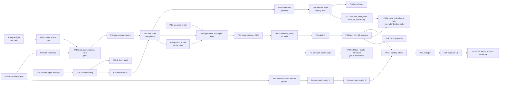

# FixFlow ship program — the one-page owner view

_Derived from `SHIP-PLAN-2026-11.md` (v8) and refreshed at the close of every phase. This page
explains; the plan decides. Status words: **done**, **in progress**, **next**, **waiting on you**,
**not started**. Last refresh: 2026-11-01, before P0a._

## Where we are

Planning is finished and checked five times. Nothing has been built or fixed yet. Production is
dead, the phones hold months of unsynced data, and the next step is yours.

| Track | Status |
| --- | --- |
| Method, discovery, deep dives, plan v6 | done |
| P0a — your pre-flight (today-phase) | **next, waiting on you** |
| Everything else | not started |

## What only you can do next (P0a, in order)

1. Set up the tools (Docker Desktop running, adb, apksigner, a JDK, EAS login, dashboard logins).
2. Send the technicians the hold notice: do not open the app, clock in, start travel, tap
   Discard, update, uninstall, clear data or reset. Commit it as sent.
3. Railway: copy and seal the old JWT secret, then cut every old service off the database and
   reset the Supabase password. Time-sensitive.
4. Archive the R2 backups, then take the Supabase dump and verify it. Same day.
5. The phone roster, each phone's build facts, and the airplane-mode photos of what is stuck.
6. Answer the decisions table (plan §4) or accept the defaults. New rows since v5: the host
   (default: a small VPS; the home box only after it passes a 14-day reliability probe, or never
   if you decide not to buy one), the commercial-SDK
   spike (default: run it), the shift-start reminder (default: yes), the workshop Wi-Fi facts,
   whether technicians hold cash before handing it over, and the books basis (no default: you
   answer it in P9-0b, with the accountant if there is one).
7. Cut the phones' network for the app, per phone, until their supervised drain.

## The order of work

Read it left to right: the top band gets the server back on a host you control; the middle band
gets the stuck data off the phones safely, then fixes the geofencing and ships v2; the bottom
band closes the money and security holes and builds the kacha-to-pakka hand-off into Odoo.

## The rules that never bend (plain words)

1. No phone gets a new app until its stuck data has been drained and the after-check passed.
   Never uninstall, except in the one documented branch with your written sign-off per phone.
2. No claim that geofencing works without evidence from the fleet's own phone models.
3. During the drain the server runs one pinned image and nothing else.
4. The automatic WhatsApp dispatcher stays off until every phone is drained or retired.
5. The old Railway address may only hang (or, in one branch, proxy). It never answers on its own.
6. Technicians stay on hold until the written release notice.
7. Money is whole paisa; no money feed runs off the event cursor; the outbox never deletes a write.

## How a phase session works

One phase per new chat. The session reads the plan's section 0 and the phase, opens a draft PR
with the checklist, writes `Plan @ <commit>` and keeps a short decisions journal in the PR body
(an owner-run phase keeps both at the head of its step table), and
closes with six lines: goal, where it fits, why this choice, before/after, what evidence ran
(including what was skipped), what remains. You merge every PR. Nothing is deployed to the box
before the drain window closes except the pinned drain image.

## Where the details are

- The plan: `SHIP-PLAN-2026-11.md` (section 0 to run it, section 4 for your decisions).
- Why the design is what it is: `HARNESS-REVIEW-2026-11-01.md` section 1 answers the six
  questions you asked on 2026-11-01; `G2-deep-dive-gate-2026-11-01.md` holds the verified
  defect register.
- Raw evidence behind the register: `evidence/`.
